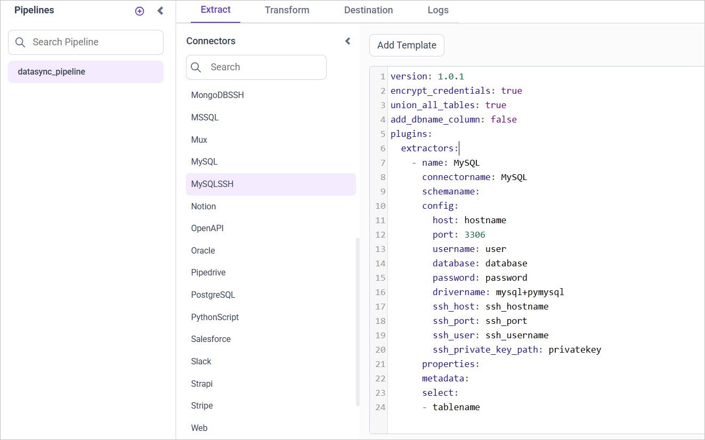
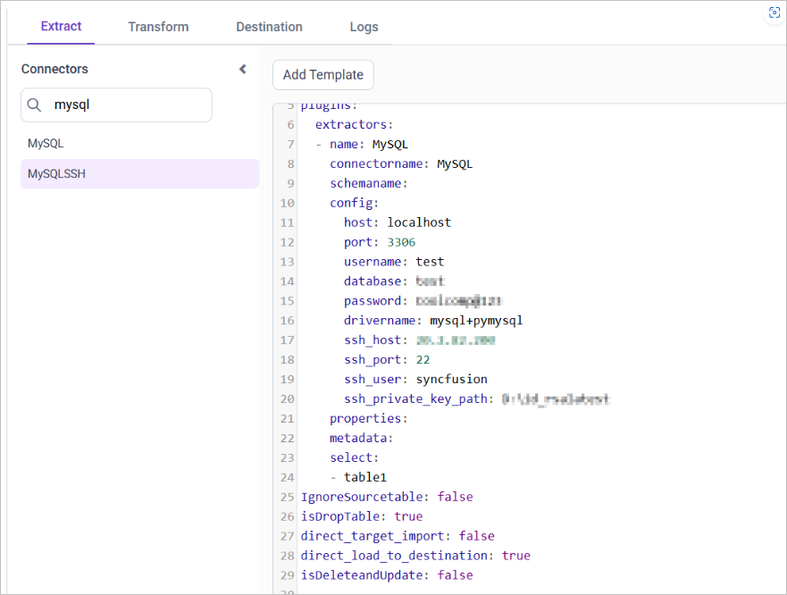

# Connect MySQL over SSH with Bold Data Hub

The Bold Data Hub MySQL SSH connector loads data from a MySQL database over an SSH connection into {{site.productNameTM}}. [MySQL](https://www.mysql.com/) is a relational database management system based on SQL (Structured Query Language). You can use MySQL for a wide range of purposes, including data warehousing, e-commerce, and logging applications.

## Connection Properties

The MySQL SSH connector in Bold Data Hub reads the following properties from the `config` section of a YAML file:

```yaml
Connectorname: MySQLSSH
host: Hostname or IP address of the server
port: Server running port
username: Username
password: Password
database: Database
drivername: mysql+pymysql
ssh_host: ssh_hostname
ssh_port: ssh_port
ssh_user: ssh_username
ssh_private_key_path: privatekey
```

### Example Configuration

The following Bold Data Hub YAML template shows a complete MySQL SSH extractor configuration:

```yaml
version: 1.0.1
encrypt_credentials: false
plugins:
  extractors:
    - name: tap_postgres
      connectorname: MySQL
      config:
        host: Hostname or IP address of the server
        port: Server running port
        username: Username
        password: Password
        database: Database
        drivername: mysql+pymysql
        ssh_host: ssh_hostname
        ssh_port: ssh_port
        ssh_user: ssh_username
        ssh_private_key_path: privatekey
      select:
        - TABLE1
        - TABLE2
```

## How do I connect MySQL over SSH in Bold Data Hub?

You connect MySQL over SSH by creating a project in Bold Data Hub and adding the `MySQLSSH` template to it.

1. Click the `Data Hub` icon on the Navigation Pane.

    

2. Click `Add Project` and enter a name for the new project.

    

3. Select the newly created project and add the `MySQLSSH` template.

    

4. Update the required details in the template, using the configuration parameters below.
5. Click **Save** and choose the destination to save the pipeline.

    

Creating a pipeline in Bold Data Hub automatically creates a data source in {{site.productNameTM}}. The {{site.productNameTM}} data source is a live data source to the destination database used in Bold Data Hub.

### Configuration Parameters

The MySQL SSH template in Bold Data Hub uses these parameters:

|Parameters |    Description                                          |
|--------------------------|----------------------------------------------|
| **Host:**                | Specify the hostname of the MySQL server.    |
| **Port:**                | Specify the port number of the MySQL server (default is 3306). |
| **Username:**            | Provide the username to authenticate with the MySQL server. |
| **Password:**            | Provide the password to authenticate with the MySQL server. |
| **Database:**            | Specify the name of the MySQL database from which data will be extracted. |
| **Driver Name:**         | Specify the driver name for connecting to MySQL (e.g., mysql+pymysql). |
|    **Select:**     |                                  **Tablename(s):**       Specify the table name list to load tables from the MySQL server.|
| **SSH Host:**        | Specify the SSH hostname for connecting to the MySQL server securely.                    |
| **SSH Port:**        | Specify the SSH port number (default is 22).                                            |
| **SSH User:**        | Provide the SSH username for authentication.                                            |
| **SSH Private Key:** | Specify the path to the SSH private key file for authentication.                        |

## How do I schedule the MySQL SSH pipeline?

You schedule the MySQL SSH pipeline in Bold Data Hub from the schedules tab, or you run it on demand.

1. To configure interval-based scheduling, click the schedules tab, select the created pipeline, click the schedule icon, and configure the schedule.

    

    

2. For an on-demand refresh, click the `Run Now` button.

    

3. Check the schedule history with the history option and the logs.

    

4. Click **Logs** to see whether the run is completed and the data source is created in {{site.productNameTM}}.

    

5. Click the `Edit DataSource` option to view the created tables.

## Frequently asked questions

### What are the default MySQL and SSH ports?

The default port of the MySQL server is 3306. The default SSH port is 22.

### How does the MySQL SSH connector authenticate to the SSH host?

The Bold Data Hub MySQL SSH connector uses an SSH username and the path to an SSH private key file.

## See also

* [Connect MySQL with Bold Data Hub](../mysql/)
* [Schedule Bold Data Hub jobs](../../schedule/)
* [Work with Bold Data Hub pipelines](../../working-with-pipelines/)
