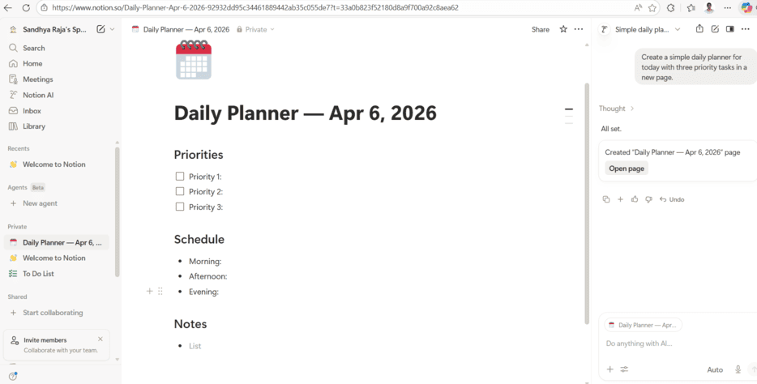
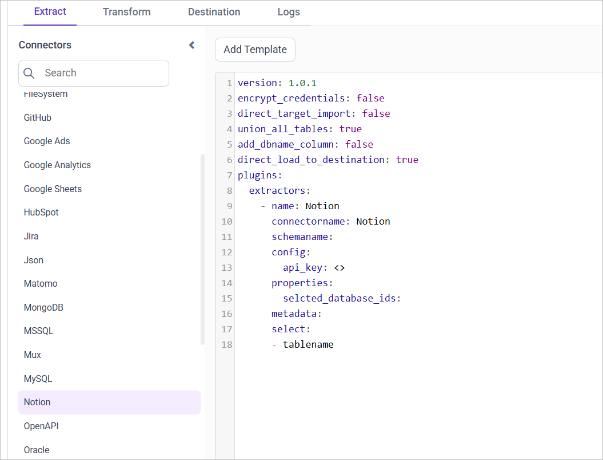

# Connect Notion with Bold Data Hub

The Bold Data Hub Notion connector loads data from your Notion workspace into Bold Reports<sup>®</sup>. [Notion](https://www.notion.so/) is a flexible workspace tool with customizable notes, documents, databases, and more.

## How do I get Notion credentials?

You get the Notion credentials for Bold Data Hub by creating an integration in your Notion account.

1. If you don't have a Notion account, create one.

    

2. Access your Notion account and navigate to **My Integrations**.
3. Click **New Integration** on the left and give it a suitable name.
4. Click **Submit** at the bottom of the page.

## How do I add the integration to a Notion database?

You give Bold Data Hub access to a Notion database by adding your integration as a connection on that database.

1. Open the database that you want to load to the destination.
2. Click the three dots in the top right corner and choose **Add connections**.
3. From the list of options, select the integration you created and click **Confirm**.

## Connection Properties

The Notion connector in Bold Data Hub reads the following properties from the `config` section of a YAML file:

```yaml
connector_name: Notion
api_key: API key
```

### Example Configuration

The following Bold Data Hub YAML template shows a complete Notion extractor configuration:

```yaml
version: 1.0.1
encrypt_credentials: false
plugins:
  extractors:
    - name: Notion_data
      connectorname: Notion
      config:
        api_key: <API KEY>
      properties:
        selected_database_ids: <SELECTED DATABASE ID>
```

## How do I connect Notion in Bold Data Hub?

You connect Notion by creating a project in Bold Data Hub and adding the `Notion` template to it.

1. Click the `Bold Data Hub` icon on the Navigation Pane.

    

2. Click `Add Project` and enter a name for the new project.

    

3. Select the newly created project and add the `Notion` template.

    

4. Update the API key in the template, and update the resources in the `select` property.
5. Click **Save** and choose the destination to save the pipeline.

Creating a pipeline in Bold Data Hub automatically creates a data source in Bold Reports<sup>®</sup>. The Bold Reports<sup>®</sup> data source is a live data source to the destination database used in Bold Data Hub.

>**Warning:**

    1. The `Encrypt_Credentials` property should be set to false when updating the new access token on the template. If you have modified other properties, such as 'select' or 'account id', the `Encrypt_Credentials` property must be set to true.  
    2. The default lifetime of the access token is 1 hour. Therefore, you need to convert it to a long-lived access token to use the same token for 60 days. Existing tables should be maintained even if the token has expired or is being used as an invalid token.

## How do I schedule the Notion pipeline?

You schedule the Notion pipeline in Bold Data Hub from the schedules tab, or you run it on demand.

1. To configure interval-based scheduling, click the schedules tab, select the created pipeline, click the schedule icon, and configure the schedule.

    

    

2. For an on-demand refresh, click the `Run Now` button.

    

3. Check the schedule history with the history option and the logs.

    

4. Click **Logs** to see whether the run is completed and the data source is created in Bold Reports<sup>®</sup>.

    

5. Click the `Edit DataSource` option to view the created tables.

## Frequently asked questions

### Why can't Bold Data Hub see my Notion database?

Bold Data Hub reads a Notion database only after you add your integration to it. Open the database, choose **Add connections**, and select the integration.

### Which credential does the Notion connector use?

The Bold Data Hub Notion connector uses an API key, set in the `api_key` property.

## See also

* [Schedule Bold Data Hub jobs](../../schedule/)
* [Work with Bold Data Hub pipelines](../../working-with-pipelines/)
* [Bold Data Hub connectors list](../)
