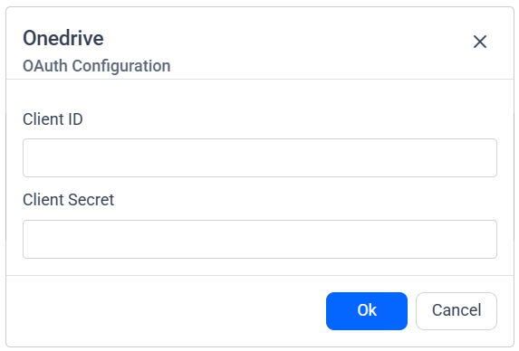
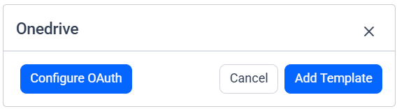
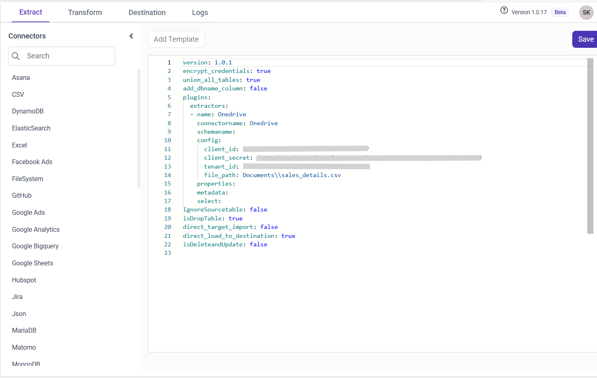

# Connect OneDrive with Bold Data Hub

The Bold Data Hub OneDrive connector loads data from files stored in OneDrive into {{site.productNameTM}}. OneDrive is a cloud-based file storage service from Microsoft for storing, syncing, and sharing files. In Bold Data Hub, the OneDrive connector lets you access data stored in your OneDrive documents.

## How do I get OneDrive API credentials?

You get the OneDrive API credentials for Bold Data Hub by registering an app in Microsoft Entra ID (formerly Azure Active Directory).

1. Sign in to the Azure Portal.
2. Go to **Microsoft Entra ID** (formerly Azure Active Directory) > **App registrations**.
3. Click **New registration** to create an app. Enter a name, choose the account type, and add a redirect URI (if needed).
4. Generate credentials:
   * Go to **API permissions** > **Add a permission**.
   * Choose **Microsoft Graph** > **Delegated permissions** like Files.Read, Files.Read.All, User.Read, Sites.Read.All, offline_access.
   * Go to **Certificates & secrets** > **New client secret** > **Add** and copy the value.
   * In **Overview**, copy the Client ID and Tenant ID.
   * Use the Client ID, Tenant ID, and Client Secret in {{site.productNameTM}} to connect OneDrive.

## Connection Properties

The OneDrive connector in Bold Data Hub reads the following properties from the `config` section of a YAML file:

```yaml
connectorname: Onedrive
client_id: <>
client_secret: <>
tenant_id: <>
file_path: <>
```

### Example Configuration

The following Bold Data Hub YAML template shows a complete OneDrive extractor configuration:

```yaml
version: 1.0.1
destination:
plugins:
  extractors:
    - name: Onedrive
      connectorname: Onedrive
      config:
        client_id: <>
        client_secret: <>
        tenant_id: <>
        file_path: <>
```

## How do I connect OneDrive in Bold Data Hub?

You connect OneDrive in Bold Data Hub by authenticating with OAuth and then completing the OneDrive template.

### OAuth Authentication with OneDrive

The Bold Data Hub OneDrive connector uses OAuth to authenticate with your Microsoft account.

1. Double-click the connector. An **Authentication Setup** window opens.

    

2. Fill in the Client ID and Client Secret and click **Ok**.

    

3. Click **Allow** in the authorization window to accept the scopes requested by Bold DataHub.
4. Update the Tenant ID, File Path, client ID, and client secret in the template, and update the resources in the `properties` property.
5. Click **Save** and choose the destination to save the pipeline.

    

Creating a pipeline in Bold Data Hub automatically creates a data source in {{site.productNameTM}}. The {{site.productNameTM}} data source is a live data source to the destination database used in Bold Data Hub. For more information on how a Bold Data Hub pipeline relates to its data sources in {{site.productNameTM}}, see the following article.

[Relationship between Bold Data Hub Pipeline and associated data sources](https://help.boldbi.com/working-with-data-sources/working-with-bold-data-hub/relationship-between-bold-data-hub-pipeline-and-associated-data-sources-in-boldbi/)


## How do I schedule the OneDrive pipeline?

You schedule the OneDrive pipeline in Bold Data Hub from the schedules tab, or you run it on demand.

1. To configure interval-based scheduling, click the schedules tab, select the created pipeline, click the schedule icon, and configure the schedule.

    

    

2. For an on-demand refresh, click the `Run Now` button.

    

3. Check the schedule history with the history option and the logs.

    

4. Click **Logs** to see whether the run is completed and the data source is created in {{site.productNameTM}}.

    

5. Click the `Edit DataSource` option to view the created tables.

## Frequently asked questions

### Which Microsoft Graph permissions does the OneDrive connector need?

Add delegated permissions like Files.Read, Files.Read.All, User.Read, Sites.Read.All, and offline_access to your Microsoft Entra ID app.

### Which values does Bold Data Hub need to connect OneDrive?

Bold Data Hub needs the Client ID, Tenant ID, and Client Secret from your app registration, plus the file path.

## See also

* [Schedule Bold Data Hub jobs](../../schedule/)
* [Work with Bold Data Hub pipelines](../../working-with-pipelines/)
* [Bold Data Hub connectors list](../)
