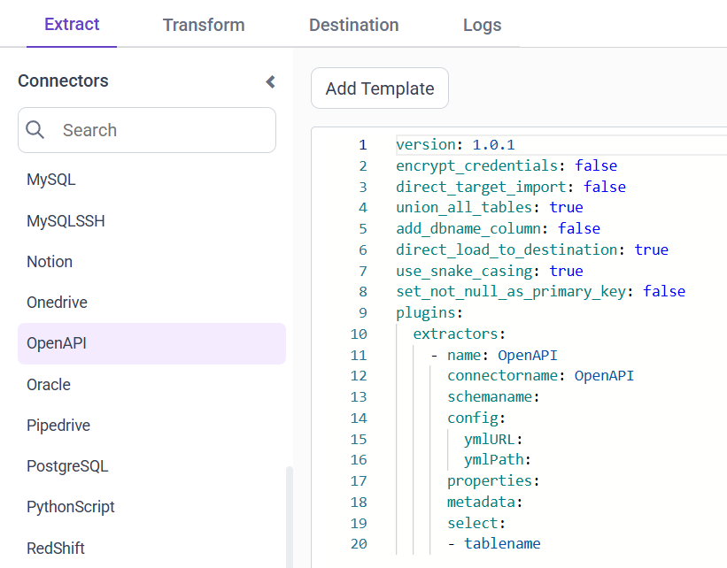

# Connect OpenAPI with Bold Data Hub

The Bold Data Hub ``OpenAPI`` connector fetches data from ``OpenAPI`` ``3.x`` documents and loads it into {{site.productNameTM}}.

## Which OpenAPI features are supported?

The Bold Data Hub OpenAPI connector supports the following OpenAPI features:

1. All HTTP methods are supported.
2. JSON and form bodies, path and query parameters are accepted.
3. File uploads can be done with `multipart/form-data` bodies.
4. Supported data types include float, string, int, date, datetime, `string enums`, and custom schemas or lists containing any of those.
5. Responses can be in html/text or application/json format containing any of the mentioned types.
6. Basic or Bearer Authentication is not supported.

## Connection Properties

The OpenAPI connector in Bold Data Hub reads the following properties from the `config` section of a YAML file:

```yaml
        ymlURL:
        ymlPath:
```

### Example Configuration

The following Bold Data Hub YAML template shows a complete OpenAPI extractor configuration:

```yaml
version: 1
encrypt_credentials: false
plugins:
  extractors:
    - name: OpenAPI
      connectorname: OpenAPI
      config:
        ymlURL:
        ymlPath:
      select:
        - tablename
```

## How do I connect OpenAPI in Bold Data Hub?

You connect an OpenAPI document by creating a pipeline in Bold Data Hub and adding the `OpenAPI` template to it.

1. Click the `Data Hub` icon on the Navigation Pane.

    

2. Click `Add Pipeline` and enter a name for the new pipeline.

    

3. Select the newly created pipeline and add the `OpenAPI` template.

    

4. Update the URL and path in the template.
5. Click **Save** and choose the destination to save the pipeline.

    

## How do I schedule the OpenAPI pipeline?

You schedule the OpenAPI pipeline in Bold Data Hub from the schedules tab, or you run it on demand.

1. To configure interval-based scheduling, click the schedules tab, select the created pipeline, click the schedule icon, and configure the schedule.

    

    

2. For an on-demand refresh, click the `Run Now` button.

    

3. Check the schedule history with the history option and the logs.

    

4. Click **Logs** to see whether the run is completed and the data source is created in {{site.productNameTM}}.

    

5. Click the `Edit DataSource` option to view the created tables.

## Frequently asked questions

### Does the OpenAPI connector support Basic or Bearer authentication?

No. Basic or Bearer Authentication is not supported by the Bold Data Hub OpenAPI connector.

### Which OpenAPI versions can Bold Data Hub read?

The Bold Data Hub OpenAPI connector fetches data from OpenAPI 3.x documents.

## See also

* [Schedule Bold Data Hub jobs](../../schedule/)
* [Work with Bold Data Hub pipelines](../../working-with-pipelines/)
* [Bold Data Hub connectors list](../)
