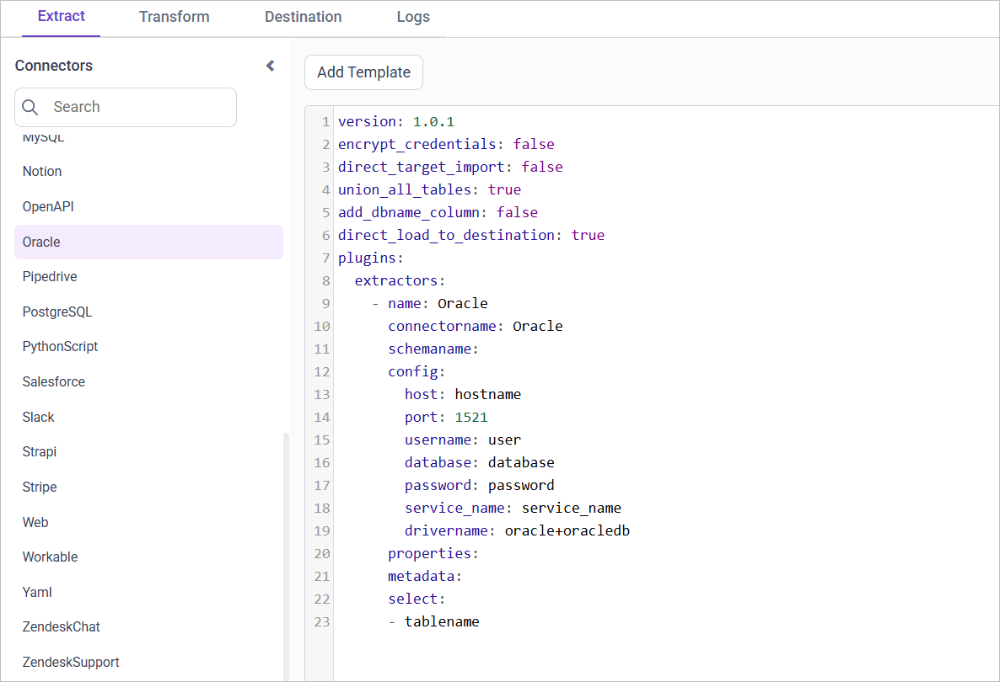
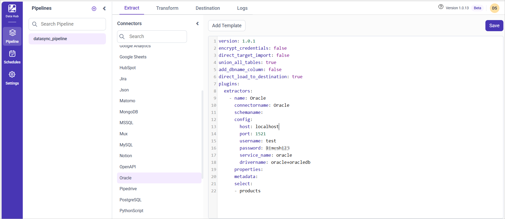

# Connect Oracle Database with Bold Data Hub

The Bold Data Hub Oracle connector loads data from an Oracle database into {{site.productNameTM}}. [Oracle Database](https://www.oracle.com/database/) is a relational database management system (RDBMS) from Oracle Corporation.

## Connection Properties

The Oracle connector in Bold Data Hub reads the following properties from the `config` section of a YAML file:

```yaml
Connectorname: Oracle
host: Hostname or IP address of the server
port: Server running port
username: Username
password: Password
database: Database
service_name: servicename
drivername: oracle+pyoracle
```

## How do I connect Oracle in Bold Data Hub?

You connect an Oracle database by creating a project in Bold Data Hub and adding the `Oracle` template to it.

1. Click the `Data Hub` icon on the Navigation Pane.

    

2. Click `Add Project` and enter a name for the new project.

    

3. Select the newly created project and add the `Oracle` template.

    

4. Update the required details in the template, using the configuration parameters below.
5. Click **Save** and choose the destination to save the pipeline.

    

Creating a pipeline in Bold Data Hub automatically creates a data source in {{site.productNameTM}}. The {{site.productNameTM}} data source is a live data source to the destination database used in Bold Data Hub.

### Configuration Parameters

The Oracle template in Bold Data Hub uses these parameters:

|  Parameters |        Description                                     |
|--------------------------|---------------------------------------------|
| **Host:**                | Specify the hostname of the Oracle server. |
| **Port:**                | Specify the port number of the Oracle server (default is 1521). |
| **Username:**            | Provide the username to authenticate with the Oracle server. |
| **Password:**            | Provide the password to authenticate with the Oracle server. |
| **Database:** (Optional)           | Specify the name of the Oracle database from which data will be extracted. |
| **Service Name:** (Optional)           | Specify the Service name of the Oracle server. |
| **Driver Name:**         | Specify the driver name for connecting to Oracle (e.g., oracle+oracledb). |
| **Select:**                  |    **Tablename(s):**         Specify the name list to load tables from the Oracle server. |
| [**Metadata:**](#metadata-properties)  (Optional)             |   **Replication Method:** Specify the replication method for the table(s). Options include FULL or INCREMENTAL. |
|| **Replication Key:**     Specify the replication key for incremental replication. This key helps in identifying new or updated records. |
|| **Replication Value:**   Specify the replication value to start the incremental replication from a particular point. |

## How do I schedule the Oracle pipeline?

You schedule the Oracle pipeline in Bold Data Hub from the schedules tab, or you run it on demand.

1. To configure interval-based scheduling, click the schedules tab, select the created pipeline, click the schedule icon, and configure the schedule.

    

    

2. For an on-demand refresh, click the `Run Now` button.

    

3. Check the schedule history with the history option and the logs.

    

4. Click **Logs** to see whether the run is completed and the data source is created in {{site.productNameTM}}.

    

5. Click the `Edit DataSource` option to view the created tables.

## Metadata Properties

The metadata section of the Bold Data Hub Oracle template defines the mode of data refresh. There are two modes: INCREMENTAL and FULL_TABLE. Both modes support only DateTime datatype columns.

## INCREMENTAL

The INCREMENTAL mode in Bold Data Hub fetches data from the date column set in the replication key, starting from the date set in the replication value. Once you schedule the pipeline, the replication value is updated automatically from the imported data.

```yaml
metadata:
  TableName:
    replication_method: INCREMENTAL
    replication_key: Column name
    replication_value: column value that data starts from
```

## FULLTABLE

The FULLTABLE mode in Bold Data Hub fetches data from the date column specified in the replication key, starting from the date specified in the replication value. Once you schedule the pipeline, the replication value is updated according to the interval_type and interval_value from the imported data.

For example, if the interval_type is set to 'year' and the interval_value is set to '1', the first schedule fetches records from January 1, 2000 to December 31, 2000. The next schedule fetches records from January 1, 2001 to December 31, 2001, and so on.

```yaml
metadata:
  TableName:
    replication_method: FULL_TABLE
    replication_key: Column name
    replication_value: column value that data starts from
    interval_type: days/hours/minutes/year/month
    interval_value: integer value to add in interval type

```

### Example Configuration

The following Bold Data Hub YAML templates show complete Oracle extractor configurations for each refresh mode.

#### FULLTABLE

```yaml
version: 1
encrypt_credentials: false
plugins:
  extractors:
    - name: tap_postgres
      connectorname: Oracle
      config:
        host: Hostname or IP address of the server
        port: Server running port
        username: Username
        password: Password
        database: Database
        service_name: servicename
        drivername: oracle+pyoracle
      select:
        - TABLE1
        - TABLE2
      metadata:
        TABLE1:
          replication_method: FULL_TABLE
          replication_key: last_modified_on
          replication_value: 2023-07-19 00:00:00
          interval_type: days
          interval_value: 6
        TABLE2:
          replication_method: FULL_TABLE
          replication_key: last_modified_on
          replication_value: 2023-07-19 00:00:00
          interval_type: days
          interval_value: 6
```

#### INCREMENTAL

```yaml
version: 1
encrypt_credentials: true
plugins:
  extractors:
    - name: tap_postgres
      connectorname: Oracle
      config:
        host: Hostname or IP address of the server
        port: Server running port
        username: Username
        password: Password
        database: Database
        service_name: servicename
        drivername: oracle+pyoracle
      select:
        - TABLE1
        - TABLE2
      metadata:
        TABLE1:
          replication_method: INCREMENTAL
          replication_key: last_modified_on
          replication_value: 2023-07-19 00:00:00
        TABLE2:
          replication_method: INCREMENTAL
          replication_key: last_modified_on
          replication_value: 2023-07-19 00:00:00
```

## Frequently asked questions

### What is the default Oracle port in Bold Data Hub?

The default port number of the Oracle server is 1521.

### Which refresh modes does the Oracle connector support?

The Bold Data Hub Oracle connector supports INCREMENTAL and FULL_TABLE modes. Both modes support only DateTime datatype columns.

## See also

* [Schedule Bold Data Hub jobs](../../schedule/)
* [Work with Bold Data Hub pipelines](../../working-with-pipelines/)
* [Bold Data Hub connectors list](../)
