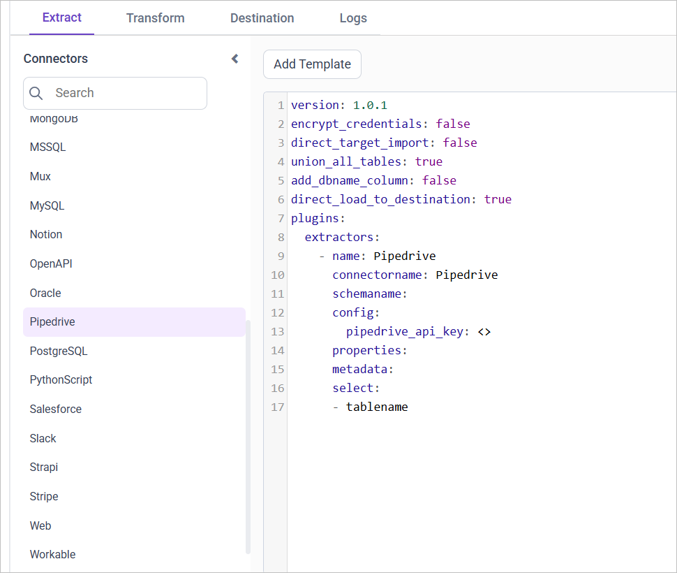
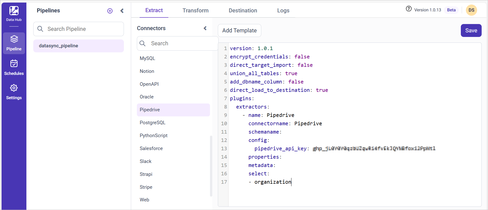

# Connect Pipedrive with Bold Data Hub

The Bold Data Hub Pipedrive connector loads sales CRM data from Pipedrive into Bold Reports<sup>®</sup>. [Pipedrive](https://www.pipedrive.com/) is a cloud-based sales Customer Relationship Management (CRM) tool for managing leads and deals.

## How do I get the Pipedrive API token?

You copy the Pipedrive API token for Bold Data Hub from your Pipedrive personal preferences.

1. Set up a Pipedrive account.
2. In Pipedrive, go to your name (in the top right corner).
3. Select **company settings**.
4. Go to **personal preferences**.
5. Select the **API** tab.
6. Copy your API token.

## Connection Properties

The Pipedrive connector in Bold Data Hub reads the following properties from the `config` section of a YAML file:

```yaml
Connectorname: Pipedrive
Pipedrive_api_key: Pipedrive API key
```

### Example Configuration

The following Bold Data Hub YAML template shows a complete Pipedrive extractor configuration:

```yaml
version: 1
encrypt_credentials: false
plugins:
  extractors:
    - name: Pipedrive_data
      connectorname: Pipedrive
      config:
        pipedrive_api_key: <PIPEDRIVE API KEY>
      select:
        - TABLE1
        - TABLE2
      properties:
        since_timestamp: <SINCE TIME STAMP>
```

## How do I connect Pipedrive in Bold Data Hub?

You connect Pipedrive by creating a project in Bold Data Hub and adding the `Pipedrive` template to it.

1. Click the `Bold Data Hub` icon on the Navigation Pane.

    

2. Click `Add Project` and enter a name for the new project.

    

3. Select the newly created project and add the `Pipedrive` template.

    

4. Update the Pipedrive API key in the template, and update the resources in the `select` property.
5. Click **Save** and choose the destination to save the pipeline.

    

Creating a pipeline in Bold Data Hub automatically creates a data source in Bold Reports<sup>®</sup>. The Bold Reports<sup>®</sup> data source is a live data source to the destination database used in Bold Data Hub.

### Which Pipedrive resources are supported?

The Bold Data Hub Pipedrive connector supports the following resources:

```js
The available resources are supported in Pipedrive
- activity
- organization
- person
- product
- deal
- pipeline
- stage
- user
 ```

>**Warning:**

    1. The `Encrypt_Credentials` property should be set to false when updating the new access token on the template. If you have modified other properties, such as 'select' or 'account id', the `Encrypt_Credentials` property must be set to true.  
    2. The default lifetime of the access token is 1 hour. Therefore, you need to convert it to a long-lived access token to use the same token for 60 days. Existing tables should be maintained even if the token has expired or is being used as an invalid token.

## How do I schedule the Pipedrive pipeline?

You schedule the Pipedrive pipeline in Bold Data Hub from the schedules tab, or you run it on demand.

1. To configure interval-based scheduling, click the schedules tab, select the created pipeline, click the schedule icon, and configure the schedule.

    

    

2. For an on-demand refresh, click the `Run Now` button.

    

3. Check the schedule history with the history option and the logs.

    

4. Click **Logs** to see whether the run is completed and the data source is created in Bold Reports<sup>®</sup>.

    

5. Click the `Edit DataSource` option to view the created tables.

## Frequently asked questions

### Which Pipedrive resources can Bold Data Hub load?

The Bold Data Hub Pipedrive connector supports activity, organization, person, product, deal, pipeline, stage, and user.

### Where do I find my Pipedrive API token?

Go to your name in Pipedrive, select company settings, open personal preferences, and select the API tab.

## See also

* [Schedule Bold Data Hub jobs](../../schedule/)
* [Work with Bold Data Hub pipelines](../../working-with-pipelines/)
* [Bold Data Hub connectors list](../)
