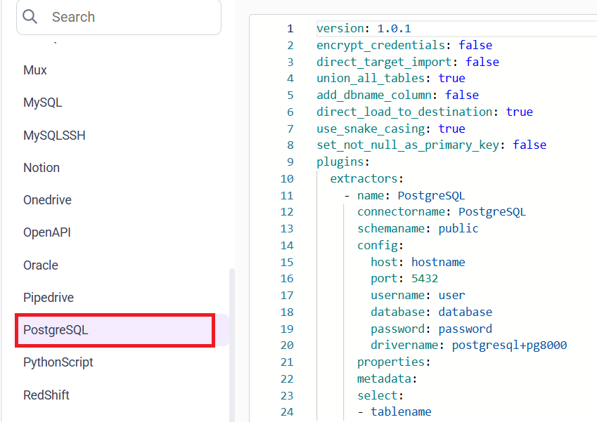
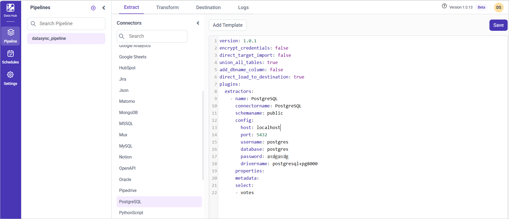

# Connect PostgreSQL with Bold Data Hub

The Bold Data Hub PostgreSQL connector loads data from a PostgreSQL database into Bold Reports<sup>®</sup>. [PostgreSQL](https://www.postgresql.org/) is a free and open-source relational database management system (RDBMS).

## Connection Properties

The PostgreSQL connector in Bold Data Hub reads the following properties from the `config` section of a YAML file:

```yaml
Connectorname: PostgreSQL
host: Hostname or IP address of the server
port: Server running port
username: Username
password: Password
database: Database
drivername: postgresql+pg8000
```

## How do I connect PostgreSQL in Bold Data Hub?

You connect PostgreSQL by creating a project in Bold Data Hub and adding the `PostgreSQL` template to it.

1. Click the `Data Hub` icon on the Navigation Pane.

    

2. Click `Add Project` and enter a name for the new project.

    

3. Select the newly created project and add the `PostgreSQL` template.

    

4. Update the required details in the template, using the configuration parameters below.
5. Click **Save** and choose the destination to save the pipeline.

    

Creating a pipeline in Bold Data Hub automatically creates a data source in Bold Reports<sup>®</sup>. The Bold Reports<sup>®</sup> data source is a live data source to the destination database used in Bold Data Hub.

### Configuration Parameters

The PostgreSQL template in Bold Data Hub uses these parameters:

|  Parameters |        Description                                     |
|--------------------------|---------------------------------------------|
| **Host:**                | Specify the hostname of the PostgreSQL server. |
| **Port:**                | Specify the port number of the PostgreSQL server (default is 5432). |
| **Username:**            | Provide the username to authenticate with the PostgreSQL server. |
| **Password:**            | Provide the password to authenticate with the PostgreSQL server. |
| **Database:**            | Specify the name of the PostgreSQL database from which data will be extracted. |
| **Driver Name:**         | Specify the driver name for connecting to PostgreSQL (e.g., postgresql+pg8000). |
| **Select:**                  |    **Tablename(s):**         Specify the name list to load tables from the PostgreSQL server. |
| [**Metadata:**](#metadata-properties)  (Optional)             |   **Replication Method:** Specify the replication method for the table(s). Options include FULL or INCREMENTAL. |
|| **Replication Key:**     Specify the replication key for incremental replication. This key helps in identifying new or updated records. |
|| **Replication Value:**   Specify the replication value to start the incremental replication from a particular point. |

## How do I schedule the PostgreSQL pipeline?

You schedule the PostgreSQL pipeline in Bold Data Hub from the schedules tab, or you run it on demand.

1. To configure interval-based scheduling, click the schedules tab, select the created pipeline, click the schedule icon, and configure the schedule.

    

    

2. For an on-demand refresh, click the `Run Now` button.

    

3. Check the schedule history with the history option and the logs.

    

4. Click **Logs** to see whether the run is completed and the data source is created in Bold Reports<sup>®</sup>.

    

5. Click the `Edit DataSource` option to view the created tables.

## Metadata Properties

The `metadata` section of the Bold Data Hub PostgreSQL template defines the mode of data refresh. There are two modes: `INCREMENTAL` and `FULL_TABLE`. Both modes support only DateTime datatype columns.

<table>
    <tr>
        <td>INCREMENTAL</td>
        <td>

```yaml
metadata:
  TableName:
    replication_method: INCREMENTAL
    replication_key: Column name
    replication_value: column value that data starts from
```

</td>
        <td>This mode fetches data from the date column mentioned in the replication key from the start date as mentioned in the replication value. Once it is scheduled, the replication value is updated automatically from the imported data.</td>
    </tr>
    <tr>
        <td>FULL_TABLE</td>
        <td>

```yaml
metadata:
  TableName:
    replication_method: FULL_TABLE
    replication_key: Column name
    replication_value: column value that data starts from
    interval_type: days/hours/minutes/year/month
    interval_value: integer value to add in the interval type

```

</td>
        <td>This mode fetches data from the date column specified in the replication key starting from the date specified in the replication value. Once scheduled, the replication value is updated according to the interval_type and interval_value from the imported data. For example, if the interval_type is set to 'year' and the interval_value is set to '1', the first schedule will fetch records from January 1, 2000 to December 31, 2000. In the next schedule, it will fetch records from January 1, 2001 to December 31, 2001, and so on.</td>
    </tr>
</table>

### Example Configuration

The following Bold Data Hub YAML templates show complete PostgreSQL extractor configurations for each refresh mode.

#### Incremental

```yaml
version: 1
encrypt_credentials: false
plugins:
  extractors:
    - name: tap_postgres
      connectorname: PostgreSQL
      config:
        host: <HOSTNAME>
        port: <PORT>
        username: <USERNAME>
        database: <DATABASENAME>
        password: <PASSWORD>
        drivername: postgresql+pg8000
      select:
        - TABLE1
        - TABLE2
      metadata:
        TABLE1:
          replication_method: INCREMENTAL
          replication_key: last_modified_on
          replication_value: 2023-07-19 00:00:00
        TABLE2:
          replication_method: INCREMENTAL
          replication_key: last_modified_on
          replication_value: 2023-07-19 00:00:00
```

#### FULLTABLE

```yaml
version: 1
encrypt_credentials: false
plugins:
  extractors:
    - name: tap_postgres
      connectorname: PostgreSQL
      config:
        host: <HOSTNAME>
        port: <PORT>
        username: <USERNAME>
        database: <DATABASENAME>
        password: <PASSWORD>
        drivername: postgresql+pg8000
      select:
        - TABLE1
        - TABLE2
      metadata:
        TABLE1:
          replication_method: FULL_TABLE
          replication_key: last_modified_on
          replication_value: 2023-07-19 00:00:00
          interval_type: days
          interval_value: 6
        TABLE2:
          replication_method: FULL_TABLE
          replication_key: last_modified_on
          replication_value: 2023-07-19 00:00:00
          interval_type: days
          interval_value: 6
```

## Frequently asked questions

### What is the default PostgreSQL port in Bold Data Hub?

The default port number of the PostgreSQL server is 5432.

### Which refresh modes does the PostgreSQL connector support?

The Bold Data Hub PostgreSQL connector supports `INCREMENTAL` and `FULL_TABLE` modes. Both modes support only DateTime datatype columns.

## See also

* [Schedule Bold Data Hub jobs](../../schedule/)
* [Work with Bold Data Hub pipelines](../../working-with-pipelines/)
* [Bold Data Hub connectors list](../)
