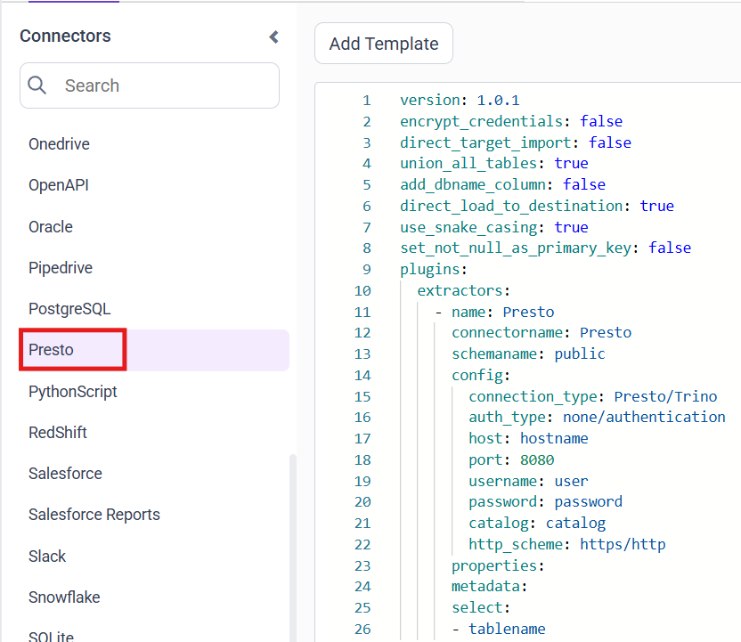
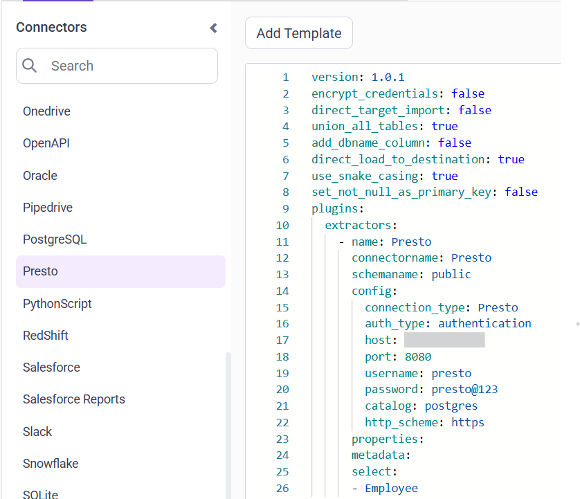

# Connect Presto with Bold Data Hub

The Bold Data Hub Presto connector loads query results from Presto into Bold Reports<sup>®</sup>. [Presto](https://prestodb.io/) is an open-source distributed SQL query engine for fast analytics on large-scale data. Presto lets you query data directly from multiple data sources without moving the data into a separate database.

## Connection Properties

The Presto connector in Bold Data Hub reads the following properties from the `config` section of a YAML file:

```yaml
connectorname: Presto
connection_type: Presto/Trino
auth_type: none/authentication
host: Hostname or IP address of the Presto server
port: Presto server port
username: Username
password: Password
catalog: Catalog name in Presto
http_scheme: HTTP or HTTPS connection protocol
```

## How do I connect to Presto without authentication?

You connect Bold Data Hub to Presto without authentication by setting `auth_type` to `none` in the template.

### Example Configuration

The following Bold Data Hub YAML template shows a Presto extractor configuration without authentication:

```yaml
version: 1.0.1
plugins:
  extractors:
    - name: Presto
      connectorname: Presto
      schemaname: public
      config:
        auth_type: none
        host: presto_servername
        port: 8080
        catalog: postgres
        http_scheme: http/https
      properties:
      metadata:
      select:
        - Employees
```

## How do I connect to Presto with authentication?

You connect Bold Data Hub to a secured Presto cluster by setting `auth_type` to `authentication` and adding a username and password.

### Example Configuration

The following Bold Data Hub YAML template shows a Presto extractor configuration with authentication:

```yaml
version: 1.0.1
plugins:
  extractors:
    - name: Presto
      connectorname: Presto
      schemaname: public
      config:
        auth_type: authentication
        host: presto_servername
        port: 8080
        username: presto_username
        password: presto_password
        catalog: postgres
        http_scheme: http/https
      properties:
      metadata:
      select:
        - Employees
```

## How do I connect Presto in Bold Data Hub?

You connect Presto by creating a project in Bold Data Hub and adding the `Presto` template to it.

1. Click the `Data Hub` icon on the Navigation Pane.

    

2. Click `Add Project` and enter a name for the new project.

    

3. Select the newly created project and add the `Presto` template.

    

4. Update the required details in the template, using the configuration parameters below.
5. Click **Save** and choose the destination to save the pipeline.

    

Creating a pipeline in Bold Data Hub automatically creates a data source in Bold Reports<sup>®</sup>. The Bold Reports<sup>®</sup> data source is a live data source to the destination database used in Bold Data Hub.

### Configuration Parameters

The Presto template in Bold Data Hub uses these parameters:

|  Parameters |        Description                                     |
|--------------------------|---------------------------------------------|
| **Auth Type:**           | Choose `none` for unauthenticated connections and `authentication` for secured Presto clusters. |
| **Host:**                | Specify the hostname of the Presto server.    |
| **Port:**                | Specify the port number of the Presto server (default is 8080). |
| **Username:**            | Provide the username to authenticate with the Presto server (required when auth type is authentication) |
| **Password:**            | Provide the password to authenticate with the Presto server (required when auth type is authentication) |
| **Catalog:**             | Specify the catalog configured on the Presto server that defines the data source used for querying. Examples: `hive` and `postgres` |
| **HTTP Scheme:**         | Specify the communication protocol used to connect to the Presto server. Choose `http` for non-SSL connections or `https` for SSL/TLS-secured connections.  |
| **Schema Name:**         | Specify the schema within the selected Presto catalog that contains the tables to be queried.  |
| **Select:**     |          **Tablename(s):**    Specify the table name list to load tables from the Presto server.|

## How do I schedule the Presto pipeline?

You schedule the Presto pipeline in Bold Data Hub from the schedules tab, or you run it on demand.

1. To configure interval-based scheduling, click the schedules tab, select the created pipeline, click the schedule icon, and configure the schedule.

    

    

2. For an on-demand refresh, click the `Run Now` button.

    

3. Check the schedule history with the history option and the logs.

    

4. Click **Logs** to see whether the run is completed and the data source is created in Bold Reports<sup>®</sup>.

    

5. Click the `Edit DataSource` option to view the created tables.

## Frequently asked questions

### What is the default Presto port in Bold Data Hub?

The default port number of the Presto server is 8080.

### When are a username and password required for Presto?

The username and password are required when the auth type is `authentication`.

## See also

* [Schedule Bold Data Hub jobs](../../schedule/)
* [Work with Bold Data Hub pipelines](../../working-with-pipelines/)
* [Bold Data Hub connectors list](../)
