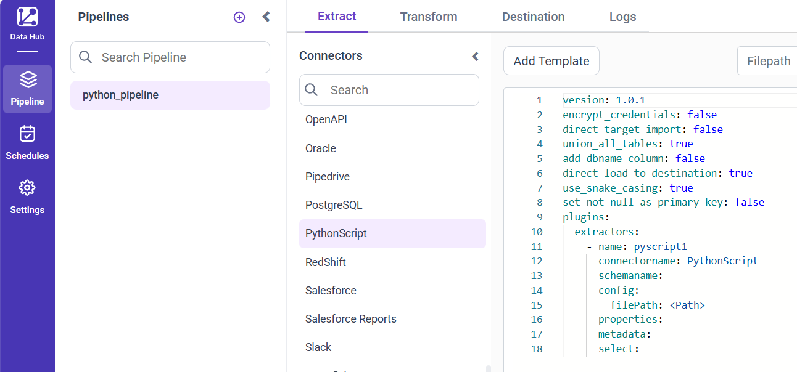
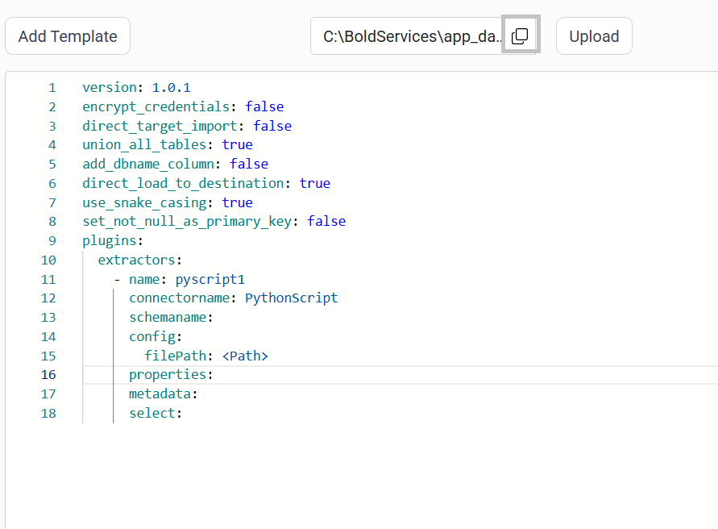
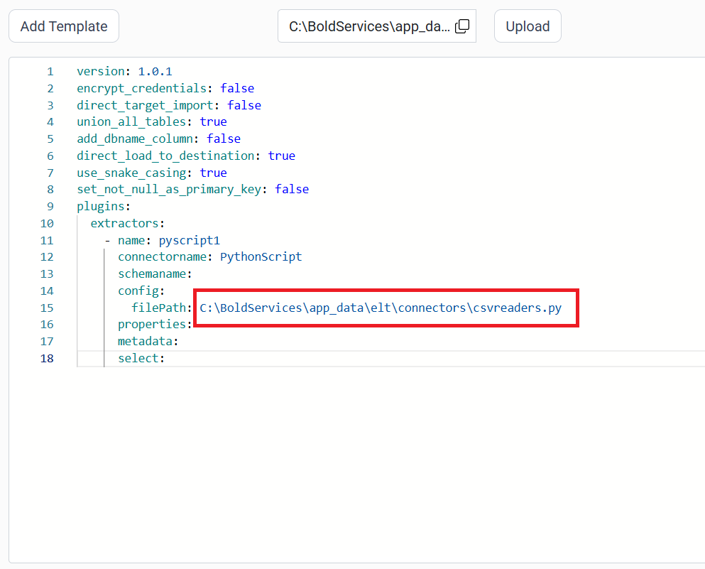

# Load data with a Python script in Bold Data Hub

The Bold Data Hub PythonScript connector runs a Python script to load data into Bold Reports<sup>®</sup>. A PythonScript is a .py file with Python instructions for tasks such as automation, data processing, or analysis.

## Example Configuration

The following Bold Data Hub YAML template shows a complete PythonScript extractor configuration:

```yaml
version: 1.0.1
encrypt_credentials: false
union_all_tables: true
add_dbname_column: false
use_snake_casing: true
plugins:
  extractors:
  - name: pyscript1
    connectorname: PythonScript
    schemaname:
    config:
      filePath: C:\BoldServices\app_data\elt\connectors\csvreaders.py
      properties:
    metadata:
    select:
```

## How do I connect a Python script in Bold Data Hub?

You connect a Python script by creating a pipeline in Bold Data Hub, adding the `PythonScript` template, and uploading your .py file.

1. Click the `Data Hub` icon on the Navigation Pane.

    

2. Click `Add Pipeline` and enter a name for the new pipeline.

    

3. Select the newly created pipeline and add the `PythonScript` template.

    

4. In your Python script, make sure you have a `data frame` object. Add the following line after the dataframe object that is moved to tables using `Bold ETL`:

    ```js
    pipeline.run(yourdataframename, table_name="yourtablename")
    ```

    Replace `yourdataframename` with the dataframe name and `yourtablename` with the table name you want in your destination database.

5. Click the **Upload File** button to upload your Python file.

    

6. Copy the file path and paste it into the filePath property.

    

    

7. Click **Save** and choose the destination to save the pipeline.

    

Creating a pipeline in Bold Data Hub automatically creates a data source in Bold Reports<sup>®</sup>. The Bold Reports<sup>®</sup> data source is a live data source to the destination database used in Bold Data Hub.


## How do I schedule the PythonScript pipeline?

You schedule the PythonScript pipeline in Bold Data Hub from the schedules tab, or you run it on demand.

1. To configure interval-based scheduling, click the schedules tab, select the created pipeline, click the schedule icon, and configure the schedule.

    

    

2. For an on-demand refresh, click the `Run Now` button.

    

3. Check the schedule history with the history option and the logs.

    

4. Click **Logs** to see whether the run is completed and the data source is created in Bold Reports<sup>®</sup>.

    

5. Click the `Edit DataSource` option to view the created tables.

## Frequently asked questions

### What must my Python script contain for Bold Data Hub?

Your script needs a `data frame` object, followed by a `pipeline.run(yourdataframename, table_name="yourtablename")` line that moves it to a table.

### How does Bold Data Hub find my Python file?

Upload the file with the **Upload File** button, then copy its file path into the filePath property.

## See also

* [Schedule Bold Data Hub jobs](../../schedule/)
* [Work with Bold Data Hub pipelines](../../working-with-pipelines/)
* [Bold Data Hub connectors list](../)
