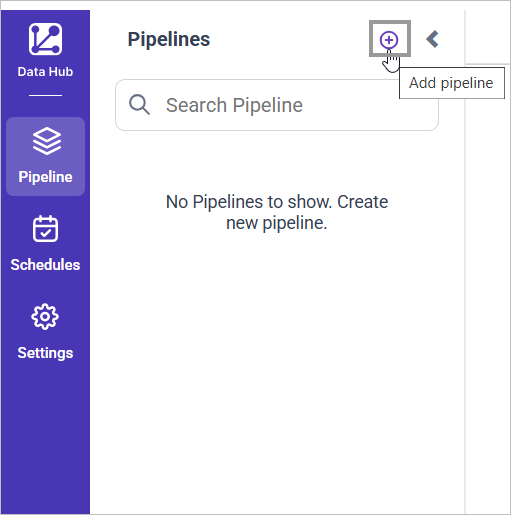
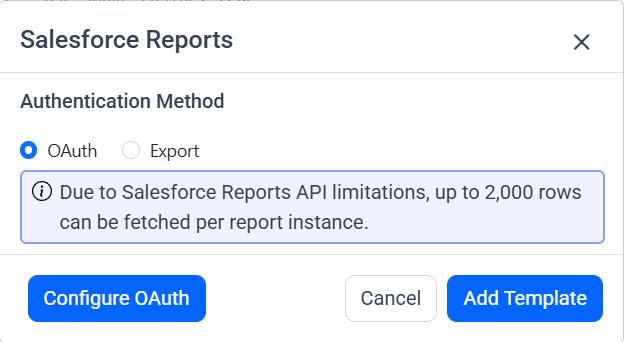
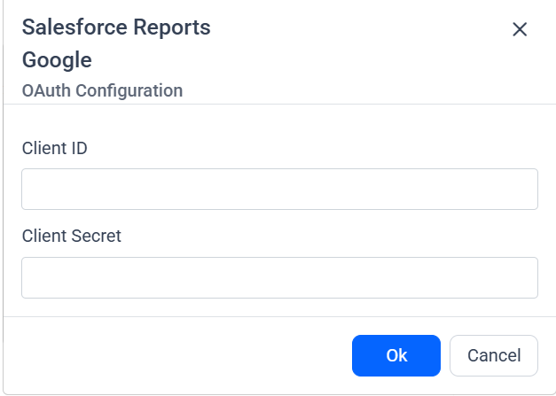
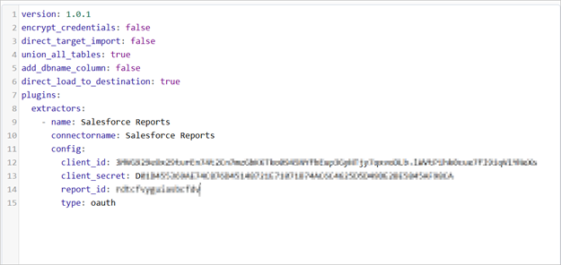
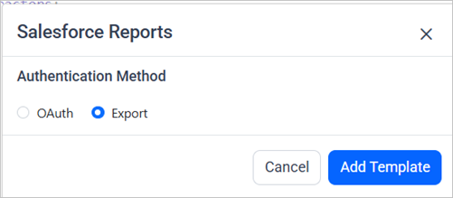
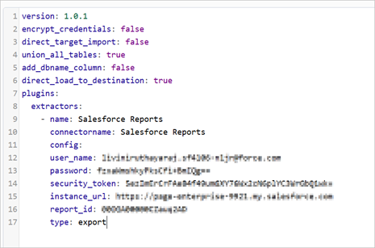
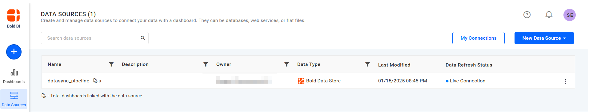
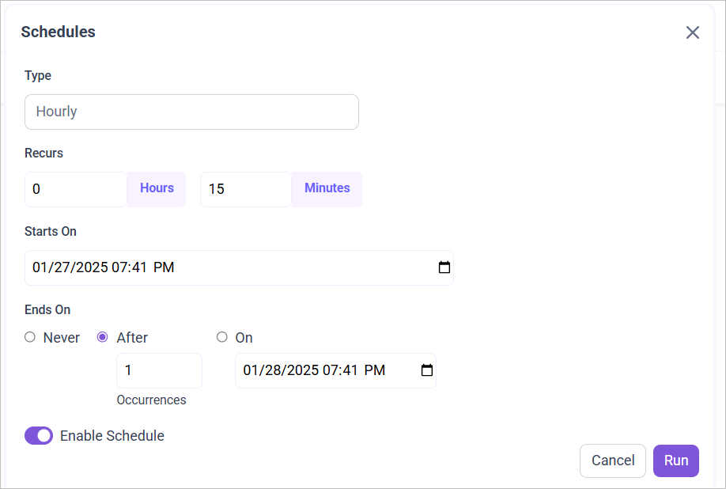
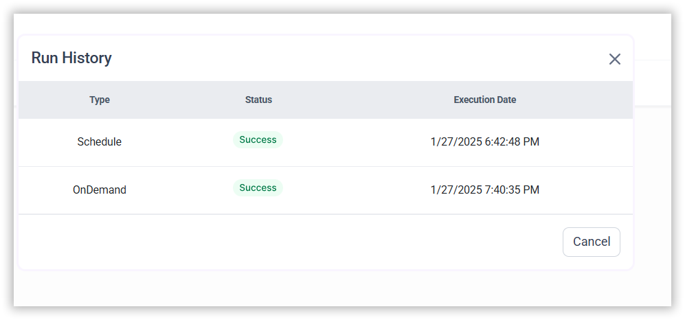

# Connect Salesforce Reports with Bold Data Hub

The Bold Data Hub Salesforce Reports connector loads data from Salesforce reports into {{site.productNameTM}}. Salesforce reports let users compile and analyze data from different sources within Salesforce.

## What credentials do I need for the OAuth option?

The Bold Data Hub Salesforce Reports connector needs the `client_id`and `client_secret` to set up your pipeline with OAuth.

### Example Configuration

The following Bold Data Hub YAML template shows a Salesforce Reports extractor configuration for the OAuth option:

```yaml
version: 1.0.1
encrypt_credentials: false
plugins:
  extractors:
    - name: Salesforce Reports
      connectorname: Salesforce Reports
      config:
        client_id : <Client ID>
        client_secret : <Client Secret>
        report_id : <report ID>
        type: oauth
```

## What credentials do I need for the export option?

The Bold Data Hub Salesforce Reports connector needs your Salesforce `user_name`, `password`, and `security_token` to set up your pipeline with the export option. Use your login credentials for the `user_name` and `password`.

### Obtain Security Token

You get the Salesforce `security_token` for Bold Data Hub by resetting it in your Salesforce personal settings.

1. Log in to Salesforce with your credentials.
2. Click your profile picture/avatar at the top right.
3. Select **Settings** from the drop-down.
4. Under **Personal Setup** in the sidebar, choose **My Personal Information** > **Reset My Security Token**.
5. Click **Reset Security Token**.
6. Check your email for the token sent by Salesforce.

### Example Configuration

The following Bold Data Hub YAML template shows a Salesforce Reports extractor configuration for the export option:

```yaml
version: 1.0.1
encrypt_credentials: false
plugins:
  extractors:
    - name: Salesforce Reports
      connectorname: Salesforce Reports
      config:
        username: <USERNAME>
        password: <PASSWORD>
        security_token: <SECURITY TOKEN>
        instance_url : <Instance URL>
        report_id : <report ID>
        type: export
```

## How do I connect Salesforce Reports in Bold Data Hub?

You connect Salesforce Reports by creating a pipeline in Bold Data Hub and adding the `Salesforce Reports` connector to it.

1. Click the `Bold Data Hub` icon on the Navigation Pane.

    

2. Click `Add Pipeline` and enter a name for the new pipeline.

    

3. Select the newly created pipeline, then double-click the `Salesforce Reports` connector in the list of available connectors. The add template pop-up appears.

    

Bold Data Hub offers two methods to authenticate for Salesforce Reports:
1. OAuth
2. Export

### For OAuth Authentication

You authenticate Salesforce Reports with OAuth by entering your client ID and client secret in Bold Data Hub.

1. Click the `Configure OAuth` button. In the pop-up, enter the client ID and client secret, and click **Ok**.

    

2. Bold Data Hub redirects you to the Salesforce authentication page.
3. After the redirection completes, the Salesforce Reports template is added with the client ID and secret.

    

### For Export Option

You authenticate Salesforce Reports with the export option by choosing it in the Bold Data Hub add template pop-up.

1. Double-click the Salesforce Reports connector in the list of available connectors. The add template pop-up appears.
2. Choose the export option and click the **add template** button.

    

3. Add the necessary details in the YAML template.
4. Click **Save** and choose the destination to save the pipeline.

    

Creating a pipeline in Bold Data Hub automatically creates a data source in {{site.productNameTM}}. The {{site.productNameTM}} data source is a live data source to the destination database used in Bold Data Hub.



## How do I schedule the Salesforce Reports pipeline?

You schedule the Salesforce Reports pipeline in Bold Data Hub from the schedules tab, or you run it on demand.

1. To configure interval-based scheduling, click the schedules tab, select the created pipeline, click the schedule icon, and configure the schedule.

    

    

2. For an on-demand refresh, click the `Run Now` button.

    

3. Check the schedule history with the history option and the logs.

    

4. Click **Logs** to see whether the run is completed and the data source is created in {{site.productNameTM}}.

    

5. Click the `Edit DataSource` option to view the created tables.

## Frequently asked questions

### Which authentication methods does the Salesforce Reports connector support?

The Bold Data Hub Salesforce Reports connector supports two methods: OAuth and Export.

### Where do I get the Salesforce security token?

In Salesforce, go to **Settings** > **My Personal Information** > **Reset My Security Token**. Salesforce sends the token to your email.

## See also

* [Connect Salesforce with Bold Data Hub](../salesforce/)
* [Schedule Bold Data Hub jobs](../../schedule/)
* [Work with Bold Data Hub pipelines](../../working-with-pipelines/)
