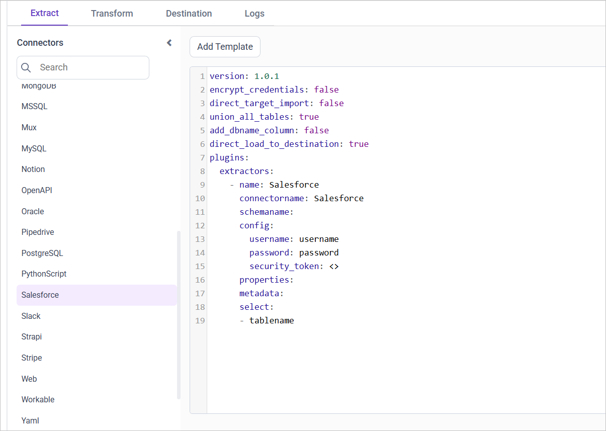
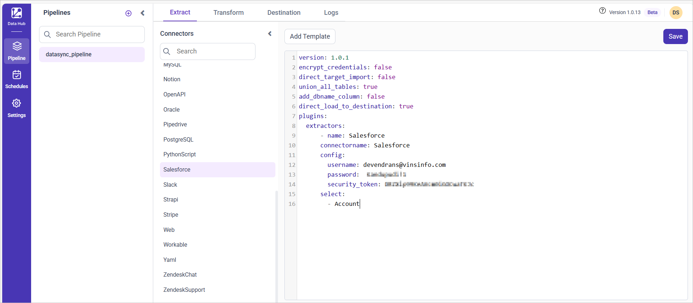

# Connect Salesforce with Bold Data Hub

The Bold Data Hub Salesforce connector loads data from your Salesforce account into {{site.productNameTM}}. [Salesforce](https://www.salesforce.com/) is a cloud platform for sales, marketing, and customer service operations.

## What Salesforce credentials do I need?

The Bold Data Hub Salesforce connector needs your Salesforce `user_name`, `password`, and `security_token` to set up your pipeline. Use your login credentials for the `user_name` and `password`.

### Obtain Security Token

You get the Salesforce `security_token` for Bold Data Hub by resetting it in your Salesforce personal settings.

1. Log in to Salesforce with your credentials.
2. Click your profile picture/avatar at the top right.
3. Select **Settings** from the drop-down.
4. Under **Personal Setup** in the sidebar, choose **My Personal Information** > **Reset My Security Token**.
5. Click **Reset Security Token**.
6. Check your email for the token sent by Salesforce.

## Connection Properties

The Salesforce connector in Bold Data Hub reads the following properties from the `config` section of a YAML file:

```yaml
Connectorname: Salesforce
Username: UserName
Password: Password
Security_token: Salesforce security token
```

### Example Configuration

The following Bold Data Hub YAML template shows a complete Salesforce extractor configuration:

```yaml
version: 1
encrypt_credentials: false
plugins:
  extractors:
    - name: Salesforce_data
      connectorname: Salesforce
      config:
        username: <USERNAME>
        password: <PASSWORD>
        security_token: <SECURITY TOKEN>
      select:
        - TABLE1
        - TABLE2
```

## How do I connect Salesforce in Bold Data Hub?

You connect Salesforce by creating a project in Bold Data Hub and adding the `Salesforce` template to it.

1. Click the `Bold Data Hub` icon on the Navigation Pane.

    

2. Click `Add Project` and enter a name for the new project.

    

3. Select the newly created project and add the `Salesforce` template.

    

4. Update the user name, password, and security token in the template, and update the resources in the `select` property.
5. Click **Save** and choose the destination to save the pipeline.

    

Creating a pipeline in Bold Data Hub automatically creates a data source in {{site.productNameTM}}. The {{site.productNameTM}} data source is a live data source to the destination database used in Bold Data Hub.

### Which Salesforce resources are supported?

The Bold Data Hub Salesforce connector supports the following resources:

```js
The available resources are supported in Salesforce
- User
- UserRole
- Lead
- Contact
- Campaign
- Product2
- Pricebook2
- PricebookEntry
- Opportunity
- OpportunityLineItem
- OpportunityContactRole
- CampaignMember
- Account
- CampaignMember
- Task
- Event  
 ```

>**Warning:**

    1. The `Encrypt_Credentials` property should be set to false when updating the new access token on the template. If you have modified other properties, such as 'select' or 'account id', the `Encrypt_Credentials` property must be set to true.  
    2. The default lifetime of the access token is 1 hour. Therefore, you need to convert it to a long-lived access token to use the same token for 60 days. Existing tables should be maintained even if the token has expired or is being used as an invalid token.

## How do I schedule the Salesforce pipeline?

You schedule the Salesforce pipeline in Bold Data Hub from the schedules tab, or you run it on demand.

1. To configure interval-based scheduling, click the schedules tab, select the created pipeline, click the schedule icon, and configure the schedule.

    

    

2. For an on-demand refresh, click the `Run Now` button.

    

3. Check the schedule history with the history option and the logs.

    

4. Click **Logs** to see whether the run is completed and the data source is created in {{site.productNameTM}}.

    

5. Click the `Edit DataSource` option to view the created tables.

## Frequently asked questions

### Which Salesforce objects can Bold Data Hub load?

The Bold Data Hub Salesforce connector supports objects such as User, Lead, Contact, Campaign, Opportunity, Account, Task, and Event. The full list is in the supported resources section.

### Where do I get the Salesforce security token?

In Salesforce, go to **Settings** > **My Personal Information** > **Reset My Security Token**. Salesforce sends the token to your email.

## See also

* [Connect Salesforce Reports with Bold Data Hub](../salesforce-reports/)
* [Schedule Bold Data Hub jobs](../../schedule/)
* [Work with Bold Data Hub pipelines](../../working-with-pipelines/)
