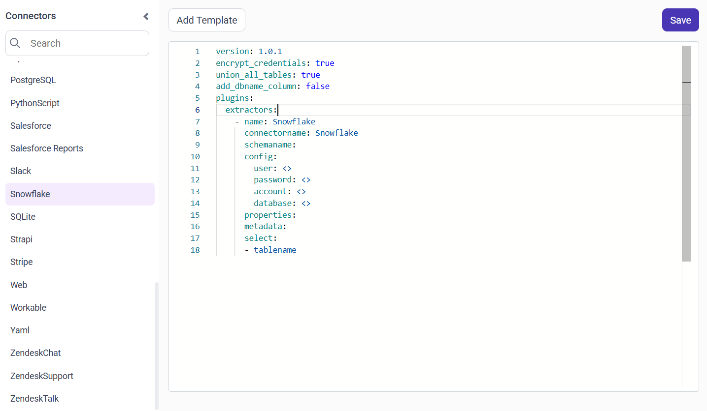
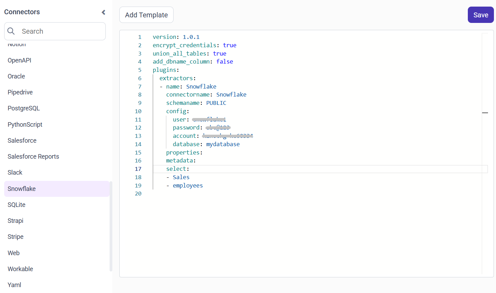

# Connect Snowflake with Bold Data Hub

The Bold Data Hub Snowflake connector loads data from a Snowflake data warehouse into {{site.productNameTM}}. Snowflake is a cloud-based data warehouse that uses SQL to manage and analyze large amounts of data. Snowflake is popular for its speed, easy scaling, and ability to handle big data. Teams often use Snowflake in business reporting, data analytics, and machine learning.

## Connection Properties

The Snowflake connector in Bold Data Hub reads the following properties from the `config` section of a YAML file:

```yaml
Connectorname: Snowflake
user: <>
password: <>
database: <>
account: <>
```

### Example Configuration

The following Bold Data Hub YAML template shows a complete Snowflake extractor configuration:

```yaml
version: 1.0.1
encrypt_credentials: true
union_all_tables: true
add_dbname_column: false
plugins:
  extractors:
    - name: Snowflake
      connectorname: Snowflake
      schemaname:
      config:
        user: <>
        password: <>
        account: <>
        database: <>
      properties:
      metadata:
      select:
      - tablename
```

## How do I connect Snowflake in Bold Data Hub?

You connect Snowflake by creating a pipeline in Bold Data Hub and adding the `Snowflake` template to it.

1. Click the `Data Hub` icon on the Navigation Pane.

    

2. Click `Add Pipeline` and enter a name for the new pipeline.

    

3. Select the newly created pipeline and add the `Snowflake` template.

    

4. Update the required details in the template, using the configuration parameters below.
5. Click **Save** and choose the destination to save the pipeline.

    

Creating a pipeline in Bold Data Hub automatically creates a data source in {{site.productNameTM}}. The {{site.productNameTM}} data source is a live data source to the destination database used in Bold Data Hub.

### Configuration Parameters

The Snowflake template in Bold Data Hub uses these parameters:

|Parameters |    Description                                          |
|--------------------------|----------------------------------------------|
| **Username:**                |  Provide the username to authenticate with the Snowflake server.    |
| **Password:**            | Provide the password to authenticate with the Snowflake server. |
| **Account:**                | Specify the Snowflake account identifier (e.g., `xy12345-kc60294`). |
| **Database:**            | Specify the name of the Snowflake database from which data will be extracted. |
| **Schema:**            | Define the schema within the database where the tables reside. |
|    **Select:**     |                                  **Tablename(s):**       Specify the table name list to load tables from the Snowflake server.|

## How do I schedule the Snowflake pipeline?

You schedule the Snowflake pipeline in Bold Data Hub from the schedules tab, or you run it on demand.

1. To configure interval-based scheduling, click the schedules tab, select the created pipeline, click the schedule icon, and configure the schedule.

    

    

2. For an on-demand refresh, click the `Run Now` button.

    

3. Check the schedule history with the history option and the logs.

    

4. Click **Logs** to see whether the run is completed and the data source is created in {{site.productNameTM}}.

    

5. Click the `Edit DataSource` option to view the created tables.

## Frequently asked questions

### Which values does Bold Data Hub need to connect Snowflake?

The Bold Data Hub Snowflake connector needs a username, password, account identifier, and database. You can also define the schema and the tables to load.

### What does a Snowflake account identifier look like?

A Snowflake account identifier looks like `xy12345-kc60294`.

## See also

* [Schedule Bold Data Hub jobs](../../schedule/)
* [Work with Bold Data Hub pipelines](../../working-with-pipelines/)
* [Bold Data Hub connectors list](../)
