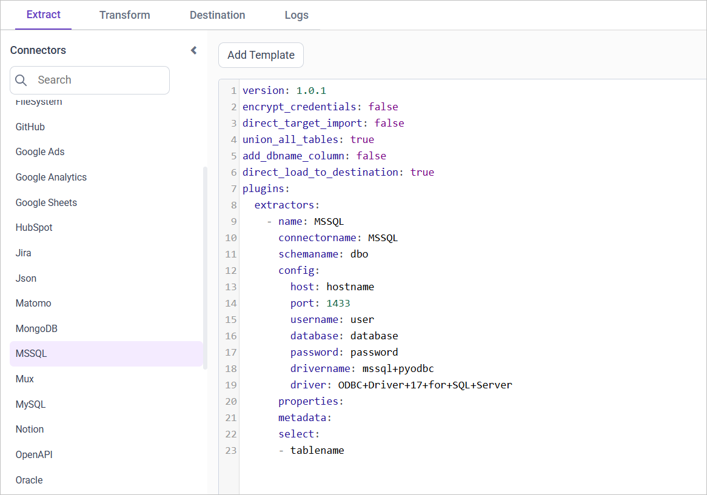
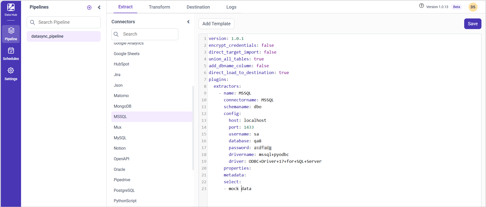
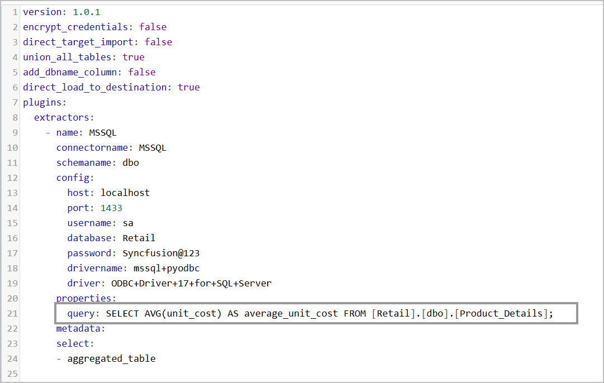

# Connect Microsoft SQL Server with Bold Data Hub

The Bold Data Hub Microsoft SQL Server connector loads data from a SQL Server database into Bold Reports<sup>®</sup>. Microsoft SQL Server is a relational database management system developed by Microsoft. SQL Server stores information in tabular form, with rows and columns representing different data attributes and the various relationships between the data values.

## What do I need before I connect SQL Server?

The Bold Data Hub SQL Server connector needs the following prerequisite:

* ODBC Driver 17+ for SQL Server

## Connection Properties

The SQL Server connector in Bold Data Hub reads the following properties from the `config` section of a YAML file:

```yaml
Connectorname: SQL
host: Hostname or IP address of the server
port: Server running port
username: Username
password: Password
database: Database
drivername: mssql+pyodbc
```

## How do I connect SQL Server in Bold Data Hub?

You connect Microsoft SQL Server by creating a project in Bold Data Hub and adding the `MSSQL` template to it.

1. Click the `Data Hub` icon on the Navigation Pane.

    

2. Click `Add Project` and enter a name for the new project.

    

3. Select the newly created project and add the `MSSQL` template.

    

4. Update the required details in the template, using the configuration parameters below.
5. Click **Save** and choose the destination to save the pipeline.

    

Creating a pipeline in Bold Data Hub automatically creates a data source in Bold Reports<sup>®</sup>. The Bold Reports<sup>®</sup> data source is a live data source to the destination database used in Bold Data Hub.

### Configuration Parameters

The MSSQL template in Bold Data Hub uses these parameters:

| Parameters |   Description       |
|--------------------------|----------------------------------------------|
| **Host:**                | Specify the hostname of the MSSQL server.    |
| **Port:**                | Specify the port number of the MSSQL server (default is 1433). |
| **Username:**            | Provide the username to authenticate with the MSSQL server. |
| **Password:**            | Provide the password to authenticate with the MSSQL server. |
| **Database:**            | Specify the name of the MSSQL database from which data will be extracted. |
| **Driver Name:**         | Specify the driver name for connecting to MSSQL (e.g., mssql+pyodbc). |
| **Driver:**              | Specify the ODBC driver to use for connecting to MSSQL (e.g., ODBC+Driver+17+for+SQL+Server). |
| **Select**                 | **Tablename(s):**        Specify the name of the table(s) to load tables from the MSSQL server. |
| [**Metadata**](#metadata-properties)  (Optional) |  **Replication Method:** Specify the replication method for the table(s). Options include FULL or INCREMENTAL. |
|| **Replication Key:** Specify the replication key for incremental replication. This key helps in identifying new or updated records. |
|| **Replication Value:**  Specify the replication value to start the incremental replication from a particular point. |

## How do I schedule the SQL Server pipeline?

You schedule the SQL Server pipeline in Bold Data Hub from the schedules tab, or you run it on demand.

1. To configure interval-based scheduling, click the schedules tab, select the created pipeline, click the schedule icon, and configure the schedule.

    

    

2. For an on-demand refresh, click the `Run Now` button.

    

3. Check the schedule history with the history option and the logs.

    

4. Click **Logs** to see whether the run is completed and the data source is created in Bold Reports<sup>®</sup>.

    

5. Click the `Edit DataSource` option to view the created tables.

## Metadata Properties

The metadata section of the Bold Data Hub MSSQL template defines the mode of data refresh. There are two modes: ``INCREMENTAL`` and ``FULL_TABLE``.

### INCREMENTAL

The INCREMENTAL mode in Bold Data Hub replicates SQL Server data using both the primary_key and the replication_key. The replication_key is a column with date or timestamp values that sets the point from which incremental fetching begins. The primary_key uniquely identifies each record.

During each sync, Bold Data Hub uses the date from the replication_key to fetch only the records that are newer than the last imported data. The primary_key helps maintain data integrity and avoid duplication.

```yaml
metadata:
  TableName:
    replication_method: INCREMENTAL
    replication_key: <Date Column name>
    primary_key: <Primary key column name>
```

### FULL_TABLE

The FULL_TABLE mode in Bold Data Hub fetches data from the date column mentioned in the replication key, starting from the date mentioned in the replication value. Once you schedule the pipeline, the replication value is updated automatically from the imported data.

```yaml
metadata:
  TableName:
    replication_method: FULL_TABLE
    replication_key: Column name
    replication_value: column value that data starts from
    interval_type: days/hours/minutes/year/month
    interval_value: integer value to add in interval type
```

### Example Configuration

The following Bold Data Hub YAML templates show complete MSSQL extractor configurations for each refresh mode.

#### Incremental

```yaml
version: 1.0.1
encrypt_credentials: false
plugins:
  extractors:
    - name: tap_postgres
      connectorname: MSSQL
      config:
        host: Hostname or IP address of the server
        port: Server running port
        username: Username
        password: Password
        database: Database
        drivername: mssql+pyodbc
        #if ODBC Driver 18 for SQL Server is installed, use the following driver: ODBC+Driver+18+for+SQL+Server
        driver: ODBC+Driver+17+for+SQL+Server
      select:
        - TABLE1
        - TABLE2
      metadata:
        TABLE1:
          replication_method: INCREMENTAL
          replication_key: last_modified_on
          primary_key: id
        TABLE2:
          replication_method: INCREMENTAL
          replication_key: last_modified_on
          primary_key: id
```

#### FULLTABLE

```yaml
version: 1.0.1
encrypt_credentials: false
plugins:
  extractors:
    - name: tap_postgres
      connectorname: MSSQL
      config:
        host: Hostname or IP address of the server
        port: Server running port
        username: Username
        password: Password
        database: Database
        drivername: mssql+pyodbc
        #if ODBC Driver 18 for SQL Server is installed, use the following driver: ODBC+Driver+18+for+SQL+Server
        driver: ODBC+Driver+17+for+SQL+Server
      select:
        - TABLE1
        - TABLE2
      metadata:
        TABLE1:
          replication_method: FULL_TABLE
          replication_key: last_modified_on
          replication_value: 2023-07-19 00:00:00
          interval_type: days
          interval_value: 6
        TABLE2:
          replication_method: FULL_TABLE
          replication_key: last_modified_on
          replication_value: 2023-07-19 00:00:00
          interval_type: days
          interval_value: 6
```

## How do I use a custom query with SQL Server?

You run a custom SQL query in Bold Data Hub by adding the query field under the properties section of the MSSQL template.

1. To execute a custom SQL query during extraction, add the query field under the properties section.
2. When you use a custom query, the select parameter does not extract data from the table name specified. Instead, Bold Data Hub uses the name in select only to create the destination table that stores the query result.
3. Add **Query** under **Properties** and include the query. When you use Query in the template, the Select parameter creates the table that stores the query result instead of extracting data from the name given in it.

The following screenshot shows a query added under the properties section of the template.



Note: When using a custom query, data is not extracted from the table name specified. Instead, the query result is used to create and populate the table.

### Example Configuration

The following Bold Data Hub YAML template runs a custom query against SQL Server and stores the result in `aggregated_table`:

```yaml
version: 1.0.1
encrypt_credentials: false
direct_target_import: false
union_all_tables: true
add_dbname_column: false
direct_load_to_destination: true
plugins:
 extractors:
   - name: MSSQL
     connectorname: MSSQL
     schemaname: dbo
     config:
       host:
       port: 1433
       username: sa
       database: Retail
       password:
       drivername: mssql+pyodbc
       driver: ODBC+Driver+17+for+SQL+Server
     properties:
       query: SELECT AVG(unit_cost) AS average_unit_cost FROM [Retail].[dbo].[Product_Details];
     metadata:
     select:
     - aggregated_table
```

### How does incremental refresh work with a custom query?

Bold Data Hub applies incremental logic to a custom query when you use the INCREMENTAL method:
* Make sure the query includes the replication_key column (typically a date or timestamp).
* Bold Data Hub applies incremental logic based on the replication_key to fetch only new or updated records.
* The primary_key ensures uniqueness and prevents duplication.

#### Example Configuration

```yaml
version: 1.0.1
encrypt_credentials: false
direct_target_import: false
union_all_tables: true
add_dbname_column: false
direct_load_to_destination: true
plugins:
  extractors:
    - name: MSSQL
      connectorname: MSSQL
      schemaname: dbo
      config:
        host:
        port: 1433
        username: sa
        database: Retail
        password:
        drivername: mssql+pyodbc
        driver: ODBC+Driver+17+for+SQL+Server
      properties:
        query: SELECT id, last_modified_on, product_name FROM [Retail].[dbo].[Product_Details];
      metadata:
        aggregated_table:
          replication_method: INCREMENTAL
          replication_key: last_modified_on
          primary_key: id
      select:
        - aggregated_table
```

## Frequently asked questions

### Which ODBC driver does the SQL Server connector need?

The Bold Data Hub SQL Server connector needs ODBC Driver 17+ for SQL Server. If ODBC Driver 18 for SQL Server is installed, use `ODBC+Driver+18+for+SQL+Server` as the driver.

### What is the default SQL Server port in Bold Data Hub?

The default port number of the MSSQL server is 1433.

### What does the select parameter do with a custom query?

With a custom query, the select parameter only names the destination table that stores the query result. Bold Data Hub does not extract data from that table name.

## See also

* [Schedule Bold Data Hub jobs](../../schedule/)
* [Work with Bold Data Hub pipelines](../../working-with-pipelines/)
* [Bold Data Hub connectors list](../)
