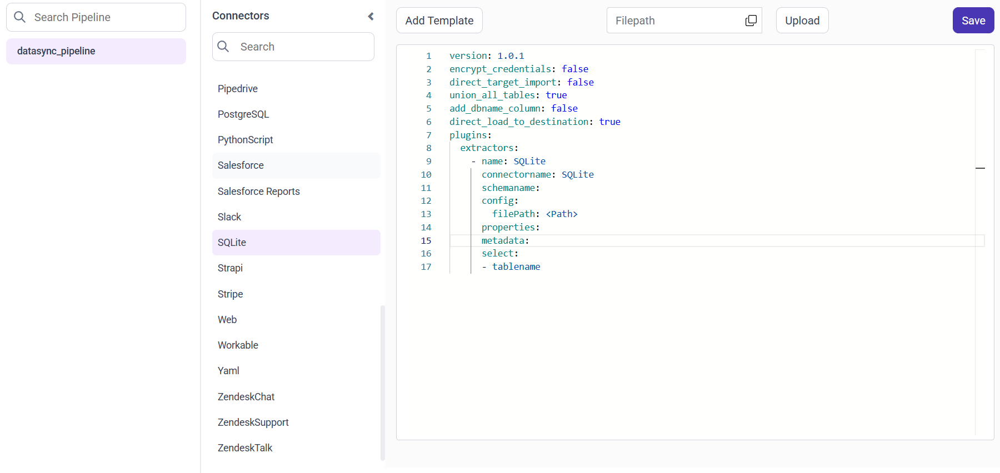
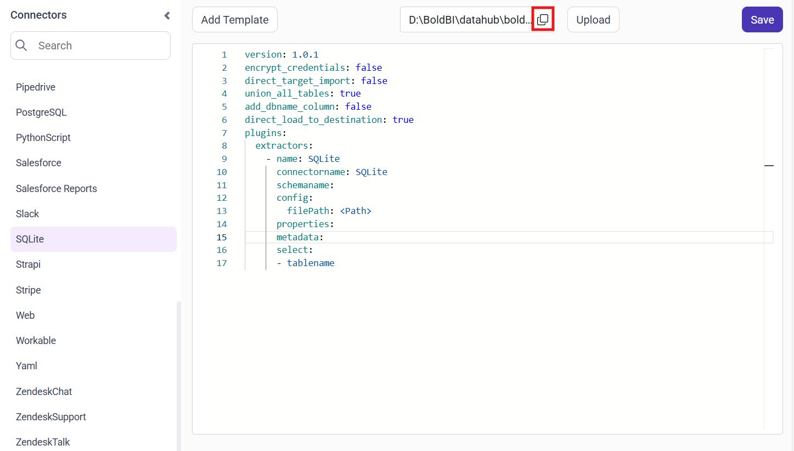
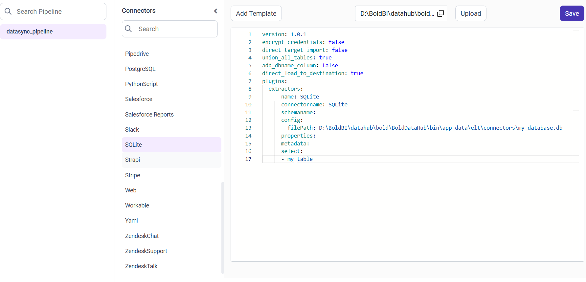

# Connect SQLite with Bold Data Hub

The Bold Data Hub SQLite connector loads data from a SQLite database file into Bold Reports<sup>®</sup>. SQLite is a lightweight, file-based database for storing and managing data locally. SQLite is easy to use and suits small to medium datasets, which makes it ideal for quick setup and offline analysis.

## How do I connect to a SQLite database file?

You connect a SQLite database file to Bold Reports<sup>®</sup> by choosing the SQLite connector in Bold Data Hub and selecting your file.

1. Make sure your .db or .sqlite file is ready and accessible.
2. In Bold Reports<sup>®</sup>, go to the Bold Data Hub section.
3. Choose SQLite from the available connectors.
4. Browse and select your SQLite database file.
5. Test the connection and proceed to import your data.

## Connection Properties

The SQLite connector in Bold Data Hub reads the following properties from the `config` section of a YAML file:

```yaml
filePath: Path to your SQLite database file (e.g., `.db` or `.sqlite`)
```

### Example Configuration

The following Bold Data Hub YAML template shows a complete SQLite extractor configuration:

```yaml
version: 1.0.1
encrypt_credentials: false
union_all_tables: true
add_dbname_column: false
plugins:
  extractors:
    - name: SQLite
      connectorname: SQLite
      schemaname:
      config:
        filePath: <Path-to-your-SQLite-file>
      properties:
      metadata:
      select:
        - tablename
```

## How do I connect SQLite in Bold Data Hub?

You connect SQLite by creating a pipeline in Bold Data Hub, adding the SQLite connector template, and uploading your file.

1. Click the `Bold Data Hub` icon on the Navigation Pane.

    

2. Click `Add Pipeline` and enter a name for the new pipeline.

    

3. Select the newly created pipeline and choose the SQLite connector. Double-click it, or click the **Add Template** option, to add the template.

    

4. Click the **Upload File** button to upload your credentials JSON file.

    

5. Copy the file path and paste it into the credentials_path property, if it's a JSON file.

    

    

6. Click **Save** and choose the destination to save the pipeline.

    

Creating a pipeline in Bold Data Hub automatically creates a data source in Bold Reports<sup>®</sup>. The Bold Reports<sup>®</sup> data source is a live data source to the destination database used in Bold Data Hub.


### Configuration Parameters

The SQLite template in Bold Data Hub uses these parameters:

|  Parameters |  Description                                     |
|--------------------------------|---------------------------------------------|
| **File Path:**                | Provide the full local path to your SQLite database file (e.g., .db, .sqlite). |
| **Select:**                  |    **Tablename(s):**         Provide one or more table names from which to load data in the BigQuery dataset. |

## How do I schedule the SQLite pipeline?

You schedule the SQLite pipeline in Bold Data Hub from the schedules tab, or you run it on demand.

1. To configure interval-based scheduling, click the schedules tab, select the created pipeline, click the schedule icon, and configure the schedule.

    

    

2. For an on-demand refresh, click the `Run Now` button.

    

3. Check the schedule history with the history option and the logs.

    

4. Click **Logs** to see whether the run is completed and the data source is created in Bold Reports<sup>®</sup>.

    

5. Click the `Edit DataSource` option to view the created tables.

## Frequently asked questions

### Which SQLite file types can Bold Data Hub read?

The Bold Data Hub SQLite connector reads .db or .sqlite database files.

### Which property holds the SQLite file location?

The `filePath` property holds the full local path to your SQLite database file.

## See also

* [Schedule Bold Data Hub jobs](../../schedule/)
* [Work with Bold Data Hub pipelines](../../working-with-pipelines/)
* [Bold Data Hub connectors list](../)
