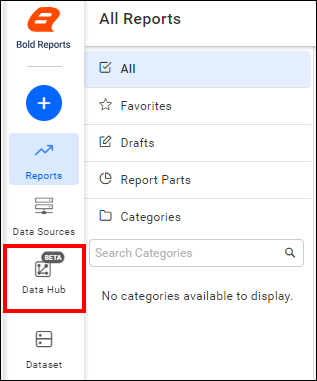
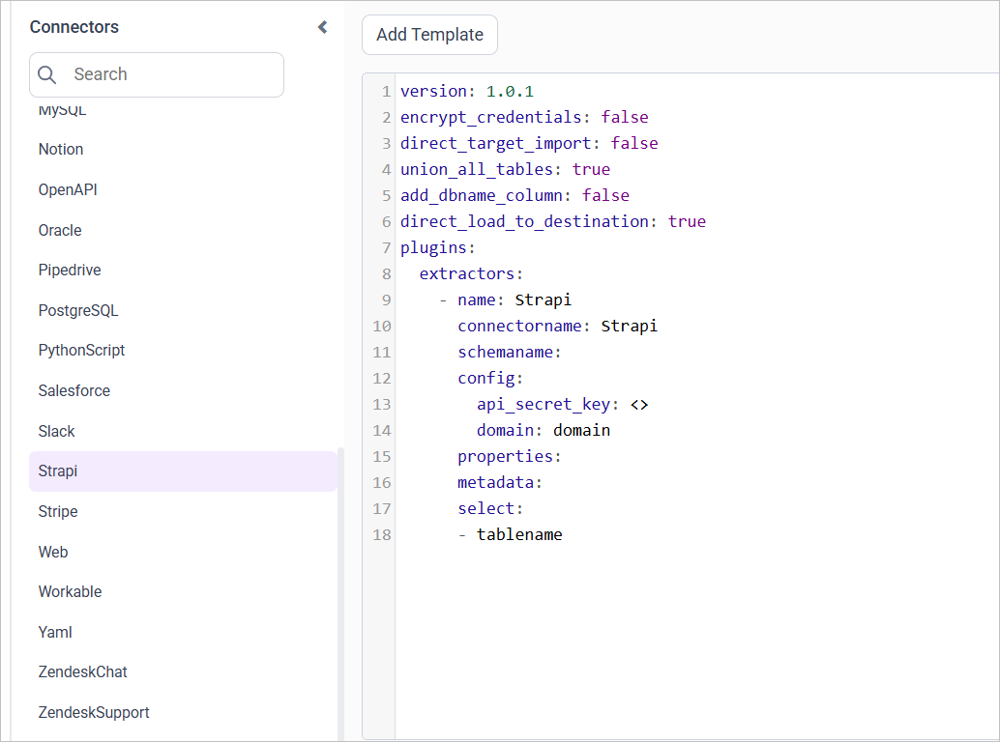

# Connect Strapi with Bold Data Hub

The Bold Data Hub Strapi connector loads content data from Strapi into Bold Reports<sup>®</sup>. Strapi is a headless CMS (Content Management System) for building API-driven content management systems.

## How do I get a Strapi API token?

You create the Strapi API token for Bold Data Hub in the global settings of your Strapi admin panel.

1. Log in to ``Strapi``.
2. Click the settings icon in the sidebar.
3. Go to **API tokens** under global settings.
4. Create a new API token.
5. Fill in **Name**, **Description**, and **Duration**.
6. Choose a token type: Read Only, Full Access, or custom.
7. Save to view your API token.
8. Copy it for configuration.

## Connection Properties

The Strapi connector in Bold Data Hub reads the following properties from the configuration section of a YAML file:

```yaml
Connectorname: Strapi
Api_secret_key: API secret key
Domain: Domain
```

### Example

The following Bold Data Hub YAML template shows a complete Strapi extractor configuration:

```yaml
version: 1
encrypt_credentials: false
plugins:
  extractors:
    - name: Strapi_data
      connectorname: Strapi
      config:
        api_secret_key: <API SECRET KEY>
        domain: <DOMAIN>
      select:
        - TABLE1
        - TABLE2
```

## How do I connect Strapi in Bold Data Hub?

You connect Strapi by creating a project in Bold Data Hub and adding the `Strapi` template to it.

1. Click the `Bold Data Hub` icon on the Navigation Pane.

    

2. Click `Add Project` and enter a name for the new project.

    

3. Select the newly created project and add the `Strapi` template.

    

4. Update the API secret key and domain in the template, and update the resources in the `select` property.
5. Click **Save** and choose the destination to save the pipeline.

Creating a pipeline in Bold Data Hub automatically creates a data source in Bold Reports<sup>®</sup>. The Bold Reports<sup>®</sup> data source is a live data source to the destination database used in Bold Data Hub.

>**Warning:**

    1. The `Encrypt_Credentials` property should be set to false when updating the new access token on the template. If you have modified other properties, such as 'select' or 'account id', the `Encrypt_Credentials` property must be set to true.  
    2. The default lifetime of the access token is 1 hour. Therefore, you need to convert it to a long-lived access token to use the same token for 60 days. Existing tables should be maintained even if the token has expired or is being used as an invalid token.

## How do I schedule the Strapi pipeline?

You schedule the Strapi pipeline in Bold Data Hub from the schedules tab, or you run it on demand.

1. To configure interval-based scheduling, click the schedules tab, select the created pipeline, click the schedule icon, and configure the schedule.

    

    

2. For an on-demand refresh, click the `Run Now` button.

    

3. Check the schedule history with the history option and the logs.

    

4. Click **Logs** to see whether the run is completed and the data source is created in Bold Reports<sup>®</sup>.

    

5. Click the `Edit DataSource` option to view the created tables.

## Frequently asked questions

### Which values does the Strapi connector need?

The Bold Data Hub Strapi connector needs an API secret key and your Strapi domain.

### Which Strapi token types can I create?

You can choose a Read Only, Full Access, or custom token type when you create the Strapi API token.

## See also

* [Schedule Bold Data Hub jobs](../../schedule/)
* [Work with Bold Data Hub pipelines](../../working-with-pipelines/)
* [Bold Data Hub connectors list](../)
