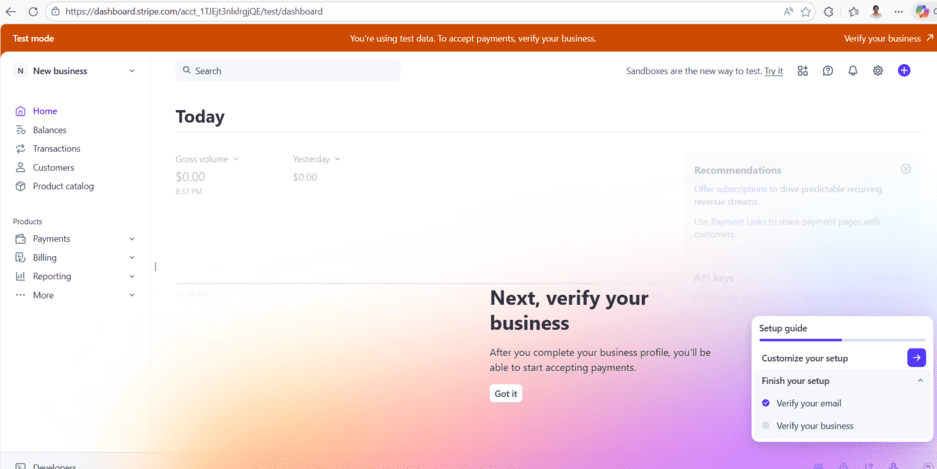
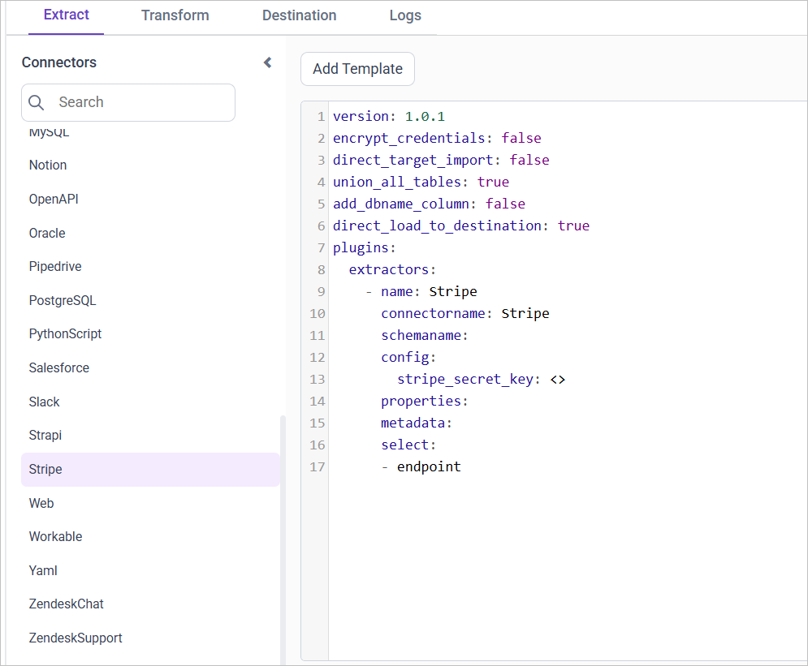
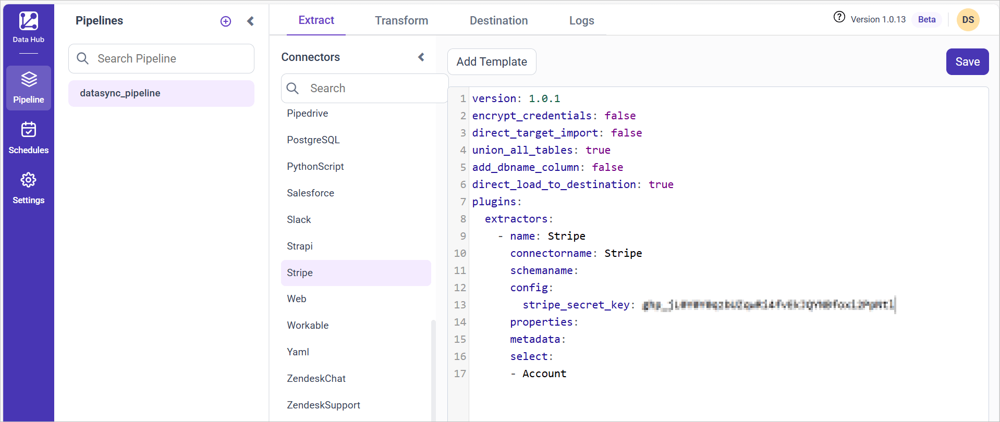

# Connect Stripe with Bold Data Hub

The Bold Data Hub Stripe connector loads payment data from your Stripe account into {{site.productNameTM}}. Stripe is an online payment platform for processing and managing customer transactions.

## How do I get Stripe credentials?

You get the Stripe secret key for Bold Data Hub from the API keys page in your Stripe account.

1. Log in to your Stripe account.

    

2. Click **Settings** in the top right corner.
3. Navigate to **Developers** in the top menu.
4. Choose **API Keys**.
5. Under **Standard Keys**, click **Reveal test key** next to the Secret Key.
6. Make a note of the `API_secret_key` for configuring `secrets.toml`.

## Connection Properties

The Stripe connector in Bold Data Hub reads the following properties from the configuration section of a YAML file:

```yaml
Connectorname: Stripe
Stripe_secret_key: Stripe secret key
```

## Metadata Properties

The metadata properties of the Bold Data Hub Stripe template define the mode of data refresh. There are two modes: `INCREMENTAL` and `FULL_TABLE`.

<table>
    <tr>
        <td></td>
        <td></td>
        <td></td>
    </tr>
    <tr>
        <td>INCREMENTAL</td>
        <td>

```yaml
metadata:
    TableName:
        replication_method: INCREMENTAL
        replication_key: Column name
        replication_value: column value that data starts from
```

</td>
        <td>This mode will retrieve data from the date column specified in the replication key starting from the date indicated in the replication value. Once it is scheduled, the replication value will be automatically updated based on the imported data.</td>
    </tr>
    <tr>
        <td>FULL_TABLE</td>
        <td>

```yaml
      metadata:
    TableName:
        replication_method: FULL_TABLE
        replication_key: Column name
        replication_value: column value that data starts from
        interval_type: days/hours/minutes/year/month
        interval_value: integer value to add in interval type
```

</td>
        <td>This mode will fetch data from the date column mentioned in the replication key starting from the date specified in the replication value. Once scheduled, the replication value is automatically updated from the imported data.</td>
    </tr>
</table>

## Example

The following Bold Data Hub YAML templates show complete Stripe extractor configurations for each refresh mode.

### ``FULL_TABLE``

```yaml
version: 1
encrypt_credentials: false
plugins:
  extractors:
    - name: stripe_data
      connectorname: stripe
      config:
        stripe_secret_key: <SECRET KEY>
      select:
         - TABLE1
         - TABLE2
      metadata:
        TABLE1:
          replication_method: FULL_TABLE
          replication_key: last_modified_on
          replication_value: 2023-07-19 00:00:00
          interval_type: days
          interval_value: 6
        TABLE2:
          replication_method: FULL_TABLE
          replication_key: last_modified_on
          replication_value: 2023-07-19 00:00:00
          interval_type: days
          interval_value: 6
```

### INCREMENTAL

```yaml
version: 1
encrypt_credentials: false
plugins:
  extractors:
    - name: stripe_data
      connectorname: stripe
      config:
        stripe_secret_key: <SECRET KEY>
      select:
         - TABLE1
         - TABLE2
      metadata:
        TABLE1:
          replication_method: FULL_TABLE
          replication_key: last_modified_on
          replication_value: 2023-07-19 00:00:00
        TABLE2:
          replication_method: FULL_TABLE
          replication_key: last_modified_on
          replication_value: 2023-07-19 00:00:00
```

## How do I connect Stripe in Bold Data Hub?

You connect Stripe by creating a project in Bold Data Hub and adding the `Stripe` template to it.

1. Click the `Bold Data Hub` icon on the Navigation Pane.

    

2. Click `Add Project` and enter a name for the new project.

    

3. Select the newly created project and add the `Stripe` template.

    

4. Update the Stripe secret key in the template, and update the resources in the `select` property.
5. Click **Save** and choose the destination to save the pipeline.

    

Creating a pipeline in Bold Data Hub automatically creates a data source in {{site.productNameTM}}. The {{site.productNameTM}} data source is a live data source to the destination database used in Bold Data Hub.

### Which Stripe resources are supported?

The Bold Data Hub Stripe connector supports the following resources:

```js
The available resources are supported in Stripe
- Subscription
- Account
- Coupon
- Customer
- Product
- Price
- Event
- Invoice
- BalanceTransaction
 ```

>**Warning:**

    1. The `Encrypt_Credentials` property should be set to false when updating the new access token on the template. If you have modified other properties, such as 'select' or 'account id', the `Encrypt_Credentials` property must be set to true.  
    2. The default lifetime of the access token is 1 hour. Therefore, you need to convert it to a long-lived access token to use the same token for 60 days. Existing tables should be maintained even if the token has expired or is being used as an invalid token.

## How do I schedule the Stripe pipeline?

You schedule the Stripe pipeline in Bold Data Hub from the schedules tab, or you run it on demand.

1. To configure interval-based scheduling, click the schedules tab, select the created pipeline, click the schedule icon, and configure the schedule.

    

    

2. For an on-demand refresh, click the `Run Now` button.

    

3. Check the schedule history with the history option and the logs.

    

4. Click **Logs** to see whether the run is completed and the data source is created in {{site.productNameTM}}.

    

5. Click the `Edit DataSource` option to view the created tables.

## Frequently asked questions

### Which Stripe resources can Bold Data Hub load?

The Bold Data Hub Stripe connector supports Subscription, Account, Coupon, Customer, Product, Price, Event, Invoice, and BalanceTransaction.

### Which refresh modes does the Stripe connector support?

The Bold Data Hub Stripe connector supports two modes: `INCREMENTAL` and `FULL_TABLE`.

## See also

* [Schedule Bold Data Hub jobs](../../schedule/)
* [Work with Bold Data Hub pipelines](../../working-with-pipelines/)
* [Bold Data Hub connectors list](../)
