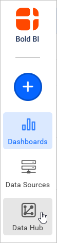
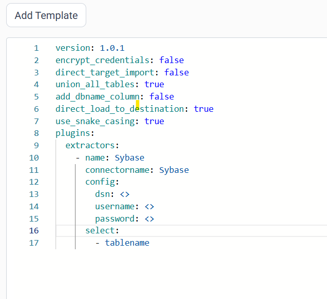
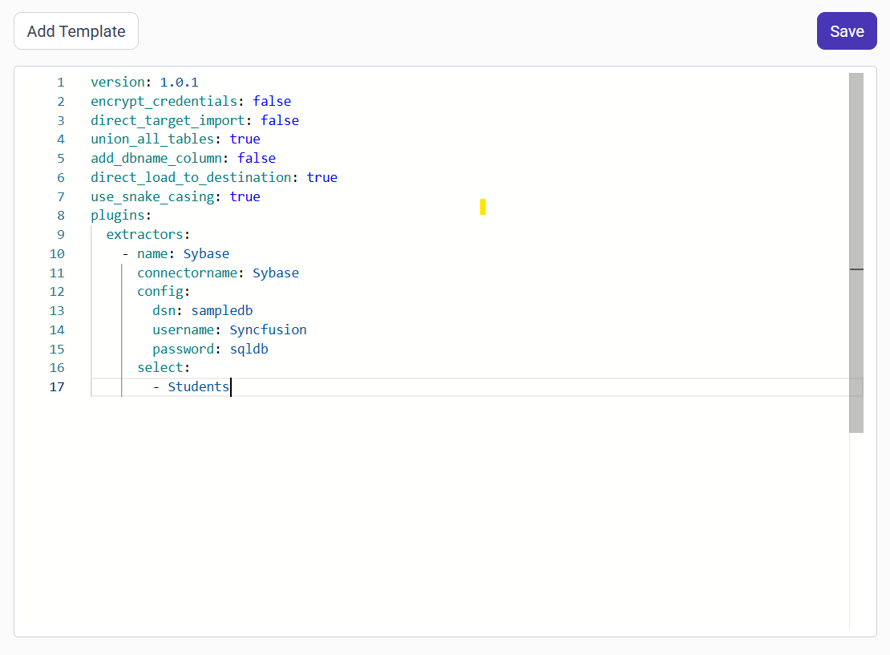

# Connect Sybase with Bold Data Hub

The Bold Data Hub Sybase connector connects to a Sybase database and fetches data from tables or views into {{site.productNameTM}}. The Sybase connector supports authentication, handles nested or related data, and presents the results in a clean, structured format for easy use.

## How do I get the Sybase ODBC connection details?

You set up the Sybase connection for {{site.productNameTM}} by configuring an ODBC DSN on your system and then selecting it in the Sybase connector.

1. Configure an ODBC DSN on your system:
    * Open **ODBC Data Source Administrator**.
    * Go to the **System DSN** tab and click **Add**.
    * Select the Sybase ODBC driver and configure it with:
            - Data Source Name (DSN)
            - Server Name/IP
            - Port
            - Database Name
2. Provide credentials:
    * Enter your Username and Password for the Sybase database.
3. Connect in {{site.productNameTM}}:
    * In {{site.productNameTM}}, choose the Sybase connector.
    * Select the configured DSN, enter your credentials, and click **Connect**.

## Connection Properties

The Sybase connector in Bold Data Hub reads the following properties from the `config` section of a YAML file:

```yaml
connectorname: Sybase
dsn: <>
username: <>
password: <>
```

### Example Configuration

The following Bold Data Hub YAML template shows a complete Sybase extractor configuration:

```yaml
version: 1.0.1
destination:
plugins:
  extractors:
    - name: Sybase
      connectorname: Sybase
      schemaname:
      config:
        dsn: <>
        username: <>
        password: <>
      properties:
      metadata:
      select:
      - tablename
```

## How do I connect Sybase in Bold Data Hub?

You connect Sybase by creating a pipeline in Bold Data Hub and adding the Sybase connector template to it.

1. Click the `Bold Data Hub` icon on the Navigation Pane.

    

2. Click `Add Pipeline` and enter a name for the new pipeline.

    

3. Select the newly created pipeline and choose the Sybase connector. Double-click it, or click the **Add Template** option, to add the template.

    

4. Update the template, using the configuration parameters below. The following screenshot shows the completed Sybase template.

    

5. Click **Save** and choose the destination to save the pipeline.

    

Creating a pipeline in Bold Data Hub automatically creates a data source in {{site.productNameTM}}. The {{site.productNameTM}} data source is a live data source to the destination database used in Bold Data Hub.


### Configuration Parameters

The Sybase template in Bold Data Hub uses these parameters:

|  Parameters |  Description                                     |
|--------------------------------|---------------------------------------------|
| **Username:**                |  Provide the username to authenticate with the Sybase server.    |
| **Password:**            |  Provide the password associated with the Sybase username. |
| **DSN Name:**            | Specify the ODBC Data Source Name configured for the Sybase database |
|    **Select:**     |                                  **Tablename(s):**       Specify the list of tables to load data from the Sybase server.|

## How do I schedule the Sybase pipeline?

You schedule the Sybase pipeline in Bold Data Hub from the schedules tab, or you run it on demand.

1. To configure interval-based scheduling, click the schedules tab, select the created pipeline, click the schedule icon, and configure the schedule.

    

    

2. For an on-demand refresh, click the `Run Now` button.

    

3. Check the schedule history with the history option and the logs.

    

4. Click **Logs** to see whether the run is completed and the data source is created in {{site.productNameTM}}.

    

5. Click the `Edit DataSource` option to view the created tables.

## Frequently asked questions

### Does the Sybase connector need an ODBC DSN?

Yes. Configure an ODBC DSN with the Sybase ODBC driver, then select that DSN in the Bold Data Hub Sybase connector.

### Can Bold Data Hub load Sybase views?

Yes. The Bold Data Hub Sybase connector fetches data from tables or views.

## See also

* [Schedule Bold Data Hub jobs](../../schedule/)
* [Work with Bold Data Hub pipelines](../../working-with-pipelines/)
* [Bold Data Hub connectors list](../)
