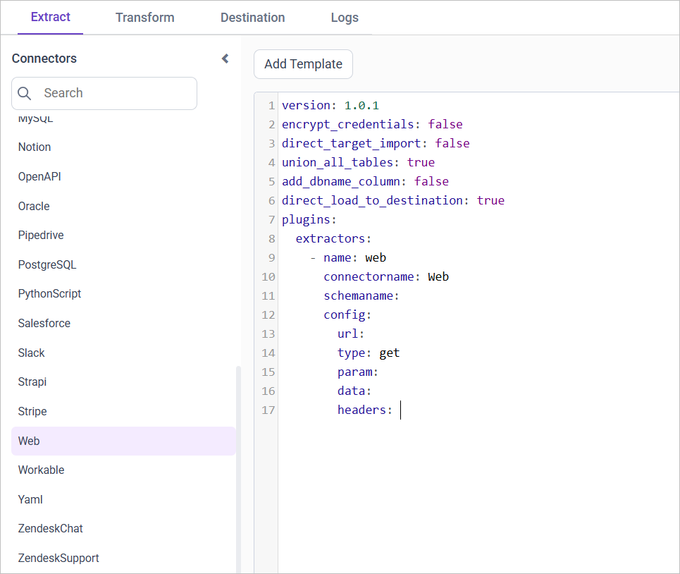
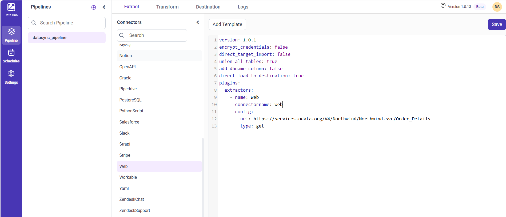

# Connect a Web REST API with Bold Data Hub

The Bold Data Hub Web connector fetches data from a REST API into Bold Reports<sup>®</sup> and supports nested JSON fields.

## What are the limits of the Web connector?

The Bold Data Hub Web connector has the following limitation:

1. Supports JSON response only.

## Connection Properties

The Web connector in Bold Data Hub reads the following properties from the `config` section of a YAML file:

```yaml
url: URL
username: Username
password: Password
type: HHTP method either GET/POST
headers: Header parameters
params: Query Paramaeter value
data: Data value
```

### Example Configuration

The following Bold Data Hub YAML template shows a complete Web extractor configuration:

```yaml
version: 1
encrypt_credentials: false
plugins:
  extractors:
    - name: web
      #Json Response only supported
      connectorname: Web
      config:
        url: url
        # Basic Authentication
        username: username
        password: password
        type: get
        headers: { 'ContentType': 'application/json' }
```

## How do I connect a REST API in Bold Data Hub?

You connect a REST API by creating a project in Bold Data Hub and adding the `Web` template to it.

1. Click the `Data Hub` icon on the Navigation Pane.

    

2. Click `Add Project` and enter a name for the new project.

    

3. Select the newly created project and add the `Web` template.

    

4. Update the required details in the template, using the configuration parameters below.
5. Click **Save** and choose the destination to save the pipeline.

    

Creating a pipeline in Bold Data Hub automatically creates a data source in Bold Reports<sup>®</sup>. The Bold Reports<sup>®</sup> data source is a live data source to the destination database used in Bold Data Hub.

### Configuration Parameters

The Web template in Bold Data Hub uses these parameters:

| Parameter         | Description     |  
|--------------|-----------|
| **URL:**           |   Specify the URL of the web service from which data will be extracted. This URL should point to the API endpoint providing the required data.    |
| **Authentication (Optional):** |**Username:** If the web service requires basic authentication, provide the username here.  **Password:** Corresponding password for basic authentication.|
|**Request Type:**|Specify whether the connector should use the GET or POST method for making requests to the API. |
|**Parameters (Optional):**| Provide parameters required for the API call in JSON format - key-value pairs. These parameters are typically used for filtering or customizing the data returned by the API.
|**Data (Optional):**| If the API call requires any additional data to be sent, specify it here in JSON format - key-value pairs. This data might include payload or request body parameters.|
|**Headers (Optional):**| Include any custom headers required for the API call. These headers should be provided in JSON format, specifying key-value pairs such as content type or authentication tokens.|

## How do I schedule the Web pipeline?

You schedule the Web pipeline in Bold Data Hub from the schedules tab, or you run it on demand.

1. To configure interval-based scheduling, click the schedules tab, select the created pipeline, click the schedule icon, and configure the schedule.

    

    

2. For an on-demand refresh, click the `Run Now` button.

    

3. Check the schedule history with the history option and the logs.

    

4. Click **Logs** to see whether the run is completed and the data source is created in Bold Reports<sup>®</sup>.

    

5. Click the `Edit DataSource` option to view the created tables.

## Frequently asked questions

### Which response formats does the Web connector support?

The Bold Data Hub Web connector supports JSON responses only, including nested JSON fields.

### Which HTTP methods can the Web connector use?

The Bold Data Hub Web connector uses the GET or POST method for requests to the API.

## See also

* [Connect OpenAPI with Bold Data Hub](../open-api/)
* [Schedule Bold Data Hub jobs](../../schedule/)
* [Work with Bold Data Hub pipelines](../../working-with-pipelines/)
