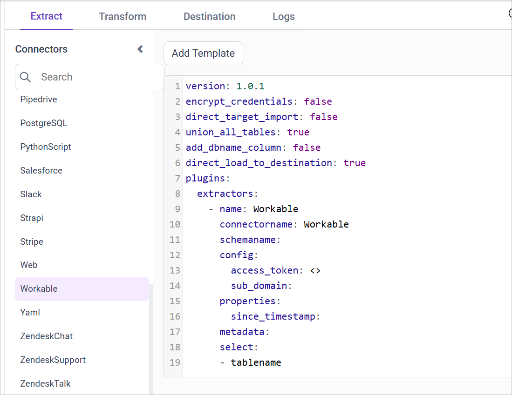
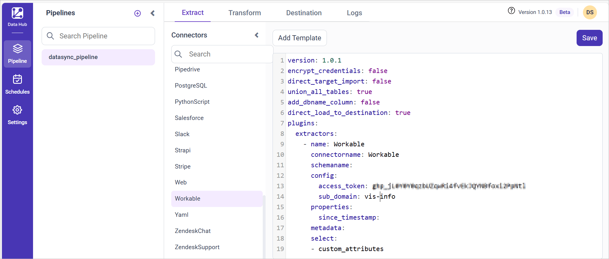

# Connect Workable with Bold Data Hub

The Bold Data Hub Workable connector loads hiring data from Workable into Bold Reports<sup>®</sup>.

**Description:**
Workable is an online platform for posting jobs and managing the hiring process. Employers can create job listings, receive applications, track candidates, collaborate with team members, schedule interviews, and manage the overall hiring workflow with Workable.

## What do I need before I connect Workable?

The Bold Data Hub Workable connector needs the following prerequisites:

**Prerequisites:**
* Application: Python (>=3.10) and Pip
* Python package: source-workable

## How do I get Workable API credentials?

You generate the Workable access token for Bold Data Hub in the Workable integration settings.

**Grab API credentials:**
1. Log in to Workable.
2. Click the user icon at the top right and select **Settings**.
3. Under **RECRUITING**, select **Integrations** on the left.
4. Locate **ACCESS TOKEN** and generate a new token.
5. Carefully copy the new token for pipeline configuration.

## Connection Properties

The Workable connector in Bold Data Hub uses the following connection properties:

**Connection Properties:**
* **Connector Name:** Workable
* **Access Token:** Workable Access token
* **Subdomain:** Workable sub-domain

**Example YAML Configuration:**

### Without Type: Start date

The following Bold Data Hub YAML template shows a Workable extractor configuration without a start date type:

```yaml
version: 1
encrypt_credentials: false
plugins:
  extractors:
    - name: Workable_data
      connectorname: Workable
      config:
        access_token: <ACCESS TOKEN>
        sub_domain: <SUB DOMAIN>
      select:
       -Table1
       -Table2
      properties:
        since_timestamp: <>

```

### With Type: Start date

The following Bold Data Hub YAML template shows a Workable extractor configuration with a start date type:

```yaml
version: 1
encrypt_credentials: false
plugins:
  extractors:
    - name: Workable_data
      connectorname: Workable
      config:
        access_token: <ACCESS TOKEN>
        sub_domain: <SUB DOMAIN>
      select:
       -Table1
       -Table2
      properties:
        since_timestamp: <>

```

## How do I connect Workable in Bold Data Hub?

You connect Workable by creating a project in Bold Data Hub and adding the `Workable` template to it.

1. Click the `Bold Data Hub` icon on the Navigation Pane.

    

2. Click `Add Project` and enter a name for the new project.

    

3. Select the newly created project and add the `Workable` template.

    

4. Update the subdomain and access token in the template, and update the resources in the `select` property.
5. Click **Save** and choose the destination to save the pipeline.

    

Creating a pipeline in Bold Data Hub automatically creates a data source in Bold Reports<sup>®</sup>. The Bold Reports<sup>®</sup> data source is a live data source to the destination database used in Bold Data Hub.

### Which Workable resources are supported?

The Bold Data Hub Workable connector supports the following resources:

```js
The available resources are supported in Workable
- members
- recruiters
- stages
- requisitions
- jobs
- custom_attributes
- events
- candidates
 ```

>**Warning:**

    1. The `Encrypt_Credentials` property should be set to false when updating the new access token on the template. If you have modified other properties, such as 'select' or 'account id', the `Encrypt_Credentials` property must be set to true.  
    2. The default lifetime of the access token is 1 hour. Therefore, you need to convert it to a long-lived access token to use the same token for 60 days. Existing tables should be maintained even if the token has expired or is being used as an invalid token.

## How do I schedule the Workable pipeline?

You schedule the Workable pipeline in Bold Data Hub from the schedules tab, or you run it on demand.

1. To configure interval-based scheduling, click the schedules tab, select the created pipeline, click the schedule icon, and configure the schedule.

    

    

2. For an on-demand refresh, click the `Run Now` button.

    

3. Check the schedule history with the history option and the logs.

    

4. Click **Logs** to see whether the run is completed and the data source is created in Bold Reports<sup>®</sup>.

    

5. Click the `Edit DataSource` option to view the created tables.

## Frequently asked questions

### Which Workable resources can Bold Data Hub load?

The Bold Data Hub Workable connector supports members, recruiters, stages, requisitions, jobs, custom_attributes, events, and candidates.

### Which Python version does the Workable connector need?

The Workable connector needs Python (>=3.10) and Pip, plus the source-workable Python package.

## See also

* [Schedule Bold Data Hub jobs](../../schedule/)
* [Work with Bold Data Hub pipelines](../../working-with-pipelines/)
* [Bold Data Hub connectors list](../)
