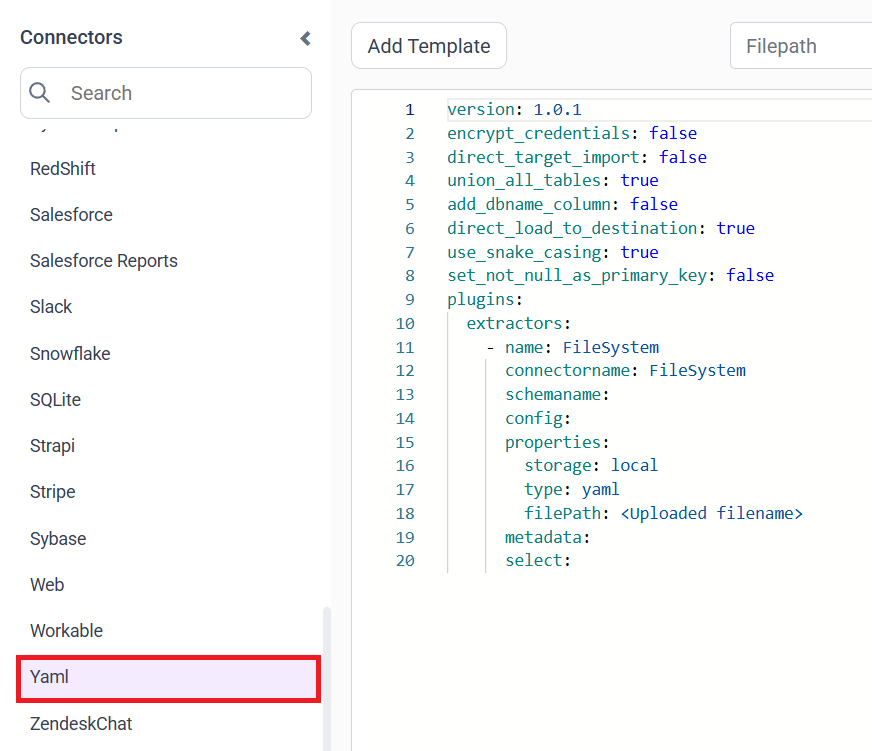
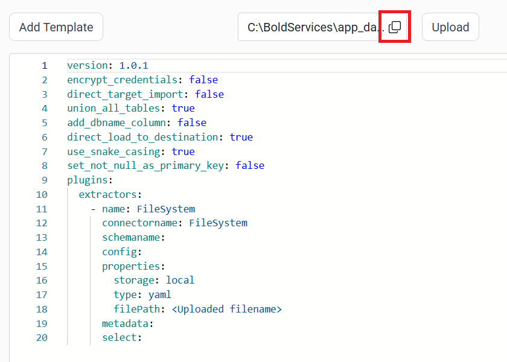
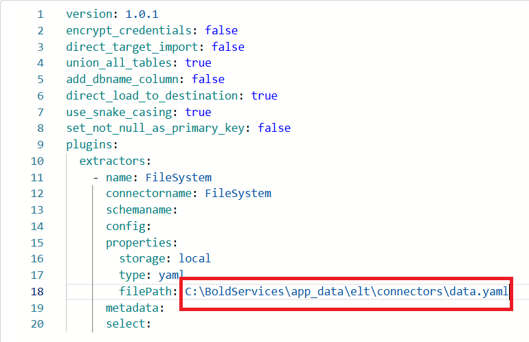
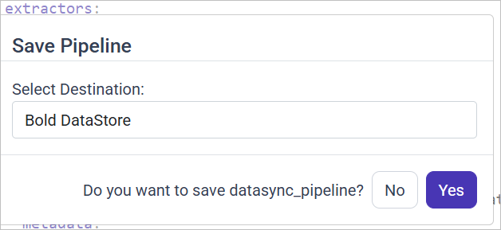

# Connect a YAML file with Bold Data Hub

The Bold Data Hub YAML connector loads data from a YAML file into {{site.productNameTM}}. YAML is a human-readable format used to store and structure data. YAML is commonly used in configuration files, data storage, or transmission in applications. YAML is easy to write and understand.

## Example Configuration

The following Bold Data Hub YAML template shows a complete YAML file extractor configuration:

```yaml
version: 1.0.1
encrypt_credentials: false
union_all_tables: true
add_dbname_column: false
use_snake_casing: true
plugins:
  extractors:
  - name: FileSystem
      connectorname: FileSystem
      schemaname:
      config:
      properties:
        storage: local
        type: yaml
        filePath: C:\BoldServices\app_data\elt\connectors\empdata.yml
      metadata:
      select:
```

## How do I connect a YAML file in Bold Data Hub?

You connect a YAML file by creating a pipeline in Bold Data Hub, adding the `Yaml` template, and uploading your file.

1. Click the `Data Hub` icon on the Navigation Pane.

    

2. Click `Add Pipeline` and enter a name for the new pipeline.

    

3. Select the newly created pipeline and add the `Yaml` template.

    

4. Click the **Upload File** button to upload your YAML file.

    

5. Copy the file path and paste it into the filePath property.

    

    

6. Click **Save** and choose the destination to save the pipeline.

    

Creating a pipeline in Bold Data Hub automatically creates a data source in {{site.productNameTM}}. The {{site.productNameTM}} data source is a live data source to the destination database used in Bold Data Hub.


## How do I schedule the YAML pipeline?

You schedule the YAML pipeline in Bold Data Hub from the schedules tab, or you run it on demand.

1. To configure interval-based scheduling, click the schedules tab, select the created pipeline, click the schedule icon, and configure the schedule.

    

    

2. For an on-demand refresh, click the `Run Now` button.

    

3. Check the schedule history with the history option and the logs.

    

4. Click **Logs** to see whether the run is completed and the data source is created in {{site.productNameTM}}.

    

## Frequently asked questions

### Which connector name does a YAML file pipeline use?

A YAML file pipeline in Bold Data Hub uses the `FileSystem` connector with `type: yaml` and `storage: local` in its properties.

### Where does Bold Data Hub read the YAML file from?

Bold Data Hub reads the YAML file from the path set in the filePath property, after you upload the file with **Upload File**.

## See also

* [Schedule Bold Data Hub jobs](../../schedule/)
* [Work with Bold Data Hub pipelines](../../working-with-pipelines/)
* [Bold Data Hub connectors list](../)
