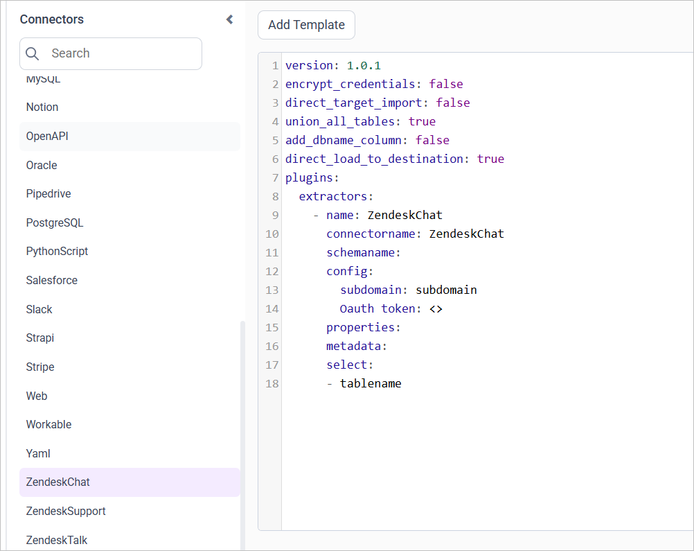
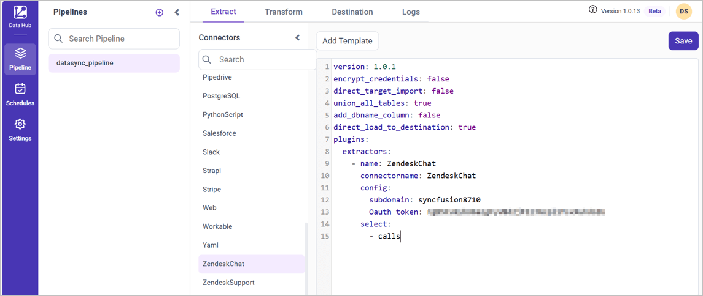

# Connect Zendesk Chat with Bold Data Hub

The Bold Data Hub Zendesk Chat connector loads data from Zendesk Chat into {{site.productNameTM}}. You need your Zendesk subdomain and a Zendesk Chat OAuth token to set it up.

## How do I find my Zendesk subdomain?

Log in to Zendesk to find the subdomain that the Bold Data Hub Zendesk Chat connector uses. The subdomain appears in the URL. For example, for ``www.yourhub.zendesk.com``, the subdomain is `yourhub`.

## How do I get a Zendesk Chat OAuth token?

You generate the Zendesk Chat OAuth token for Bold Data Hub by adding an API client in Zendesk Chat and authorizing it in your browser.

1. Access Zendesk Chat directly or through the **Chat** option in the top right corner of the Zendesk product.
2. Navigate to **Settings** > **Account** > **API** > **Add API client**.
3. Fill in the client name, company, and redirect URLs (default: `http://localhost:8080`).
4. Record the **CLIENT_ID** and **SUBDOMAIN**.
5. Format the following URL with your own CLIENT_ID and SUBDOMAIN, paste it into a new browser tab, and press Enter.
6. The call is made. You may be prompted to log in and select **Allow** to generate the token.
7. If the call is successful, your browser's address field displays your new OAuth token (returned as the `access_token` value).
8. Despite any error messages in the browser's main window, if 'access_token' appears in the browser's URL field, the process was successful.
9. Safely store the OAuth token for authentication when you retrieve data from Zendesk Chat.
10. For other ways to get a Zendesk Chat token, see the [Zendesk Chat API documentation](https://developer.zendesk.com/rest_api/docs/chat/introduction).

## Connection Properties

The Zendesk Chat connector in Bold Data Hub reads the following properties from the config section of a YAML file:

```yaml
Connectorname: Zendesk
subdomain: Zendesk sub-domain
Oauth_token: OAuth token

```

### Metadata Properties

The metadata properties of the Bold Data Hub Zendesk Chat template define the mode of data refresh. There are two modes: INCREMENTAL and `FULL_TABLE`. Both modes support only columns with DateTime data types.

<table>
    <tr>
        <td></td>
        <td></td>
        <td></td>
    </tr>
    <tr>
        <td>INCREMENTAL</td>
        <td>

```yaml
metadata:
  TableName:
    replication_method: INCREMENTAL
    replication_key: Column name
    replication_value: column value that data starts from
```

</td>
          <td>This mode fetches data from the date column specified in the replication key starting from the date specified in the replication value. Once scheduled, the replication value is updated according to the interval_type and interval_value from the imported data. For example, if the interval_type is set to 'year' and the interval_value is set to '1', the first schedule will fetch records from January 1, 2000 to December 31, 2000. In the next schedule, it will fetch records from January 1, 2001 to December 31, 2001, and so on.</td>
    </tr>
    <tr>
        <td>FULL_TABLE</td>
        <td>

```yaml
  metadata:
  TableName:
    replication_method: FULL_TABLE
    replication_key: Column name
    replication_value: column value that data starts from
    interval_type: days/hours/minutes/year/month
    interval_value: integer value to add in interval type

```

</td>
        <td>This mode fetches data from the date column mentioned in the replication key from the start date as mentioned in the replication value. Once it is scheduled, the replication value is updated based on the interval_type and interval_value from the imported data. For ex  set interval_type as 'year' and intervalue value as '1'.In first schedule, will fetch the record from Jan 1, 2000 to Dec 31, 2000. In next schedule, will fetch the record from Jan 1, 2001 to Dec 31, 2001 and so on.</td>
    </tr>
</table>

### Examples

The following Bold Data Hub YAML templates show complete Zendesk Chat extractor configurations for each refresh mode.

#### INCREMENTAL

```yaml
version: 1
encrypt_credentials: false
plugins:
  extractors:
    - name: zendesk_data
      connectorname: zendesk
      config:
        subdomain: <SUBDOMAIN>
        Oauth token: <OAUTH TOKEN>
      Select:
        - TABLE1
        - TABLE2
      metadata:
        TABLE1:
          replication_method: FULL_TABLE
          replication_key: last_modified_on
          replication_value: '2023-07-19 00:00:00'
        TABLE2:
          replication_method: FULL_TABLE
          replication_key: last_modified_on
          replication_value: '2023-07-19 00:00:00'
```

#### FULL_TABLE

```yaml
version: 1
encrypt_credentials: false
plugins:
  extractors:
    - name: zendesk_data
      connectorname: zendesk
      config:
        subdomain: <SUBDOMAIN>
        Oauth token: <OAUTH TOKEN>
      Select:
        - TABLE1
        - TABLE2
        metadata:
          TABLE1:
            replication_method: FULL_TABLE
            replication_key: last_modified_on
            replication_value: '2023-07-19 00:00:00'
            interval_type: days
            interval_value: 6
          TABLE2:
            replication_method: FULL_TABLE
            replication_key: last_modified_on
            replication_value: '2023-07-19 00:00:00'
            interval_type: days
            interval_value: 6
```

## How do I connect Zendesk Chat in Bold Data Hub?

You connect Zendesk Chat by creating a project in Bold Data Hub and adding the `Zendesk Chart` template to it.

1. Click the `Bold Data Hub` icon on the Navigation Pane.

    

2. Click `Add Project` and enter a name for the new project.

    

3. Select the newly created project and add the `Zendesk Chart` template.

    

4. Update the subdomain and OAuth token in the template, and update the resources in the `select` property.
5. Save the pipeline to the Reports Data Store.

    

Creating a pipeline in Bold Data Hub automatically creates a data source in {{site.productNameTM}}. The {{site.productNameTM}} data source is a live data source to the destination database used in Bold Data Hub.

>**Warning:**

    1. The `Encrypt_Credentials` property should be set to false when updating the new access token on the template. If you have modified other properties, such as 'select' or 'account id', the `Encrypt_Credentials` property must be set to true.  
    2. The default lifetime of the access token is 1 hour. Therefore, you need to convert it to a long-lived access token to use the same token for 60 days. Existing tables should be maintained even if the token has expired or is being used as an invalid token.

## How do I schedule the Zendesk Chat pipeline?

You schedule the Zendesk Chat pipeline in Bold Data Hub from the schedules tab, or you run it on demand.

1. To configure interval-based scheduling, click the schedules tab, select the created pipeline, click the schedule icon, and configure the schedule.

    

    

2. For an on-demand refresh, click the `Run Now` button.

    

3. Check the schedule history with the history option and the logs.

    

4. Click **Logs** to see whether the run is completed and the data source is created in {{site.productNameTM}}.

    

5. Click the `Edit DataSource` option to view the created tables.

## Frequently asked questions

### Which values does the Zendesk Chat connector need?

The Bold Data Hub Zendesk Chat connector needs your Zendesk subdomain and a Zendesk Chat OAuth token.

### How do I know the Zendesk Chat token was generated?

If 'access_token' appears in the browser's URL field, the process was successful, even if the main window shows an error.

## See also

* [Connect Zendesk Support with Bold Data Hub](../zendesk-support/)
* [Schedule Bold Data Hub jobs](../../schedule/)
* [Work with Bold Data Hub pipelines](../../working-with-pipelines/)
