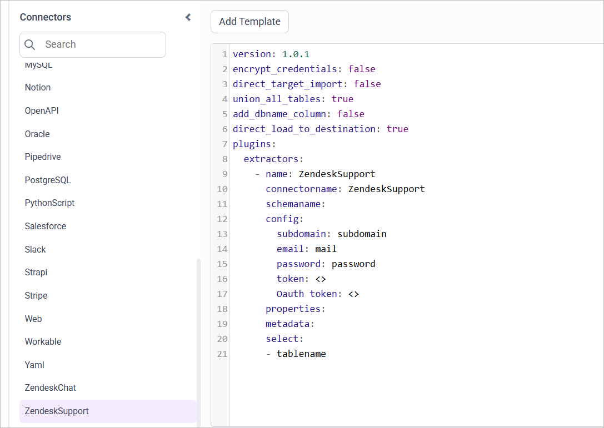
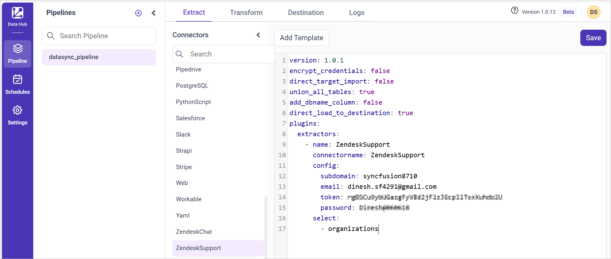

# Connect Zendesk Support with Bold Data Hub

The Bold Data Hub Zendesk Support connector loads customer service data from Zendesk into Bold Reports<sup>®</sup>. Zendesk is a cloud-based customer service and support platform with ticket management, live chat, and more.

## How does Bold Data Hub authenticate to Zendesk Support?

The Bold Data Hub Zendesk Support connector authenticates with one of the following three methods:
1. Method 1 (subdomain + email address + password)
2. Method 2 (subdomain + email address + API token)
3. Method 3 (subdomain + OAuth token)

## How do I find my Zendesk subdomain?

Log in to Zendesk to find the subdomain that the Bold Data Hub Zendesk Support connector uses. The subdomain appears in the URL. For example, for `www.yourhub.zendesk.com`, the subdomain is `yourhub`.

## How do I get a Zendesk Support API token?

You create the Zendesk Support API token for Bold Data Hub in the Zendesk Admin Center.

1. In Zendesk (top right), select **Admin Center**.
2. Choose **Apps and Integrations**.
3. Navigate to **APIs** and select **Zendesk API**. Activate **Password access** and **Token access**.
4. Click **Add API token**, provide a description, and write down the API token.
5. The token is displayed only once, so keep it in a safe place.

## How do I get a Zendesk Support OAuth token?

You get the Zendesk Support OAuth token for Bold Data Hub by first obtaining a client ID and then requesting a complete token with it.

1. Obtain the client ID through the Zendesk API. Send the curl request and note the client ID in the response.
2. Alternatively, retrieve the client ID through OAuth.
3. Obtain a complete token using the client ID you acquired, following the Zendesk OAuth instructions.
4. After you send the request, you receive a complete token that you can use to set up Zendesk Support.

## Connection Properties

The Zendesk Support connector in Bold Data Hub reads the following properties from the config section of the ``yaml`` file:

```yaml
Connector Name: Zendesk
Subdomain: Zendesk sub-domain
Email: Mail id used for login
Password: Password for the account
Token: API Token
OAuth Token: OAuth token
```

## Metadata Properties

The metadata properties of the Bold Data Hub Zendesk Support template define the mode of data refresh. There are two modes: INCREMENTAL and `FULL_TABLE`. Both modes support only columns with DateTime datatype.

<table>
    <tr>
        <td></td>
        <td></td>
        <td></td>
    </tr>
    <tr>
        <td>INCREMENTAL</td>
        <td>

```yaml
metadata:
  TableName:
    replication_method: INCREMENTAL
    replication_key: Column name
    replication_value: column value that data starts from
```

</td>
        <td>This mode will fetch data from the date column mentioned as the replication key, starting from the date specified in the replication_value. Once it is scheduled, the replication_value will be updated automatically from the imported data.</td>
    </tr>
    <tr>
        <td>FULL_TABLE</td>
        <td>

```yaml
  metadata:
  TableName:
    replication_method: FULL_TABLE
    replication_key: Column name
    replication_value: column value that data starts from
    interval_type: days/hours/minutes/year/month
    interval_value: integer value to add in interval type

```

</td>
        <td>This mode fetches data from the date column mentioned in the replication key from the start date as mentioned in the replication value. Once it is scheduled, the replication value is updated based on the interval_type and interval_value from the imported data. For ex  set interval_type as 'year' and intervalue value as '1'.In first schedule, will fetch the record from Jan 1, 2000 to Dec 31, 2000. In next schedule, will fetch the record from Jan 1, 2001 to Dec 31, 2001 and so on.</td>
    </tr>
</table>

### Example

The following Bold Data Hub YAML templates show complete Zendesk Support extractor configurations for each refresh mode.

#### FULL_TABLE

```yaml
version: 1.0.1
encrypt_credentials: false
plugins:
  extractors:
    - name: zendesk_data
      connectorname: zendesk
      config:
        subdomain: <SUBDOMAIN>
        email: <EMAIL>
        password: <PASSWORD>
        token: <TOKEN>
        Oauth token: <OAUTH TOKEN>
    Select:
      - TABLE1
      - TABLE2
    metadata:
      TABLE1:
        replication_method: FULL_TABLE
        replication_key: last_modified_on
        replication_value: '2023-07-19 00:00:00'
        interval_type: days
        interval_value: 6
      TABLE2:
        replication_method: FULL_TABLE
        replication_key: last_modified_on
        replication_value: '2023-07-19 00:00:00'
        interval_type: days
        interval_value: 6
```

#### INCREMENTAL

```yaml
version: 1.0.1
encrypt_credentials: false
plugins:
  extractors:
    - name: zendesk_data
      connectorname: zendesk
      config:
        subdomain: <SUBDOMAIN>
        email: <EMAIL>
        password: <PASSWORD>
        token: <TOKEN>
        Oauth token: <OAUTH TOKEN>
    Select:
      - TABLE1
      - TABLE2
    metadata:
      TABLE1:
        replication_method: FULL_TABLE
        replication_key: last_modified_on
        replication_value: '2023-07-19 00:00:00'
      TABLE2:
        replication_method: FULL_TABLE
        replication_key: last_modified_on
        replication_value: '2023-07-19 00:00:00'
```

## How do I connect Zendesk Support in Bold Data Hub?

You connect Zendesk Support by creating a project in Bold Data Hub and adding the `Zendesk Support` template to it.

1. Click the `Bold Data Hub` icon on the Navigation Pane.

    

2. Click `Add Project` and enter a name for the new project.

    

3. Select the newly created project and add the `Zendesk Support` template.

    

4. Update the subdomain, email address, password, or token (API or OAuth) in the template, and update the resources in the `select` property.
5. Save the pipeline to the Data Store.

    

Creating a pipeline in Bold Data Hub automatically creates a data source in Bold Reports<sup>®</sup>. The Bold Reports<sup>®</sup> data source is a live data source to the destination database used in Bold Data Hub.

### Which Zendesk Support resources are supported?

The Bold Data Hub Zendesk Support connector supports the following resources:

```yaml
The available resources are supported in Zendesk Support
- users
- sla_policies
- groups
- organizations
- brands
 ```

>**Warning:**

    1. The `Encrypt_Credentials` property should be set to false when updating the new access token on the template. If you have modified other properties, such as 'select' or 'account id', the `Encrypt_Credentials` property must be set to true.  
    2. The default lifetime of the access token is 1 hour. Therefore, you need to convert it to a long-lived access token to use the same token for 60 days. Existing tables should be maintained even if the token has expired or is being used as an invalid token.

## How do I schedule the Zendesk Support pipeline?

You schedule the Zendesk Support pipeline in Bold Data Hub from the schedules tab, or you run it on demand.

1. To configure interval-based scheduling, click the schedules tab, select the created pipeline, click the schedule icon, and configure the schedule.

    

    

2. For an on-demand refresh, click the `Run Now` button.

    

3. Check the schedule history with the history option and the logs.

    

4. Click **Logs** to see whether the run is completed and the data source is created in Bold Reports<sup>®</sup>.

    

5. Click the `Edit DataSource` option to view the created tables.

## Frequently asked questions

### Which Zendesk Support resources can Bold Data Hub load?

The Bold Data Hub Zendesk Support connector supports users, sla_policies, groups, organizations, and brands.

### Can I view the Zendesk API token again later?

No. Zendesk displays the API token only once, so keep it in a safe place.

## See also

* [Connect Zendesk Chat with Bold Data Hub](../zendesk-chat/)
* [Schedule Bold Data Hub jobs](../../schedule/)
* [Work with Bold Data Hub pipelines](../../working-with-pipelines/)
