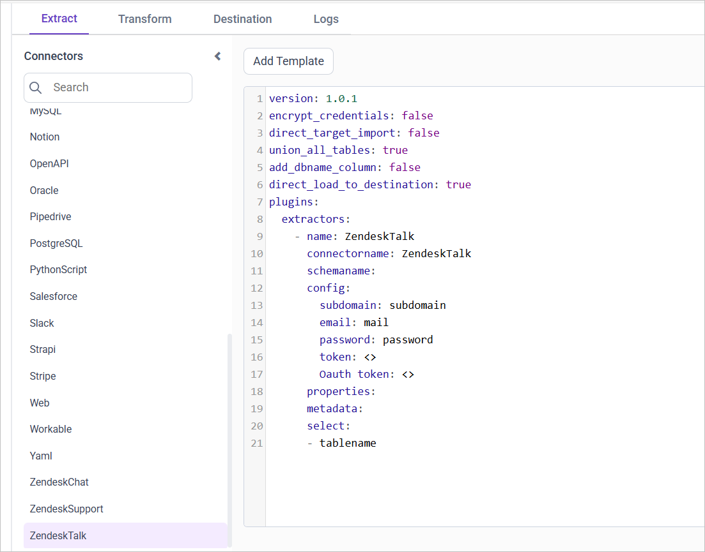
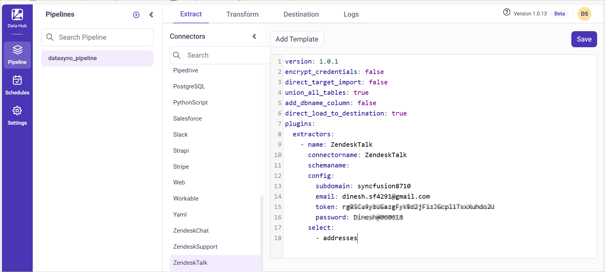

# Zendesk Talk data migration configuration in Bold Data Hub

The Bold Data Hub Zendesk Talk connector fetches data with the Zendesk Talk API and loads it into Bold Reports<sup>®</sup>. You configure the connector in a YAML template, choose a data refresh mode, and schedule the pipeline to keep the data current.

## What does the Zendesk Talk connector do?

The Bold Data Hub Zendesk Talk connector fetches data with the Zendesk Talk API and loads it into Bold Reports<sup>®</sup>. The process for obtaining credentials for Zendesk Talk mirrors that of Zendesk Support. You can use existing Zendesk Support credentials or create new ones.

## Connection Properties

The Bold Data Hub Zendesk Talk connection properties live in the `config` section of the YAML file. The `config` section contains the following properties:

```yaml
Connectorname: Zendesk
subdomain: Zendesk sub-domain
Email: Email address used for login
Password: Password for the account
Token: API Token
Oauth_token: OAuth token
```

## Metadata Properties

The Bold Data Hub metadata properties define two modes of data refresh: INCREMENTAL and ``FULL_TABLE``. The replication key supports only DateTime datatype columns.

<table>
    <tr>
        <td></td>
        <td></td>
        <td></td>
    </tr>
    <tr>
        <td>INCREMENTAL</td>
        <td>

```yaml
metadata:
  TableName:
    replication_method: INCREMENTAL
    replication_key: Column name
    replication_value: column value that data starts from
```

</td>
        <td>This mode retrieves data from the date column specified in the replication key starting from the designated start date in the replication value. Once scheduled, the replication value is automatically updated based on the imported data.</td>
    </tr>
    <tr>
        <td>FULL_TABLE</td>
        <td>

```yaml
metadata:
  TableName:
    replication_method: FULL_TABLE
    replication_key: Column name
    replication_value: column value that data starts from
    interval_type: days/hours/minutes/year/month
    interval_value: integer value to add in interval type
```

</td>
        <td>This mode retrieves data from the date column specified in the replication key starting from the specified start date in the replication value. Once scheduled, the replication value is automatically updated from the imported data.</td>
    </tr>
</table>

### What does an example configuration look like?

The following Bold Data Hub YAML templates show a complete Zendesk Talk configuration for each refresh mode.

#### FULL_TABLE

```YAML
version: 1.0.1
encrypt_credentials: false
plugins:
  extractors:
    - name: zendesk_data
      connectorname: zendesk
      config:
        subdomain: subdomain
        email: mail
        password: password
        token: <>
        Oauth token: <>
      Select:
        - TABLE1
        - TABLE2
      metadata:
        TABLE1:
          replication_method: FULL_TABLE
          replication_key: last_modified_on
          replication_value: '2023-07-19 00:00:00'
          interval_type: days
          interval_value: 6
        TABLE2:
          replication_method: FULL_TABLE
          replication_key: last_modified_on
          replication_value: '2023-07-19 00:00:00'
          interval_type: days
          interval_value: 6

```

#### INCREMENTAL

```YAML
version: 1.0.1
encrypt_credentials: false
plugins:
  extractors:
    - name: zendesk_data
      connectorname: zendesk
      config:
        subdomain: subdomain
        email: mail
        password: password
        token: <>
        Oauth token: <>
      Select:
        - TABLE1
        - TABLE2
      metadata:
        TABLE1:
          replication_method: FULL_TABLE
          replication_key: last_modified_on
          replication_value: '2023-07-19 00:00:00'
        TABLE2:
          replication_method: FULL_TABLE
          replication_key: last_modified_on
          replication_value: '2023-07-19 00:00:00'

```

## How do I configure Bold Data Hub to connect to Zendesk Talk?

You connect Bold Data Hub to Zendesk Talk by creating a project, adding the `Zendesk Talk` template, and saving it to the Bold Reports<sup>®</sup> Data Store.

  1. Click the `Bold Data Hub` icon on the Navigation Pane.

  

  1. Click `Add Project` and provide the name for the new project.
  
   
  
  1. Select the newly created project and add the `Zendesk Talk` template.

  
  
  1. Update the subdomain, email address, password or token (API or OAuth) in the template. Update the resources on the `select` property and save it to the Bold Reports<sup>®</sup> Data Store.

  
  
  1. Creating a Pipeline in Bold Data Hub automatically creates a Data Source in Bold Reports<sup>®</sup>. The Bold Reports<sup>®</sup> Data Source is a live data source to the destination database used in Bold Data Hub.

### Which Zendesk Talk resources are supported?

Bold Data Hub supports the following Zendesk Talk resources in the `select` property:

```yaml
The available resources are supported in Zendesk Talk
- calls
- addresses
- greeting_categories
- greetings
- ivrs
- phone_numbers
- settings
- lines
- agents_activity
```

>**Warning:**

    1. The <b> Encrypt_Credentials </b> property should be set to false when updating the new access token on the template. If you have modified other properties, such as 'select' or 'account id', the <b> Encrypt_Credentials </b> property must be set to true.  
    2. The default lifetime of the access token is 1 hour. Therefore, you need to convert it to a long-lived access token to use the same token for 60 days. Existing tables should be maintained even if the token has expired or is being used as an invalid token.

### How do I schedule a Bold Data Hub job?

You schedule a Bold Data Hub job from the **Schedules** tab, or run it on demand with **Run Now**.

1. To configure interval-based scheduling, click the schedules tab, select the created pipeline, click the schedule icon, and configure it. The images show the schedules tab and the schedule dialog.


1. For on-demand refresh, click the Run Now button.

.

1. Check the schedule history with the history option and the logs.


1. Click Logs to see whether the run is completed and the data source is created in Bold Reports<sup>®</sup>.


1. Click the `Edit DataSource` option to view the created tables.

## Frequently asked questions

### Can I reuse my Zendesk Support credentials for Zendesk Talk?

Yes. The process for obtaining Zendesk Talk credentials mirrors that of Zendesk Support, so you can use existing Zendesk Support credentials or create new ones.

### Which refresh modes does the Zendesk Talk connector support?

The Bold Data Hub Zendesk Talk connector supports INCREMENTAL and FULL_TABLE refresh modes. Both modes support only DateTime datatype columns.

### How long is the access token valid?

The default lifetime of the access token is 1 hour. Convert it to a long-lived access token to use the same token for 60 days.

## See also

* [Working with pipelines in Bold Data Hub](./../../working-with-pipelines/)
* [Schedule Bold Data Hub jobs](./../../schedule/)
* [Bold Data Hub data store](./../../data-store/)
* [Zendesk Support connector](./../zendesk-support/)
