# Bold Data Hub data store destinations

Bold Data Hub in {{site.productNameTM}} loads pipeline data into a data store destination whose credentials you set in the **Settings** tab.

## Which destinations does Bold Data Hub support?

Bold Data Hub supports the following data store destinations. You set destination credentials in the **Settings** tab.

>1. Bold IMDB Datastore 
>2. PostgreSQL 
>3. Apache Doris 
>4. SQL server 
>5. MySQL 
>6. Google BigQuery 
>7. Snow Flake 
>8. Oracle 
>9. ClickHouse 
>10. Firebolt 
>11. Teradata 
>12. SAP HANA Cloud 
>13. IBMDB2 
>14. Azure Synapse 
>15. Amazon RedShift 
>16. MinIO 
>17. Star Rocks

## Can I configure multiple destinations of the same type?

Yes. Bold Data Hub lets you configure multiple data store destinations with the same server type and load data into them. This is common when you have multiple databases of the same type, for example multiple MySQL or PostgreSQL databases.

You might use them for different environments, such as development, testing, staging, or production. You might also use them for different segments of business operations.

## Which destinations do not support data source creation?

Bold Data Hub does not support data source creation for the following destinations.

>**Note:** data source creation is not supported for the following:
>1. Teradata
>2. SAP HANA Cloud
>3. IBMDB2
>4. Firebolt
>5. MinIO
>6. GoogleBigQuery

## How do I add a data store destination?

You add a Bold Data Hub data store destination from the **Settings** tab in five steps.

Step 1: Click **Settings**.

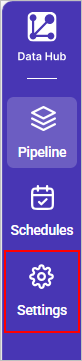

Step 2: Choose the **Connection Type**.

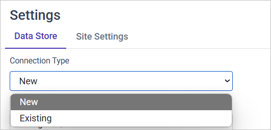

* **New**: Choose this option if you are creating a new connection to a destination for which you have not previously created credentials.

* **Existing**: Select this option if you are updating or modifying the credentials or settings of a connection that you have already set up.

Step 3: Choose the destination where you want to move the data.

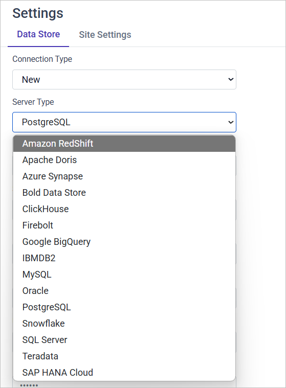

Step 4: Enter the credentials for the respective destination.

Step 5: Click **Save** to save the credentials from the {{site.productNameTM}} Data Store. If all the given credentials are valid, the “Datastore settings are saved successfully” message appears near the **Save** button.

## Bold IMDB Datastore

The Bold IMDB Datastore fetches the destination credentials from the {{site.productNameTM}} Data Store configuration.

The data is moved based on the credentials given in the {{site.productNameTM}} data store.

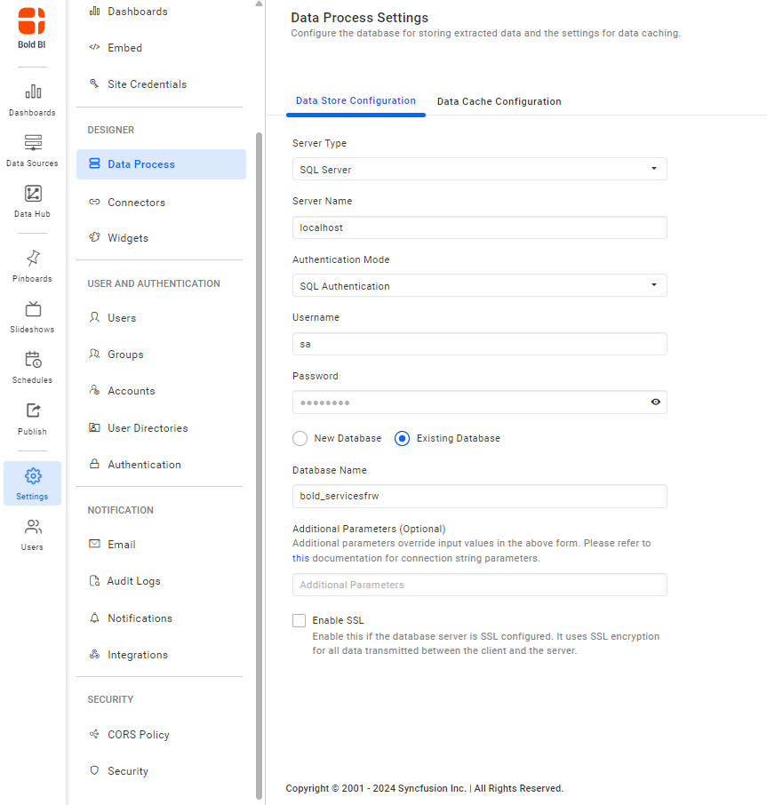

## PostgreSQL

Bold Data Hub needs the following credentials for a PostgreSQL destination:
1. Server name/Host name
2. Port number (default port number is 5432)
3. Maintenance Database : The maintenance DB is a default database for users and applications to connect to. On PostgreSQL 8.1 and above, the maintenance DB is normally called ``postgres``.
4. Username
5. Password
6. Check the SSL (Secure Sockets Layer) checkbox if needed.
7. Database name : To move the data to an existing database on the server, select the existing database radio button and enter the database name in the textbox. To create a new database, select new database and enter the database name in the textbox.

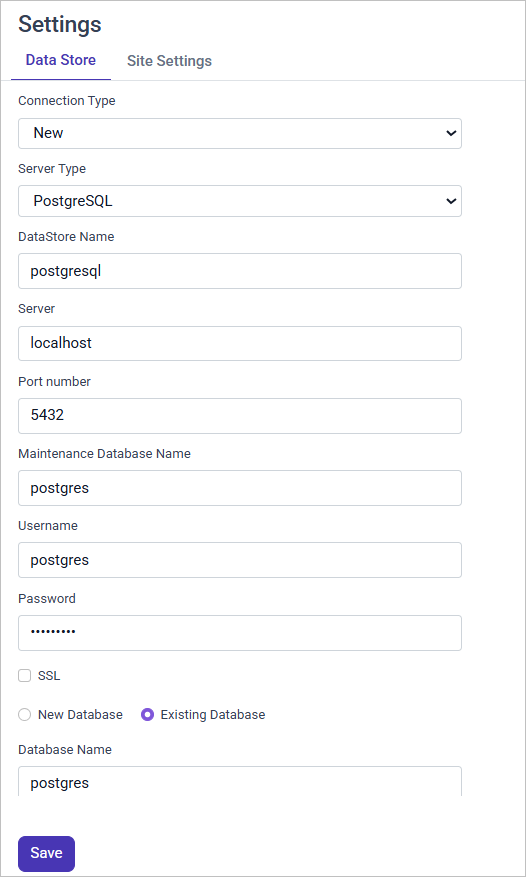

## Apache Doris

Bold Data Hub connects to an Apache Doris destination with the credentials you enter in the settings shown below.

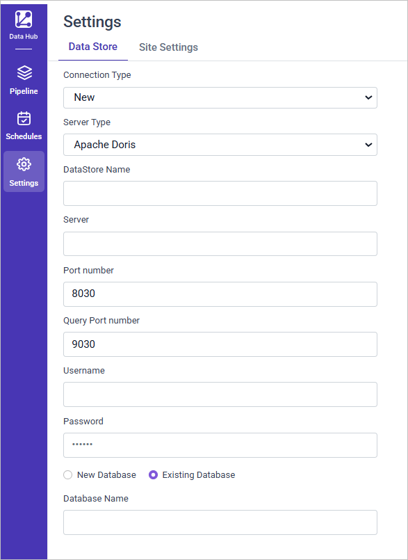

Click **Save** to save the credentials.
If all the given credentials are valid, the “Datastore settings are saved successfully” message appears near the **Save** button.

## SQL Server

Bold Data Hub needs the following credentials for a SQL Server destination:

1. Server name/Host name
2. Username
3. Password
4. Check the SSL (Secure Sockets Layer) checkbox if needed.
5. Database name : To move the data to an existing database on the server, select the existing database radio button and enter the database name in the textbox. To create a new database, select new database and enter the database name in the textbox.

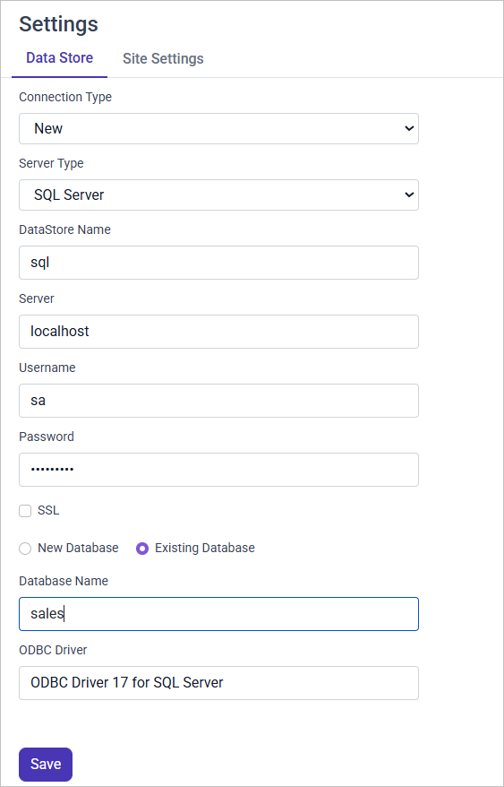

## MySQL

Bold Data Hub needs the following credentials for a MySQL destination:

1. Server name/Host name
2. Port number (default port number is 3306)
3. Username
4. Password
5. Check the SSL (Secure Sockets Layer) checkbox if needed.
6. Database name : To move the data to an existing database on the server, select the existing database radio button and enter the database name in the textbox. To create a new database, select new database and enter the database name in the textbox.

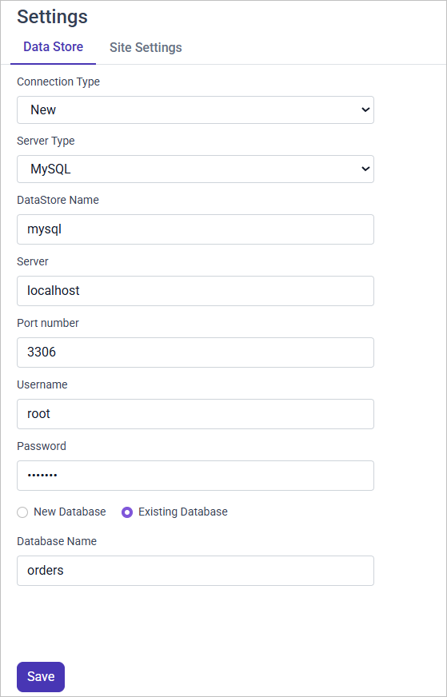

## Snow Flake

Bold Data Hub needs the following credentials for a Snowflake destination:

1. **Server**: Enter the server name.
    Example: `account.snowflakecomputing.com`
2. **Username** : Enter your Snowflake username.
3. **Password** : Input your Snowflake password.
4. **Warehouse**: Enter your Snowflake warehouse name.
5. **Database** : Enter your Snowflake database name.

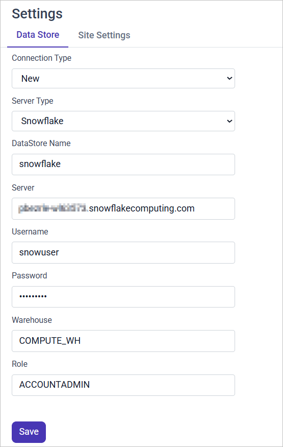

Click **Save** to save the credentials.
If all the given credentials are valid, the “Datastore settings are saved successfully” message appears near the **Save** button.

## Oracle

Bold Data Hub needs the following credentials for an Oracle destination:

1. **Host**: Enter the hostname or IP address of the Oracle database server.
2. **Port**: Enter the port number Oracle is listening on (default is 1521).
3. **Service Instance Name**: Provide the Oracle service name.
4. **Username**: Input your Oracle database username.
5. **Password**: Input your Oracle database password.
6. **Database**: Input your Oracle database name (Database name should be same as user name).

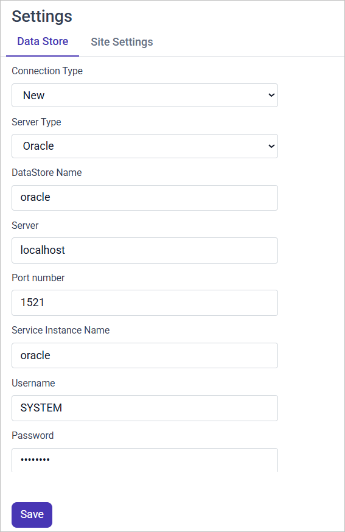

Click **Save** to save the credentials.
If all the given credentials are valid, the “Datastore settings are saved successfully” message appears near the **Save** button.

## Google BigQuery

Bold Data Hub needs the following credentials for a Google BigQuery destination:

1. **Project ID** : Enter the Google BigQuery project ID.
2. **File Path** : Upload the Google BigQuery service account JSON file.

See [Steps to download the service account JSON file](../data-store/#steps-to-download-the-service-account-json-file) to learn how to get the Google BigQuery service account JSON file.

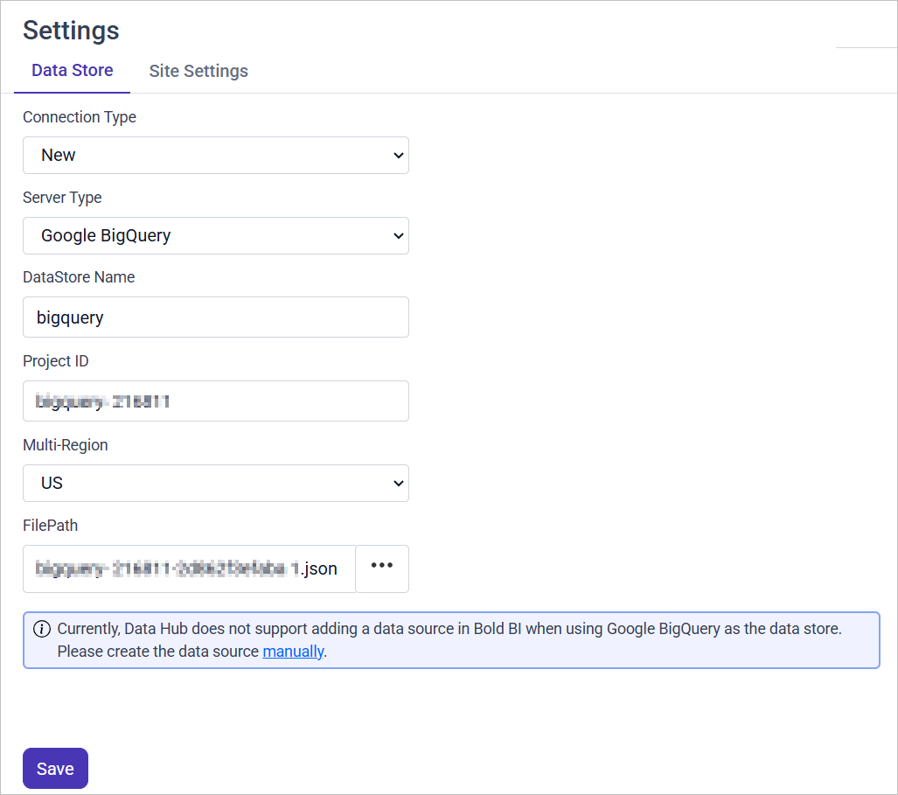

Click **Save** to save the credentials.
If all the given credentials are valid, the “Datastore settings are saved successfully” message appears near the **Save** button.

### Steps to download the Service Account JSON file:

You download the Google BigQuery service account JSON file for Bold Data Hub from the Google Cloud console.

1. Log in to or create a Google Cloud account.
2. Sign up for or log in to the [Google Cloud Platform](https://console.cloud.google.com/) in your web browser.
3. Create a new Google Cloud project.
4. After you reach the [Google Cloud console welcome page](https://console.cloud.google.com/welcome), click the project selector in the top left. Click the **New Project** button, name the project, and then click the **Create** button.
5. Create a service account and grant BigQuery permissions.
You then need to create a [Google Cloud service account](https://cloud.google.com/iam/docs/creating-managing-service-accounts#creating). After clicking the **Go to Create service account** button on the linked docs page, select the project you created and name the service account whatever you like.
6. Click the **Continue** button and grant the following roles, so that Bold Data Hub can create schemas and load data:
· BigQuery Data Editor
· BigQuery Job User
· BigQuery Read Session User
  You don't need to grant users access to this service account now, so click the **Done** button.
7. Download the service account JSON.
    On the service accounts table page that opens after you click **Done**, select the three dots under the **Actions** column for your service account. Then, select **Manage keys**.
    On the next page, click the **Add key** button, then the **Create new key** button. Keep the preselected JSON option and click the **Create** button.

A JSON file that includes your service account private key is then downloaded.

>**Note:** Bold Data Hub does not support creating a data source in {{site.productNameTM}} when using Google Bigquery as the data store.

## ClickHouse

Bold Data Hub needs the following credentials for a ClickHouse destination:

1. Select the server type as Clickhouse.
2. Fill in your Clickhouse credentials as follows:
3. Datastore Name: Enter a meaningful name; this is how the Clickhouse credentials will be stored in Bold Data Hub.
4. Server: Enter the server name. Example: service.region.clickhouse.cloud or private ip.
5. Secure Connection: Enter your connection type as Insecure (HTTP) or Secure (HTTPS).
6. Http Port number: Enter your Http and Tcp port number.
7. Username: Enter your Clickhouse username.
8. Password: Input your Clickhouse password.
9. Database: Enter your Clickhouse database name.

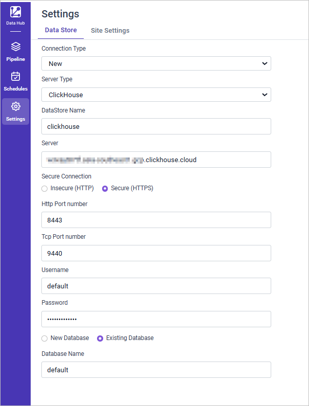

Click **Save** to save the credentials.

If all the given credentials are valid, the “Datastore settings are saved successfully” message appears near the **Save** button.

For more details, see [Connecting ClickHouse as a destination using Bold Data Hub](https://support.boldbi.com/kb/article/18509/connecting-clickhouse-as-destination-using-bold-data-hub)

## Firebolt

Bold Data Hub needs the following credentials for a Firebolt destination:

1. Select the server type as Firebolt.
2. Fill in your Firebolt credentials as follows:
3. Datastore Name: Enter a meaningful name; this is how the Firebolt credentials will be stored in Bold Data Hub.
4. Account: Enter the Account Name. Example: account-1.
5. Enter your Client ID and Client Secret.
6. Enter your Engine Name.
7. Database: Enter your Clickhouse database name.

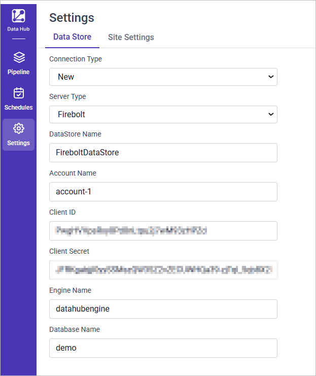

Click **Save** to save the credentials.

If all the given credentials are valid, the “Datastore settings are saved successfully” message appears near the **Save** button.

>**Note:** Bold Data Hub does not support creating a data source in {{site.productNameTM}} when using Firebolt as the data store.

## Teradata

Bold Data Hub needs the following credentials for a Teradata destination:

1. Select the server type as Teradata.
2. Fill in your Teradata credentials as follows:
3. Datastore Name: Enter a meaningful name; this is how the Teradata credentials will be stored in Bold Data Hub.
4. Server: Enter the Server Name. Example: teradataenv-u043k14.env.clearscape.teradata.com.
5. Username: Enter your Teradata username.
6. Password: Input your Teradata password.
7. Database: Enter your Teradata database name.

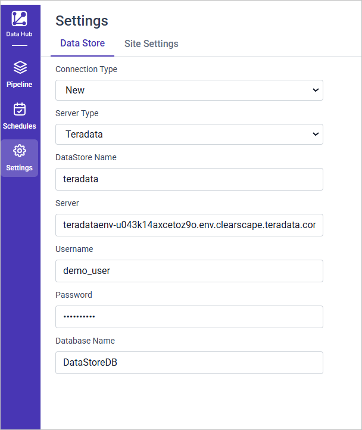

Click **Save** to save the credentials.

If all the given credentials are valid, the “Datastore settings are saved successfully” message appears near the **Save** button.

>**Note:** Bold Data Hub does not support creating a data source in {{site.productNameTM}} when using Teradata as the data store.

## SAP HANA Cloud

Bold Data Hub needs the following credentials for a SAP HANA Cloud destination:

1. Select the server type as SAP HANA Cloud.
2. Fill in your SAP HANA credentials as follows:
3. Datastore Name: Enter a meaningful name; this is how the SAP HANA credentials will be stored in Bold Data Hub.
4. Server: Enter the Server Name. Example: 042a9310-1f79-4d80-ab0b-06277ca7c54a.hana.trial-us10.hanacloud.ondemand.com.
5. Username: Enter your SAP HANA username.
6. Password: Input your SAP HANA password.
7. Database: Enter your SAP HANA database name.

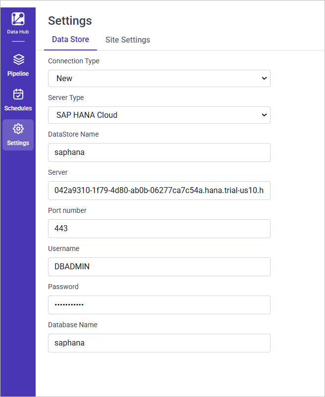

Click **Save** to save the credentials.

If all the given credentials are valid, the “Datastore settings are saved successfully” message appears near the **Save** button.

>**Note:** Bold Data Hub does not support creating a data source in {{site.productNameTM}} when using SAP HANA Cloud as the data store.

## IBMDB2

Bold Data Hub needs the following credentials for an IBMDB2 destination:

1. Select the server type as IBMDB2.
2. Fill in your IBMDB2 credentials as follows:
3. Datastore Name: Enter a meaningful name; this is how the IBMDB2 credentials will be stored in Bold Data Hub.
4. Server: Enter the Server Name.
5. Username: Enter your IBMDB2 username.
6. Password: Input your IBMDB2 password.
7. Database: Enter your IBMDB2 database name.
8. Enter the IBM client library path.

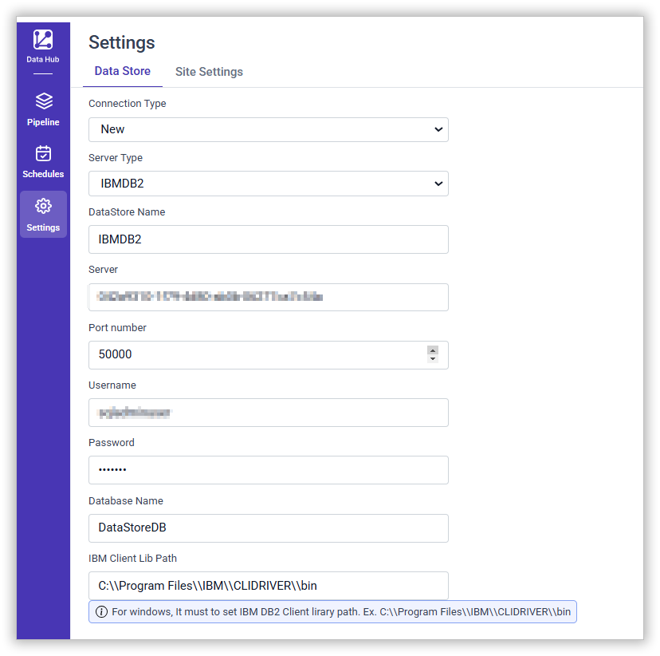

Click **Save** to save the credentials.

>**Note:** Bold Data Hub does not support creating a data source in {{site.productNameTM}} when using IBMDB2 as the data store.

## Azure Synapse

Bold Data Hub needs the following credentials for an Azure Synapse destination:

1. Select the server type as Azure Synapse.
2. Fill in your Azure Synapse credentials as follows:
3. Datastore Name: Enter a meaningful name; this is how the Azure Synapse credentials will be stored in Bold Data Hub.
4. Server: Enter the Server Name.
5. Username: Enter your Azure Synapse username.
6. Password: Input your Azure Synapse password.
7. Database: Enter your Azure Synapse database name.
8. Enter the staging type preferred.

  For faster data transfers with large datasets, use Azure Blob. When staging is not set, the isDirectImport property is not supported.

  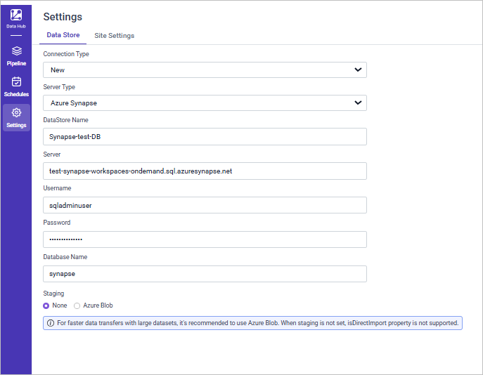

1. When using staging, enter the Azure ContainerName, Account Name, Account Key, SAS token.

The following screenshot shows the Azure Blob staging fields.

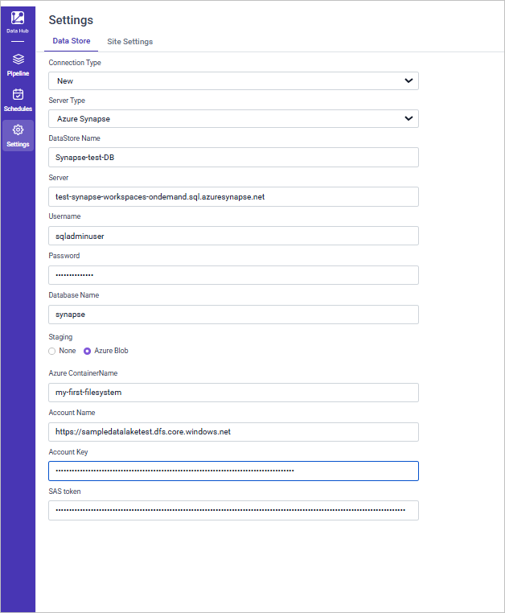

Click **Save** to save the credentials.

## Amazon RedShift

Bold Data Hub needs the following credentials for an Amazon RedShift destination:

1. Select the server type as Azure RedShift.
2. Fill in your Azure RedShift credentials as follows:
3. Datastore Name: Enter a meaningful name; this is how the Amazon RedShift credentials will be stored in Bold Data Hub.
4. Server: Enter the Server Name.
5. Username: Enter your Amazon RedShift username.
6. Password: Input your Amazon RedShift password.
7. Database: Enter your Amazon RedShift database name.
8. Enter the staging type preferred.

For faster data transfers with large datasets, use s3 blob. When staging is not set, the isDirectImport property is not supported.

* Use S3 blob staging for faster data transfers with large dataset.
* If Anonymous Access is selected, enter Bucket Name, Key Name, Region, and Role only.
* If Anonymous Access is not selected, enter Bucket Name, Key Name, Region, Access Key ID, Secret Access Key, and Role (if needed).
* Click **Save** to store the credentials and complete the setup.

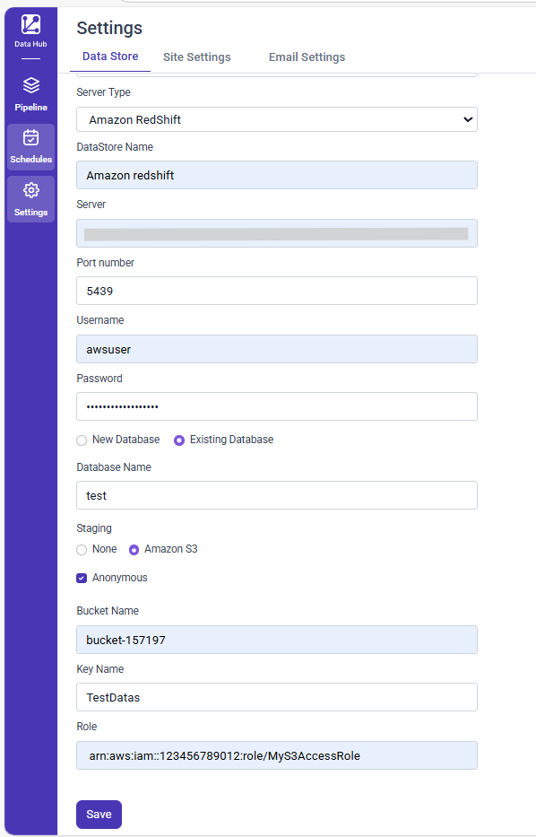

Click **Save** to save the credentials.

## MinIO

Bold Data Hub needs the following credentials for a MinIO destination:

1. Select the server type as MinIO.
2. Fill in your MinIO credentials as follows:
3. Datastore Name: Enter a meaningful name; this is how the MinIO credentials will be stored in Bold Data Hub.
4. Server: Enter the Server Name.
5. Port Number: Specify the port where MinIO is hosted.
6. Access Key: Provide your MinIO access key.
7. Secret Key: Enter the secret key associated with your MinIO access.
8. Bucket Name: Provide the MinIO bucket name where the data will be stored.

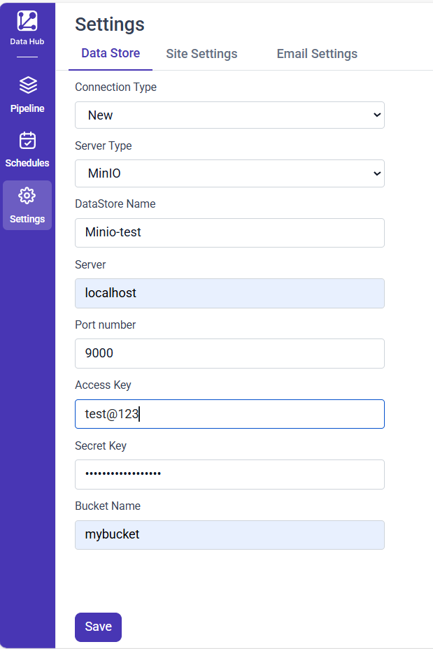

Click **Save** to save the credentials.

>**Note:** Bold Data Hub does not support creating a data source in {{site.productNameTM}} when using MinIO as the data store.

## Star Rocks

Bold Data Hub needs the following credentials for a StarRocks destination:

1. Select the server type as StarRocks.
2. Fill in your StarRocks connection details as follows:
3. Datastore Name: Enter a meaningful name; this is how the StarRocks credentials will be stored in Bold Data Hub.
4. Server: Enter the Server Name.
5. Port Number: Specify the port where StarRocks is hosted.
6. Enter the user name.
7. Enter the password.
8. Enter the database Name.

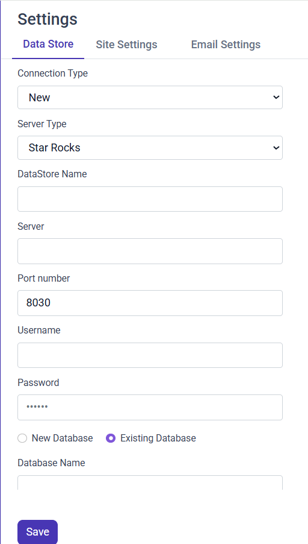

Click **Save** to save the credentials.

## Frequently asked questions

### How do I know the destination credentials are valid?

If all the given credentials are valid, Bold Data Hub shows the “Datastore settings are saved successfully” message near the **Save** button.

### Can I create a {{site.productNameTM}} data source from a Google BigQuery data store?

No. Bold Data Hub does not support creating a data source in {{site.productNameTM}} when using Google BigQuery as the data store.

## See also

* [Schedule Bold Data Hub pipeline jobs](../schedule/)
* [Configure email settings for Bold Data Hub](../email-settings/)
* [Install Bold Data Hub](../installation/)
