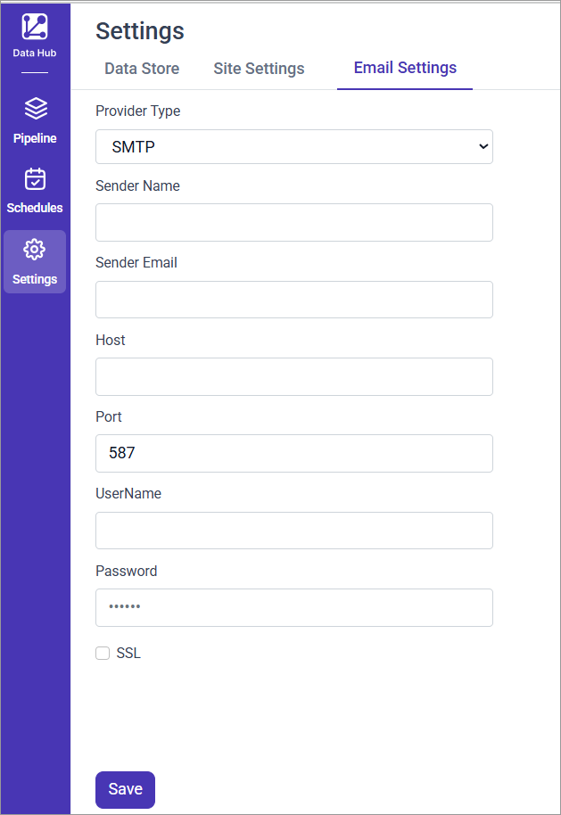

# Configure email settings for Bold Data Hub mail alerts

Bold Data Hub in {{site.productNameTM}} sends pipeline **mail alerts** through the SMTP settings you configure in the **Email settings** section of the **Settings** tab.

> **Note:** Sender mail configuration is mandatory if mail alerting needs to be enabled.

The following screenshot shows the **Email settings** section in the Bold Data Hub **Settings** tab.

----

## SMTP Configuration Fields

Bold Data Hub uses the following SMTP fields to send pipeline mail alerts:

| Field            | Description                                                                 |
|------------------|-----------------------------------------------------------------------------|
| **Provider Type**| Select the email service provider. Currently supports `SMTP`.               |
| **Sender Name**  | Name displayed as the sender in the recipient’s inbox.                      |
| **Sender Email** | The email address used to send notifications.                               |
| **Host**         | The SMTP server host (e.g., `smtp.gmail.com`, `smtp.office365.com`).        |
| **Port**         | Port used for SMTP transmission. Typically `587` for TLS.                   |
| **UserName**     | SMTP username (usually the same as the sender email address).               |
| **Password**     | App-specific password if using MFA/2FA.                                     |
| **SSL**          | Enable this option if your provider requires SSL instead of TLS.            |

> **TLS vs SSL:** Port `587` typically uses **STARTTLS**, while port `465` uses **SSL**. Choose the correct port and SSL setting based on your provider.

----

## When do I need an app password?

Bold Data Hub needs an app password in the **Password** field when multi-factor authentication (MFA) is enabled on the sender account.

* For a Google account with MFA, generate an [App Password from your Google Account](https://myaccount.google.com/apppasswords).
* For a Microsoft account with MFA, generate an [App Password from your Microsoft Account](https://docs.microsoft.com/en-us/azure/active-directory/user-help/multi-factor-authentication-end-user-app-passwords).

----

## How do I save the SMTP configuration?

Bold Data Hub stores your SMTP settings when you save them from the **Email settings** section.

1. Fill in all required fields.
2. Select the **SSL** option if your provider requires it.
3. Click **Save**.

A confirmation message appears near the **Save** button when the provided credentials are correct.

> SMTP needs to be configured only once. These settings are reused for all pipelines with mail alerting enabled.

## How do I choose who receives pipeline alerts?

Bold Data Hub sets email recipients for pipeline alerts in the **Schedule** tab. See [Mail Alert settings for Bold Data Hub schedules](https://help.boldreports.com/enterprise-reporting/designer-guide/manage-content/working-with-bold-data-hub/schedule/#mail-alert).

## Frequently asked questions

### Do I have to configure SMTP for every pipeline?

No. You configure SMTP in Bold Data Hub only once, and the settings are reused for all pipelines with mail alerting enabled.

### Which port should I use for SMTP?

Port `587` typically uses **STARTTLS**, while port `465` uses **SSL**. Choose the port and SSL setting that your provider requires.

## See also

* [Schedule Bold Data Hub pipeline jobs](../schedule/)
* [Bold Data Hub data store destinations](../data-store/)
* [Work with Bold Data Hub pipelines](../working-with-pipelines/)
