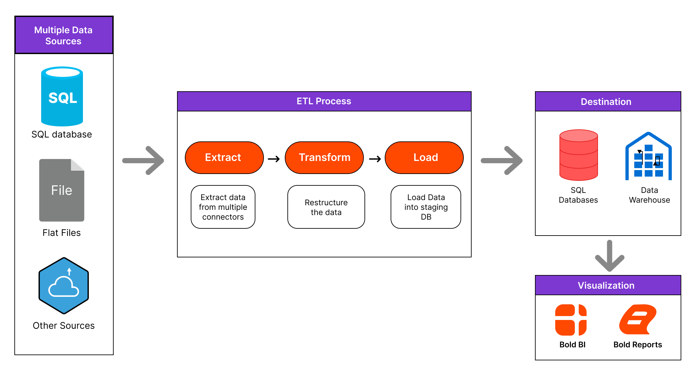
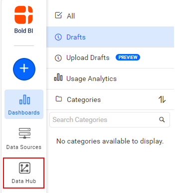
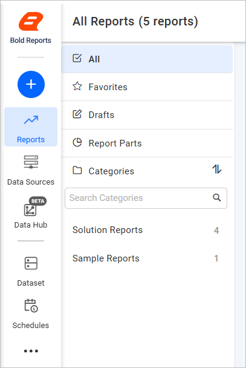
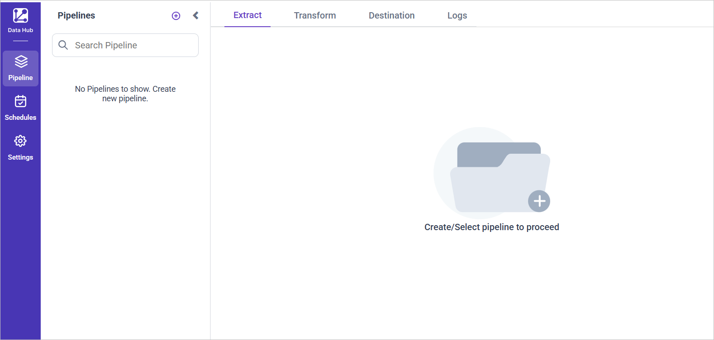

# Working with Bold Data Hub in Bold Reports<sup>®</sup> Report Server

**Bold Data Hub** is the ETL (extract, transform, load) application integrated with Bold Reports<sup>®</sup>. It pulls data from files, web sources, and SQL and NoSQL databases, transforms it, and schedules recurring jobs to keep it current. Use it when you need to prepare and centralize data from multiple sources before you build reports against it.

You can learn about the integrated Bold Data Hub architecture, the Python requirement for running ETL scripts, and how to access and start using Bold Data Hub from Bold Reports<sup>®</sup>.

## What is Bold Data Hub?

Bold Data Hub extends Bold Reports<sup>®</sup> with dedicated extract-transform-load capabilities. It connects to file-based, web, SQL, and NoSQL data sources through a library of connectors. It applies SQL-based transformations to the extracted data and writes the results to a configured destination. You can schedule recurring jobs so downstream reports always work against current data, rather than a one-time import.

Bold Data Hub and Bold Reports<sup>®</sup> share the same Identity Provider (IdP), so you sign in to Data Hub with the same credentials you already use for Bold Reports<sup>®</sup>.

### What can you do with Bold Data Hub?

With Bold Data Hub, you can:

* Connect to file, web, SQL, and NoSQL data sources through built-in connectors.
* Transform extracted data using SQL scripts before it reaches its destination.
* Schedule recurring ETL jobs so data stays current without manual re-imports.
* Access Bold Data Hub directly from the Report Server using shared IdP credentials.

## How is Bold Data Hub integrated with Bold Reports<sup>®</sup>?

The integrated Bold Data Hub architecture connects Bold Data Hub with Bold Reports<sup>®</sup> Report Server. The following diagram shows the integrated Bold Data Hub architecture.



## Which Python version does the ETL server need?

Bold Data Hub requires Python 3.13 to run ETL scripts on Windows OS. You can use either:

* A system-wide Python 3.13 installation, or
* A Python 3.13 virtual environment (venv) created specifically for ETL.

If Python 3.13 is already installed, either globally or inside a venv, specify the correct Python path in `{Drive}:\BoldServices\etl\etlservice\appsettings.json`.

### How do I use a system-wide Python 3.13 installation?

For a system-wide Python installation on Windows, set the Bold Data Hub `PythonPath` to the Python 3.13 folder:

```json
"PythonPath": "<Drive>:\\BoldServices\\Python313"
```

### How do I use Python 3.13 with a virtual environment (venv)?

For a dedicated venv, enable the virtual environment setting and point the Bold Data Hub `PythonPath` to the venv Scripts folder:

```json
"isVirtualEnvironmentAdded": true
"PythonPath": "C:\\BoldServices\\Python313Env\\Scripts"
```

## How do I open Bold Data Hub from Bold Reports<sup>®</sup>?

You open Bold Data Hub from the Report Server by clicking the `Data Hub` icon. Bold Data Hub opens in a new tab.



The icon is located under the same working-with-etl section.



Clicking the icon redirects you to the Bold Data Hub homepage.



> **Important:** Bold Reports<sup>®</sup> and Bold Data Hub are integrated with the same Identity Provider (IdP), so you can access both with a single set of login credentials.

## What are the key features of Bold Data Hub?

Bold Data Hub offers these key features:

* **Broad connector support**: Connect to file, web, SQL, and NoSQL data sources through a dedicated set of connectors. See [Bold Data Hub Connectors](./data-connectors/) for the full list.
* **SQL-based transformation**: Apply SQL scripts to reshape and clean extracted data before it reaches its destination.
* **Scheduled ETL jobs**: Schedule recurring extraction and transformation jobs so report data stays current without manual re-imports.
* **Single sign-on with Bold Reports<sup>®</sup>**: Sign in to Data Hub with the same credentials used for Bold Reports<sup>®</sup>, thanks to shared IdP integration.

## When should I use Bold Data Hub?

Use Bold Data Hub in these common cases:

* **Centralizing data from multiple systems before reporting**: Pull data from several file, web, SQL, and NoSQL sources into one destination before building reports against it.
* **Keeping report data current with scheduled extraction**: Set up recurring jobs so reports always reflect the data from the last scheduled run.
* **Cleaning or reshaping source data before it reaches reports**: Use SQL transformations to correct or restructure data during extraction, instead of after it reaches the report.
* **Connecting reports to sources without native connectors**: Use a Bold Data Hub connector to bring in data from a source Bold Reports<sup>®</sup> doesn't connect to directly.

## Who should use this guide?

The Bold Data Hub guide is intended for:

* Administrators setting up Bold Data Hub and configuring the Python environment.
* Data engineers building and scheduling ETL pipelines.
* Report authors who need transformed or centralized data available for reports.

## What do I need before I start?

Before you begin using Bold Data Hub, make sure you have:

* Windows OS with Python 3.13 installed, either system-wide or in a dedicated virtual environment.
* The correct Python path configured in `appsettings.json`.
* A Bold Reports<sup>®</sup> account with access to the Bold Data Hub application.

## What are the limitations of Bold Data Hub?

Bold Data Hub has these considerations and limitations:

* Python 3.13 is required specifically; other Python versions aren't supported for running ETL scripts.
* The Python path must be configured correctly in `appsettings.json` before ETL jobs can run.
* Data Hub and Bold Reports<sup>®</sup> share IdP-based sign-in, so access depends on your IdP account permissions.

## Frequently asked questions

### Which Python version does Bold Data Hub require?

Bold Data Hub requires Python 3.13, either installed system-wide or inside a dedicated virtual environment, on Windows.

### Do I need to sign in separately to use Bold Data Hub?

No. Bold Data Hub shares the same Identity Provider (IdP) as Bold Reports<sup>®</sup>, so your existing credentials work.

### Where do I configure the Python path?

You configure the Bold Data Hub Python path in `{Drive}:\BoldServices\etl\etlservice\appsettings.json`, using either the system-wide path or the venv Scripts path.

### Can I schedule ETL jobs to run automatically?

Yes. Bold Data Hub schedules recurring jobs. See [Scheduling Bold Data Hub Jobs](./schedule/) for setting up recurring jobs.

### Where do I find the list of supported data sources?

The [Bold Data Hub Connectors](./data-connectors/) page lists the supported file, web, SQL, and NoSQL connectors.

## How do I get help with Bold Data Hub?

If Bold Data Hub doesn't open from the Report Server, or an ETL job fails to run, check the Python path in `appsettings.json`. Then, confirm that your IdP account has access to Bold Data Hub. For setup and connector details, see the related articles below.

## Related articles

* [Data Store](./data-store/) to configure where transformed data is written once a pipeline finishes running.
* [Install Bold Data Hub](./installation/) if you're setting up Bold Data Hub for the first time or alongside an existing Bold Reports<sup>®</sup> installation.
* [Working with Pipeline](./working-with-pipelines/) to build the extraction and transformation steps a job runs.
* [Transformation](./transformation-preview/) to preview how your SQL transformations affect the extracted data before running a job.
* [Scheduling Bold Data Hub Jobs](./schedule/) to set up the recurring runs described in this page.
