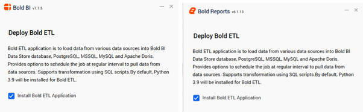
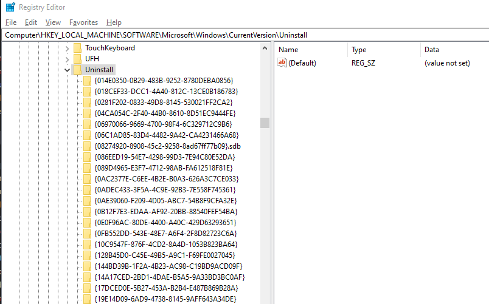
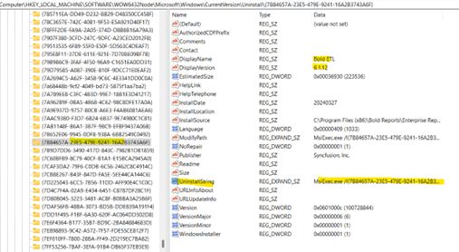

# Install Bold Data Hub

Bold Data Hub is an optional application you can install with {{site.productNameTM}}, add later with the ``BoldETL.msi`` file, or remove with its registry uninstall string.

## How do I make Bold Data Hub optional during installation of {{site.productNameTM}}?

The {{site.productNameTM}} installer lets you install the Bold Data Hub application at the same time as {{site.productNameTM}}, or skip it and add it later.

1. During installation, check the box labeled **Install Data Application** in the installer wizard to include the Bold Data Hub application.
   The following screenshot shows the **Install Data Application** checkbox in the installer wizard.
  

2. To skip the Bold Data Hub application during configuration, uncheck the same checkbox.

3. To install the Bold Data Hub application after the initial setup, use the ``BoldETL.msi`` file in the {{site.productNameTM}} installation directory.

4. To install the Data Hub service and application pool correctly, open the command prompt in administrative mode and run the BoldETL.msi file.
  
    Example,
    {{site.productNameTM}} & {{site.productNameTM}} Locations:
    ```yaml
    “C:\Program Files (x86) \{{site.productName}}\Enterprise Reporting\BoldETL>BoldETL.msi”
    “C:\Program Files (x86) \{{site.productName}} Enterprise Edition\BoldETL>BoldETL.msi”
    ```
----

## What happens if I double-click the MSI file?

Installing the Bold Data Hub service by double-clicking the MSI file, instead of running it from an administrative command prompt, may lead to service configuration issues in Internet Information Services (IIS).

----

## How do I uninstall Bold Data Hub in {{site.productNameTM}}?

You uninstall the Bold Data Hub application by running its uninstall string from the Windows registry in an administrative command prompt.

1. Open the system registry and locate the ```Computer\HKEY_LOCAL_MACHINE\SOFTWARE\Microsoft\Windows\CurrentVersion\Uninstall``` key associated with the application.
   The following screenshot shows the Uninstall key in the registry.


2. Search within the key to find the exact Bold Data Hub version or application, and locate its **UninstallString**.
   The following screenshot shows the Bold Data Hub entry and its uninstall string.


3. Double-click **UninstallString** to get the complete uninstall string for MSIExec.exe. Then, change `/I` to `/X` in the string.

    For example:
    ```yaml
    From: MsiExec.exe /I{7B84657A-23E5-479E-9241-16A2B3743A6F}
    To: MsiExec.exe /X{7B84657A-23E5-479E-9241-16A2B3743A6F}
    ```

4. Run the modified command in a command prompt with administrator privileges. The Bold Data Hub application is then uninstalled.
    For example:
    ```msiExec.exe /X{7B84657A-23E5-479E-9241-16A2B3743A6F}```

> **Note:** Removing ``BoldETL.msi`` through the Windows Control Panel may not fully remove the application pool and etlservice application components.

## Frequently asked questions

### Can I install Bold Data Hub after {{site.productNameTM}} is already installed?

Yes. Run the ``BoldETL.msi`` file from the {{site.productNameTM}} installation directory in a command prompt opened in administrative mode.

### Why should I not uninstall Bold Data Hub from the Control Panel?

Removing ``BoldETL.msi`` through the Windows Control Panel may not fully remove the application pool and etlservice application components.

## See also

* [Bold Data Hub data store destinations](../data-store/)
* [Configure email settings for Bold Data Hub](../email-settings/)
* [Schedule Bold Data Hub pipeline jobs](../schedule/)
