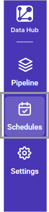
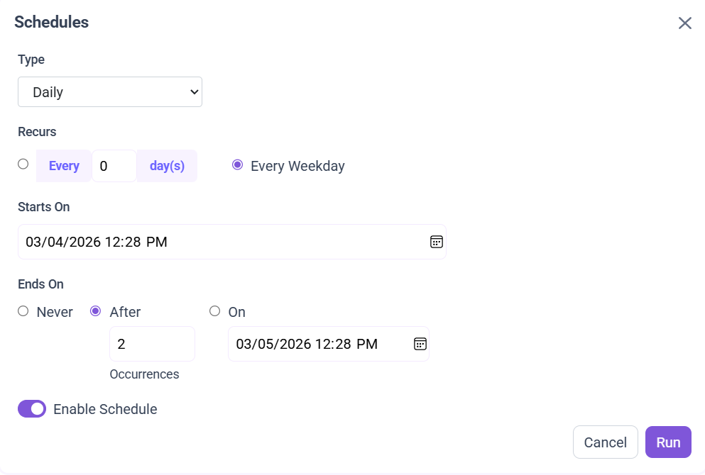
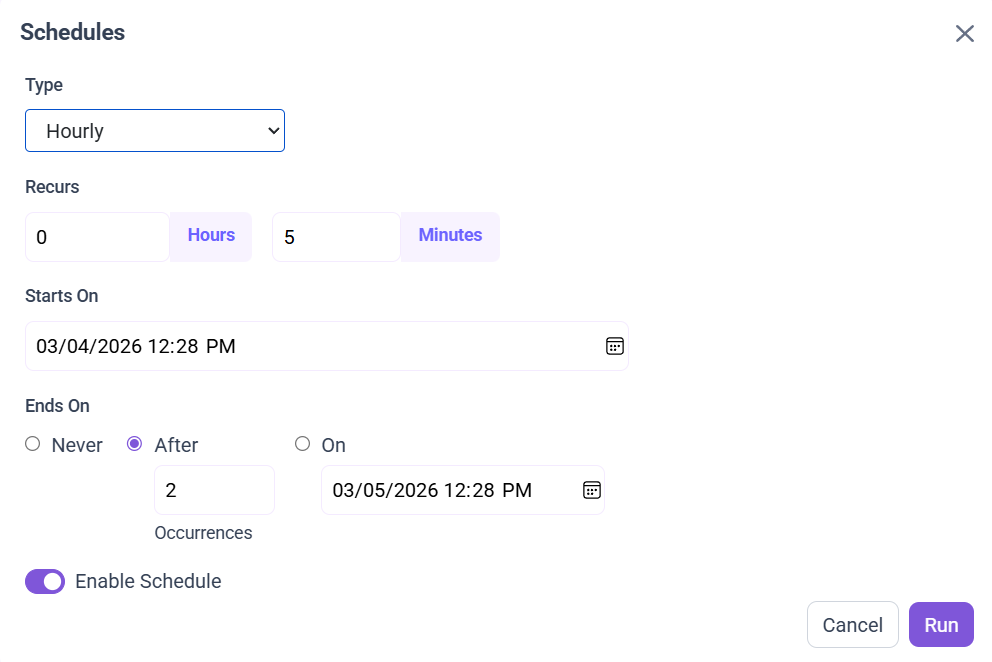
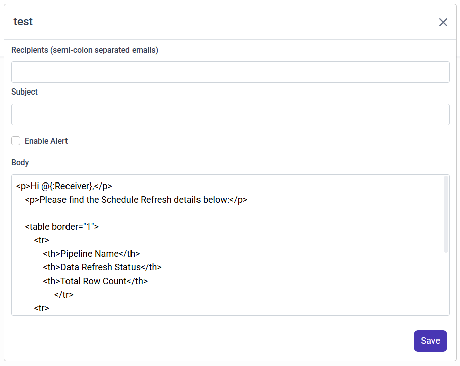

# Schedule Bold Data Hub pipeline jobs

In Bold Data Hub, the Schedule page lists your pipelines and lets you configure On Demand or Interval based schedules for each one.

The following screenshot shows the schedule icon for a pipeline.

## How do I run a pipeline on demand?

Bold Data Hub refreshes pipeline data on demand when you select the **Run Now** option.

 > **Note:** ``Run Now`` option only works if you save the ``pipeline`` in ``Extract`` tab.

## How do I set up an interval schedule?

Bold Data Hub runs a pipeline at regular intervals when you configure an interval-based schedule.

1. Click the **Schedules** tab, select the created pipeline, and click the schedule icon to configure it.

1. Select the recurrence type, recurrence, start date, and end date in the **Refresh Setting** dialog box. Scheduling supports two recurrence types: ``Daily`` and ``Weekly``.

### Daily

The Daily recurrence type in Bold Data Hub runs the schedule at regular daily intervals.
You can choose one of the following options:

1. Every N day(s): Runs the schedule once every specified number of days. Example: Every 3 days.
2. Every Weekday: Runs the schedule Monday to Friday only.

### Hourly

The Hourly recurrence type in Bold Data Hub runs the schedule at fixed intervals based on hours and minutes.

Recur every H hour(s) and M minute(s): Runs the schedule after the specified number of hours and minutes have passed.
Example: Every 0 hours and 5 minutes (runs every 5 minutes).

1. Check the schedule history using the **History** option and the logs.

## Mail Alert

The **Mail Alert** feature in Bold Data Hub lets you configure email notifications for each pipeline. When a pipeline's scheduled execution completes, an alert is sent to the specified recipients.

 > **Note:** Configure the ``Sender mail`` in the ``Settings`` tab before you schedule or run the pipeline.

### How do I configure mail alert settings?

You set up Bold Data Hub mail alerts for a pipeline in the mail alert dialog, shown in the following screenshot.

 1. **Add Recipients**
    * Enter one or more email addresses in the **Recipients** field.
    * Separate multiple email addresses with a **semicolon ( ; )**.

        **Example:** `user1@example.com;user2@example.com`

 2. **Set Mail Subject**
    * Specify a clear and concise subject line for the alert email.

 3. **Enable Mail Alerts**
    * Toggle the **Enable Mail Alert** option to activate the notification.

 4. **Mail Alert Body**
    * A default email body is generated, containing pipeline execution details.
    * You can customize the content and remove unnecessary columns from the body if required.

Configure the sender mail settings in the **Settings** tab. See [Email Settings for Bold Data Hub](../email-settings/).

## Frequently asked questions

### Why does Run Now not work for my pipeline?

The ``Run Now`` option only works if you save the ``pipeline`` in the ``Extract`` tab.

### How do I send alerts to more than one recipient?

Enter the email addresses in the **Recipients** field separated by a semicolon, for example `user1@example.com;user2@example.com`.

## See also

* [Configure email settings for Bold Data Hub](../email-settings/)
* [Work with Bold Data Hub pipelines](../working-with-pipelines/)
* [Bold Data Hub data store destinations](../data-store/)
