# Transform and preview data in Bold Data Hub

Bold Data Hub lets you transform extracted data with SQL scripts and preview the results before you load them for Bold Reports<sup>®</sup>. On the ``Tranformation`` page, you convert extracted data into a suitable format for analysis. This stage includes data cleaning, filtering, aggregation, and normalization. You can also enrich data by integrating it with additional information.

## How do I create a transform table in Bold Data Hub?

You create a transform table in Bold Data Hub from the Transform tab of a project, after the project data reaches the destination database.

1. After the project data has been successfully transferred to the designated destination database, choose a specific project and open the **Transform** tab in the right side panel.

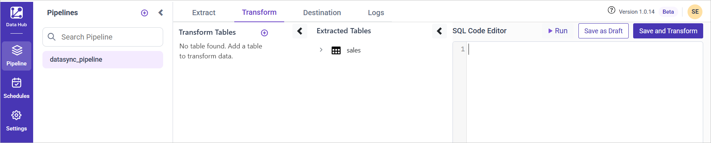

1. To create a table in the designated location through SQL scripts, click the **Add Table** button.


1. Enter the table name in the **Table Name** field. If necessary, you can provide primary key values in a comma-separated format in the **Unique Column Name(s)** text box for further customization.

## Drop Table and Unique Columns usage:

The Bold Data Hub **Drop Table** checkbox drops and recreates the existing table during each extraction. Select it to avoid data duplication, because Bold Data Hub recreates the transform table for every schedule.
Click **Save** to apply changes or **Close** to cancel.

The following screenshot shows the transform table dialog with the **Table Name**, **Unique Column Name(s)**, and **Drop Table** options.

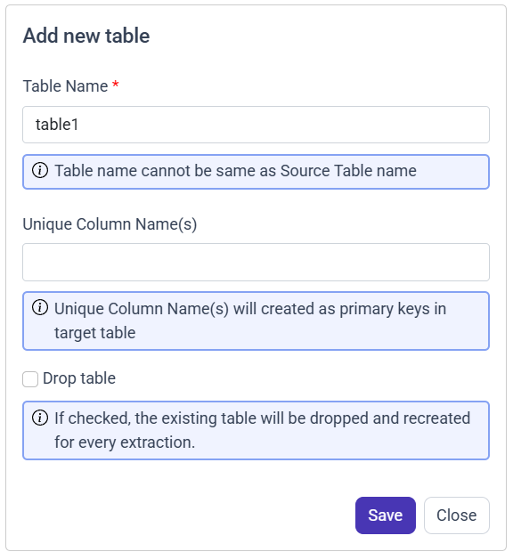

### What happens if I skip Drop Table and the primary key?

Bold Data Hub displays a data duplication warning popup if you do not select the **Drop Table** option and do not specify any primary key.
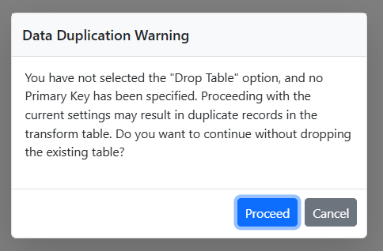

#### Which options does the duplication warning offer?

The Bold Data Hub data duplication warning offers two options:

    Proceed: Continue with the current settings (duplicates may occur).
    Cancel: Go back and configure either Primary Key as Unique Column Name(s) or enable the "Drop Table" option to avoid duplication.

## How do I write a transformation script?

Bold Data Hub first moves the extracted data to `DuckDB` and builds a default select query that you can edit.

1. The data is first transferred to the `DuckDB` database within the designated `{project_name}` schema. It is then transformed for integration into the target databases. For example, for a project named "datasync_pipeline", the data moves to the `datasync_pipeline` table schema.

2. By default, a select query is formed and added to the transformation script based on the first table extracted in the pipeline. You can modify the script based on your requirement.

3. The **Extracted Tables** list shows the tables extracted with their columns and data types. Double-click a table or column to include it in the code editor for easy transformation.

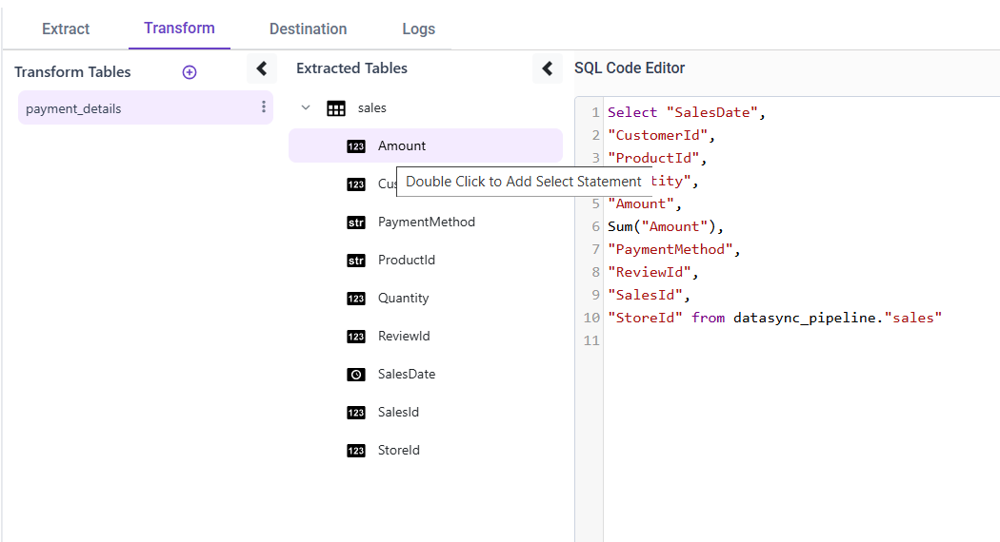

Sample transformation script:

```SQL
select date_part('year', SalesDate) as "year", date_part('month',SalesDate) as "month", sum(Amount) as "TotalAmount" from datasync_pipeline.sales
group by date_part('year',SalesDate),date_part('month',SalesDate)
```

The following screenshot shows a transformation script in the Bold Data Hub code editor.

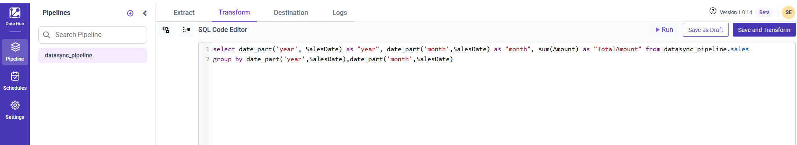

Note: You can minimize the Transform Tables and Extracted Tables to use the code editor area fully.

## Preview:

Bold Data Hub shows the results of your transformation query when you click the **Run** button.

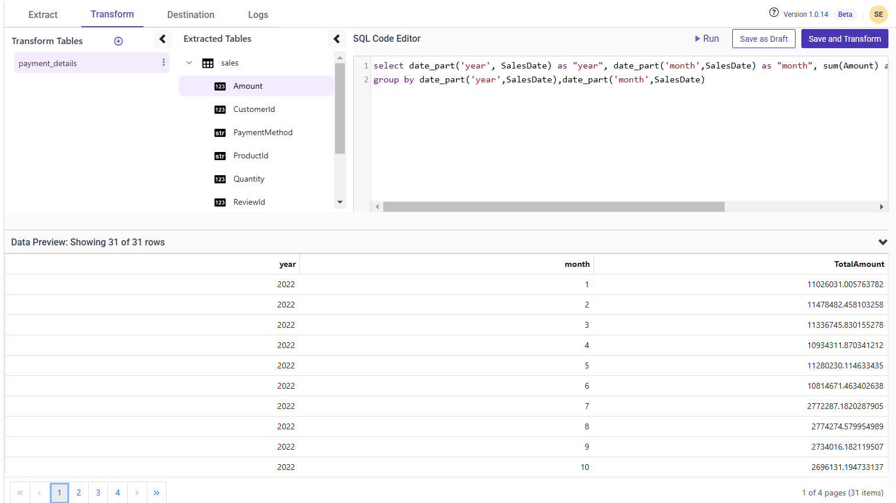

> **Note:** The preview option only works after the source table data has been moved to destination database. You can also minimize the preview after you use it.

### Transformation Capabilities:

Bold Data Hub transformation lets you add multiple tables, edit or delete them, reorder them, and set primary keys.

1. In the Transform section, you can incorporate multiple tables into your projects.

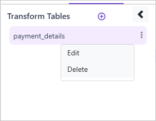

1. Edit/Delete Table Confirmation Popup:
When you click Edit or Delete, a confirmation popup appears:
Deleting/Editing the table will affect reports that depend on it. Are you sure you want to proceed?

    Proceed: Continue with edit or delete.  
    Cancel: Abort the action.

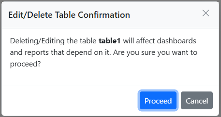

1. Drag and drop the transform tables to reorder the sequence in which the transform tables run. You can also reuse these tables for future analyses.

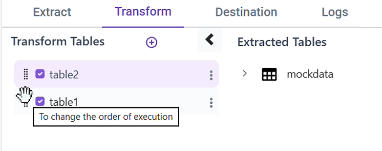

1. To add primary keys to the transform tables, enter the primary key values when you add or edit the tables.


> **IMPORTANT:** If a primary key is added, it must also be referenced in the SQL query. If the primary key is missing in the query, an error popup appears.

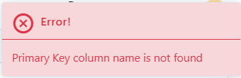

1. After you finish the transformation, click the ``Save and Transform`` button. The tables are transferred to the destination database during this process. The data is then transformed and moved to the destination.

 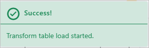

1. Use ``Save as Draft`` to switch between the transform and other tabs without losing the transformation query.

> **IMPORTANT:** After you finish the transformation, you can see the results in the Destination tab.

 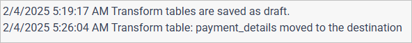

 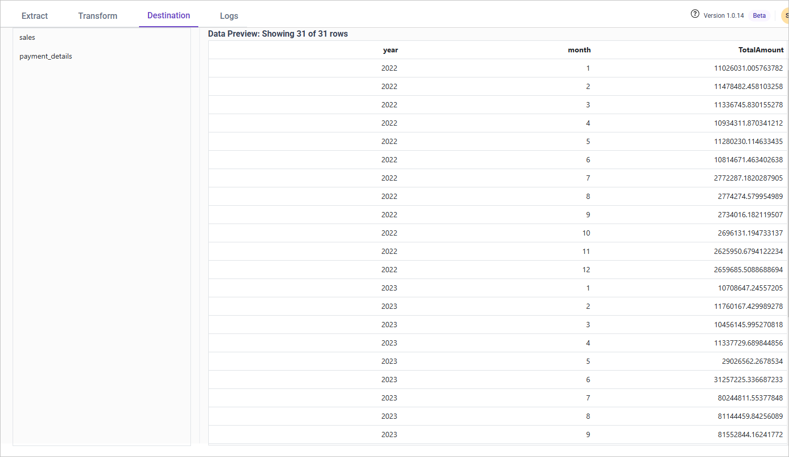

## Frequently asked questions

### When does the Bold Data Hub preview work?

The Bold Data Hub preview only works after the source table data has been moved to the destination database.

### What happens if a primary key is not in the SQL query?

If you add a primary key to a transform table, Bold Data Hub requires it in the SQL query. If it is missing, an error popup appears.

## See also

* [Working with Bold Data Hub](./)
* [Working with Pipeline](./../working-with-pipelines/)
* [Data Store](./../data-store/)
* [Scheduling Bold Data Hub Jobs](./../schedule/)
