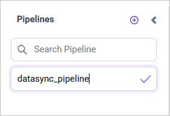
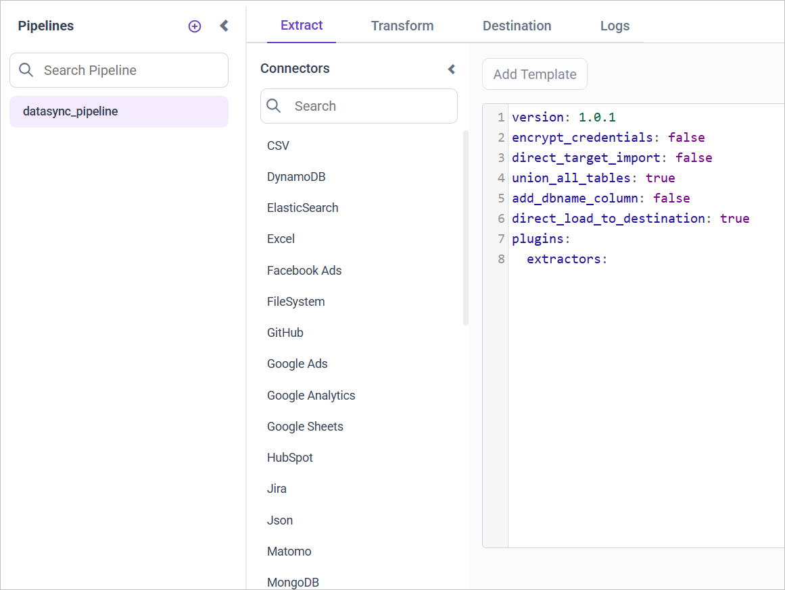
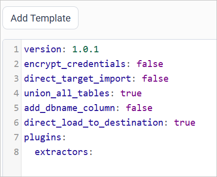
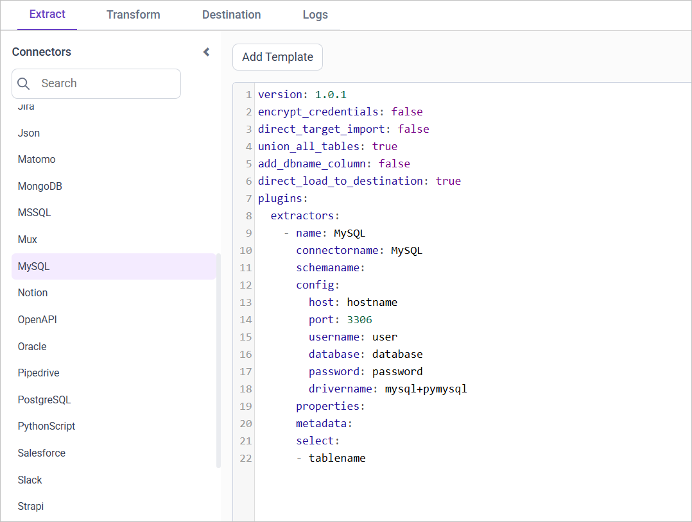
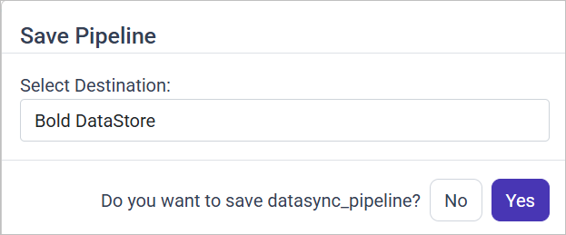
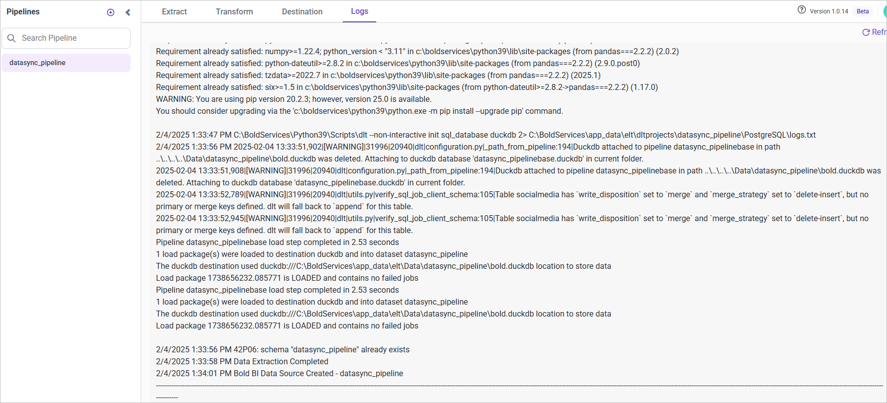
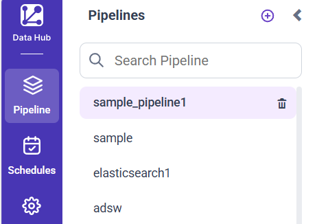
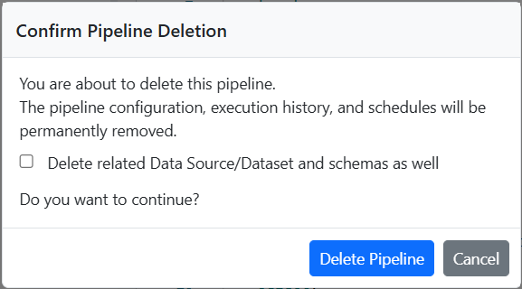

# Create and manage pipelines in Bold Data Hub

A Bold Data Hub pipeline imports data from one or more connectors into your destination database, so you can use the data in {{site.productNameTM}}. Before you create a pipeline, configure the [Data Store](../data-store/) to proceed with the subsequent steps.

## How do I create a new pipeline?

You create a new pipeline in Bold Data Hub from the left side panel.

1. In the left side panel, click the **Add Pipeline** button.

     

   > **Note:** Pipeline name using only alphanumeric characters and click on the ``tick`` icon to confirm and save the Pipeline details.

2. Enter the pipeline name and select the confirm icon.
3. Select the pipeline name to continue with further actions.



Bold Data Hub then opens the Extract page, where you configure the settings for the source connector.



## How do I configure the source connector on the Extract page?

You configure the Bold Data Hub source connector in a **YAML** file format on the Extract page. The data source name is displayed in the Connector list panel. Select the connector name and click **Add Template** to access sample configuration details. You can add multiple connectors to a pipeline to transfer data to a destination database.





Example: Configuration File

```yaml
version: 1
encrypt_credentials: false
plugins:
  extractors:
  - name: MySQL
    connectorname: MySQL
    schemaname:
    config:
      host: localhost
      port: 3306
      username: root
      database: sakila
      password: +NQCHLZ1l/RaR1L0HK+0jg==
      drivername: mysql+pymysql
    select:
    - inventory
    - payment
  - name: PostgreSQL
    connectorname: PostgreSQL
    schemaname: test
    config:
      host: localhost
      port: 5438
      username: postgres
      database: demo
      password: +NQCHLZ1l/RaR1L0HK+0jg==
      drivername: postgresql+pg8000
    select:
    - ticket_metrics
```

## How do I run the pipeline and load data to the destination?

You run a Bold Data Hub pipeline by saving the configuration, choosing a destination, and starting the run from the Schedule page.

1. Click the **Save** button. A popup window appears.
2. In the popup, click the dropdown menu labeled Select ``Destination``.
3. Choose the specific ``DataStoreName`` that you previously configured in the Data Store settings page.

   

4. Go to the **Schedule** page and select the **Run Now** option to start the run immediately.


When the pipeline run completes, Bold Data Hub creates a data source in {{site.productNameTM}}.


To check the current operational status, open the **Logs** tab.


## Pipeline Properties

Bold Data Hub pipeline properties control how tables are created, where data flows, and how primary keys are set in the destination.

### Drop table

**isDropTable**  
**Description:**  
The Bold Data Hub `isDropTable` property controls whether existing tables in the destination are dropped and recreated during pipeline execution.
* true (Default): If the table exists, it is dropped and recreated before loading fresh data.
* false: Tables are created only if they don't exist, and data is inserted/appended without dropping.

**When/Why to Use:**

* Set to true for full refreshes, where historical data is not needed and a clean schema is desired.
* Set to false for incremental loads or when preserving data continuity is critical (for example, production append-only workflows or pipelines using upserts when a primary key is defined).
* Dropping tables helps handle breaking schema changes by recreating tables with updated structures.

**Note:**
* Applied across all supported datastores.
* This property is not applicable when a primary key is explicitly defined, as existing tables are updated through upsert operations instead of being dropped and recreated.
* In some versions (for example, pre 1.0.21), this was not configurable. Always check version compatibility.

### Direct load to destination

**direct_load_to_destination**  
**Description:**  
The Bold Data Hub `direct_load_to_destination` property determines the data flow path: whether data moves from a staging layer (DuckDB) to the target datastore or remains in staging.
* true (default): Data is first loaded into DuckDB (staging) for transformation and then moved to the target datastore.
* false: Data is loaded into DuckDB for transformation but is not moved to the target datastore. Only transformed data can be moved later to the target datastore (via the transform option in DataHub).

**When/Why to Use:**
* Set to true when you want the full data flow, from source to staging (DuckDB) to destination.
* Set to false when you want to keep only the transformed data in staging (DuckDB) and avoid automatic movement to the destination.

**Note:**
Applied across all supported datastores.

### Direct target import

**direct_target_import**  
**Description:**  
The Bold Data Hub `direct_target_import` property determines whether data moves directly to the target datastore or is processed first through a staging layer before export (DuckDB to Parquet to destination).
* false (default): Data is first loaded into DuckDB (staging), then exported as Parquet files and moved to the destination using bulkupload.
* true: Data is sent directly to the destination datastore without using the staging layer.

**When/Why to Use:**
* Prefer false (staging + Parquet) for large datasets, because exporting optimized Parquet files from DuckDB and bulk-loading them can be faster.
* Prefer true for simple extracts or connectors that support efficient direct ingestion.

**Note:**
* This property is supported for Amazon Redshift, Google BigQuery and Snowflake.
* Amazon S3 is required for the staging + Parquet workflow only when the destination is Amazon Redshift.
* For MSSQL, direct_target_import is supported only when the connector type is also MSSQL.

### Set not null as primary keys

**set_not_null_as_primary_key**  
**Description:**  
The Bold Data Hub `set_not_null_as_primary_key` property determines whether columns that contain no null values in DuckDB are automatically treated as primary keys in the destination when no explicit primary key is defined.
* true: After data is loaded to DuckDB, each column is scanned; columns with no nulls are treated as primary keys.
* false: No automatic inference from data; primary keys must be provided explicitly.
If a column contains no nulls (even if it's not explicitly defined as NOT NULL in the schema), it is automatically promoted as a primary key candidate in the destination.

**When/Why to Use:**</br>
Use this when importing from sources that often lack explicit primary keys (CSV, JSON, or semi-structured data). It helps auto-detect candidate keys and reduces manual configuration.

**Behavior & Caution:**
* The process inspects actual data (not only schema metadata) to find columns with no nulls.
* Columns with internal DLT metadata (for example, _dlt_id, _dlt_parent_id) are excluded from inference.
* Caution: A column that contains no nulls may still be non-unique. Promoting such a column to a primary key can cause correctness or constraint errors in the destination.

**Note:**
| Supported Datastores | Not Supported Datastores |
|-----------------------|--------------------------|
| Apache Doris          | Azure Synapse            |
| Google BigQuery       | ClickHouse               |
| MySQL                 | Firebolt                 |
| Oracle                | IBM DB2                  |
| PostgreSQL            | MinIO                    |
| SQL Server            | SAP HANA Cloud           |
| Snowflake             | Teradata                 |
| Amazon Redshift       |                          |

## How do I configure primary keys for connectors?

You define custom primary keys in Bold Data Hub with the primary_keys property in the extractor's properties section. This property specifies which column(s) are used as primary key(s) in the destination table.

**Syntax:**

```yaml
properties:
  primary_keys: '{table_name_1}: {key_1}, {key_2}; {table_name_2}: {key_3}'
```

**Example:**

```yaml
properties:
  primary_keys: 'customers: customerId, firstName;orders: orderId'
```

For the customers table: primary keys are customerId and firstName (composite key).
For the orders table: primary key is orderId.

**Behavior:**
* The property is expected to be a string with semicolon-separated table specifications and comma-separated keys.
* Table names must match those in the extractor's `select` list.
* Multiple keys per table are supported (composite primary keys), assuming the destination database allows them.
* If `primary_keys` is not specified and the `set_not_null_as_primary_key` property is true, columns with no null values are set as PK. Otherwise, tables remain without primary keys.

**Important:** Ensure the column names are correct and present in the table schema. Mismatched columns may cause data extraction errors.

**Note:**
| Supported Datastores | Not Supported Datastores |
|-----------------------|--------------------------|
| Apache Doris          | Azure Synapse            |
| Google BigQuery       | ClickHouse               |
| MySQL                 | Firebolt                 |
| Oracle                | IBM DB2                  |
| PostgreSQL            | MinIO                    |
| SQL Server            | SAP HANA Cloud           |
| Snowflake             | Teradata                 |
| Amazon Redshift       |                          |

### Example

The following Bold Data Hub configuration sets primary keys for a MySQL connector.

#### MySQL Connector with Primary Keys

```yaml
version: 1.0.1
encrypt_credentials: false
direct_target_import: false
union_all_tables: true
add_dbname_column: false
direct_load_to_destination: true
use_snake_casing: true
set_not_null_as_primary_key: false
plugins:
  extractors:
    - name: MySQL
      connectorname: MySQL
      schemaname:
      config:
        host: localhost
        port: 3306
        username: root
        database: work
        password: <password>
        drivername: mysql+pymysql
      properties:
        primary_keys: 'customers: customerId, firstName;orders: orderId'
      select:
        - customers
        - orders
```

## How do I delete a pipeline?

You delete a Bold Data Hub pipeline from the left side panel by clicking the **Delete** icon next to the selected pipeline.



### How do I confirm the deletion?

Bold Data Hub shows a confirmation popup when you delete a pipeline.
* Use the checkbox to decide whether the associated data source and schema are deleted along with the pipeline.
* Click **DeletePipeline** to proceed with the deletion.
* Click **Cancel** to close the dialog and stop the deletion process.



### What happens after deletion?

The result of deleting a Bold Data Hub pipeline depends on whether you select the checkbox in the confirmation popup.

#### If the checkbox is selected

* The selected pipeline will be permanently removed from the Pipelines list.
* The datasource and dataset created for the pipeline in {{site.productNameTM}} will be deleted.
* The schema and its tables associated with the pipeline will also be deleted in the selected destination.

#### If the checkbox is not selected

* The selected pipeline will be permanently removed from the Pipelines list.
* The datasource, dataset and schema created for the pipeline in {{site.productNameTM}} will not be deleted.

## Frequently asked questions

### Can I add more than one connector to a pipeline?

Yes. You can add multiple connectors to a Bold Data Hub pipeline to transfer data to a destination database.

### What happens when a pipeline run completes?

When the pipeline run completes, Bold Data Hub creates a data source in {{site.productNameTM}}. You can check the status in the **Logs** tab.

## See also

* [Data Store](../data-store/)
* [Transformation](../transformation-preview/)
* [Scheduling Bold Data Hub Jobs](../schedule/)
* [Working with Bold Data Hub](../)
