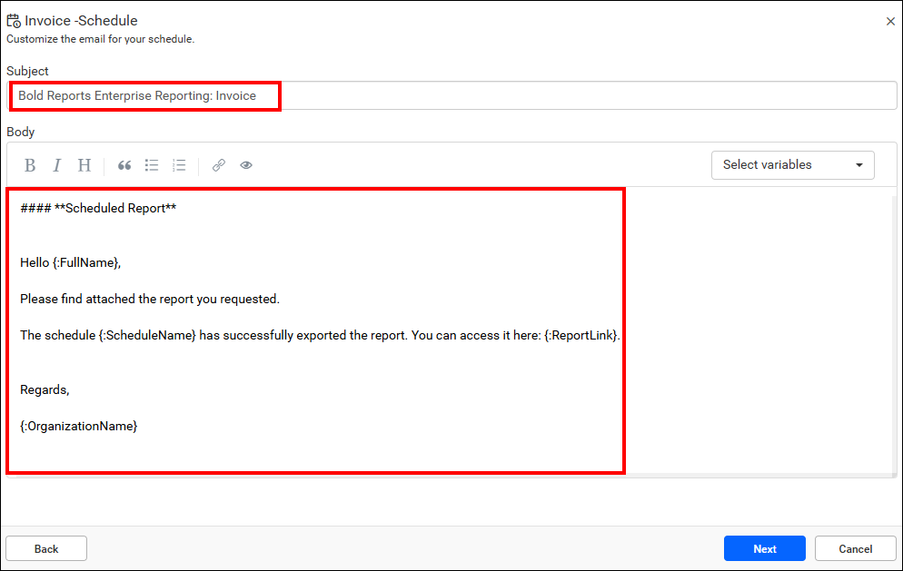
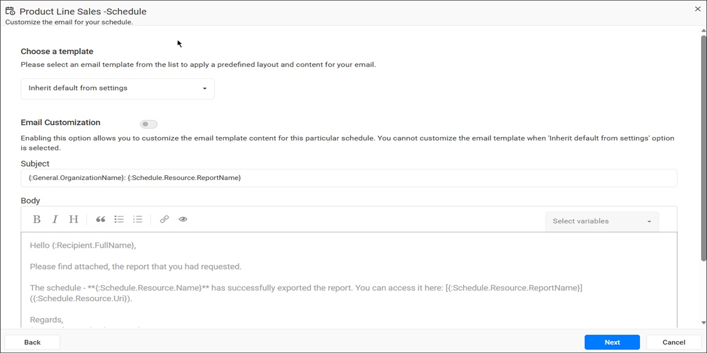
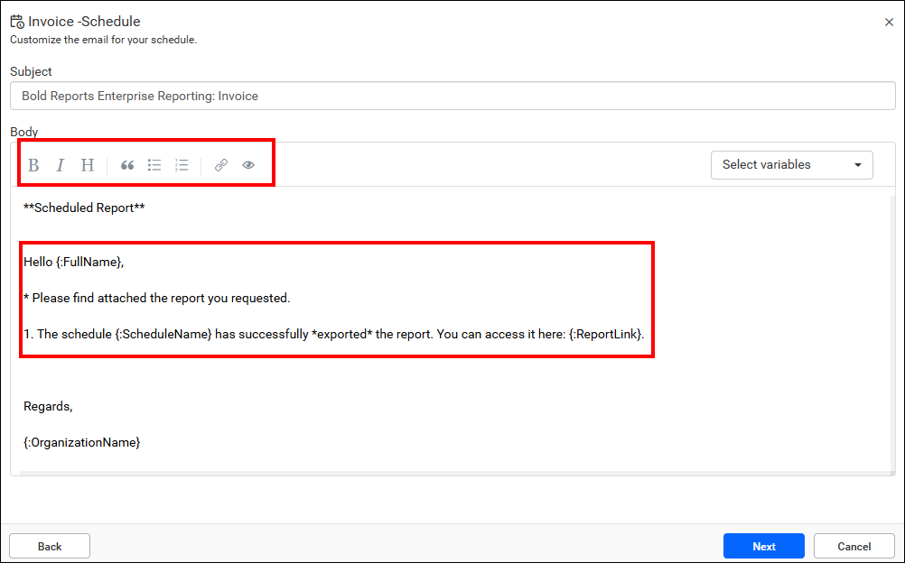
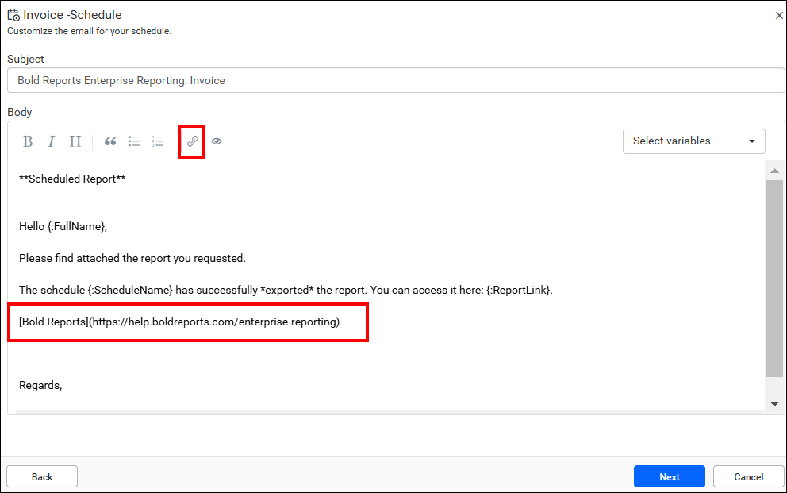
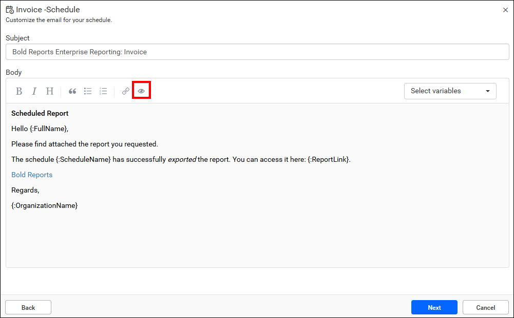

# Customize the schedule email template in {{site.productNameTM}} Report Server

Custom schedule report settings in the {{site.productNameTM}} Report Server let you customize the `Schedule Template` and the `Predefined Variables` for scheduled report emails. You can change the email subject, format the email body, insert links, and preview the email before the schedule runs.

## How do I customize the schedule email template?

The {{site.productNameTM}} Report Server lets you customize the email content that it sends during the schedule. Follow these steps in the schedule dialog:

1. Open the schedule email content page. The page initially displays default content, as shown in the following image.

    

2. Use the default email subject, or customize it by selecting variables from the dropdown menu. Once you select a variable from this dropdown, the default subject content resets to accommodate your customization.

    

3. Customize the email body content. Improve its readability with formatting options such as bold, italic, bullet points, numbers, links, and quotations. The following image shows examples of these formatting options.

    

4. Insert links into your content as needed. The following image shows the insert link option.

    

5. Use the `Preview option` to see the actual email format while scheduling.

    

6. After you customize the email content, click `Next` in the schedule dialog.

## Which predefined variables can I use in the email template?

The Report Server assigns each predefined variable directly from the server to the mail template when you select it. You can use the following variables in the scheduled email subject and body:

* {Full Name}: The recipient's full name.
* {First Name}: The recipient's first name.
* {Last Name}: The recipient's last name.
* {Schedule Name}: The name of the schedule.
* {Report Name}: The name of the scheduled report.
* {Report Link}: The link to the scheduled report.
* {Export Format}: The chosen export file format for the schedule.
* {Date}: Specifies the date when the schedule is triggered.
* {Organization Name}: The Organization name, retrieved from the site settings.
* {Category Name}: The category name associated with the selected report.
* {Expression}: Use dynamic expressions to customize content. See the [Expression](./../../report-designer/compose-report/expressions/) documentation for guidance on framing expressions.
    > Expressions utilizing **Dataset Fields** are not supported in the scheduled email template.
* {Report Image}: Provides support for inserting the report into the email body as an image.

## Frequently asked questions

### Can I use dataset fields in the schedule email template?

No. Expressions utilizing **Dataset Fields** are not supported in the scheduled email template in the {{site.productNameTM}} Report Server.

### Can I add the report itself to the email body?

Yes. The {Report Image} variable inserts the report into the email body as an image.

### How do I check the email before the schedule runs?

Use the `Preview option` in the schedule dialog to see the actual email format while scheduling.

## See also

* [Manage report schedules](./../manage-reports-schedule/)
* [Schedule report settings](./../schedule-report-settings/)
* [Data-driven schedule](./../data-driven-schedule/)
