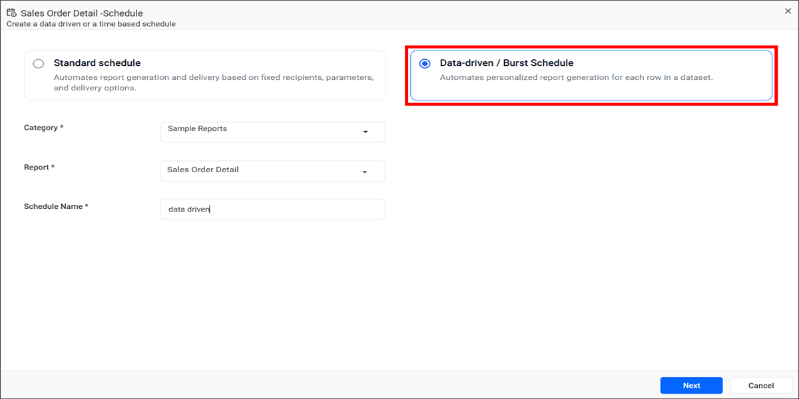
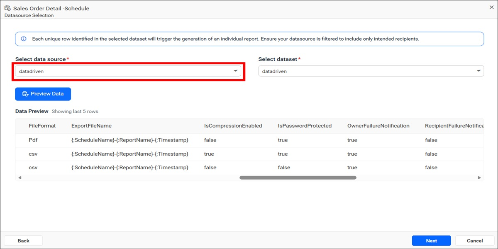
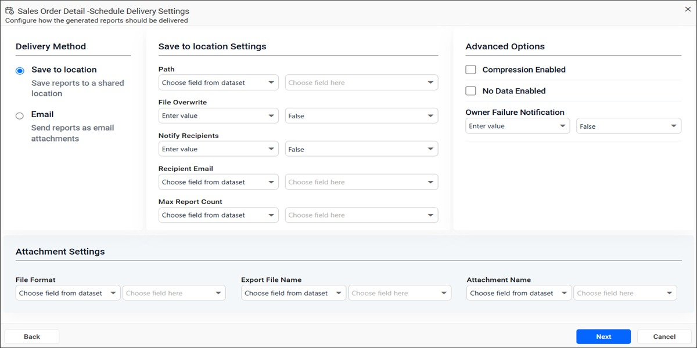
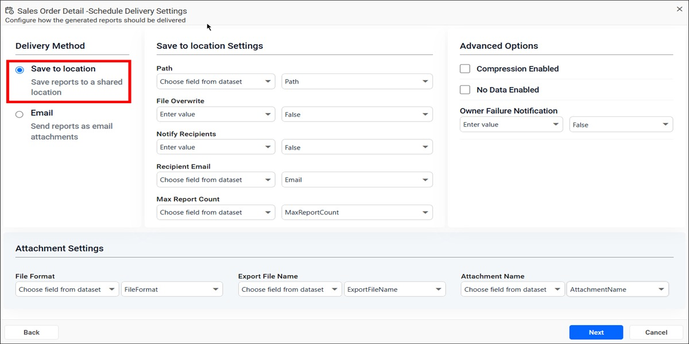
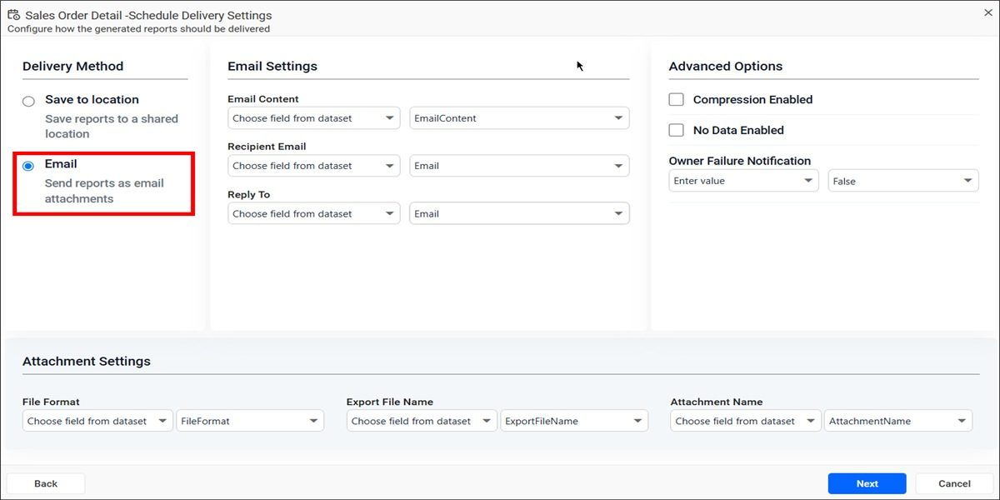
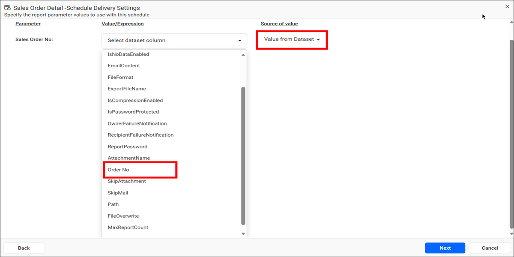
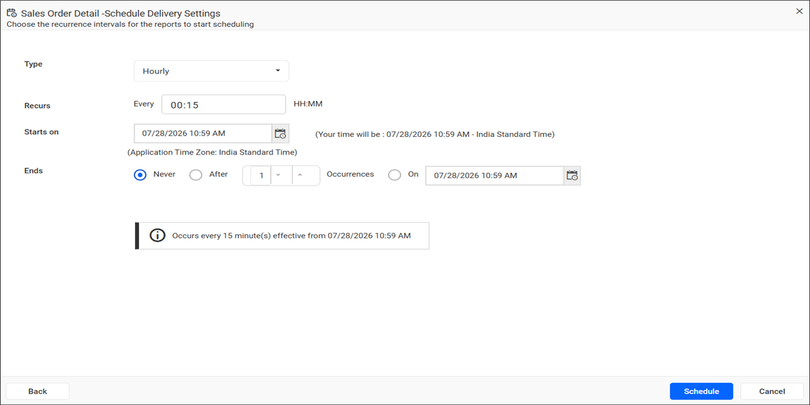

# Create a data-driven schedule in {{site.productNameTM}} Report Server

Data-Driven / Burst Scheduling in the {{site.productNameTM}} Report Server automates the generation and delivery of personalized reports based on records available in a dataset. The scheduler processes each row in the selected dataset and generates an individual report using the values configured for that row.

Data-driven scheduling helps organizations distribute reports to multiple recipients with different parameter values, export formats, delivery methods, and report settings. You do not need to create multiple schedules manually.

> **NOTE:** Data-Driven Scheduling is best suited for reports that contain parameters. The scheduler uses parameter values from each dataset row to generate personalized reports for different recipients.

## How do I create a data-driven schedule?

You create a data-driven schedule in the Report Server from the context menu of the report you want to schedule. Follow these steps:

1. Click the **Schedule** option in the context menu of the respective report.

2. Select **Data-driven / Burst Schedule**.

3. Choose the required **Category** and **Report**.

4. Enter a unique **Schedule Name**.

5. Click the `Next` button.

The following image shows the schedule dialog with the data-driven option selected.



> **NOTE:** Before creating a Data-Driven Schedule, create the required datasource and dataset in the {{site.productNameTM}} application. The dataset should contain the recipient information, report parameters, delivery settings, export options, and other schedule configuration values required for report generation. Only datasets associated with the selected datasource are available for selection during schedule configuration.

## How do I select the datasource and dataset?

The datasource and dataset in a Report Server data-driven schedule contain the records used to configure recipients, report parameters, delivery settings, export formats, and other schedule options. Each row in the selected dataset represents an individual report generation request.



1. Select the required **Data Source**.

2. Select the required **Dataset**.

3. Click the `Preview Data` button to verify the dataset records. The preview displays the last 5 records from the selected dataset.

4. Click the `Next` button to continue.

> **NOTE:** Each unique row identified in the selected dataset triggers the generation of an individual report. Ensure that the dataset contains only the intended recipients and schedule configuration values.

### What does a sample dataset record look like?

The following sample JSON dataset record shows values that a {{site.productNameTM}} data-driven schedule can use:

```json
{
    "ReportName": "SalesOrderDetail",
    "DeliveryType": "Mail",
    "Email": "sample@gmail",
    "IsNoDataEnabled": false,
    "EmailContent": "#### **Scheduled Report**\n\n\nHello {:FullName},\n\nPlease find attached the report you requested.\n\nThe schedule {:ScheduleName} has successfully exported the report. You can access it here: {:ReportLink}.\n\n\nRegards,\n\n{:OrganizationName}",
    "FileFormat": "Pdf",
    "ExportFileName": "{:ScheduleName}-{:ReportName}-{:Timestamp}",
    "IsCompressionEnabled": false,
    "IsPasswordProtected": true,
    "OwnerFailureNotification": true,
    "RecipientFailureNotification": false,
    "ReportPassword": "sample@123",
    "AttachmentName": "Report_1",
    "Order No": "SO50750",
    "SkipAttachment": true,
    "SkipMail": false,
    "Path": "Reports",
    "FileOverwrite": true,
    "MaxReportCount": 200,
    "NotifyRecipients": true
}
```

> **NOTE:** The column names shown in the sample dataset (such as `Email`, `FileFormat`, `Order No`, `Path`, and `AttachmentName`) are provided for illustrative purposes only. You can use your own dataset column names and map them to the corresponding schedule properties during configuration. Ensure that the dataset contains the values required for report generation, delivery, and parameter mapping.

## How do I configure delivery settings?

The Delivery Settings page in a Report Server data-driven schedule determines how the generated reports are delivered for each dataset row. After you select the datasource and dataset, click the `Next` button to open it.



All schedule properties support two configuration methods:

* **Choose field from dataset** - Uses values from a dataset column during schedule execution.
* **Enter value** - Uses the same fixed value for all generated reports.

### Save to Location

**Save to Location** in a data-driven schedule exports generated reports to a shared location. Select **Save to Location** and configure the following settings:

* **Path** - Specifies the folder where the generated reports are saved.
* **File Overwrite** - Determines whether existing files with the same name should be overwritten.
* **Notify Recipients** - Sends notifications after report generation.
* **Recipient Email** - Email address used for notifications.
* **Max Report Count** - Specifies the maximum number of reports that can be generated during a single schedule execution. Ensure that this value is greater than or equal to the number of records in the selected dataset; otherwise, some dataset records may not be processed.



### Email

**Email** delivery in a data-driven schedule sends generated reports as email attachments. Select **Email** and configure the following settings:

* **Email Content** - Custom email message sent to recipients.
* **Recipient Email** - Email address of the report recipient.
* **Reply To** - Email address used for reply responses.



### Attachment Settings

Attachment settings in a data-driven schedule determine how the Report Server creates the generated report files.

* **File Format** - Export format for the report. Supported formats include PDF, Excel, Word, HTML, PPT, CSV, and XML.
* **Export File Name** - Name of the generated file.
* **Attachment Name** - Name used for the email attachment.

### Advanced Options

Advanced options in a data-driven schedule control compression, empty-report handling, and failure notifications. The following advanced settings are available:

* **Compression Enabled** - Compresses the exported report before delivery.
* **No Data Enabled** - Processes the schedule even when the report does not contain data.
    * **Skip Attachment** - Sends the email notification without attaching the report when the generated report contains no data.
    * **Skip Mail** - Does not send the email notification when the generated report contains no data.
* **Owner Failure Notification** - Sends notifications to the schedule owner when schedule execution fails.

You can retrieve the values for these settings directly from dataset columns or enter them manually.

Click the `Next` button after you configure the delivery settings.

## How do I map report parameters to dataset columns?

The Report Parameter Mapping page in a Report Server data-driven schedule supplies parameter values dynamically for each dataset row.



For each report parameter, select the source from the **Source of value** dropdown. The following options are available:

* **None** - No value is assigned to the parameter.
* **Use Default** - Uses the default value configured in the report.
* **Expression** - Uses a custom expression.
* **Value from Dataset** - Retrieves the parameter value from a dataset column.

When **Value from Dataset** is selected as the **Source of value**, you can select a dataset column from the **Value/Expression** dropdown for each report parameter. The scheduler uses the selected dataset column to populate the corresponding report parameter during schedule execution.

For example, if the report contains a parameter named **Sales Order No**, you can map it to any suitable dataset column that contains the required parameter values, such as **Order No**.

| Dataset Column | Report Parameter |
|---------------|------------------|
| Order No | Sales Order No |

When the schedule executes, the scheduler retrieves the value from the selected dataset column. It assigns that value to the corresponding report parameter for each dataset record.

> **NOTE:** Dataset column names are user-defined and can vary based on the datasource design. Any dataset column can be mapped to a report parameter as long as it contains the appropriate values required for report generation.

Example dataset rows:

| Order No |
|----------|
| SO50750 |
| SO50751 |
| SO50752 |

In this example, the values from the **Order No** column are passed to the **Sales Order No** report parameter. The result is three personalized report outputs.

Click the `Next` button after you configure the parameter mappings.

## How do I set the schedule recurrence?

The recurrence settings of a Report Server data-driven schedule are similar to those available in a standard schedule. Specify when and how often the data-driven schedule should run.



Configure the following schedule options:

* **Type** - Select the schedule frequency such as Hourly, Daily, Weekly, Monthly, or Yearly.
* **Recurs** - Defines how often the schedule should repeat.
* **Starts On** - Specifies the date and time when the schedule begins.
* **Ends Never** - Runs indefinitely until manually disabled.
* **Ends After** - Stops after a specified number of occurrences.
* **Ends On** - Stops on a specified date and time.

A schedule summary helps you verify the configured recurrence pattern.

Click the `Schedule` button to create the data-driven schedule.

> **NOTE:** During execution, the scheduler processes each dataset row individually. The report parameters, recipients, export settings, file names, and delivery configuration are dynamically generated from the corresponding dataset record.

## Frequently asked questions

### How many reports does a data-driven schedule generate?

A {{site.productNameTM}} data-driven schedule generates an individual report for each unique row in the selected dataset. The **Max Report Count** must be greater than or equal to the number of records, or some records may not be processed.

### Which export formats can a data-driven schedule use?

Supported formats include PDF, Excel, Word, HTML, PPT, CSV, and XML.

### What happens when a generated report has no data?

With **No Data Enabled**, the schedule still runs. **Skip Attachment** sends the email without the report, and **Skip Mail** does not send the email.

## See also

* [Manage report schedules](./../manage-reports-schedule/)
* [Schedule report settings](./../schedule-report-settings/)
* [Custom schedule report settings](./../custom-schedule-report-settings/)
