# Create and manage report schedules in {{site.productNameTM}} Report Server

The {{site.productNameTM}} Report Server provides report-specific schedules to help you manage the processing and distribution of reports. All schedules specify a type of recurrence, which can be monthly, weekly, or daily.

You can add, edit, delete, and manage report schedules in {{site.productNameTM}} On-Premises Edition. You can also run schedules on demand and enable or disable them.

The schedules page displays the schedules that are accessible to the user based on their permissions.

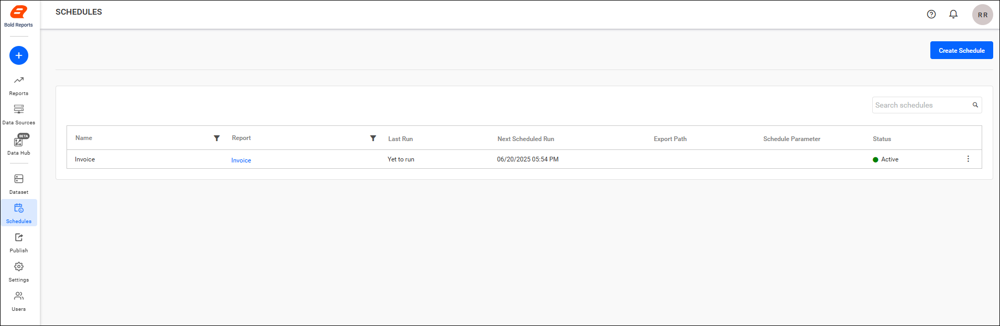

## How do I add a schedule?

You can create a schedule in the Report Server only if you have the `Create All Schedules` permission. You can create schedules in three ways:

1. Add a schedule from the `+` icon in the left side menu.
2. Add a schedule from the context menu of the respective reports.
3. Add a schedule from the schedule listing page.

### How do I add a schedule from the Create button menu?

The `+` icon in the Report Server left side menu opens the schedule dialog for any report.

1. Click the `+` icon in the left side menu and choose `Schedule` to create a new schedule.

    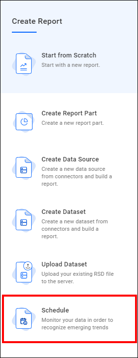

2. Choose the required category from the **Category** dropdown. Once you select a category, the reports under that category appear in the **Report** dropdown menu.

    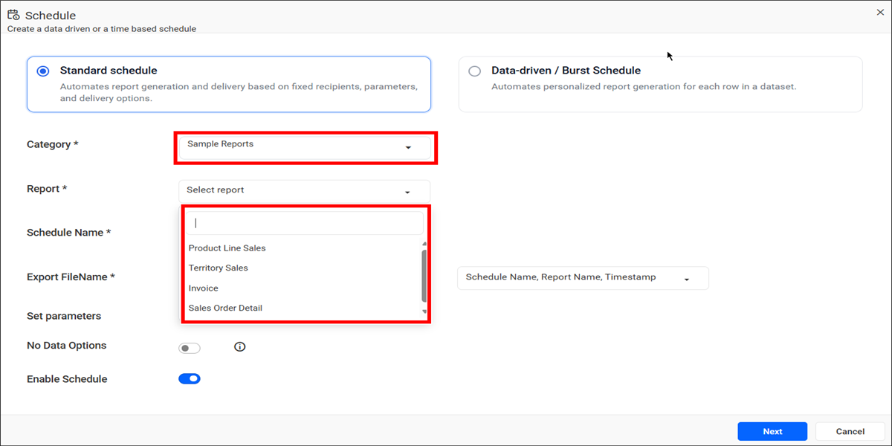

3. Select the desired report from the dropdown menu.

    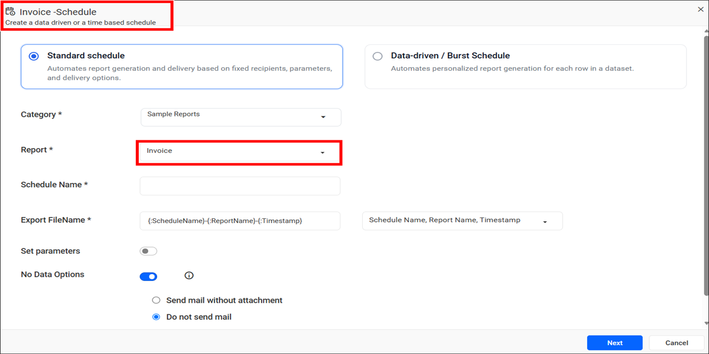

### How do I add a schedule from the context menu of the respective reports?

The reports grid context menu in the Report Server opens the schedule dialog with the category and report already selected.

1. Click the `Actions` button in the reports grid context menu, then select **Create Schedule** to schedule the corresponding report.

    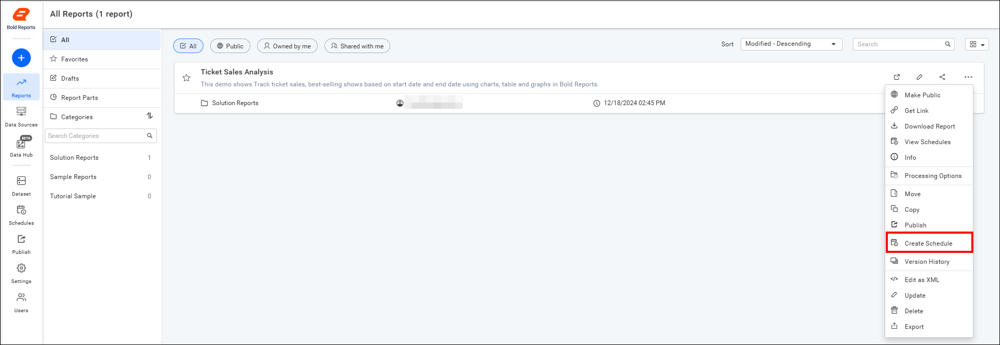

2. When the dialog box opens, the category and report values are preselected by default.

    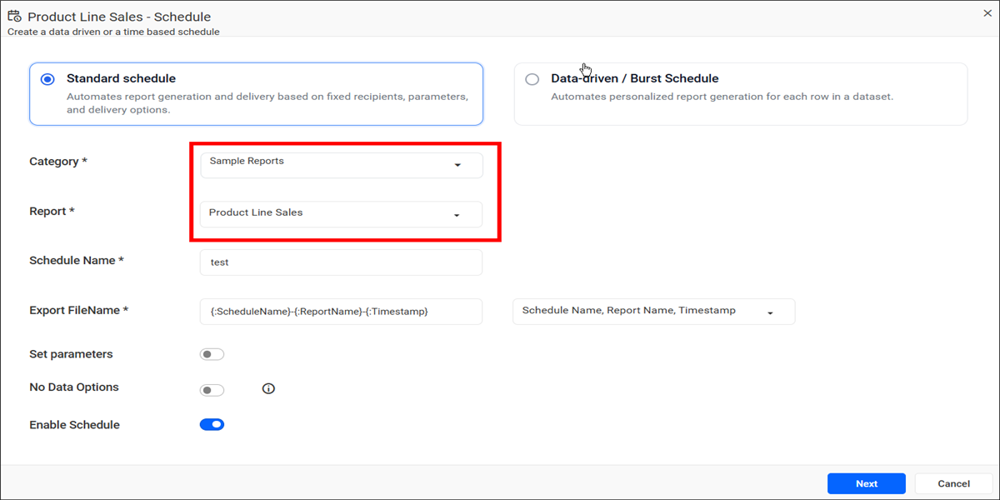

    > Categories or Reports can be changed from the schedule dialog box.

3. After you add the schedule details, click `Next` in the schedule dialog.

### How do I add a schedule from the schedule listing page?

The **Schedules** page in the Report Server has a `Create Schedule` button that opens the schedule dialog.

1. Click `Schedules` in the left side panel of the Report Server, and then click the `Create Schedule` button.

    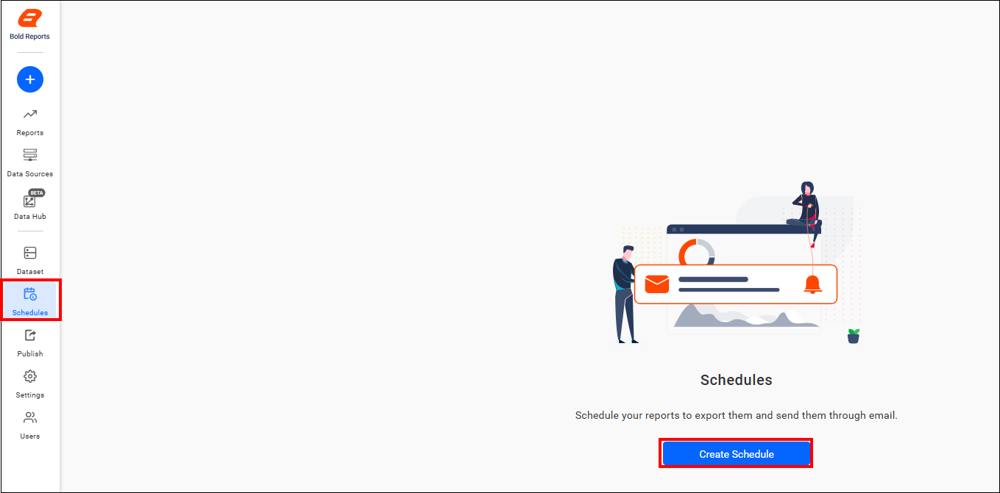

2. Select the required category from the `Category` dropdown. After you select the category, the reports under that category appear in the `Report` dropdown.

    

3. Select the required report from the dropdown.

    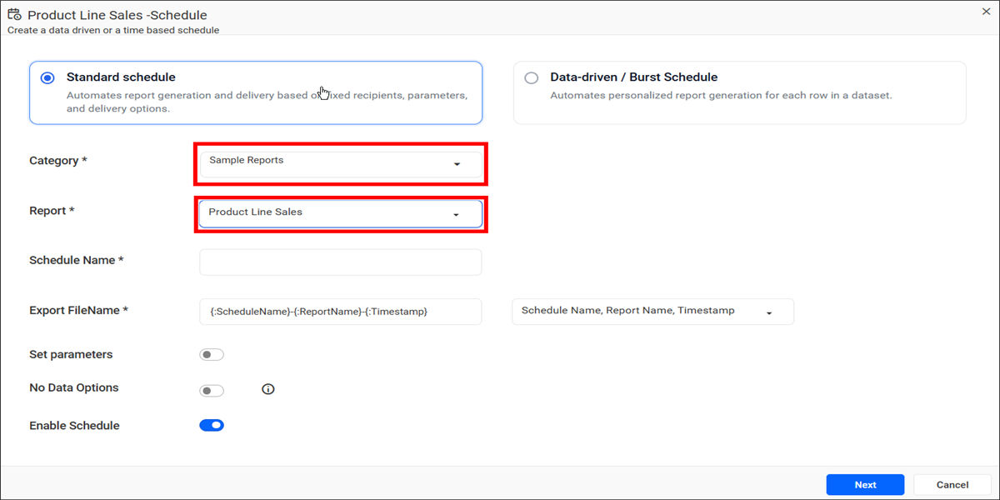

4. Select the export name from the dropdown options, which include Schedule Name, Report Name, Timestamp and Date Format.

    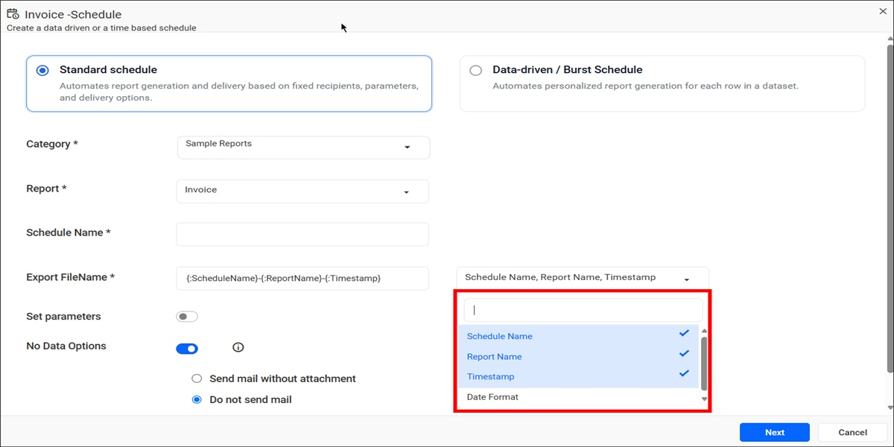

#### Export FileName predefined variables

The Report Server offers the following predefined variables for the export file name:

* Schedule Name : The name assigned to the specific schedule.
* Report Name   : The name of the report that is scheduled.
* Timestamp     : A unique identifier generated based on the exact date and time the report was scheduled.
* Date Format   : The format in which the date will be displayed in the report.

## What do the No Data Options do?

`No Data Options` in a Report Server schedule control what happens when a scheduled report has no data. When you enable it, scheduled reports with no data follow the selected behavior:

* When you select the **Send mail without attachment** option, the system sends an email notification without attaching the report if the report has no data.

    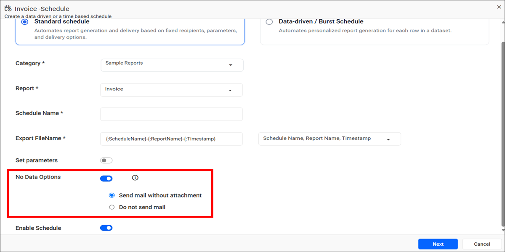

* When you select the **Do not send mail** option, no email is sent if the scheduled report contains no data.

    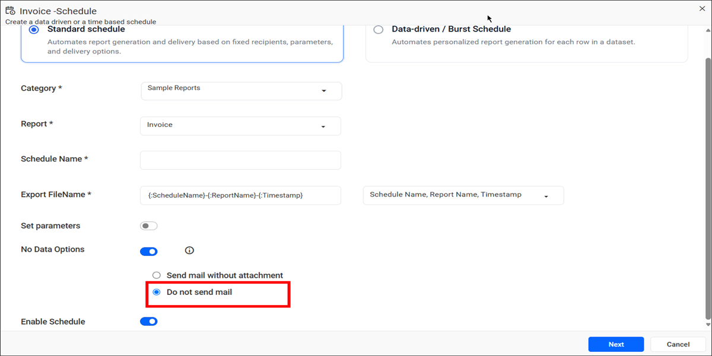

## How do I configure report parameters in a schedule?

The Report Server scheduler dialog displays the parameters available for the report.

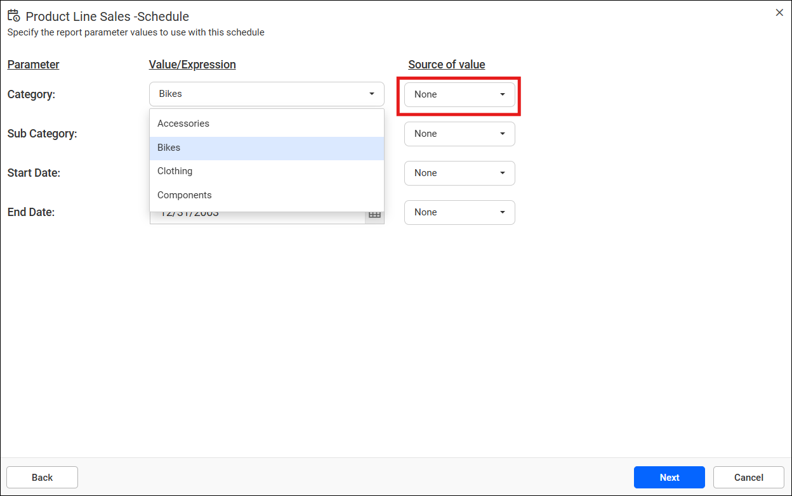

Select the parameter values to schedule and export the reports with these filters.

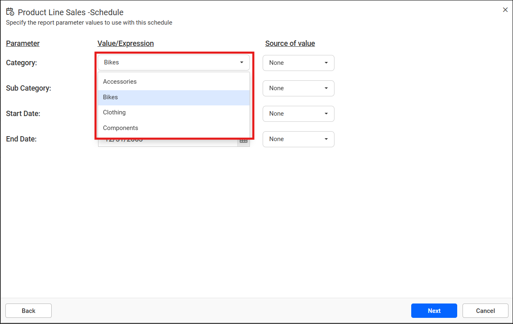

> **Note:** To modify the parameter values, enable the `Set Parameters` option in the schedule dialog box.

## How do I configure recurrence intervals?

The `Add Schedule` dialog box in the Report Server lets you select the recurrence type, recurrence interval, start date and end date.

* You can schedule reports to run hourly, daily, weekly, monthly, or yearly.

* The application's time zone appears below the date picker. The start time of the schedule is converted to the client's time zone and shown on the right side for your convenience.

    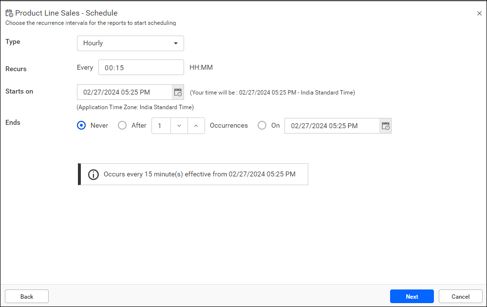

## How do I compress and password-protect exported files?

The Report Server schedule dialog lets you compress exported reports into a zip file and protect them with a password.

* You can compress the exported reports into a zip file by selecting the **Enable File Compression** option in the schedule dialog box. Compression is not mandatory, and you can turn it off at any time by unchecking that option.

    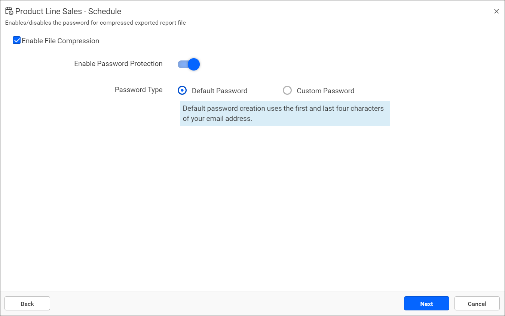

* You can make exported reports more secure with password protection by enabling the **Enable Password Protection** option in the schedule dialog box. The **Default Password** option is selected by default.

    > For the default password, the password will be generated as a combination of the first and last four characters of the email.

* You can customize the password protection rules for exporting reports by choosing the **Custom Password** option.
* However, the username or first name is mandatory in the password condition.

    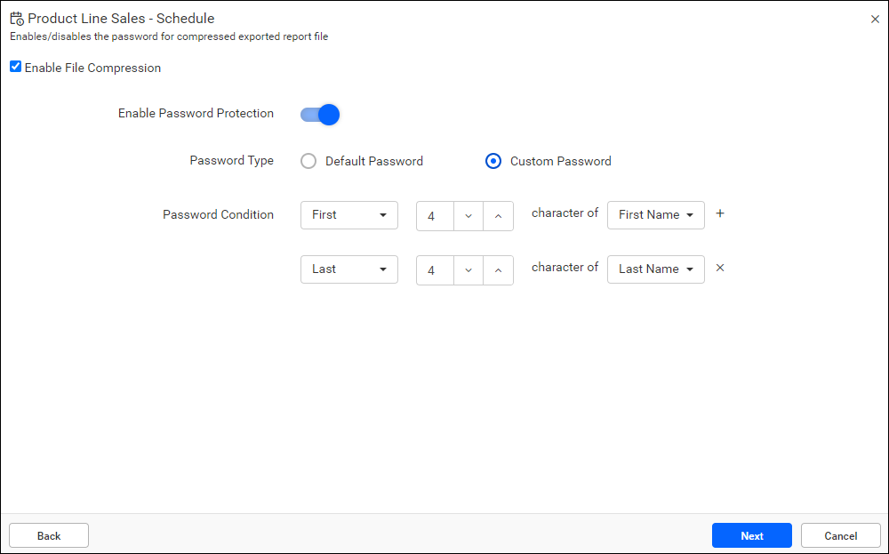

* When you configure a <b>Custom Password</b> for exported reports, the available password conditions depend on the recipient type:
    <ul>
        <li>
            <b>Internal users</b> – Passwords can be generated using any combination of the selected user attributes, such as First Name, Last Name, Email, and Custom Text.
        </li>
        <li>
            <b>External recipients</b> – Password creation supports only <b>Email</b> and <b>Custom Text</b>. User-specific fields such as First Name and Last Name are not supported for external recipients.
        </li>
    </ul>

    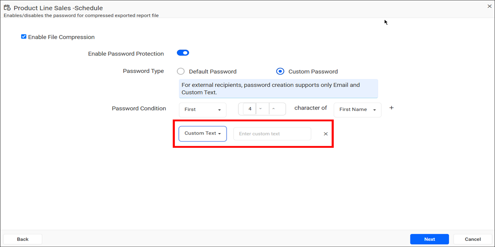

For instance, consider a sample user with the following details:

First Name : John 
Last Name : Michael 
Email: johnmichael@gmail.com 
Custom Text: john@123 

The following table lists possible password combinations for this sample user and their unlock passwords.

<table>
<tr>
    <th>
        Password Rule
    </th>
    <th>
        Unlock Password
    </th>
</tr>
<tr>
    <td>
        First four characters of Email   +  
        Last four characters of First Name
    </td>
    <td>
        johnJohn
    </td>
</tr>
    <tr>
    <td>
        First four characters of First Name   +  
        First four characters of Last Name
    </td>
    <td>
        JohnMich
    </td>
</tr>
    <tr>
    <td>
        First four characters of Email   +  
        Last four characters of Last Name
    </td>
    <td>
        johnhael
    </td>
</tr>
<tr>
    <td>
        Last four characters of First Name   +  
        Custom Text
    </td>
    <td>
        Johnjohn@123
    </td>
</tr>
</table>

## How do I customize the mail template?

The mail template in a Report Server schedule defines the text that is sent via email to the Report Server user.

* The mail template initially displays the default template. If the custom password is enabled, you can add a password hint to the mail template if necessary.

* You can also customize the email template to your preference.

    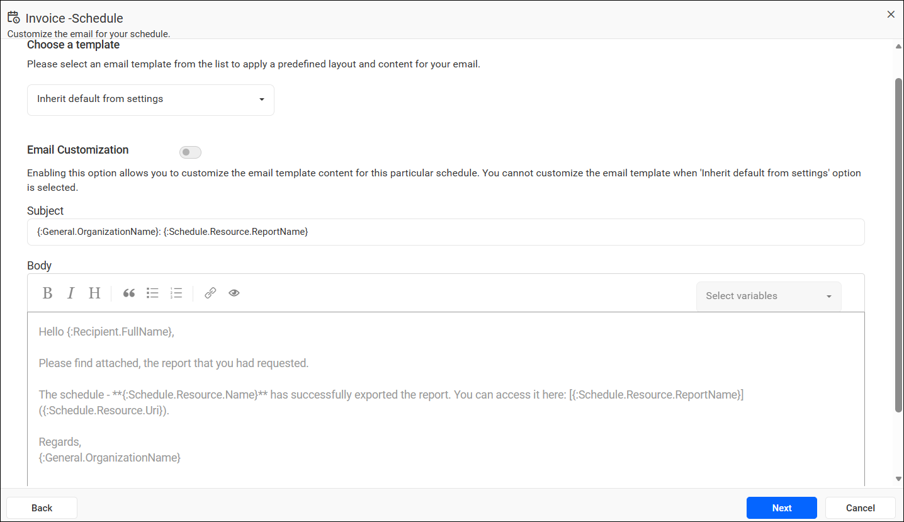

### Schedule Email Templates

Schedule email templates in the Report Server are created and managed from the **Email Templates** page under email settings. Templates created for the **Timed Report Export** notification type are available for selection while creating or editing a report schedule.

When you configure a schedule email, the **Choose a template** dropdown displays the following options:

* **Inherit default from settings** - Uses the template marked as **Default** in the **Timed Report Export** email templates configuration page.
* **Timed Report Export** - Uses the system default email template.
* Templates created for the **Timed Report Export** notification type are listed in the dropdown using their template names. For example, if a template named **test** is created in the Email Templates settings page, it will appear as **test** in the template selection list.

    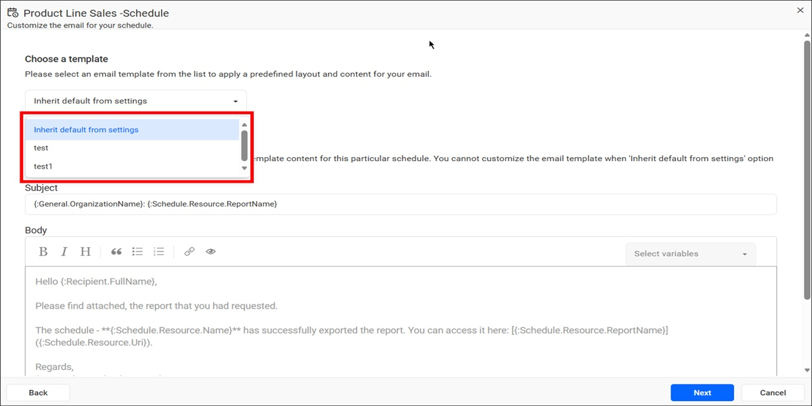

> **NOTE:** When **Inherit default from settings** is selected, the schedule uses the template marked as **Default** in the Email Templates settings page. Any custom templates created for the **Timed Report Export** notification type are also listed in the template dropdown.

### Mail template predefined variables

Predefined variables in the Report Server mail template insert user and schedule information automatically. When you select a variable, the corresponding user information is retrieved from the server and inserted into the mail template.

* {Full Name}: The recipient's full name.
* {First Name}: The recipient's first name.
* {Last Name}: The recipient's last name.
* {Schedule Name}: The name of the schedule.
* {Report Name}: The name of the scheduled report.
* {Report Link}: The link to the scheduled report.
* {Export Format}: The chosen export file format for the schedule.
* {Date}: Specifies the date when the schedule is triggered.
* {Organization Name}: The [Organization name](./../../../administrator-guide/custom-rebranding/#organization-name), retrieved from the site settings.
* {Category Name}: The category name associated with the selected report.
* {Expression}: Use dynamic expressions to customize content. See the [Expression](./../../report-designer/compose-report/expressions/) documentation for guidance on framing expressions.
    > Expressions utilizing **Dataset Fields** are not supported in the scheduled email template.
* {Report Image}: Provides support for inserting the report into the email body as an image.

### Configure the Export Types

A Report Server schedule can export reports in one or multiple formats such as **PDF**, **Word**, **Excel**, **HTML**, **PPT**, **CSV**, and **XML**.

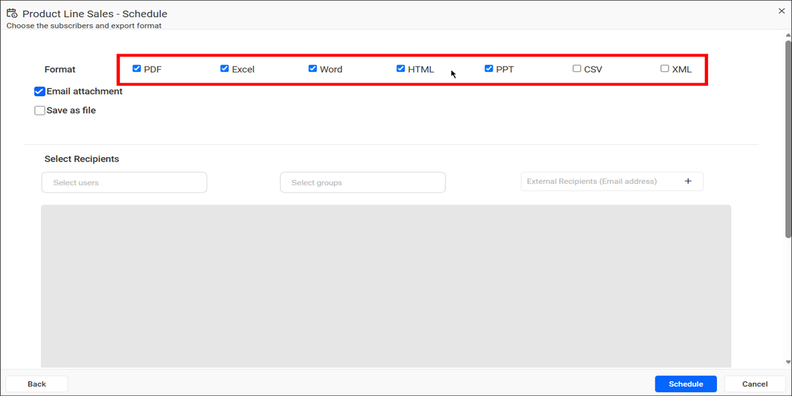

> **NOTE:** Multiple selected export formats are delivered as a single `.zip` attachment. When only one export format is selected, the report is attached in the corresponding file format.

### Email attachment

The **Email attachment** option in a Report Server schedule sends exported reports to individual users or groups.

* You can also send the exported reports to external recipients by providing their **Email addresses**. You can add multiple external recipients at once by separating the emails with a comma(,). For example: [recipient1@gmail.com,recipients2@gmail.com].

    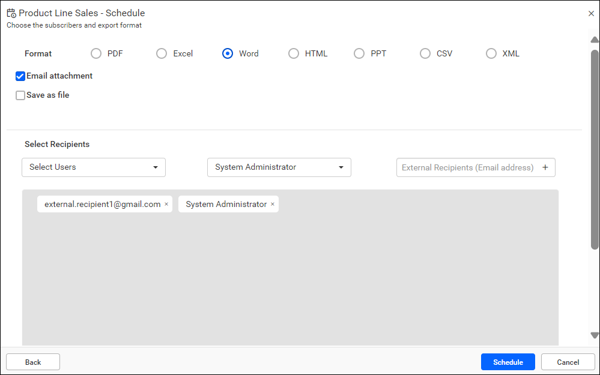

    > **Note:** Email attachment is selected by default.

#### Combine Recipients

The **Combine Recipients** option in a Report Server schedule sends a single email to all selected recipients instead of multiple individual emails.

* When enabled, the selected users, groups, and external recipients receive the scheduled report in a single email.

* When disabled, separate emails are sent to each selected recipient.

    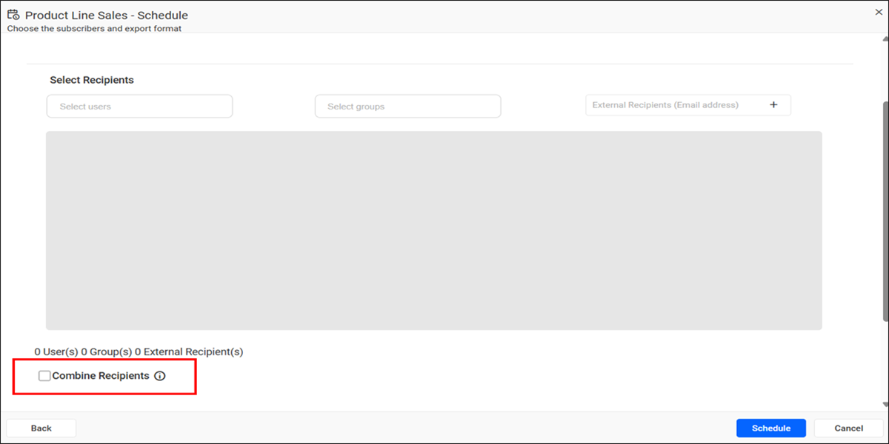

* When the **Combine Recipients** option is enabled, the **CC** section becomes available. You can add users, groups, and external recipients as CC recipients.

    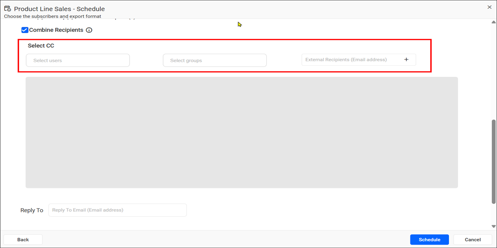

> **Note:** When the **Combine Recipients** option is selected and no **CC** recipients are added, all selected users, groups, and external recipients in the **To** field receive a single email. When the **Combine Recipients** option is not selected, separate emails are sent to each recipient.

### Save as file

The **Save as file** option in a Report Server schedule saves exported reports to any location.

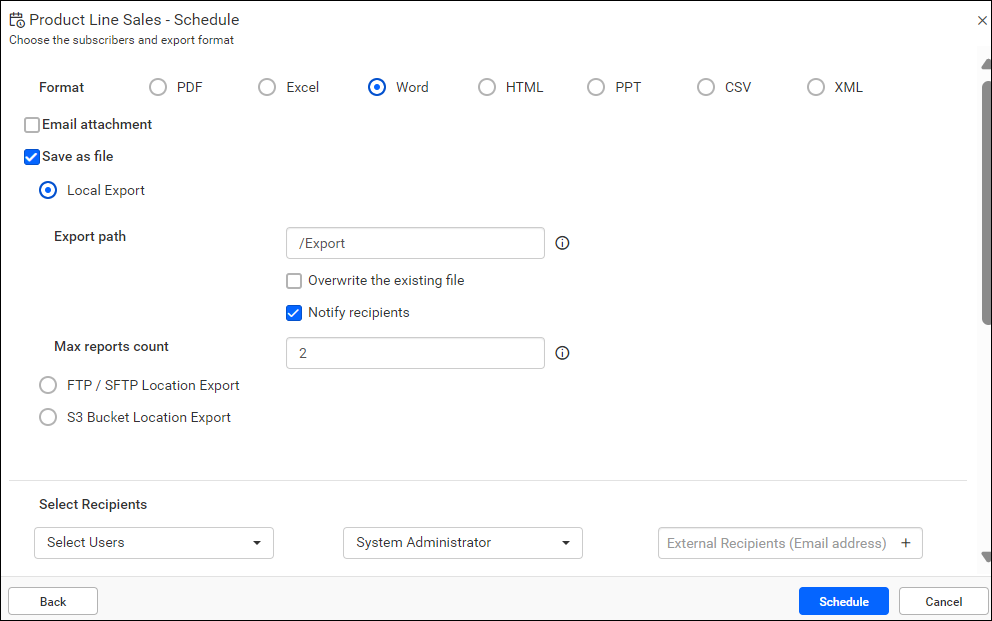
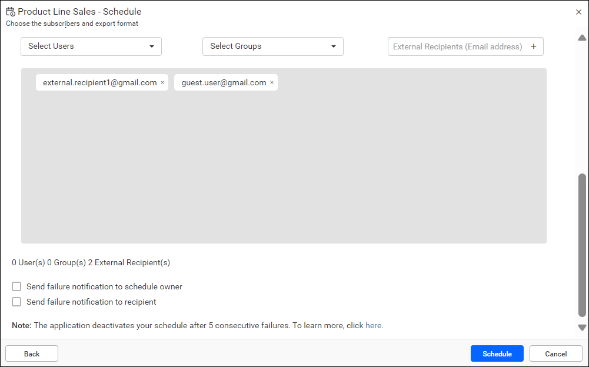

#### Local Export

Local export in a Report Server schedule saves the exported report to a folder. Specify the **Export Path** and **Max reports count**.

**Export Path** - The location to save the exported report. By default, the folder path will be **\Export**, and the default root path location will be **C:\BoldServices\app_data\reporting\Jobs**.

* Edit the default folder path location to specify the required folder path in the Export path.

* You must specify the required root path, which can be updated in the [Schedule Report Settings](./../../../designer-guide/manage-schedule/schedule-report-settings/#save-as-file) export path.

**Max Reports Count** - Specify the maximum number of exported reports to be saved at this location.

**Overwrite the Existing File** - Enabling this option overwrites existing files in the export folder.

**Notify Recipients** - Enabling this option sends notifications to the recipients.

#### Export to FTP or SFTP Location

FTP or SFTP export in a Report Server schedule saves the exported file at a network location.

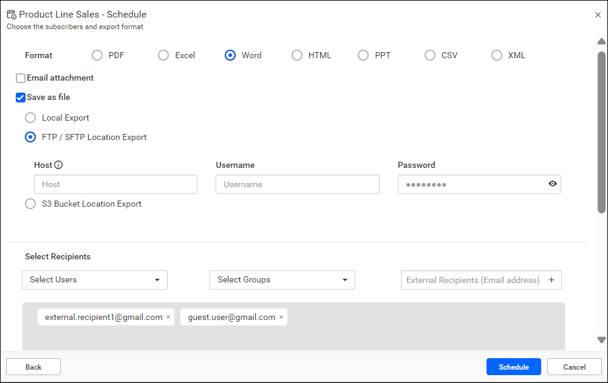

* To save the exported file at a network location, you must provide the path in UNC(Universal Naming Convention). For example, `ftp://192.168.203.23/Export` or `sftp://192.168.203.23/Export`.

    **Root directory path**: `ftp://192.168.203.23`

    **Relative path**: `/Export`

    * You can specify the root directory path in [Schedule Report Settings](./../../../designer-guide/manage-schedule/schedule-report-settings/#ftp-or-sftp-settings), and the relative path when you create the schedules.

    * If the Export folder does not exist, the folder is created automatically while running the schedules.

      > **Write** permission is required for the root directory path folder.

* When you click **Schedule**, the report is scheduled for the selected recurrence.
    > **Read, Write, Delete** permissions for that **Specific Schedule** will be granted to the user who created the schedule.

### S3 Bucket Location Export

S3 Bucket Location Export in a Report Server schedule exports reports directly to an Amazon S3 bucket. Provide the necessary bucket details and credentials to configure it.

**Credential Type:** Select either **Access Key** or **KMS Key** to authenticate and access the Amazon S3 bucket.

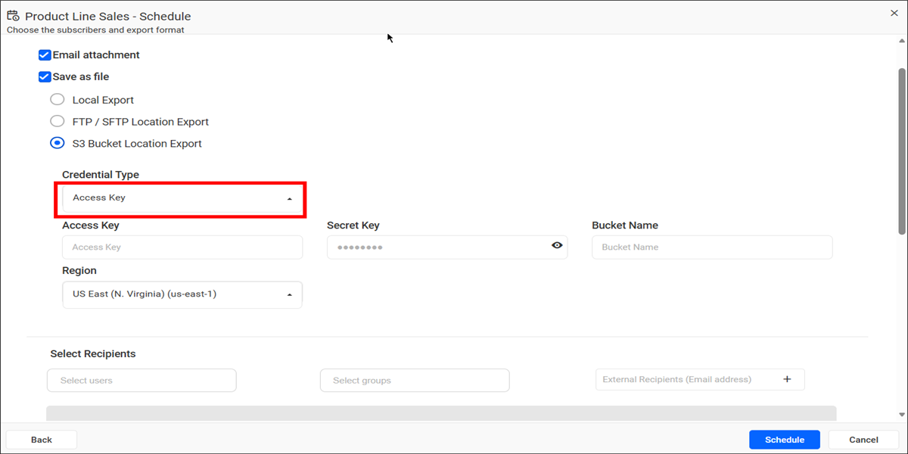

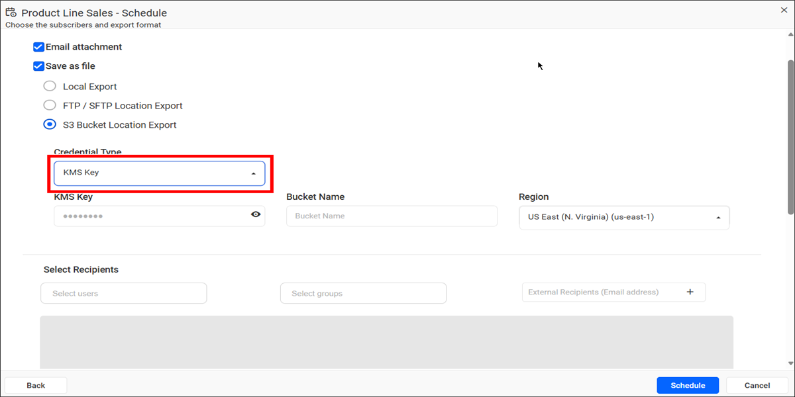

> **NOTE:** When using the **KMS Key** credential type, the environment hosting the {{site.productNameTM}} application must have the required permissions to access both the Amazon S3 bucket and the specified AWS KMS key.

You can set the default export location in the [schedule report settings](./../../../designer-guide/manage-schedule/schedule-report-settings/#s3-bucket-settings) file and modify the location here as needed.

### Reply to Email

The reply to email option in a Report Server schedule becomes enabled when an email attachment is selected. You can specify a `Reply-To` email address. When recipients reply to the scheduled email, replies go to the configured address instead of the sender’s email.

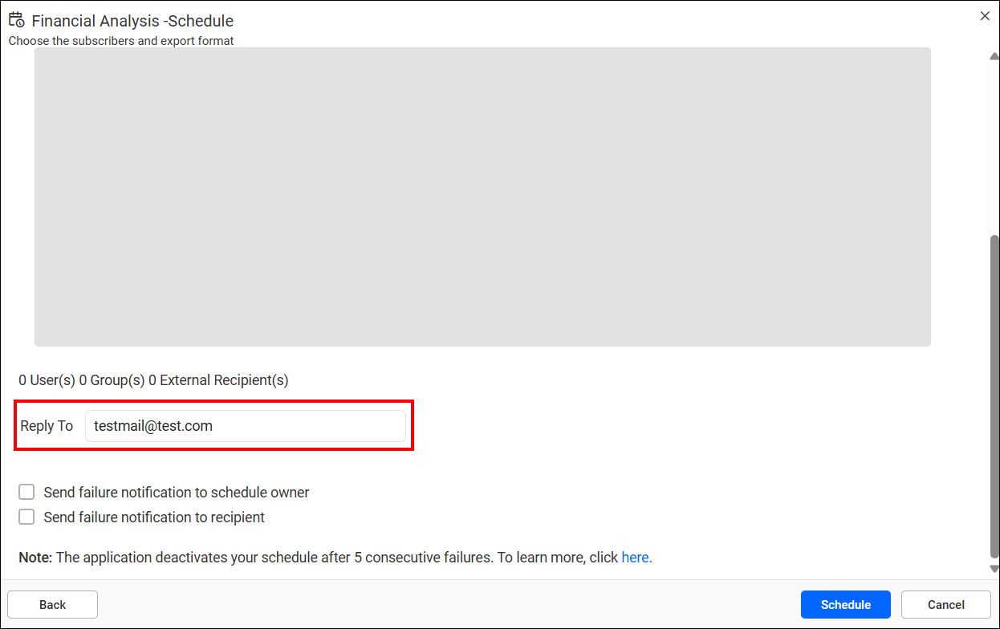

#### Sending Schedule failure notification to the owner and recipients

The Report Server supports sending notifications of schedule failure to both the schedule owner and recipients. If a schedule export fails, an email containing a failure error message can be sent to both the owner and recipients.

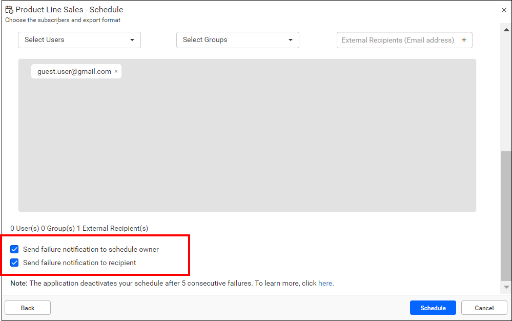

> **Note:** When scheduling emails, attachment size limits can cause failures if the total email size exceeds the allowed threshold. See the [email service sending limits KB article](https://support.boldreports.com/agent/kb/19380) for the email service and its sending limits.

## How do I run a schedule now?

The **Run Now** option in the Report Server schedule grid context menu runs a schedule on demand. The report is exported in the specified format and sent to the recipients via email, along with a link to the report in {{site.productNameTM}}.

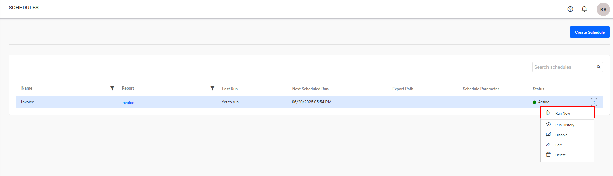

## How do I view the run history of a schedule?

The **Run History** option in the Report Server schedule grid context menu shows the run history of a schedule.

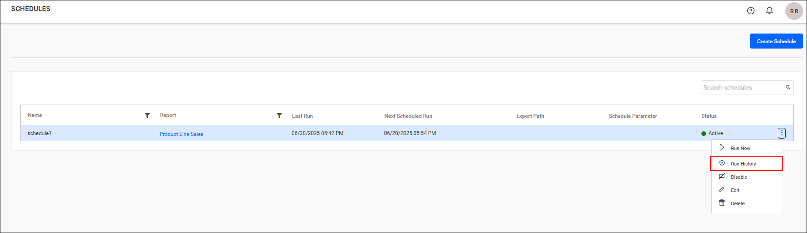
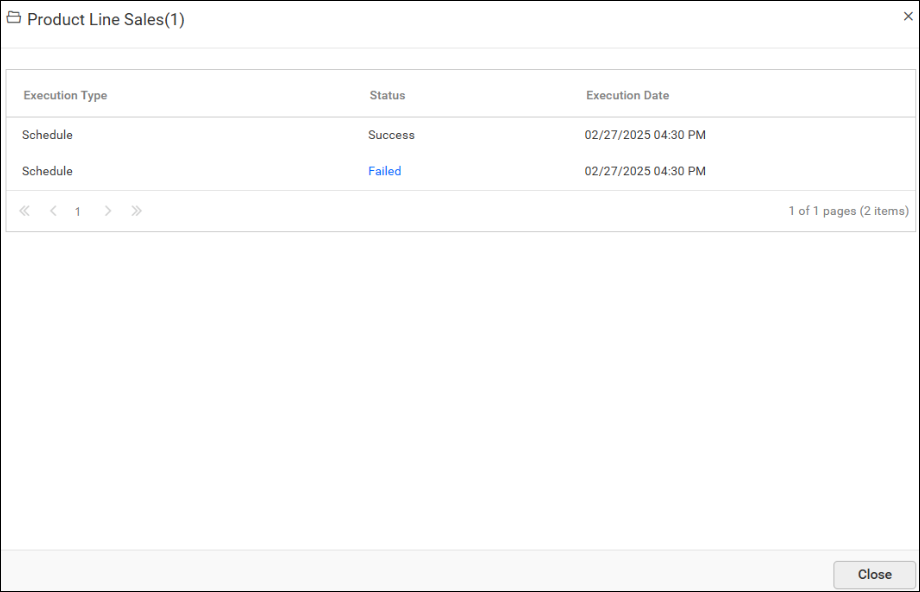

You can also view failure information by clicking the failed link in the Run History dialog.

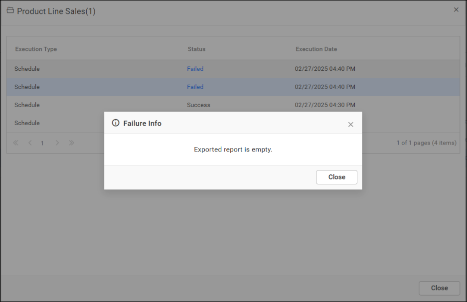

## How do I enable or disable a schedule?

You can disable a Report Server schedule at any time, and it ignores any future occurrences. When you enable it again, it gets the next occurrence and runs accordingly.

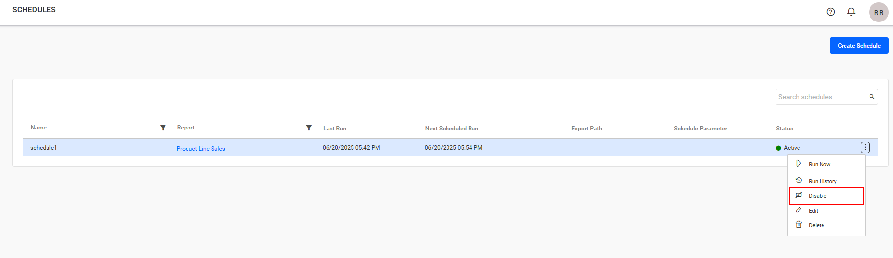

## How do I edit a schedule?

The **Edit Schedule** dialog box in the Report Server lets you change the category, report, name, recurrence type, recurrence interval, start and end dates, export format, and recipients.

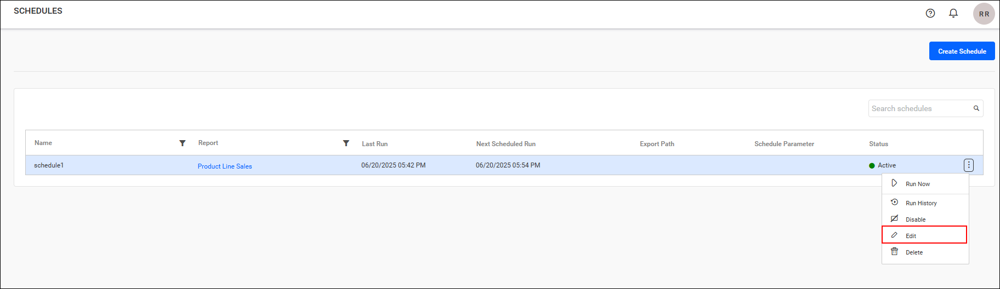

## How do I delete a schedule?

You can delete schedules from the Report Server when you no longer need them.

1. Click the **Actions** button in the schedules grid context menu.
2. Select **Delete** to delete the schedule.

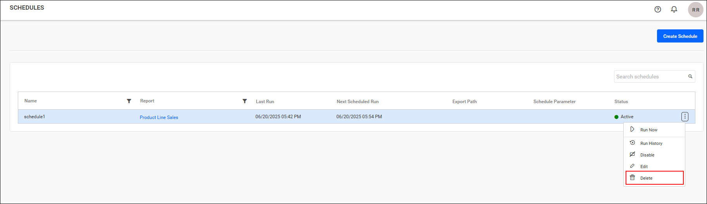

## REST API reference

The following table lists the available APIs related to schedules in {{site.productNameTM}} On-Premises Edition.

<table>
    <tr>
        <th>
            Action
        </th>
        <th>
            HTTP Method
        </th>
        <th>
            Endpoint
        </th>
        <th>
            Description
        </th>
    </tr>
    <tr>
        <td>
            <a href="https://help.boldreports.com/enterprise-reporting/rest-api-reference/v1.0/server-api-reference/#operation/Items_AddSchedule" target="_blank">AddSchedule</a>
        </td>
        <td>
            POST
        </td>
        <td>
            /api/site/{tenant-name}/v1.0/reports/schedule
        </td>
        <td>
            Adds a schedule to the server. Schedule details should be provided as input.
        </td>
    </tr>
    <tr>
        <td>
            <a href="https://help.boldreports.com/enterprise-reporting/rest-api-reference/v1.0/server-api-reference/#operation/Items_UpdateSchedule" target="_blank">UpdateSchedule</a>
        </td>
        <td>
            PUT
        </td>
        <td>
            /api/site/{tenant-name}/v1.0/reports/schedule/{scheduleid}
        </td>
        <td>
            Updates a schedule. Schedule ID should be provided in the path parameter, and the schedule details should be provided as input.
        </td>
    </tr>
    <tr>
        <td>
            <a href="https://help.boldreports.com/enterprise-reporting/rest-api-reference/v1.0/server-api-reference/#operation/Items_RunScheduleReport" target="_blank">RunScheduleReport</a>
        </td>
        <td>
            GET
        </td>
        <td>
            /api/site/{tenant-name}/v1.0/schedules/{scheduleId}/run
        </td>
        <td>
            Runs a scheduled report. Should provide a schedule ID in the path parameter.
        </td>
    </tr>
    <tr>
        <td>
            <a href="https://help.boldreports.com/enterprise-reporting/rest-api-reference/v1.0/server-api-reference/#operation/Items_GetScheduleItemDetail" target="_blank">GetScheduleItemDetail</a>
        </td>
        <td>
            GET
        </td>
        <td>
            /api/site/{tenant-name}/v1.0/reports/schedule/{scheduleId}
        </td>
        <td>
            Returns the respective schedule details. Should pass Schedule ID in the path parameter.
        </td>
    </tr>
    <tr>
        <td>
            <a href="https://help.boldreports.com/enterprise-reporting/rest-api-reference/v1.0/server-api-reference/#operation/Items_GetScheduleItems" target="_blank">GetScheduleItems</a>
        </td>
        <td>
            GET
        </td>
        <td>
            /api/site/{tenant-name}/v1.0/reports/schedule/items
        </td>
        <td>
            Returns the list of scheduled items.
        </td>
    </tr>
    <tr>
        <td>
            <a href="https://help.boldreports.com/enterprise-reporting/rest-api-reference/v1.0/server-api-reference/#operation/Items_GetItems" target="_blank">GetSchedules</a>
        </td>
        <td>
            GET
        </td>
        <td>
            /api/site/{tenant-name}/v1.0/items
        </td>
        <td>
            Returns the list of schedules for the current user. ItemType should be Schedule.
        </td>
    </tr>
    <tr>
        <td>
            <a href="https://help.boldreports.com/enterprise-reporting/rest-api-reference/v1.0/server-api-reference/#operation/Items_IsItemNameExists" target="_blank">IsScheduleNameExists</a>
        </td>
        <td>
            POST
        </td>
        <td>
            /api/site/{tenant-name}/v1.0/items/is-name-exists
        </td>
        <td>
            Returns an item's existence, whether the given schedule name already exists or not on the server. Schedule name and ItemType as Schedule should be passed in the request body.
        </td>
    </tr>
    <tr>
        <td>
            <a href="https://help.boldreports.com/enterprise-reporting/rest-api-reference/v1.0/server-api-reference/#operation/Items_GetItemDetail" target="_blank">GetScheduleDetail</a>
        </td>
        <td>
            GET
        </td>
        <td>
           /api/site/{tenant-name}/v1.0/items/{id}
        </td>
        <td>
            Returns the specified schedule details from the server. Schedule item ID should be passed as a path parameter.
        </td>
    </tr>  
    <tr>
        <td>
            <a href="https://help.boldreports.com/enterprise-reporting/rest-api-reference/v1.0/server-api-reference/#operation/Items_DeleteItem" target="_blank">DeleteSchedule</a>
        </td>
        <td>
            DELETE
        </td>
        <td>
           /api/site/{tenant-name}/v1.0/items/{id}
        </td>
        <td>
            Deletes the specified schedule from the server. Schedule item ID should be passed as a path parameter.
        </td>
    </tr>
</table>

## Frequently asked questions

### Who can create a schedule in Report Server?

Only users with the `Create All Schedules` permission can create schedules in the {{site.productNameTM}} Report Server.

### What happens when I select multiple export formats?

Multiple selected export formats are delivered as a single `.zip` attachment. When only one export format is selected, the report is attached in the corresponding file format.

### Where can a schedule save exported reports?

A schedule can save exported reports to a local export path, an FTP or SFTP location, or an Amazon S3 bucket.

## See also

* [Schedule report settings](./../schedule-report-settings/)
* [Data-driven schedule](./../data-driven-schedule/)
* [Custom schedule report settings](./../custom-schedule-report-settings/)
