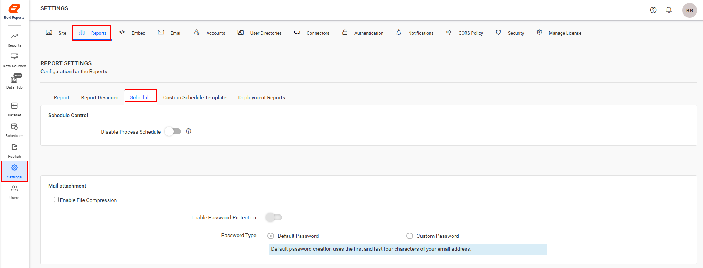
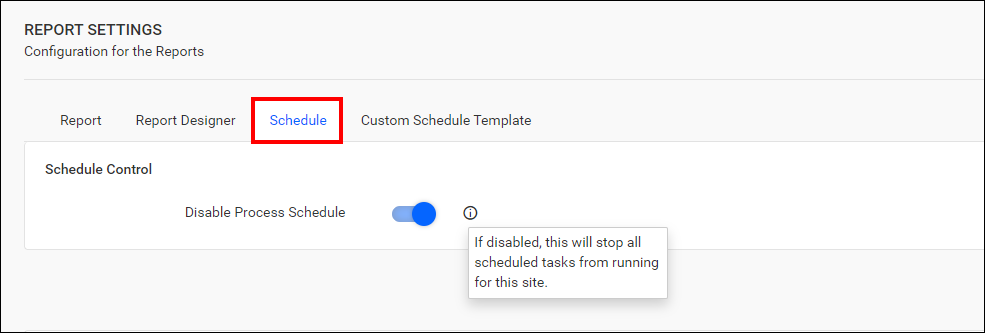
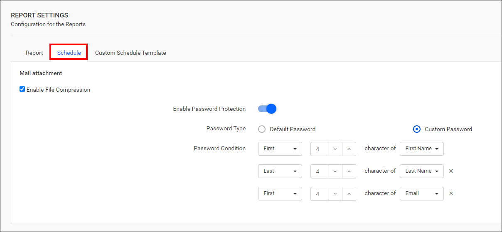
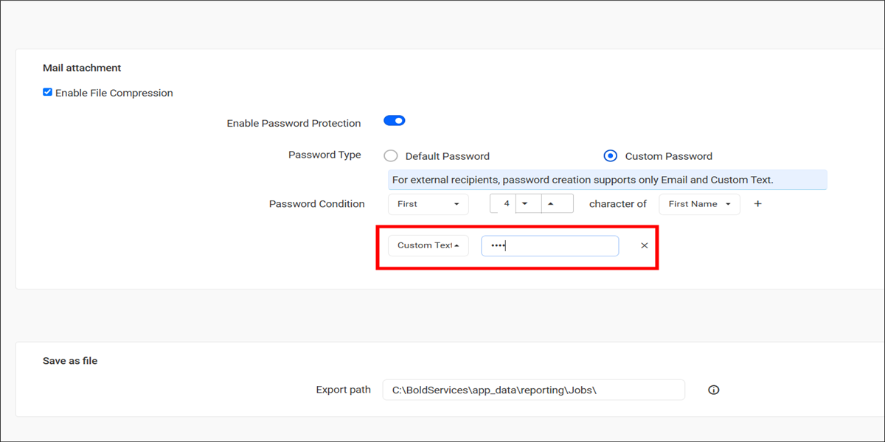
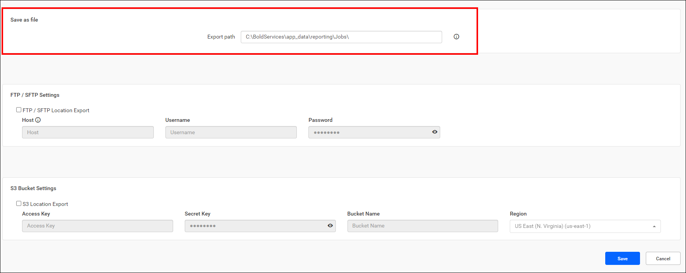
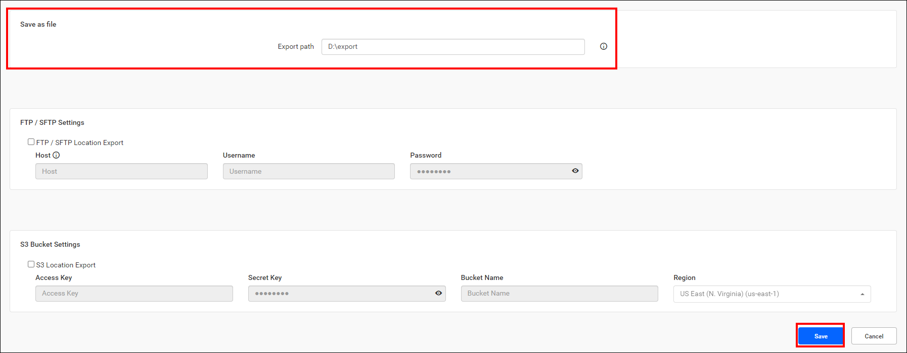
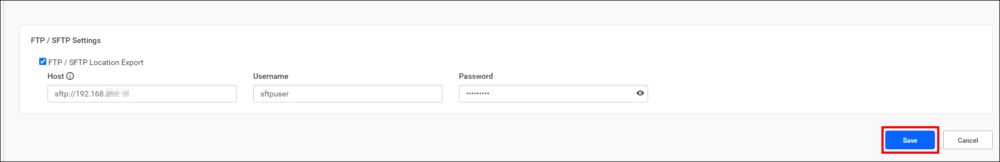
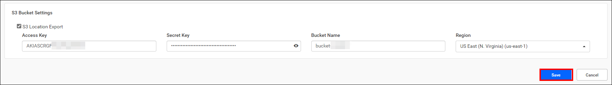
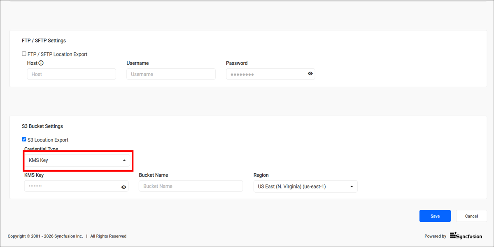

# Configure schedule report settings in {{site.productNameTM}} Report Server

Schedule report settings in the {{site.productNameTM}} Report Server let you manage schedule control, compress exported reports into a zip file, and configure export paths. Use the `Enable File Compression` option to compress the exports.

You can also set up FTP/SFTP and S3 bucket exports for scheduled reports. These settings let you specify where the reports are saved, how they are transferred to external storage locations, and control the scheduling of report exports.

## How do I stop all schedules on a site?

The **Disable Process Schedule** option in the Report Server schedule control settings stops all scheduled tasks for the site.

1. Click the `Settings` option in the Report Server left-side panel and navigate to the `Reports` tab.

    

2. Enable the **Disable Process Schedule** option. All scheduled tasks for this site are stopped.

    

3. After you configure the schedule control settings, click the `Save` button to apply the changes.

## How do I enable file compression and password protection?

The Report Server `Schedule` settings tab lets you compress exported reports into a zip file and protect them with a password.

1. Click the `Settings` option in the Report Server left-side panel and navigate to the `Reports` tab.

2. Switch to the `Schedule` tab, as shown in the following image.

    

3. Check the `Enable File Compression` option and click the `Save` button to save the settings.

4. Make exported reports more secure with password protection by enabling the `Enable Password Protection` option. The `Default Password` option is selected by default.

    > For the default password setting, the system will generate a password by combining the first four and the last four characters of the user's email.

5. Customize the password protection rules for exporting reports by choosing the `Custom Password` option. However, the username or first name is mandatory in the password condition.

    

6. When you configure a <b>Custom Password</b> for exported reports, the available password conditions depend on the recipient type:
    <ul>
        <li>
            <b>Internal users</b> – Passwords can be generated using any combination of the selected user attributes, such as First Name, Last Name, Email, and Custom Text.
        </li>
        <li>
            <b>External recipients</b> – Password creation supports only <b>Email</b> and <b>Custom Text</b>. User-specific fields such as First Name and Last Name are not supported for external recipients.
        </li>
    </ul>

    

7. For instance, consider a sample user with the following details:

    First Name : John 
    Last Name : Michael 
    Email: johnmichael@gmail.com 
    Custom Text: john@123 

8. The following table lists the possible password combinations for this sample user and their corresponding unlock passwords:
    <table>
        <tr>
            <th>
                Password Rule
            </th>
            <th>
                Unlock Password
            </th>
        </tr>
        <tr>
            <td>
                The First four characters of the Email   +  
                The Last four characters of the First Name
            </td>
            <td>
                johnJohn
            </td>
        </tr>
        <tr>
            <td>
                First four characters of First Name   +  
                First four characters of Last Name
            </td>
            <td>
                JohnMich
            </td>
        </tr>
        <tr>
            <td>
                First four characters of Email   +  
                Last four characters of Last Name   +  
            </td>
            <td>
                johnhael
            </td>
        </tr>
        <tr>
            <td>
                Last four characters of First Name   +  
                Custom Text
            </td>
            <td>
                Johnjohn@123
            </td>
        </tr>
    </table>

## Save as file

The **Export path** setting in the Report Server `Schedule` tab sets the root location where scheduled reports are saved as files.

1. Click the `Settings` option in the Report Server left-side panel and navigate to the `Reports` tab.

2. Switch to the `Schedule` tab, as shown in the following image.

    

3. Save the export path value for exporting reports to the specified location. By default, the directory root path will be **C:\BoldServices\app_data\reporting\Jobs**.

    

4. Edit the default directory root path value in the **Export path** option, and then click the `Save` button to save the changes.

    

## FTP or SFTP Settings

The Report Server can export scheduled reports to an FTP location when you configure the respective server credentials.

1. Enable the **FTP / SFTP Location Export** checkbox.
2. Enter the server credentials.
3. Save the changes to apply them.

The following image shows the FTP location settings.

## S3 Bucket Settings

The Report Server can export scheduled reports to an Amazon S3 bucket when you configure the respective bucket details. To do this, enable the **S3 Bucket Export** checkbox.

**Credential Type:** Select the authentication method used to access the Amazon S3 bucket.

### Access Key

The **Access Key** credential type authenticates to the Amazon S3 bucket with an access key and secret key.

* **Access Key:** Provide the access key for your Amazon S3 bucket.

* **Secret Key:** Provide the secret key for your Amazon S3 bucket.

* **Bucket Name:** Enter the name of the Amazon S3 bucket where exported reports will be stored.

* **Region:** Select the AWS region in which the S3 bucket is hosted.

    

### KMS Key

The **KMS Key** credential type uses an AWS KMS key to access and encrypt objects in the S3 bucket.

* **KMS Key:** Enter the AWS KMS key used to access and encrypt objects stored in the S3 bucket.

* **Bucket Name:** Enter the name of the Amazon S3 bucket where exported reports will be stored.

* **Region:** Select the AWS region in which the S3 bucket is hosted.

    

> **NOTE:** When using a KMS key, the environment hosting the {{site.productNameTM}} application must have the necessary AWS permissions to access both the specified Amazon S3 bucket and the AWS KMS key. Ensure that the configured IAM user or role has the required S3 and KMS permissions.

After you enter the required details, click the `Save` button to save the settings.

## Frequently asked questions

### What is the default export root path for scheduled reports?

By default, the directory root path in the {{site.productNameTM}} Report Server will be **C:\BoldServices\app_data\reporting\Jobs**.

### How is the default password for exported reports created?

The `Default Password` option is selected by default. The system combines the first four and the last four characters of the user's email.

### Which credential types can I use for S3 bucket export?

You can select either **Access Key** or **KMS Key** as the credential type for the Amazon S3 bucket.

## See also

* [Manage report schedules](./../manage-reports-schedule/)
* [Custom schedule report settings](./../custom-schedule-report-settings/)
* [Data-driven schedule](./../data-driven-schedule/)
