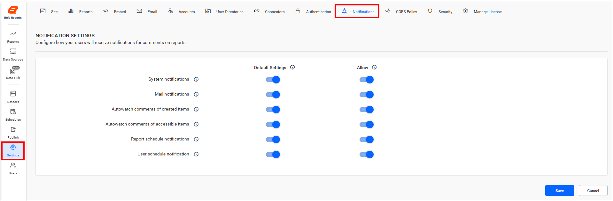
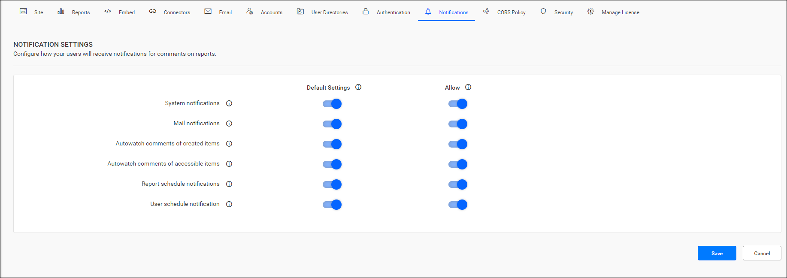
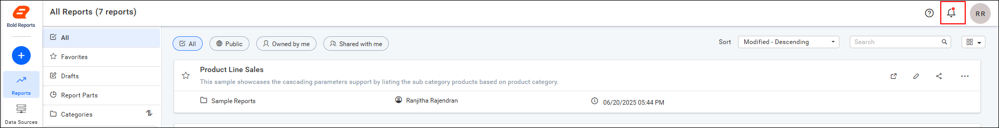
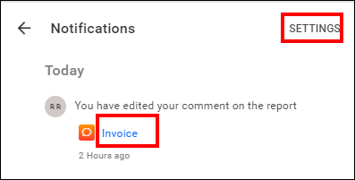
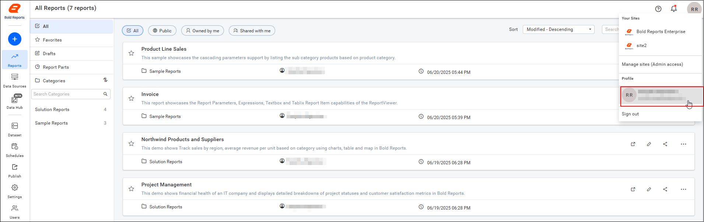
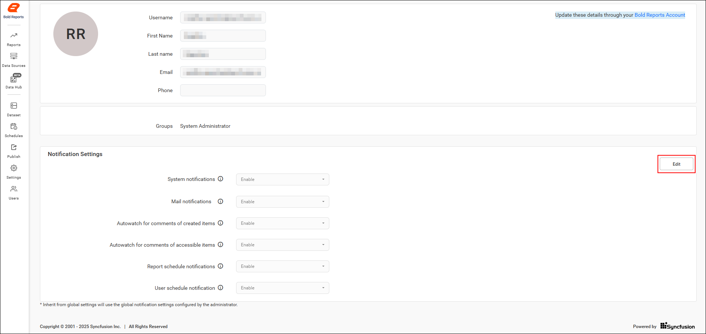
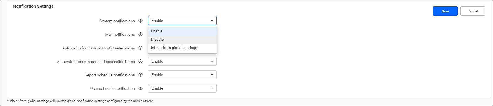
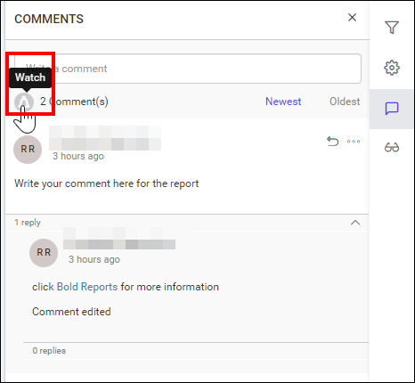

# {{site.productNameTM}} Report Server notification settings

{{site.productNameTM}} Report Server notification settings alert users whenever a comment is added to reports in {{site.productNameTM}} On-Premises Edition. Both the System Administrator and individual users can adjust these settings.

## How do I open the notification settings?

You open the Report Server notification settings from the **Settings** option. Follow these steps:

1. Click the **Settings** option in the Report Server's left-side panel.
2. Navigate to the **Notification** tab.

The following image shows the **Notification** tab on the settings page.

## Site notification settings(Admin notification settings)

The Report Server administrator manages application notification preferences on the admin notification settings page. The administrator enables or disables both email and system notifications, including how users receive notifications for report comments.

### How do I view system notifications?

Report Server system notifications appear when you click the `Notification` icon in the top-right corner of the menu bar.

* To view the system notifications, click the `Notification` icon located in the top-right corner of the menu bar.
    

* Users can navigate to a specific comment by clicking the report name in the notification section. To adjust their notification settings, users can navigate to their profile page by clicking the `Settings` option.
    

### What do mail notifications cover?

Report Server mail notifications send users emails for activities such as comments, permissions, schedules, views, user(s) and group(s) synchronizations( both manual and scheduled), and user account activation. You turn them on by enabling the mail notifications option.

### Auto watch comments of created items

The Report Server auto watch setting for created items sends notifications for comments on all items created by users when you enable it.

### Auto watch comments of accessible items

The Report Server auto watch setting for accessible items sends notifications for comments on all items accessed by users when you enable it.

### Report schedule notification

The Report Server report schedule button lets you restrict the mail received for scheduled reports. Enable or disable the button to control this mail.

### User schedule notification

The Report Server user schedule button lets you restrict the mail received for admin users. Enable or disable the button to control this mail.

The following are the default and allowable notification settings configurations:

#### Default settings

The Report Server default setting applies to users when they are added to the Report Server. Users can switch from this setting to create their own, or choose to inherit this setting at any time from their profile edit page.

#### Allow/restrict settings

The Allow/restrict setting is the master setting for the Report Server. Enabling or disabling any setting here applies that change to the Report Server, overriding the default and user settings.

## User notification settings

Report Server users configure how they receive notifications for comments on the user notification settings page. Users navigate to this page from the profile edit page, as shown in the following images.

The following image shows the options for changing the notification settings of the current user.

Settings can be enabled, disabled, or inherited from the global settings, which are the default settings of the Report Server.

### How do I watch a specific report?

Report Server users can watch a specific item, apart from the auto-watch settings for created and accessible items.

* Apart from the auto-watch settings for created and accessible item settings, users can also watch an item specifically.

    

Users can toggle between watch and unwatch for a report comment at any time.

## Frequently asked questions

### Who can change notification settings in Report Server?

Both the System Administrator and individual users can adjust notification settings in {{site.productNameTM}} Report Server.

### Which setting overrides the others?

The Allow/restrict setting is the master setting for the Report Server. It overrides the default and user settings.

### Can I stop watching a report comment?

Yes. Users can toggle between watch and unwatch for a report comment at any time.

## See also

* [Collaboration in Report Server](./../collaboration/)
* [Manage report schedules](./../manage-schedule/manage-reports-schedule/)
* [Designer guide overview](./../)
