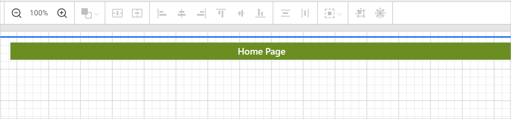
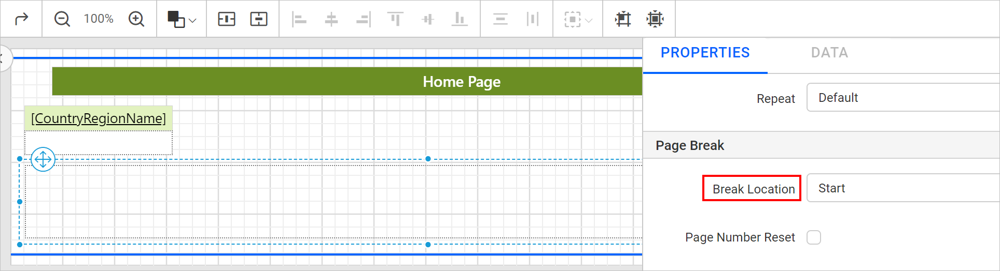
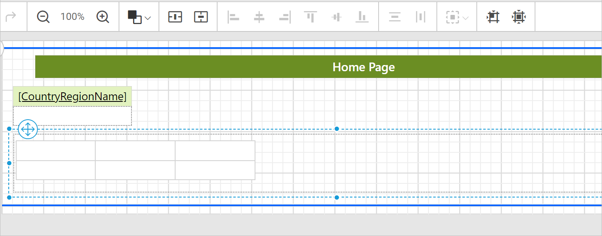
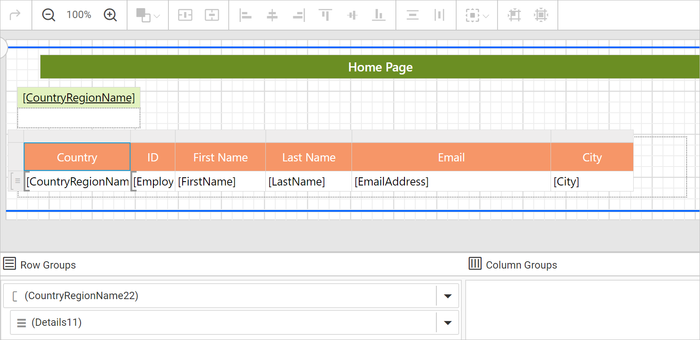
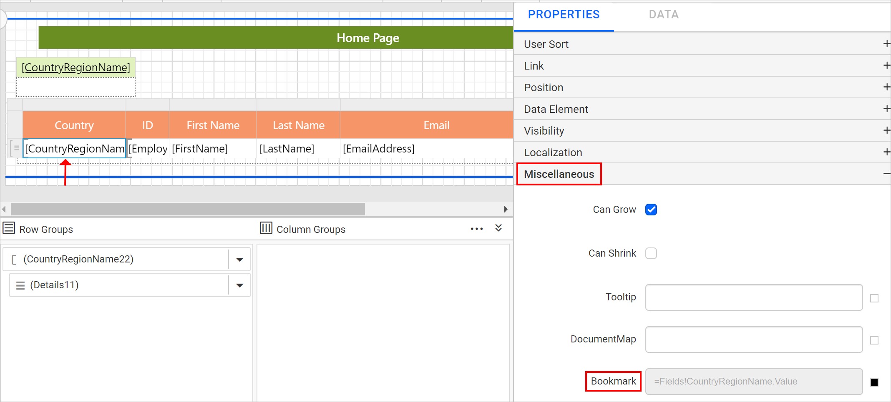
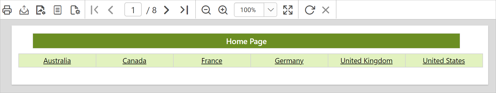
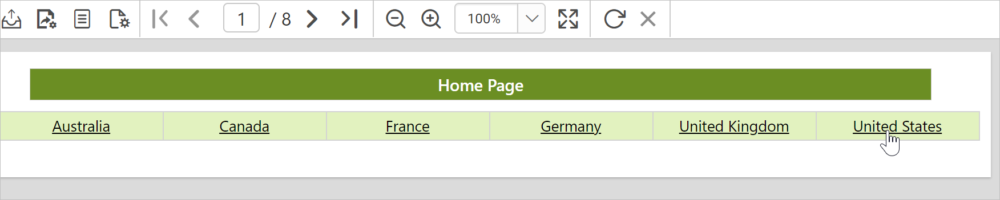
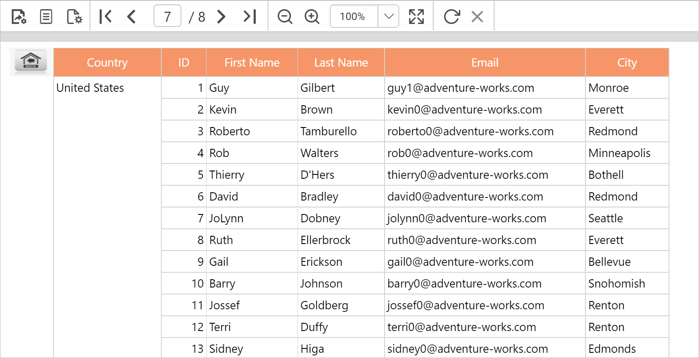

# Add bookmarks in {{site.productNameTM}} Web Report Designer

Bookmark links in {{site.productNameTM}} Web Report Designer let users navigate to different parts of an RDL report. You can add bookmarks to each textbox, image, table or chart, or to the unique group values displayed in a tablix, to direct users to specified locations in the report. The value of the bookmark property can be your own strings or an expression.

Prefer watching over reading? Watch the video on designing an interactive bookmark report:

`youtube: https://www.youtube.com/watch?v=sAuj7xgPfRk`

## How do I configure a bookmark?

You configure a bookmark in Web Report Designer by entering a string or expression in the `Bookmark` property of a report item.

1. Select the text box, image, table, chart, or other report item to which you want to add a bookmark. The respective report item properties are listed in the `Properties` pane.
2. Under the `Miscellaneous` category, enter a string or expression in the `Bookmark` text field. The value acts as the label for this bookmark.
    

To open the set or reset expression menu in the properties panel, see the [Set Expressions](./../../compose-report/properties-panel/#set-expression) and [Reset Expressions](./../../compose-report/properties-panel/#reset-expression) sections.


> Note: The bookmark can be any string, but it must be unique in the report. If the bookmark is not unique, a link to the bookmark finds the first matching bookmark.

## How do I link to a bookmark?

You link to a bookmark in Web Report Designer by choosing the `Bookmark` option under the `Link` category of a report item.

1. Select the text box, image, or chart series to which you want to link a bookmark. The respective item properties are listed in the `Properties` pane.
2. Under the `Link` category, choose the `Bookmark` option. An option to link the bookmark is enabled.
    
3. In the bookmark dropdown, type or select a bookmark, or set an expression that evaluates to a bookmark.
    

## How do I design a bookmark report?

The following Web Report Designer example shows how to use the bookmark feature to design an interactive report.

### Create data

The bookmark example uses the following dataset query for dataset creation:

```sql
SELECT [HumanResources].[vEmployee].[EmployeeID],
[HumanResources].[vEmployee].[FirstName],
[HumanResources].[vEmployee].[LastName],
[HumanResources].[vEmployee].[EmailAddress],
[HumanResources].[vEmployee].[City],
[HumanResources].[vEmployee].[CountryRegionName]
FROM [HumanResources].[vEmployee]
```

> To create the dataset with the above query, see the [Create Data](./../../manage-data/dataset/create-an-embedded-dataset/) section. The `AdventuresWorks` database is used here.

### Add bookmark

The bookmark design shows how to configure and link bookmarks in report items. At runtime, clicking an item navigates to the first matching bookmark.

1. Add a textbox to the report and enter the text as `Home Page`. Apply some formatting.
   

2. Open the textbox properties. Under the `Miscellaneous` category, enter the `Bookmark` property value as `HomePage`.
   

3. Add a matrix report item and remove the first column.
   

4. Assign the `CountryRegionName` field in the first cell.
   

5. Select that cell and open the properties panel. Under the `Link` category, choose the `Bookmark` option.

    

6. Set the `=Fields!CountryRegionName.Value` expression in the `Bookmark` field.

    

7. Add a rectangle and set the `Page Break` as `Start`.

    

8. Insert a table report item. To add a table, see the [Add table](./../../report-items/tablix/design-ssrs-rdl-report-using-table/#add-a-table-to-the-report) section.

    

9. [Assign dataset fields](./../../report-items/tablix/assign-data-to-tablix-data-region/#assign-dataset-from-properties-panel) and apply formatting as shown in the following image.

    

10. Open the `CountryRegionName` [group properties](./../../report-items/tablix/grouping-panel/#group-member-properties) and set the page break as `End`.

    

11. Select the `CountryRegionName` group cell and open the properties panel. Under the `Miscellaneous` category, enter the `Bookmark` property value as `=Fields!CountryRegionName.Value`.

    

12. [Add a column](./../../report-items/tablix/insert-or-delete-a-column-ssrs/#insert-a-column) in the table report item.

    

    The next steps add an image in a table cell and configure a bookmark for it. Clicking the image navigates to the first page of the report.

13. [Insert an image](./../../report-items/tablix/cell-properties/#insert-item-using-cell-menu) in the first cell of the column.

    

14. Select the image and open the properties panel. Under the `Link` category, choose the `Bookmark` option.

    

15. Choose the `HomePage` bookmark label in the `Bookmark` option.

    

16. Set the border as `None` for the first column cell.

    

17. To [repeat header row](./../../report-items/tablix/repeat-headers-on-each-page-in-ssrs/) for each group, enable `Report on New Page` and set `Keep With Group` as `After` for the first static field.

    

## Preview

The Web Report Designer preview shows the bookmark navigation at work. On report preview, the first page of the report looks like the following image.



Clicking a country name displays the respective group.





Clicking the image navigates to the main page of the report.


> Download the above report design from the [bookmark sample report on GitHub](https://github.com/boldreports/resources/tree/master/docs/report-designer/compose-report/bookmark.rdl)

## Frequently asked questions

### Does a bookmark need to be unique?

Yes. The bookmark can be any string, but it must be unique in the report. If it is not unique, a link to the bookmark finds the first matching bookmark.

### Which report items can link to a bookmark?

In Web Report Designer, you can link a bookmark from a text box, image, or chart series by choosing the `Bookmark` option under the `Link` category.

## See also

* [Document map](./../document-map/)
* [Link data](./../link-data/)
* [Properties panel](./../properties-panel/)
