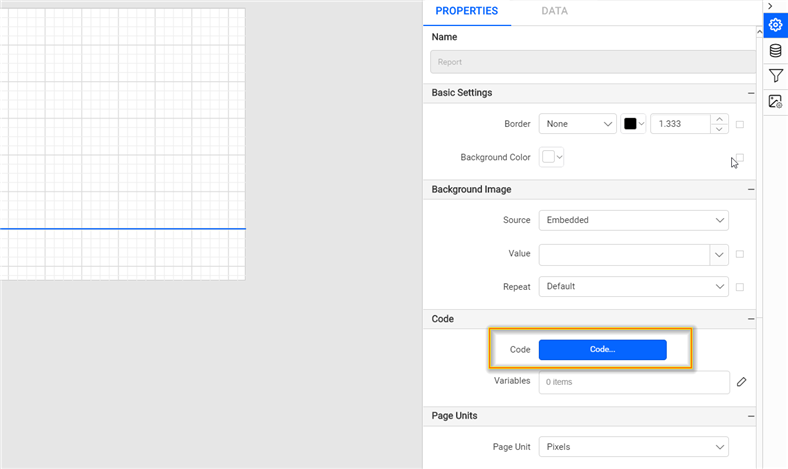
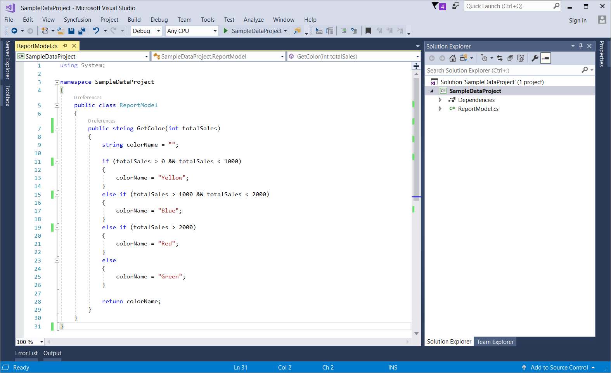

# Add custom code with the Code Module in Web Report Designer

The Code Module in {{site.productNameTM}} Web Report Designer adds custom code or custom assemblies to a report. The Code Module adds references to custom code embedded in a report or generated with custom assemblies.

## How do I add custom code to a report?

You add custom code in Web Report Designer from the `Code` category of **Report Properties**, writing the code in Visual Basic (VB).

1. Click the outer grey surface of the report area, and then click the **Properties** icon to open the **Report Properties**.
    
2. The custom code option is listed under the `Code` category. Click **Code...** to open the Code Module dialog.
    
3. In the code tab, type the code in the Visual Basic (VB) language.
    
4. The following code example shows a custom function that returns the color string based on the given value range:

    ```basic
    Public Function GetColor(ByVal TotalSales As Decimal) As String
        Dim ColorName As String
        If TotalSales > 0 And TotalSales < 1000 Then
            ColorName = "Yellow"
        ElseIf TotalSales > 1000 And TotalSales < 1500  Then
            ColorName = "Blue"
        ElseIf TotalSales > 2000 Then
            ColorName = "Red"
        Else
            ColorName = "Green"
        End If
        Return ColorName
    End Function
    ```

    
5. Click **OK**.
6. Use the following expression to call the custom code function in the report.
    
    To learn more about handling expressions, see the [Expression](./../../compose-report/expressions/) section.
7. To view the color changes based on the price range in a report, click `Preview`.
   

## How do I add assembly references?

You embed custom assemblies in a Web Report Designer report by creating a simple Visual Studio class library project and defining the required custom functions.

### How do I create a custom assembly?

You create a custom assembly for {{site.productNameTM}} as a Visual Studio class library that you build into a `.dll`.

1. Create a Visual Studio class library. Go to **Installed > Visual C#**, and then select **Class Library (.Net Framework)** from the listed templates. Change the application name, and then click **OK**.
   

2. Open the class file and create a simple function.
   

3. After defining the required functions, build the project. The assembly `(.dll)` is generated in the bin folder of the respective application.

> Note: To embed the custom assembly into the report, the generated assembly must be installed in GAC, or it must be available in the reporting services `bin` location. We prefer manually copying and pasting the generated custom assembly into the following path: **C:\Syncfusion<sup>®</sup>\Report Server\ReportServer.Web\ReportService\bin**.

### How do I add references to a custom assembly?

You add a custom assembly reference in the Web Report Designer Code Module from the **References** tab.

1. Switch to the **References** tab.
   

2. To add an **Assembly** reference, click the **Add** icon.
   

3. Specify the assembly name and click **OK**.
   

## How do I add class instances?

You add a class instance in the Web Report Designer Code Module from the **Classes** tab.

1. Switch to the **Classes** tab.
    

2. To add a **Class instance** reference, click the **Add** icon.
    

3. Specify the assembly name and instance name, and click **OK**. The custom code assembly and instance are now embedded into the report.
    

4. Use the following expression to call the embedded custom code function in the report.

    
    To learn more about handling expressions, see the [Expression](./../../compose-report/expressions/) section.

5. To view the color changes based on the price range in a report, click `Preview`.
    

> Download the above report design from the [code module sample report on GitHub](https://github.com/boldreports/resources/tree/master/docs/report-designer/compose-report/code-module.rdl)

## Frequently asked questions

### Which language does the Code Module use for custom code?

In the code tab of the Web Report Designer Code Module, you type the code in the Visual Basic (VB) language.

### Where must a custom assembly be placed?

The generated assembly must be installed in GAC, or it must be available in the reporting services `bin` location, such as **C:\Syncfusion<sup>®</sup>\Report Server\ReportServer.Web\ReportService\bin**.

## See also

* [Expressions](./../expressions/)
* [Report properties](./../report-properties/)
* [Report variables](./../report-variables/)
