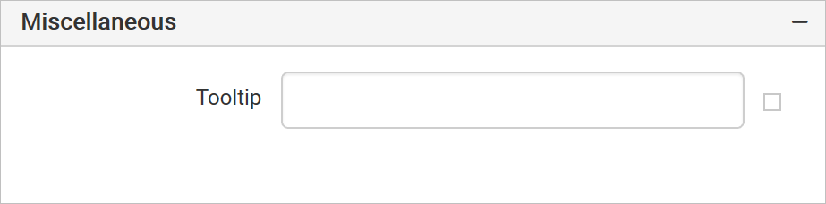

# Common properties of report items in Web Report Designer

{{site.productNameTM}} Web Report Designer shares a set of common properties across the report layout and most report items. You use these properties to name, style, show or hide, position, and describe report items in RDL reports.

## Name

The **Name** field in the Web Report Designer sets the name of a report item. Type a name for the report item, or keep the default name. For example, the default name for a textbox report item is similar to `TextBox1`. Every report item has this property.

> You cannot set the name property for report, body, header and footer.

## Border properties

The Border property in the Web Report Designer customizes the borders around the report layout and report items. You can set the border width, color, and style for each side of the report layout and report items. You can change three border properties:

* The **border-color** specifies the color of a border.

* The **border-style** specifies whether a border should be solid, dashed line, double line, or dotted.

* The **border-width** specifies the width of a border.

The border properties are listed under the `Appearance` or `Basic Settings` category in the properties panel.

> This property is not applicable for `Line` report item.

### Border style

The border-style property in the Web Report Designer lets you select one of the following border styles:

* None - No border.

* Dashed - Border is a series of short lines.

* Dotted - Border is a series of dots.

* Double - Border is two solid lines.

* Solid - Border is a single solid line.

### Border color

The border-color property in the Web Report Designer sets the color of the border around the report layout or report items.

### Border width

The border-width property in the Web Report Designer sets the width of the border. Increase or decrease the border width in the numeric drop-down provided for the border property.

### How do I set borders for each side?

The Web Report Designer lets you set the border properties of the bottom, left, top, and right sides of the report layout or report items individually. The individual border options are under the `Advanced Properties` menu. To open or close the advanced properties menu, see [Advanced Properties](./../../compose-report/properties-panel/#advanced-properties).

### How do I set border properties based on a dynamic value?

The Web Report Designer lets you assign expressions to set the border properties based on dynamic values. To open the set or reset expression menu in the properties panel, see [Set Expressions](./../../compose-report/properties-panel/#set-expression) and [Reset Expressions](./../../compose-report/properties-panel/#reset-expression).

## Background color

The background color property in the Web Report Designer sets the background color of the report items or the report. It is listed under the `Appearance` or `Basic Settings` category in the properties panel.

> This property is not applicable for `Line` report item.

You can assign expressions to set the background property based on dynamic values. To open the set or reset expression menu in the properties panel, see [Set Expressions](./../../compose-report/properties-panel/#set-expression) and [Reset Expressions](./../../compose-report/properties-panel/#reset-expression).

## Font Properties

The font family, font size, font color, font style, and font weight properties in the Web Report Designer style the text content in the selected report items.

### Font Family

The `Font Family` drop-down list in the Web Report Designer lists the supported font family names. Choose the required font family from the drop-down list to change the `Font Family` of the selected report items.

### Font Color

The font color property in the Web Report Designer sets the color of the text content in the selected report items. Click the color palette icon and choose the required color in the `Color Palette`.

### Font Size

The Font size property in the Web Report Designer increases the size of the text in the selected report items. You can increase the font size using the numeric drop-down shown in the following image.

### Font Styles

The `Font Style` drop-down list in the Web Report Designer changes the font style of text content in the selected report items. The supported font styles are:

* Default

* Normal

* Italic

### Font Weight

The font weight drop-down list in the Web Report Designer changes the font weight of text content in the selected report items. The supported font weights are:

* Default

* Normal

* Light

* Bold

You can assign expressions to set the font properties based on dynamic values. To open the set or reset expression menu in the properties panel, see [Set Expressions](./../../compose-report/properties-panel/#set-expression) and [Reset Expressions](./../../compose-report/properties-panel/#reset-expression).

## Visibility

The visibility property in the Web Report Designer shows or hides report items on report preview or export. Enable or disable the property as follows.

* Enable the checkbox to display the report item.

* Disable the checkbox to hide the report item.

You can also set the visibility of report items based on dynamic values using expressions. To open the set or reset expression menu in the properties panel, see [Set Expressions](./../../compose-report/properties-panel/#set-expression) and [Reset Expressions](./../../compose-report/properties-panel/#reset-expression).

> This property is applicable only for report items.

## Position

The left, top, width, and height properties in the Web Report Designer position and size the report items in the report design. These properties are listed under the `Position` category in the properties panel.

You can increase or decrease the values in the numeric drop-down of the respective property.

## Custom properties

Custom properties in the Web Report Designer set values for additional properties of report items, or of the whole report, that are not available in the properties pane. They are listed under the `Miscellaneous` category in the properties panel.

To define a custom property:

1. Click the `Set Attributes...` button to open the `Custom Attributes` dialog.

    

2. Click the `ADD` button to define a value for the custom property.

3. In the `Name` field, provide the property name. In the value field, assign the values.

    

## Tooltip

The `ToolTip` property in the Web Report Designer configures a tooltip for report items. It is listed under the `Miscellaneous` category in the properties panel.

A tooltip displays information, such as descriptive text or data related to the specific report item. When you hover over the report item in a rendered report, the tooltip shows the information.

To configure a tooltip for a report item:

1. Select the report item in the design area.

2. In the properties panel, set the tooltip value.

    

You can also set the tooltip of report items based on dynamic values using expressions. To open the set or reset expression menu in the properties panel, see [Set Expressions](./../../compose-report/properties-panel/#set-expression) and [Reset Expressions](./../../compose-report/properties-panel/#reset-expression).

> This property is applicable only for report items.

## See also

* [Properties panel](./../../compose-report/properties-panel/)
* [Format data](./../../compose-report/format-data/)
* [Layout ordering](./../../compose-report/layout-ordering/)
