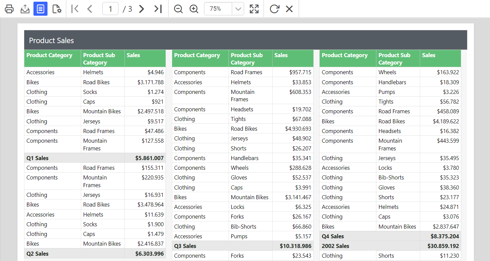

# Create a multiple-column report in Web Report Designer

A multiple-column report in Bold Reports® Web Report Designer displays data in multiple sets of columns across the page. When you print the report, it prints adjacent columns until there is no free space left on a page.

You cannot design a report that has a multi-column layout on the top half of the report and a table layout on the bottom half of the report.

Prefer watching over reading? Watch this video on creating and configuring a multi-column report:

`youtube: https://www.youtube.com/watch?v=dje7I8qE3Ps`

## How do I set the multiple-column properties?

You set multiple-column properties in the Web Report Designer under the `Page Column` category of the `Report Properties`.

1. Open or create a table report.

    

2. Click outside the design area to open the `Report Properties` in the properties panel. Multi-column properties are listed under the `Page Column` category in the properties list.

    

3. In the `Columns` property, provide the number of columns in the report.

4. In the `Column Spacing` property, type the width of the space between columns.

5. Set the required `Margin` and `Paper Size` properties.

    

## How do I preview a multiple-column report?

The Web Report Designer preview displays a multiple-column report as a single column. To view the table in multi-column layout, use the print layout.

1. Click the `Preview` button. The report preview is displayed as a single column.

2. Click the `Print Layout` option in the Report Viewer toolbar to view the table in multi-column layout.

    

## Which export formats show multiple columns?

Only the `PDF` and `Power Point` rendering formats in Bold Reports® display data in multiple columns. In export formats such as HTML, Excel, Word, and CSV, a multi-column layout is displayed as a single column.

The following image shows a multi-column report.

> Download the above report design from the [multiple-column sample report on GitHub](https://github.com/boldreports/resources/tree/master/docs/report-designer/compose-report/create-multiple-column-report-ssrs.rdl)

## Frequently asked questions

### Can I combine a multi-column layout with a table layout in one report?

No. You cannot design a report that has a multi-column layout on the top half and a table layout on the bottom half.

### Why does my report preview show only one column?

The default preview displays the report as a single column. Click `Print Layout` in the Report Viewer toolbar to view the multi-column layout.

## See also

* [Report properties](./../report-properties/)
* [Page layout](./../page-layout/)
* [Page margin](./../page-margin/)
