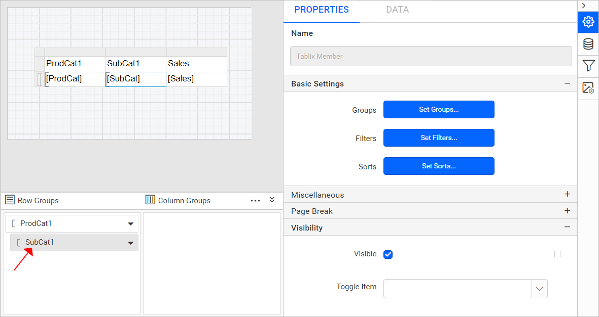
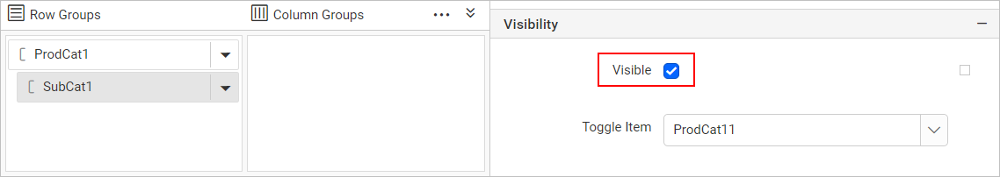
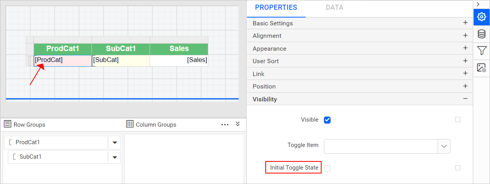
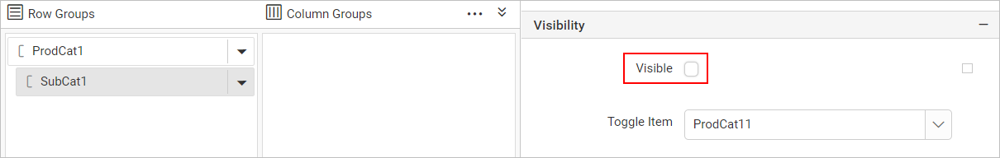
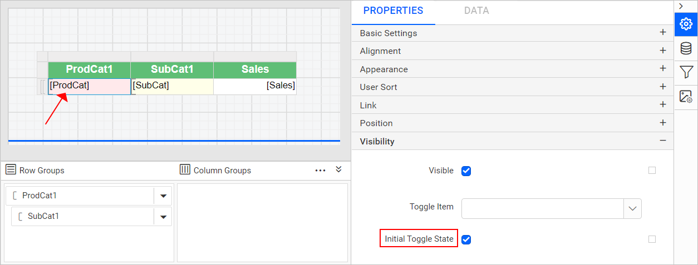

# Create SSRS drilldown report

**Drilldown action** in Bold Reports<sup>®</sup> Web Report Designer creates an interactive report. Readers can expand or collapse report items, rows, and columns associated with a group in a table or matrix. They no longer see every level of detail at once.

You add a drilldown action to a table group in the steps below. You control whether the group is expanded or collapsed on first preview. You also keep the drilldown indicator symbol in sync with the group's state.

## What is a drilldown action?

A drilldown action in the Web Report Designer ties a group's `Visibility` property to a `Toggle` textbox elsewhere in the report. Clicking that textbox expands or collapses the associated group at run time. The group's `Initial Toggle State` controls whether the drilldown symbol at first preview matches the group's actual expanded or collapsed state. The two easily get out of sync if you leave it at its default value.

### What can I do with drilldown actions?

Drilldown actions in Bold Reports<sup>®</sup> let you:

* Show or hide a group's detail rows or columns by default when a report is first previewed.
* Let readers expand or collapse a group interactively using a toggle textbox.
* Keep the drilldown indicator symbol in sync with the group's actual visibility state.
* Apply this to both table and matrix data regions.

## Create data

To present data in the table, create a dataset in the Web Report Designer and bind data to the table data region. The following dataset query is used to create the dataset in this walkthrough:

```sql
SELECT PC.Name AS ProdCat, PS.Name AS SubCat, DATEPART(yy, SOH.OrderDate) AS OrderYear, 'Q' + DATENAME(qq, SOH.OrderDate) AS OrderQtr,SUM(SOD.UnitPrice * SOD.OrderQty) AS Sales
FROM Production.ProductSubcategory PS INNER JOIN
Sales.SalesOrderHeader SOH INNER JOIN
Sales.SalesOrderDetail SOD ON SOH.SalesOrderID = SOD.SalesOrderID INNER JOIN
Production.Product P ON SOD.ProductID = P.ProductID ON PS.ProductSubcategoryID = P.ProductSubcategoryID INNER JOIN
Production.ProductCategory PC ON PS.ProductCategoryID = PC.ProductCategoryID
WHERE (SOH.OrderDate BETWEEN '1/1/2002' AND '12/31/2003')
GROUP BY DATEPART(yy, SOH.OrderDate), PC.Name, PS.Name, 'Q' + DATENAME(qq, SOH.OrderDate), PS.ProductSubcategoryID
```

> To create a dataset using the above query, see [Create Data](./../../manage-data/dataset/create-an-embedded-dataset/). The `AdventuresWorks` database is used here.

## How do I add a drilldown action to a table group?

You add a drilldown action in the Web Report Designer by setting the visibility and toggle properties of a child group.

1. Design a [simple table report with a row group](./../../report-items/tablix/insert-or-delete-a-row-group-ssrs/#insert-a-row-group) that has a parent group and a child group.

    

2. Select the `SubCat` field in the grouping panel. The group properties load in the properties panel.

    

3. In the `Visiblity` property, set the visibility of the `SubCat` group to show or hide the group when you first preview the report.

    

    * Enable the checkbox to display the group.
    * Disable the checkbox to hide the group.
    * To determine the visibility state at run time, set an expression for the visibility property.

### How do I show the group on initial display?

To show the group expanded on preview in the Web Report Designer, set the `SubCat` group visibility to `true` and choose a toggle textbox.

1. Set the visibility for the `SubCat` group as `true` in the report. The sub-category group values are in expanded state on preview.

    

2. Open the `Toggle` property drop-down list. It lists the available textbox report items in the report. Choose the `ProdCat` field textbox to expand or collapse the `SubCat` group based on product categories.

    

    > The text box that you use for the toggle must be in a containing scope that controls the item that you want to show or hide.

3. To differentiate the values, apply background color and font styles for the parent and child group.

    

4. Click the `Preview` button to see the report preview. The `>` symbol before each product category is the drilldown action.

    

**Initial Toggle state**:

The `Initial Toggle State` property in the Web Report Designer keeps the drilldown symbol in sync with the group state. In the report preview, notice the drilldown action symbol. The group values are in expanded state, but the report shows the collapsed symbol instead of the expand symbol.

1. In the `ProdCat` textbox properties, change the `Initial Toggle State` to `false`.

    

2. Click the `Preview` button. The drilldown symbol is now in expanded state.

    

### How do I hide the group on initial display?

To hide the `SubCat` group values on preview in the Web Report Designer, set the group visibility to `false` and set the `Initial Toggle State` to `True`.

1. Set the visibility for the `SubCat` group as `false`.

    

2. Set the `Initial Toggle State` as `True` in the `ProdCat` textbox properties.

    

3. Click the `Preview` button to see the report preview. The sub-category group values are in collapsed state, and the drilldown action symbol is also in collapsed state.

    

4. To see the sub-category products and their sales values, click the `>` symbol to expand the group.

    

> Download the above report design from the [drilldown sample report on GitHub](https://github.com/boldreports/resources/tree/master/docs/report-designer/compose-report/create-ssrs-drill-down-report.rdl)

## What are the key features of drilldown reports?

Drilldown reports in the Web Report Designer provide these key features:

* **Group-level visibility control**: Show or hide a group's detail rows by default using the group's `Visibility` property.
* **Toggle-driven interactivity**: Link a textbox as the `Toggle` control for a group, so readers can expand or collapse it interactively during preview.
* **Initial toggle state matching**: Keep the drilldown indicator symbol consistent with the group's actual expanded or collapsed state using `Initial Toggle State`.
* **Visual differentiation**: Apply background color and font styles to parent and child groups so drilled-down data remains easy to read.

## When should I use a drilldown report?

Drilldown reports in Bold Reports<sup>®</sup> suit these common use cases:

* **Summarizing sales by category with detail on demand**: Show product category totals by default and let readers drill into subcategory-level sales only when they need it.
* **Reducing a dense table to a scannable summary**: Collapse detail rows in a large table or matrix so readers see a compact summary first, then expand groups of interest.
* **Building interactive drill-down tables**: Combine multiple drilldown groups in one table so different readers can explore the level of detail relevant to them.
* **Presenting year-over-year or quarter-over-quarter breakdowns**: Group sales data by year and quarter, and use drilldown to let readers expand only the periods they care about.

## Who should use this guide?

The drilldown report guide for the Bold Reports<sup>®</sup> Web Report Designer is intended for:

* Report authors building interactive tables or matrices with expandable detail.
* Developers configuring group visibility and toggle properties in the Web Report Designer.
* Anyone adapting SSRS-style drilldown reports for use in Bold Reports<sup>®</sup>.

## What do I need first?

Before you create a drilldown report in the Web Report Designer, you need:

* A table or matrix report with a parent and child group already configured.
* A textbox report item available in the same containing scope to use as the toggle control.

## What are the limits of drilldown actions?

Drilldown actions in the Web Report Designer have these considerations and limitations:

* The toggle textbox must be in a containing scope that controls the item you want to show or hide, or the drilldown action won't work as expected.
* `Initial Toggle State` only affects the indicator symbol shown at first preview. It doesn't change the group's actual `Visibility` setting.
* Drilldown applies to groups in table and matrix data regions. It doesn't apply to report items outside a grouped data region.

## FAQ

### Why does the drilldown symbol show the wrong expand or collapse icon on first preview?

A wrong drilldown icon on first preview happens when `Initial Toggle State` doesn't match the group's actual `Visibility` state. Set `Initial Toggle State` to `false` if the group starts expanded, or `true` if it starts collapsed.

### Can drilldown be used with a matrix instead of a table?

Yes. Drilldown actions work the same way for groups in table and matrix data regions.

### What happens if the toggle textbox isn't in the right scope?

The toggle won't correctly control the target group's visibility. The textbox used for the toggle must be in a containing scope that controls the item you want to show or hide.

### Where can I download the sample report used in this guide?

A downloadable copy of the drilldown report design is linked at the end of the hide group on initial display section above.

## How do I get help with drilldown reports?

If a drilldown toggle in the Web Report Designer doesn't expand or collapse the expected group, check the toggle textbox's containing scope. Also, check the group's `Visibility` and `Initial Toggle State` settings. For dataset creation and row grouping basics, see the related articles below.

## Related articles

* [Create an Embedded DataSet](./../../manage-data/dataset/create-an-embedded-dataset/) if you need to build the dataset this walkthrough's query is based on.
* [Insert or delete a row group](./../../report-items/tablix/insert-or-delete-a-row-group-ssrs/) to set up the parent and child groups a drilldown action needs.
* [Create SSRS drill through report](./../create-ssrs-drill-through-report/) for a different way to reveal detail, by opening a separate linked report instead of expanding a group in place.
