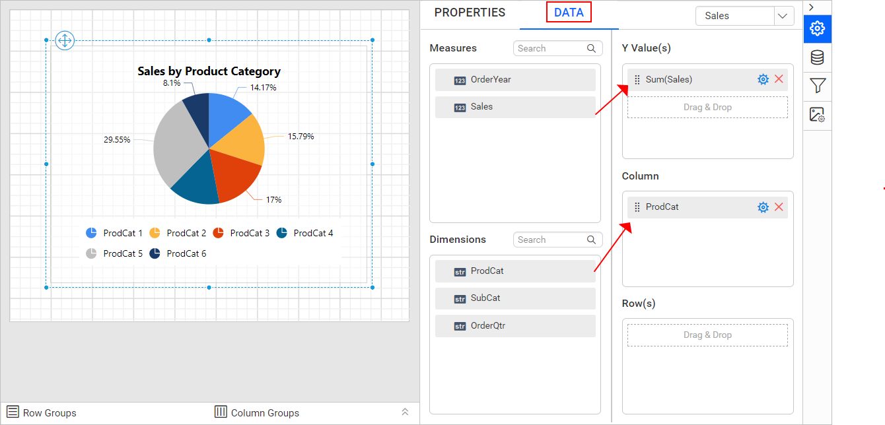

# Create SSRS drill through report

**Drill through** in {{site.productNameTM}} Web Report Designer creates an interactive report. Readers click a link within the main report to open a related report. A summary report can then lead directly into the detailed report behind one of its values.

In the steps below, you design the drill through (sub) report and define a parameter to filter it. You then configure the drill through action on a chart series in the main report. Clicking a series opens the filtered sub-report.

## What is a drill through report?

A drill through setup in the Web Report Designer involves two reports. The main report displays summary data. The sub-report (the drill through report) shows detail for a single item from that summary, filtered by a parameter.

The main report's report item, such as a chart series, has a `Link` property that points to the sub-report. The link passes the clicked value as a parameter. Opening the link renders the sub-report already filtered to the relevant item.

### What can I do with drill through reports?

Drill through reports in {{site.productNameTM}} let you:

* Open a related, detailed report by clicking a value in a summary report, such as a chart series or table cell.
* Pass the clicked value automatically as a parameter to filter the sub-report.
* Apply drill through to chart series, and similarly to other report items that support the `Link` property.
* Navigate back from the sub-report to the main report using the `Go to parent` action.

## Create data

To present data in the table, create a dataset in the Web Report Designer and bind data to the table data region. The following dataset query is used to create the dataset in this walkthrough:

```sql
SELECT PC.Name AS ProdCat, PS.Name AS SubCat, DATEPART(yy, SOH.OrderDate) AS OrderYear, 'Q' + DATENAME(qq, SOH.OrderDate) AS OrderQtr,SUM(SOD.UnitPrice * SOD.OrderQty) AS Sales
FROM Production.ProductSubcategory PS INNER JOIN
Sales.SalesOrderHeader SOH INNER JOIN
Sales.SalesOrderDetail SOD ON SOH.SalesOrderID = SOD.SalesOrderID INNER JOIN
Production.Product P ON SOD.ProductID = P.ProductID ON PS.ProductSubcategoryID = P.ProductSubcategoryID INNER JOIN
Production.ProductCategory PC ON PS.ProductCategoryID = PC.ProductCategoryID
WHERE (SOH.OrderDate BETWEEN '1/1/2002' AND '12/31/2003')
GROUP BY DATEPART(yy, SOH.OrderDate), PC.Name, PS.Name, 'Q' + DATENAME(qq, SOH.OrderDate), PS.ProductSubcategoryID
```

> To create a dataset using the above query, see [Create Data](./../../manage-data/dataset/create-an-embedded-dataset/). The `AdventuresWorks` database is used here.

## How do I design the drill through report?

Design the drill through report in the Web Report Designer before you configure the drill through action in the main report.

1. Design the report as described in the [Data bar report](./../../report-items/data-bar/design-ssrs-data-bar-using-table/) section. The report design looks like the following image.

    

2. Define a [basic parameter](./../../report-parameters/add/#create-parameter) and name it `Product Category`.

    

3. Apply a filter condition on the dataset to filter the product category and its sub-categories at dataset level.

    

4. Add a filter and choose the `Prodcat` field.

    

5. Assign the `Product Category` parameter as an expression in the value field and click `OK`.

    

> To apply filters at dataset level, see [Dataset Filters](./../../manage-data/dataset/add-a-filter-to-a-dataset/).

## How do I add a drill through action to a chart?

You add a drill through action in the Web Report Designer by designing a main report and linking the drill through report with the `Link` property. In this example, you configure the drill through action for a chart series.

Design the main report as described in the [Pie chart](./../../report-items/data-bar/design-ssrs-data-bar-using-table/) section. The main report looks like the following image.



1. Open the chart properties.
   
2. Choose the `Sales1` series in the choose series drop-down and click the `edit` icon.
   
3. The secondary panel lists the respective series properties.
   
4. Under the `Link` category, choose the `Report` option in the `Link To` property.
   
5. In the `Report` field, browse and set the path of the data bar report you already designed.
   
6. Click the `Set Parameters` button. The parameters dialog opens, as shown in the following image.
   
7. Click the `ADD` option in the dialog to configure parameter values.
   
8. In the `Parameter Name` field, select the parameter name of the selected report.
   
9. Provide the `=Fields!ProdCat.Value` expression value in the `Parameter Value` field and click `OK`.
   

   > To learn more about report linking, see [Link Report](./../../compose-report/link-data/#report-linking).

   

## How do I drill through a chart series?

You drill through a chart series in the Web Report Designer preview by clicking a series in the main report.

1. Click the `Preview` button. The report preview looks like a normal pie chart.

    

2. Click any series in the report preview.

    

3. The sub-report displays the sub-category wise sales amount of the `Bikes` product. Click the `Go to parent` icon to navigate from the sub-report to the main report.

    

> Download the above report designs from these links: [Parent report](https://github.com/boldreports/resources/tree/master/docs/report-designer/compose-report/create-ssrs-drill-through-report-pie-chart.rdl) and [Child report](https://github.com/boldreports/resources/tree/master/docs/report-designer/compose-report/create-ssrs-drill-through-report-databar.rdl)

## What are the key features of drill through reports?

Drill through reports in the Web Report Designer provide these key features:

* **Parameter-driven sub-report filtering**: The main report passes a clicked value as a parameter to the sub-report, so the sub-report opens already filtered to the relevant item.
* **Chart series drill through**: Configure the `Link` property on a chart series so clicking a series opens the linked sub-report.
* **Dataset-level filtering in the sub-report**: Apply a filter condition on the sub-report's dataset using the passed parameter, so only relevant rows render.
* **Return navigation**: Use the `Go to parent` action in the sub-report to navigate back to the main report.

## When should I use a drill through report?

Drill through reports in {{site.productNameTM}} suit these common use cases:

* **Summarizing sales by category with detail behind each slice**: Show a pie chart of sales by product category in the main report. Readers click a slice to see sub-category detail.
* **Building multi-level reporting workflows**: Chain a summary report to one or more detailed sub-reports, so users navigate from overview to detail without leaving the reporting workflow.
* **Reducing report clutter while keeping detail available**: Keep the main report focused on summary visuals, and move detailed breakdowns into a sub-report reachable only on demand.
* **Reusing a single detail report across multiple summary views**: Design one parameterized sub-report and link it from multiple main reports or chart series, passing different parameter values.

## Who should use this guide?

The drill through report guide for the {{site.productNameTM}} Web Report Designer is intended for:

* Report authors linking a summary report to a detailed sub-report.
* Developers configuring chart series properties and report parameters.
* Anyone adapting SSRS-style drill through reports for use in {{site.productNameTM}}.

## What do I need first?

Before you create a drill through report in the Web Report Designer, you need:

* A main report and a separate drill through (sub) report, both already designed.
* A parameter defined on the sub-report to filter it, and a matching field to pass as that parameter's value from the main report.

## What are the limits of drill through actions?

Drill through actions in the Web Report Designer have these considerations and limitations:

* The main report's `Link` property must point to the correct sub-report path, and its parameter values must match the parameter names defined on that sub-report.
* Drill through is configured per report item, such as a specific chart series. Other series or items don't inherit the same link unless configured individually.
* Filtering happens at the sub-report's dataset level, so the filter condition and parameter expression must reference the correct field.

## FAQ

### Can I use drill through on a report item other than a chart series?

This walkthrough uses the `Link` property on chart series for drill through. You can configure other report items that support a `Link To Report` option the same way.

### What happens if the parameter name doesn't match between the main report and the sub-report?

The parameter won't bind correctly, and the sub-report may not filter as expected. The `Parameter Name` set in the main report's `Set Parameters` dialog must match a parameter defined on the sub-report.

### How do I get back to the main report from the sub-report?

Click the `Go to parent` icon in the sub-report preview to navigate back to the main report.

### Where can I download the sample reports used in this guide?

Downloadable copies of both the parent and child report designs are linked at the end of the drill through chart series section above.

## How do I get help with drill through reports?

If a drill through link in the Web Report Designer doesn't open the expected sub-report, or the sub-report isn't filtered correctly, check the `Link` property's report path and parameter mapping. For dataset filtering and report linking basics, see the related articles below.

## Related articles

* [Create an Embedded DataSet](./../../manage-data/dataset/create-an-embedded-dataset/) if you need to build the dataset this walkthrough's query is based on.
* [Add a Report Parameter to a Report](./../../report-parameters/add/) for the general steps behind the parameter used to filter the sub-report.
* [Dataset Filters](./../../manage-data/dataset/add-a-filter-to-a-dataset/) to apply the same kind of filter condition used here in other reports.
* [Create SSRS drilldown report](./../create-ssrs-drill-down-report/) for a different way to reveal detail, by expanding a group in place instead of opening a separate report.
