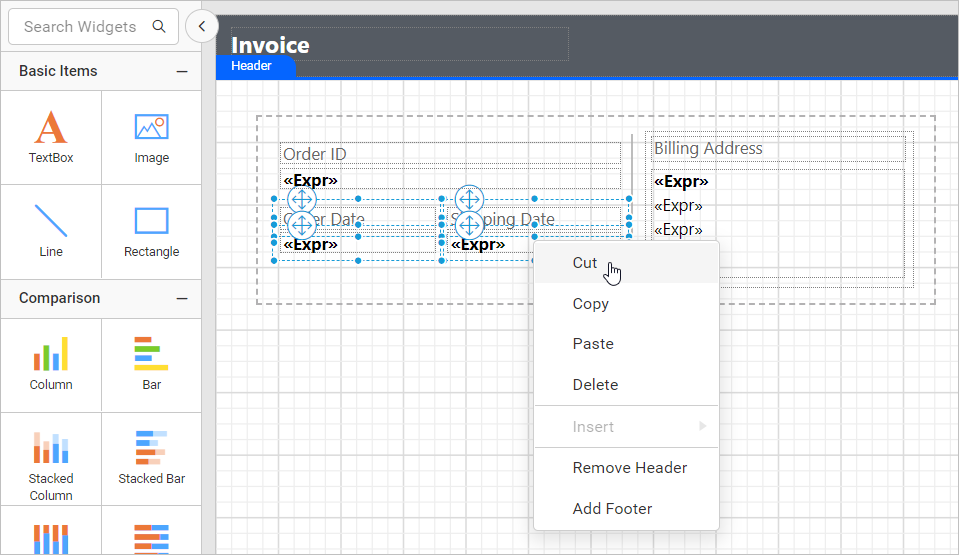

# Context menu in Web Report Designer

A context menu in Bold Reports® Web Report Designer is a pop-up menu that shows the basic options used in the design surface. When you right-click the design surface, the context menu displays options that depend on the target design surface or report item.

## How do I add or remove the header and footer?

The Web Report Designer context menu adds or removes the report header and footer. Right-click the design surface. Based on the header and footer visibility, the context menu displays the following options:

1. Add Header
2. Add Footer
3. Remove Header
4. Remove Footer

### Add Header

The `Add Header` option in the Web Report Designer context menu enables the header in the report design.

1. Right-click the design surface.
2. Click the `Add Header` option in the context menu.

    

The header is now enabled in the report design.

### Add Footer

The `Add Footer` option in the Web Report Designer context menu enables the footer in the report design.

1. Right-click the design surface.
2. Click the `Add Footer` option in the context menu.

    

The footer is now enabled in the report design.

### Remove Header

The `Remove Header` option in the Web Report Designer context menu removes the header from the report design.

1. Right-click the design surface.
2. Click the `Remove Header` option in the context menu.

    

The header is now removed from the report design.

### Remove Footer

The `Remove Footer` option in the Web Report Designer context menu removes the footer from the report design.

1. Right-click the design surface.
2. Click the `Remove Footer` option in the context menu.

    

The footer is now removed from the report design.

## How do I insert a report item?

The `Insert` option in the Web Report Designer context menu adds a report item to the design surface, a rectangle, or a tablix cell.

### Insert item at design surface

The Web Report Designer context menu lists report items under the `Insert` option based on the target surface (body, footer, or header).

1. Right-click the design surface. The context menu shows the report items list in the `Insert` option.

    

2. Click the required report item in the insert menu. The report item is added to the report design.

    

### Insert item at rectangle container

The Web Report Designer context menu inserts a report item inside a rectangle report item.

1. Select the rectangle report item and right-click it.

    

2. Click the required report item type in the insert menu. The report item is added to the rectangle.

    

### Insert item at tablix cell

The Web Report Designer context menu inserts a report item inside a tablix cell.

1. Select the cell in the tablix report item and right-click it.

    

2. Click the required report item type in the insert menu. The report item is added to the target cell.

    

> If a table cell contains rectangle, then insert action will add the new report item as child of rectangle.

## How do I cut a report item?

The `Cut` option in the Web Report Designer context menu removes selected report items from the design surface, a rectangle, or a tablix cell.

### Cut item from design surface

The Web Report Designer context menu cuts selected report items from the design surface.

1. Select the required report items in the design surface and right-click.

    

2. Click the `Cut` option in the context menu. The selected report items are removed from the report design.

### Cut item from rectangle container

The Web Report Designer context menu cuts selected report items from a rectangle report item.

1. Select the required report items in the target rectangle report item and right-click.

    

2. Click the `Cut` option in the context menu. The selected report items are removed from the target rectangle.

### Cut item from tablix cell

The Web Report Designer context menu cuts a report item, or a nested tablix, from a tablix cell.

1. Select the cell in the tablix report item and right-click it.

    

2. Click the `Cut` option in the context menu. The report item is removed from the target cell.

To cut a nested tablix:

1. Select the cell in the nested tablix. The gripper for the respective tablix is enabled, as shown in the following image.

    

2. Right-click the common gripper area.

    

3. Click the `Cut` option in the context menu. The respective nested tablix is removed from the parent tablix cell.

## How do I copy a report item?

The `Copy` option in the Web Report Designer context menu copies selected report items to the internal clipboard.

### Copy item from design surface

The Web Report Designer context menu copies selected report items from the design surface.

1. Select the required report items in the design surface and right-click.

    

2. Click the `Copy` option in the context menu. The selected report items are copied to the internal clipboard.

### Copy item from rectangle container

The Web Report Designer context menu copies selected report items from a rectangle report item.

1. Select the required report items in the target rectangle report item and right-click.

    

2. Click the `Copy` option in the context menu. The selected report items are copied to the internal clipboard.

### Copy item from tablix cell

The Web Report Designer context menu copies a report item, or a nested tablix, from a tablix cell.

1. Select the cell in the tablix report item and right-click it.

    

2. Click the `Copy` option in the context menu. The selected report item is copied to the internal clipboard.

To copy a nested tablix:

1. Select the cell in the nested tablix. The gripper for the respective tablix is enabled, as shown in the following image.

    

2. Right-click the common gripper area.

    

3. Click the `Copy` option in the context menu. The respective nested tablix is copied to the internal clipboard.

## How do I paste a report item?

The `Paste` option in the Web Report Designer context menu pastes the last copied item into the design area, a rectangle, or a tablix cell.

### Paste item at design area

The Web Report Designer pastes the last copied item at the target mouse position in the design area. Right-click the design surface and click the `Paste` option in the context menu.

### Paste item at rectangle

The Web Report Designer pastes the last copied item in the rectangle based on the mouse position. Right-click the rectangle report item and click the `Paste` option in the context menu.

### Paste item at tablix cell

The Web Report Designer pastes the last copied item in the tablix cell. Right-click the required tablix cell and click the `Paste` option in the context menu.

> If tablix cell contains rectangle, then copied item will be pasted inside the rectangle.

## How do I delete a report item?

The `Delete` option in the Web Report Designer context menu removes the selected report item from the report design.

1. Select a report item in the design surface, a rectangle, or a tablix.
2. Right-click the report item.
3. Click the `Delete` option in the context menu. The selected report item is removed from the report design.

## Frequently asked questions

### Where is an item inserted if the tablix cell contains a rectangle?

If a table cell contains a rectangle, the insert action adds the new report item as a child of the rectangle.

### Where is a copied item pasted in the design area?

The last copied item is pasted at the target mouse position on the design surface.

## See also

* [Report item selection](./../report-item-selection/)
* [Report item alignment](./../report-item-alignment/)
* [Report item resizing](./../report-item-resizing/)
