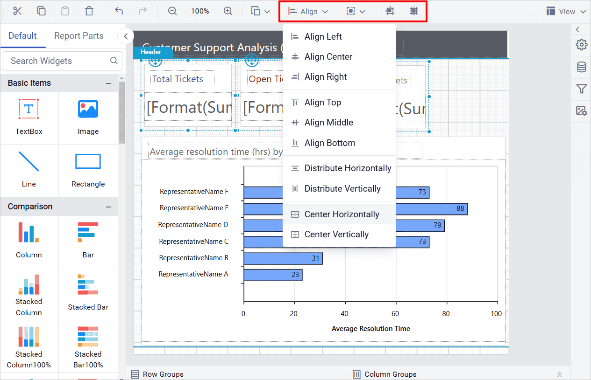

# Report item alignment in Web Report Designer

{{site.productNameTM}} Web Report Designer provides a set of interactive alignment options that align, distribute, size, and snap report items on the design surface. These options are available under the `Align` context menu in the toolbar.

## Align

The Align options in the Web Report Designer align report items on the design surface in left, center, right, top, middle, and bottom directions. To enable these options in the toolbar, you must select at least two report items in the design surface.

### Left align

Left align in the Web Report Designer aligns the selected items to the left position of the report item that has the left-most position value among the selected report items.

**Before aligning**:

**After aligning**:

### Center align

Center align in the Web Report Designer aligns the selected report items to the center position, based on the left-most and right-most positions of the selected report items.

**Before aligning**:

**After aligning**:

### Right align

Right align in the Web Report Designer aligns the selected items to the right position of the report item that has the right-most position value among the selected report items.

**Before aligning**:

**After aligning**:

### Top align

Top align in the Web Report Designer aligns the selected items to the top position of the report item that has the top-most position value among the selected report items.

**Before aligning**:

**After aligning**:

### Middle align

Middle align in the Web Report Designer aligns the selected report items to the middle position, based on the top-most and bottom-most positions of the selected report items.

**Before aligning**:

**After aligning**:

### Bottom align

Bottom align in the Web Report Designer aligns the selected items to the bottom position of the report item that has the bottom-most position value among the selected report items.

**Before aligning**:

**After aligning**:

### Center horizontally

Center horizontally in the Web Report Designer aligns the selected report items horizontally to the center position of the design surface or parent container.

**Before aligning**:

**After aligning**:

### Center vertically

Center vertically in the Web Report Designer aligns the selected report items vertically to the center position of the design surface or parent container.

**Before aligning**:

**After aligning**:

## Distribute

The Distribute option in the Web Report Designer places the selected report items with equal spacing in both horizontal and vertical directions.

### Horizontally

The horizontal distribute option in the Web Report Designer places the report items in the design surface at equal intervals horizontally.

**Before aligning**:

**After aligning**:

### Vertically

The vertical distribute option in the Web Report Designer places the report items in the design surface at equal intervals vertically.

**Before aligning**:

**After aligning**:

## Sizing

The Sizing option in the Web Report Designer gives the selected report items in the design surface an equal size.

### Same size

Same size in the Web Report Designer resizes the width and height of the selected report items to the size of the first selected report item.

### Same height

Same height in the Web Report Designer resizes the height of the selected report items to the height of the first selected report item.

### Same width

Same width in the Web Report Designer resizes the width of the selected report items to the width of the first selected report item.

## How do I align items to the grid?

The Align to grid option in the Web Report Designer snaps the top left of the selected report items to the closest grid line in the design surface.

## How do I size items to the grid?

The Size to grid option in the Web Report Designer snaps the selected report item to the closest gridline by resizing the report item on all four sides.

## Frequently asked questions

### How many report items must I select to use the align options?

You must select at least two report items in the design surface to enable the align options in the toolbar.

### Which item sets the size when I use Same size?

The first selected report item sets the size. Same size, Same height, and Same width resize the other selected items to match it.

## See also

* [Report item selection](./../report-item-selection/)
* [Report item resizing](./../report-item-resizing/)
* [Layout ordering](./../../layout-ordering/)
