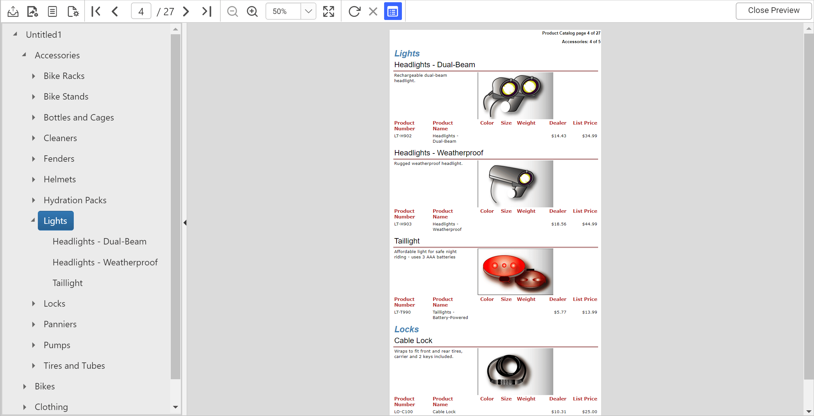
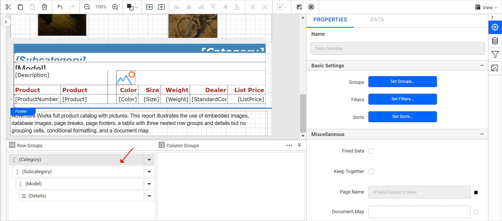
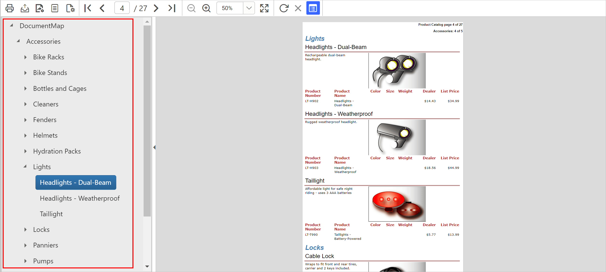

# Document map in {{site.productNameTM}} Web Report Designer

A document map in {{site.productNameTM}} Web Report Designer is a navigation feature that shows a side pane with hierarchical links when you view a report. A user can click the content in the list to navigate to the report page that displays that item.

Prefer watching over reading? Watch this video on configuring a document map for a tablix report item:

`youtube: https://www.youtube.com/watch?v=NKULueqZ2Vs`

## Which property adds links to the document map?

The `DocumentMap` property in the Web Report Designer adds links to the document map. Configure it under the `Miscellaneous` category of the report item properties. You can also set the document map property for a table or matrix group.

You can configure a static text, or an expression that evaluates to the text you want to display, as the value for the document map property.

## How do I configure a document map?

You configure a document map in the Web Report Designer by assigning a `Document Map` expression to each group of a tablix. For example, the following report design has a tablix report item with three parent groups.

The report preview looks like the following image.

Follow these steps to list the category, subcategory, and model in a hierarchical document map. When the user clicks an entry, the preview goes directly to the clicked category, subcategory, or model.

1. Select the tablix and open the grouping panel.

    

2. Click the `Category` group to show the respective group properties.

    

3. Under the `Miscellaneous` category, assign `=Fields!Category.Value` as the expression in the `Document Map` property.

    

4. Similarly, assign `=Fields!Subcategory.Value` and `=Fields!Model.Value` as the values for the SubCategory and Model groups respectively.

5. Preview the report. The Product Category label appears under the Document Map, as shown in the image. You can navigate through the tablix using this content list.

    

You have now created a document map to navigate through the report.

## How do I show or hide the document map?

The `Show/Hide` Document Map button on the Report Viewer toolbar toggles the display of the document map. Click it to show or hide the side pane.

## Rendering Behaviour

The document map in {{site.productNameTM}} is intended for use in the Report Viewer. The document map rendering behaviour varies for each rendering format, and a few rendering formats do not support document maps.

* In Excel export, document maps are exported as a hierarchy of links in a named worksheet. Other sections of the report are exported as separate worksheets in the same workbook. Each worksheet is linked with the document map.

* In Word export, document maps are exported as the table of contents.

* In PDF export, the document maps are expressed through PDF bookmarks.

* PowerPoint, XML, and CSV export formats ignore the document map settings.

> Download the above report design from the [document map sample report on GitHub](https://github.com/boldreports/resources/tree/master/docs/report-designer/compose-report/document-map.rdl).

## Frequently asked questions

### Can I set a document map on a table or matrix group?

Yes. You can set the document map property for a table or matrix group, as well as for report items.

### How is the document map exported to PDF?

In PDF export, the document map is expressed through PDF bookmarks.

## See also

* [Bookmark](./../bookmark/)
* [Group data](./../group-data/)
