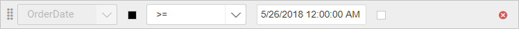
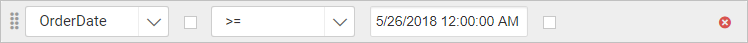
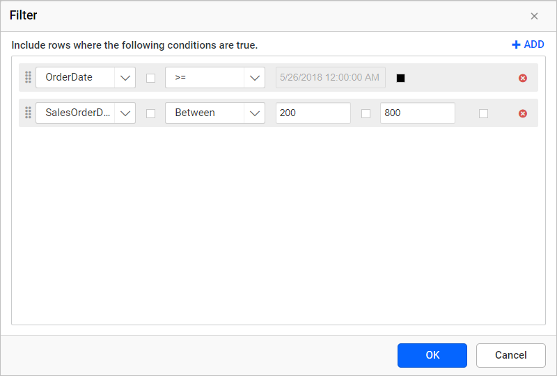
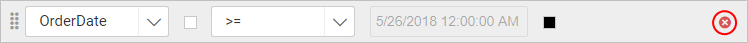

# Filter data in {{site.productNameTM}} Web Report Designer

Filters in {{site.productNameTM}} Web Report Designer limit the data in a report by passing a specific dataset field value. You can use filters to limit the data in data regions.

## Add filters

You add filters in the Web Report Designer filter dialog by choosing a field, an operator, and a value.

1. Click the **Add** icon to add a filter.

   

2. The first drop-down list shows the dataset fields. Choose the necessary field from the drop-down list, or set an [Expression](./../../compose-report/filter-data/#set-expression).
   

3. Choose an **Operator** type from the second drop-down list.

   

   To filter a specific range of data, use the **Between** operator.

   

4. In the **Value** field, enter the value directly or set an [Expression](./../../compose-report/filter-data/#set-expression).
5. To add multiple filters, repeat steps 1 to 4.

   

6. Click **OK**.

## Set Expression

You set a filter expression in the Web Report Designer from the square icon next to the field. First, follow steps 1 to 4 of [Add filters](./../../compose-report/filter-data/#add-filters).

1. To edit or create an expression, click the square icon and select `Expression`.

   

2. The `Expression` dialog opens. To learn more, see the [Expression](./../../compose-report/expressions/) section.

   

3. The icon turns `Black color` when the expression is applied to the dataset field.

   

## How do I reset an expression?

You reset a filter expression in the Web Report Designer from the same square icon.

1. Click the square icon and select `Reset`.
   

2. The icon turns `White color` after the reset action.
   

## How do I reorder filters?

The Web Report Designer lets you change the order of filters by dragging them. Click and hold the icon in the left corner, and then drag the filter to a higher or lower position.

The following image shows the position of the dragged filter:

## Remove Filters

You remove a filter in the Web Report Designer by clicking the **Delete** icon in the right corner of the respective filter.

## Frequently asked questions

### How do I filter a range of values?

Use the **Between** operator in the second drop-down list to filter a specific range of data.

### How do I know an expression is applied to a filter?

The square icon turns `Black color` when an expression is applied, and `White color` after you reset it.

## See also

* [Group data](./../group-data/)
* [Sort data](./../sort-data/)
* [Expression Builder](./../expressions/)
