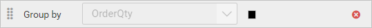
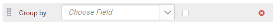

# Group data in {{site.productNameTM}} Web Report Designer

Grouping in {{site.productNameTM}} Web Report Designer organizes data in data regions by a field value or expression value.

## How do I add grouping?

You add a group expression in the Web Report Designer group dialog by choosing a dataset field or setting an expression.

1. Click the **Add** icon to add a group expression.

   

2. The drop-down lists the dataset fields of the dataset assigned to the data region. Choose a field, or click the square icon to set an [Expression](./../../compose-report/group-data/#set-expression).

    

3. Click OK.
4. To add multiple group expressions, repeat steps 1 to 3.

    

## Set Expression

You set a group expression in the Web Report Designer from the square icon next to the field. First, follow steps 1 to 3 to add a group expression.

1. To edit or create an expression, click the square icon and select `Expression`.

    

2. The `Expression` dialog opens. To learn more, see the [Expression](./../../compose-report/expressions/) section.

    

3. The icon turns `Black color` when the expression is applied to the dataset field.
   

## How do I reset an expression?

You reset a group expression in the Web Report Designer from the same square icon.

1. Click the square icon and select `Reset`.
   

2. The icon turns `White color` after the reset action.
   

## How do I reorder group expressions?

The Web Report Designer lets you change the order of group expressions by dragging them. Click and hold the icon in the left corner, and then drag the group expression to a higher or lower position.

The following image shows the position of the dragged group expression:

## How do I remove grouping?

You remove a group expression in the Web Report Designer by clicking the **Delete** icon in the right corner of the respective group expression.

## Frequently asked questions

### Can I group by more than one field?

Yes. Repeat the add steps to add multiple group expressions.

### What can I group data by?

You can group data in data regions by a field value or an expression value.

## See also

* [Filter data](./../filter-data/)
* [Sort data](./../sort-data/)
* [Expression Builder](./../expressions/)
