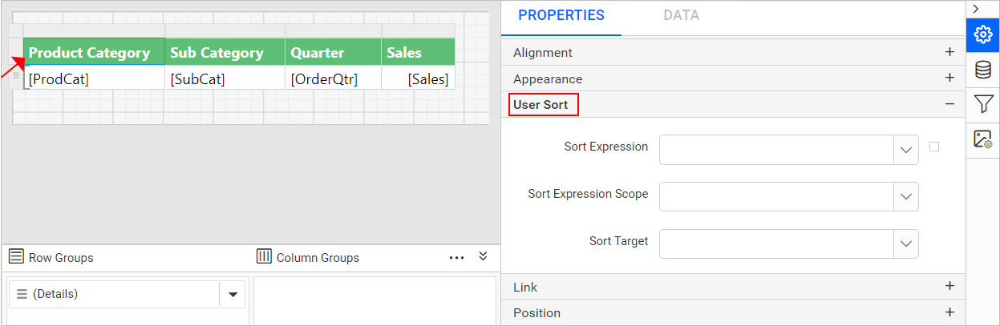

# Interactive sorting in Bold Reports<sup>®</sup> Web Report Designer

Interactive sorting in Bold Reports<sup>®</sup> Web Report Designer lets a user toggle between ascending and descending order dynamically in the Report Viewer. You enable it by setting interactive sorting on a `TextBox` report item within a data region.

## Create data

To present data in the table, create a dataset in the Web Report Designer and bind data to the table data region. The following dataset query is used to create the dataset in this walkthrough:

```sql
SELECT PC.Name AS ProdCat, PS.Name AS SubCat, DATEPART(yy, SOH.OrderDate) AS OrderYear, 'Q' + DATENAME(qq, SOH.OrderDate) AS OrderQtr,SUM(SOD.UnitPrice * SOD.OrderQty) AS Sales
FROM Production.ProductSubcategory PS INNER JOIN
Sales.SalesOrderHeader SOH INNER JOIN
Sales.SalesOrderDetail SOD ON SOH.SalesOrderID = SOD.SalesOrderID INNER JOIN
Production.Product P ON SOD.ProductID = P.ProductID ON PS.ProductSubcategoryID = P.ProductSubcategoryID INNER JOIN
Production.ProductCategory PC ON PS.ProductCategoryID = PC.ProductCategoryID
WHERE (SOH.OrderDate BETWEEN '1/1/2002' AND '12/31/2003')
GROUP BY DATEPART(yy, SOH.OrderDate), PC.Name, PS.Name, 'Q' + DATENAME(qq, SOH.OrderDate), PS.ProductSubcategoryID
```

> To create a dataset using the above query, see [Create Data](./../../manage-data/dataset/create-an-embedded-dataset/). The `AdventuresWorks` database is used here.

## How do I add interactive sorting?

You add interactive sorting in the Web Report Designer by setting the `User Sort` property on a column header textbox.

1. Design a [simple table report](./../../design-rdl-report-in-web-report-designer/#add-table-report-item).

    

2. Select the column header textbox of the column on which you want to enable interactive sorting. In this example, you add interactive sorting on the `Product Category` column.

    

3. In the `User Sort` property, set the interactive sorting using the following fields:

    

    * **Sort Expression**: The `Sort Expression` field lists the available fields in the assigned dataset. Select the expression containing the value of the field you want to sort on.
       
    * **Sort Expression Scope**: The `Sort Expression Scope` field lists the available details, row, and column grouping in the respective data region.
        * To enable interactive sorting on the `Details Row`, choose the details group.
        * To enable interactive sorting on a `Grouping Column`, choose the group.
          
    * **Sort Target**: Select the grouping level or data region within the report to sort.
       

> By default, sorting will be applied to the current scope, you can optionally choose a different scope in `Sort Expression Scope` and `Sort Target` fields.

## How does interactive sorting work in preview?

The Web Report Designer preview enables the interactive sorting button in the respective column header.


Click the arrow icon to sort the column dynamically in ascending or descending order.

> Download the above report design from the [interactive sorting sample report on GitHub](https://github.com/boldreports/resources/tree/master/docs/report-designer/compose-report/interactive-sorting.rdl)

## Frequently asked questions

### Which report item do I set interactive sorting on?

Set interactive sorting on a `TextBox` report item within a data region, such as a column header textbox.

### Which scope does interactive sorting use by default?

Sorting is applied to the current scope by default. You can choose a different scope in the `Sort Expression Scope` and `Sort Target` fields.

## See also

* [Sort data](./../sort-data/)
* [Group data](./../group-data/)
* [Filter data](./../filter-data/)
