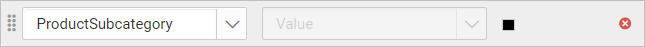
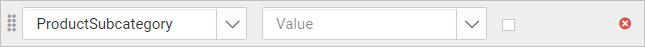
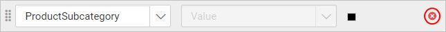

# Add linking actions in {{site.productNameTM}} Web Report Designer

Linking in {{site.productNameTM}} Web Report Designer makes a report interactive with **Hyperlink** and **Report Linking** actions. You find these settings under the `Link` category in the properties panel.

The following image shows the link options in the properties panel.

   

## Report Linking

Report Linking in {{site.productNameTM}} Web Report Designer lets you access the main report from the server. The linked report keeps its original report definition.

### Report Path

You set the report path in Web Report Designer by choosing a report from the server in the browse dialog.

   1. Choose the `Report` option in the `Link To` dropdown. The fields you need to configure the report path are now enabled under the link property.

      

   2. Click the browse button in the **Report** option.

      

   3. Open any folder in the browse dialog.

      

   4. Select a report shown in the browse dialog and click **OK**.

      

   5. The selected report path is now linked in the **Report** option.

      

#### Set Parameters

You specify parameters for **Report Linking** in Web Report Designer through the `Parameters` dialog.

   1. Click the `Set Parameters` button. The `Parameters` dialog opens.

      

   2. If the report is linked with the main report, the main report parameter names are available in the drop-down list. To add a **New** parameter, click the **Add** icon.

      

   3. In **Parameter Name**, enter the name of the report parameter.

   4. In **Value**, enter the parameter value.

      

   5. Click the **OK** button to save the parameters.

#### Set Expression

You set an expression for a linked report parameter in Web Report Designer from the square icon next to the value. First, follow steps 1 to 4 in Set Parameters to add parameters.

1. To edit or create an expression, click the square icon and select `Expression`.

     

2. The `Expression` dialog opens. For details, read the [Expression](./../../compose-report/expressions/) section and its following sections.

   

3. The icon turns `Black color` when an expression is applied to the parameter.

   

#### Reset Expression

You reset a parameter expression in Web Report Designer from the same square icon.

1. To reset an expression, click the square icon and select `Reset`.
   

2. The icon turns `White color` after the reset action.
   

#### Remove Parameters

You remove a linked report parameter in Web Report Designer by clicking the `Delete` icon.

## Hyperlink

A Hyperlink in {{site.productNameTM}} Web Report Designer links a report item to a webpage. Use the following steps to add one.

### How do I add a hyperlink?

You add a hyperlink in Web Report Designer by choosing **URL** in the `Link To` property.

1. Select the **URL** option in the `Link To` property dropdown. The fields you need to specify an external URL are now enabled under the link property.
   

2. In the **URL** option, enter a URL or set an [Expression](./../../compose-report/link-data/#set-expression) that evaluates to the URL.
   

3. To view the link, click **Preview** and click the report item. It navigates to the given **URL** link.

### How do I link a bookmark?

You link a bookmark in Web Report Designer by choosing the `Bookmark` option under the `Link` category.

1. Select the text box, image, or chart series to which you want to link a bookmark. The item properties are listed in the `Properties` pane.
2. Under the `Link` category, choose the `Bookmark` option. An option to link the bookmark is enabled.
   
3. In the bookmark dropdown, type or select a bookmark, or set an expression that evaluates to a bookmark.
   

## Frequently asked questions

### Which link actions can I add in Web Report Designer?

You can add **Hyperlink** and **Report Linking** actions from the `Link` category in the properties panel. You can also link a text box, image, or chart series to a bookmark.

### Can a hyperlink URL come from an expression?

Yes. In the **URL** option, you can enter a URL or set an expression that evaluates to the URL.

## See also

* [Bookmark](./../../compose-report/bookmark/)
* [Create an SSRS drill-through report](./../../compose-report/create-ssrs-drill-through-report/)
* [Expressions](./../../compose-report/expressions/)
