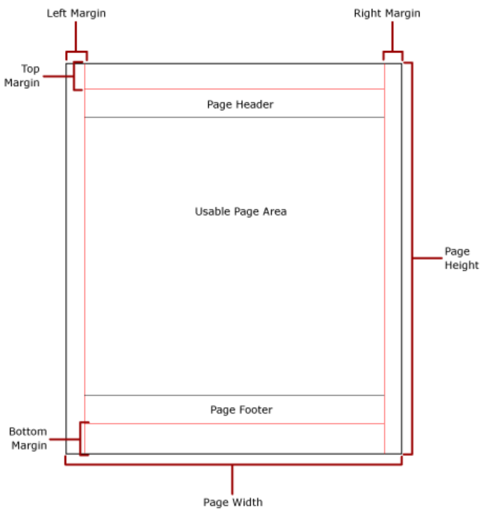

# Page layout in Bold Reports<sup>®</sup> Web Report Designer

Page layout in Bold Reports<sup>®</sup> Web Report Designer is the `Design Surface`, which has three areas: `Header`, `Body`, and `Footer`. You place report items on the design surface to build the report design you want.

When you preview or export, the report is generated from the formatting, page breaks, and keep together properties applied to the report items on the design surface.

## Which rendering layouts does Bold Reports<sup>®</sup> use for export?

Bold Reports<sup>®</sup> uses three rendering layouts when you export a report with the built-in Bold Reports<sup>®</sup> Report Viewer. You can export to file formats such as `Word`, `Excel`, `PDF`, `PowerPoint`, `HTML`, or `CSV`. Each file format exports reports based on one of these layouts:

* Soft page-break layout
* Hard page-break layout
* Data layout

Each layout follows a set of predefined rules for report item positioning and decides how much data fits on each page. It then converts the data and report items to a readable format.

**Soft page-break layout** - Export formats such as `Word`, `Excel`, and `HTML` follow the soft page-break layout. It maintains the report layout and formatting.

> To see how a report appears in a soft page-break rendering layout, use the `Preview` option. The built-in Bold Reports<sup>®</sup> Report Viewer displays the report as it would appear in HTML, Word, or Excel format.

**Hard page-break layout** - Export formats such as `PDF` follow the hard page-break layout. It maintains the report layout and formatting.
Reports exported to PDF have a consistent page size and suit printing well.

> To see how a report appears in a hard page-break rendering layout, use `Print` preview. The report appears as it would in `PDF` format.

**Data layout** - Export formats such as `CSV` follow the data layout. It clears all layout and formatting from the report and displays only the data. You can use the exported file to import the raw report data into another file type.

## How does pagination work in Bold Reports<sup>®</sup>?

Pagination in Bold Reports<sup>®</sup> is the number of pages in a report and how report items are arranged on those pages. Pagination varies with the rendering layout used to view and export the report.

Reports exported with the data and soft page-break layouts are typically not affected by pagination. The hard page-break layout has the most impact on report layout and physical page size.

To control pagination, set the page-related properties in [Report Properties](./../../compose-report/report-properties/). Each rendering layout supports page properties differently, so the same report paginates differently depending on the rendering layout used.

* The `Hard page-break` rendering layout is a page-oriented format. You can set page properties to control the page breaks in reports viewed in PDF.

* The `Soft page-break` rendering layout is not oriented to physical pages. If the report contains interactive features that expand it horizontally or vertically, you cannot control the page breaks in `Word`, `Excel`, and `HTML` formats. Pagination is applied only in the vertical direction. Page margins are not applied.

* The `Data` rendering layout does not support pagination. Page-related properties specified in the report are ignored when you view the report in `CSV` format.

## How does paper size affect pagination?

The [paper size](./../../compose-report/report-properties/#paper-size) you set in Bold Reports<sup>®</sup> Report Properties defines the pagination when the report is rendered and printed in the print layout.

* Reports exported with the hard page-break rendering layout insert page breaks both horizontally and vertically based on the paper size.
  > A page break is inserted in the horizontal direction when the report body grows past the right side of the page. A page break is inserted in the vertical direction when the report body grows past the bottom of the page.

* Reports exported with the soft page-break rendering layout insert page breaks horizontally based on the paper size.
  > If the specified page size (report width) is less than the width of the report body, including margins, and the rendering layout is `Hard page-break`, the resulting report may flow horizontally across multiple pages.

## How are margins applied?

[Margins](./../../compose-report/report-properties/#margin) in Bold Reports<sup>®</sup> are applied from the edge of the physical page inward to the specified margin setting. A report item that extends into the margin area is clipped, so the overlapping area is not rendered.

If the specified margin sizes make the horizontal or vertical width of the page equal zero, the margin is set to zero. Margins are applied only when you render and print reports in the hard page-break rendering layout.

## How do I avoid extra blank pages in print and print preview?

To avoid extra blank pages in Bold Reports<sup>®</sup> print and print preview, set the report body width less than or equal to the page width. An extra blank page is created when the report width is greater than the page width.

```html
Body Width <= Page Width - (Left Margin + Right Margin)
```

The usable page area is the area of the physical page left after space is allocated for margins, column spacing, and the page header and footer. Margins are applied only when you render the report in the print layout and print reports. The following image shows the margin and usable page area of a physical page.



Use the following formulas to calculate the usable area for report rendering.

### Horizontal usable area

The horizontal usable area of a Bold Reports<sup>®</sup> report page is calculated as follows:

```html
X = Page.Width - (Left Margin + Right Margin + Column Spacing)
```

### Vertical usable area

The vertical usable area of a Bold Reports<sup>®</sup> report page is calculated as follows:

```html
Y = Page.Height - (Top Margin + Bottom Margin + Header Height + Footer Height)
```

For example, the report width is 21 cm, the left margin is 0.5 cm, and the right margin is 0.5 cm. To avoid an extra printed page in the exported PDF file, use the following formula:

```html
width of body (20) + left margin (0.5) + right margin (0.5) <= report width (21)
```

If the body width is 20 or less, the report renders without extra pages. If it is greater than 20, extra pages are added.

## Frequently asked questions

### Does CSV export keep page breaks?

No. The `Data` rendering layout used by `CSV` does not support pagination, and page-related properties are ignored.

### Are page margins applied in Word or Excel exports?

No. The `Soft page-break` rendering layout used by `Word`, `Excel`, and `HTML` does not apply page margins. Margins are applied only in the hard page-break rendering layout.

## See also

* [Report properties](./../../compose-report/report-properties/)
* [Page margin](./../../compose-report/page-margin/)
* [Header, body, and footer properties](./../../compose-report/header-body-and-footer-properties/)
