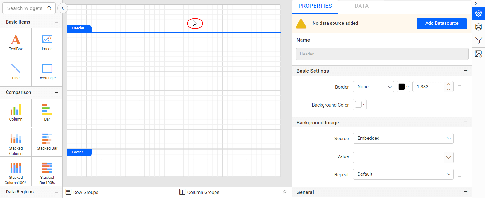
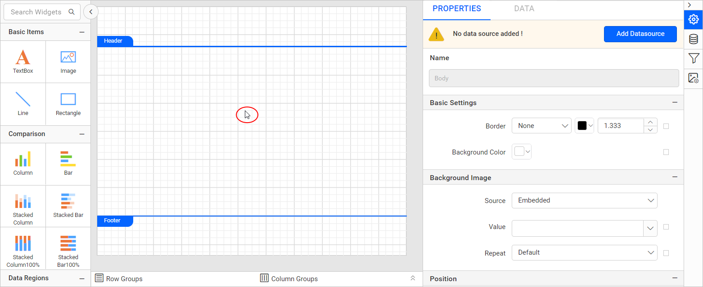
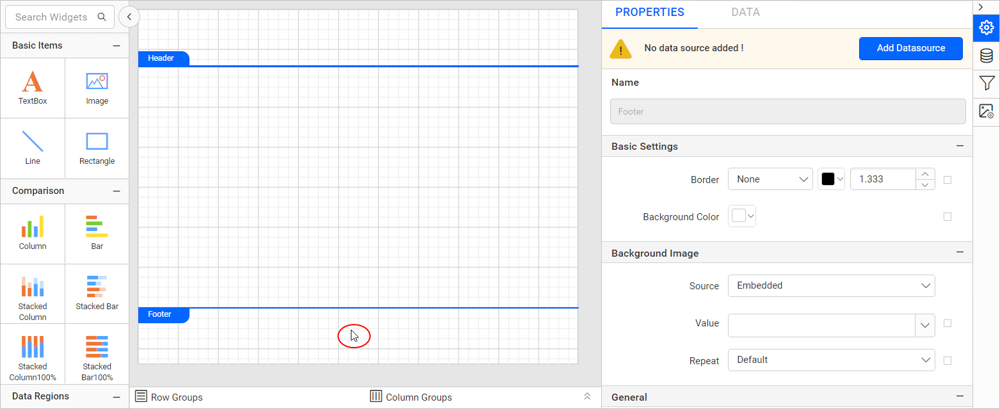
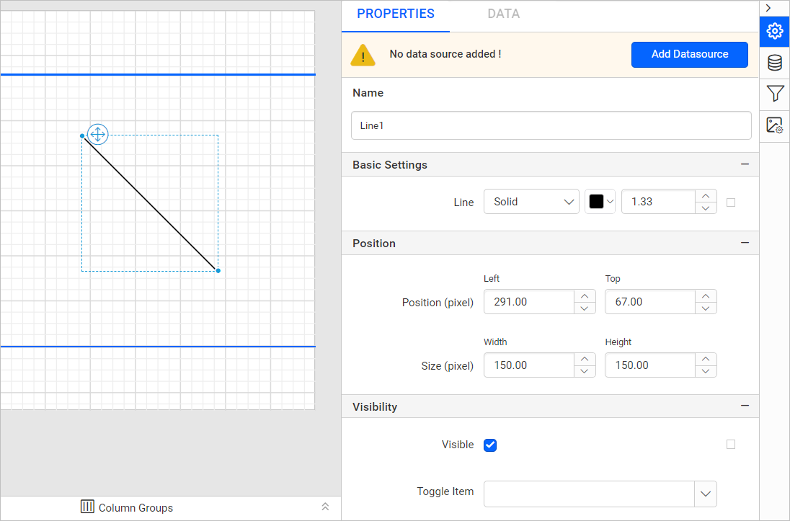

# Properties panel in {{site.productNameTM}} Web Report Designer

The Properties panel in {{site.productNameTM}} Web Report Designer lets you view and edit the properties of the selected report item or the entire report. It appears on the right side of Web Report Designer.

## How do I open the properties panel?

You open the properties panel in Web Report Designer by clicking the `Properties` icon in the configuration panel.

The properties panel is displayed as shown below.

> By default, the properties panel displays the `Report` properties.

To set and edit the report properties, read the [Report properties](./../../compose-report/report-properties/) section.

### Header properties

You open the `Header` properties in Web Report Designer by focusing the mouse pointer on the header area of the report.

To set and edit the report header properties, read the [Header properties](./../../compose-report/report-properties/) section.
> To show or hide the header in the report, read the [Show or hide header](./../../compose-report/show-or-hide-header-footer-in-report/#show-or-hide-report-header) section.

### Body properties

You open the `Body` properties in Web Report Designer by focusing the mouse pointer on the body area of the report.

To set and edit the report body properties, read the [Body properties](./../../compose-report/report-properties/) section.

### Footer properties

You open the `Footer` properties in Web Report Designer by focusing the mouse pointer on the footer area of the report.

To set and edit the report footer properties, read the [Footer properties](./../../compose-report/report-properties/) section.
> To show or hide the footer in the report, read the [Show or hide footer](./../../compose-report/show-or-hide-header-footer-in-report/#show-or-hide-report-footer) section.

### Report item properties

You open the properties of any report item in Web Report Designer by selecting that item in the design area. Its properties are then listed in the properties panel. In the following image, a line report item is selected in the design area and the line properties are listed in the properties panel.

## Common properties

Common properties in {{site.productNameTM}} Web Report Designer, such as name, border, and background, apply to most report items and the report layout. They are described in the [Common properties](./../../compose-report/common-properties/) section.

## Set expression

You set an expression for a property in Web Report Designer from the square icon next to that property.

1. Click the square icon at the right corner of the property.
   
2. Click the `Expression` menu to open the expression builder.
   

   > To learn more about handling expressions in the report designer, read the [Expressions](./../../compose-report/expressions/) section.
3. The square icon turns `Black color` when the expression is applied to the property.
   

## Reset expression

You reset a property expression in Web Report Designer from the same square icon.

1. Click the square icon at the right corner of the property.
   
2. Click the `Reset` menu option to remove the expression for the property.
3. The icon turns `White color` after the reset action.
   

## Advanced properties

Advanced properties in Web Report Designer are nested properties listed under the `Advanced` property menu in the properties panel.

1. Click the square icon at the right corner of the property.
   
2. Click the `Advanced...` menu option. The advanced properties of that category are listed as shown below.
   
3. After you customize the properties, click the `Close` icon to close the `Advanced Options` menu.
   

## What are dependent properties?

Dependent properties in Web Report Designer appear in the properties view only based on the value of another property. For example, when you drag and drop the chart item into the design area, the `Title` property is listed in the properties view as shown below.

If the `Show Chart Title` property is set to true, the dependent title properties are listed in the properties view as shown below.

If the `Show Chart Title` property is set to false again, the dependent title properties are hidden from the properties view.

## See also

* [Report properties](./../../compose-report/report-properties/)
* [Common properties](./../../compose-report/common-properties/)
* [Property navigator](./../../compose-report/property-navigator/)
